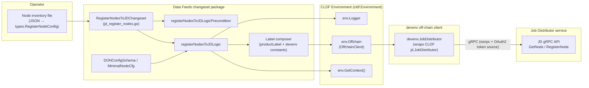
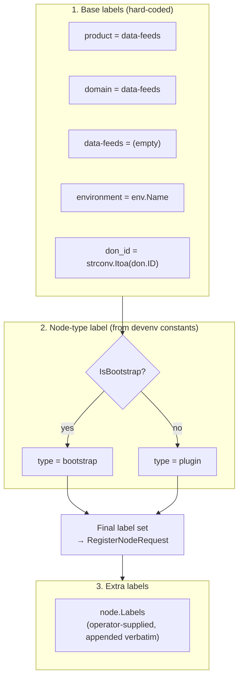
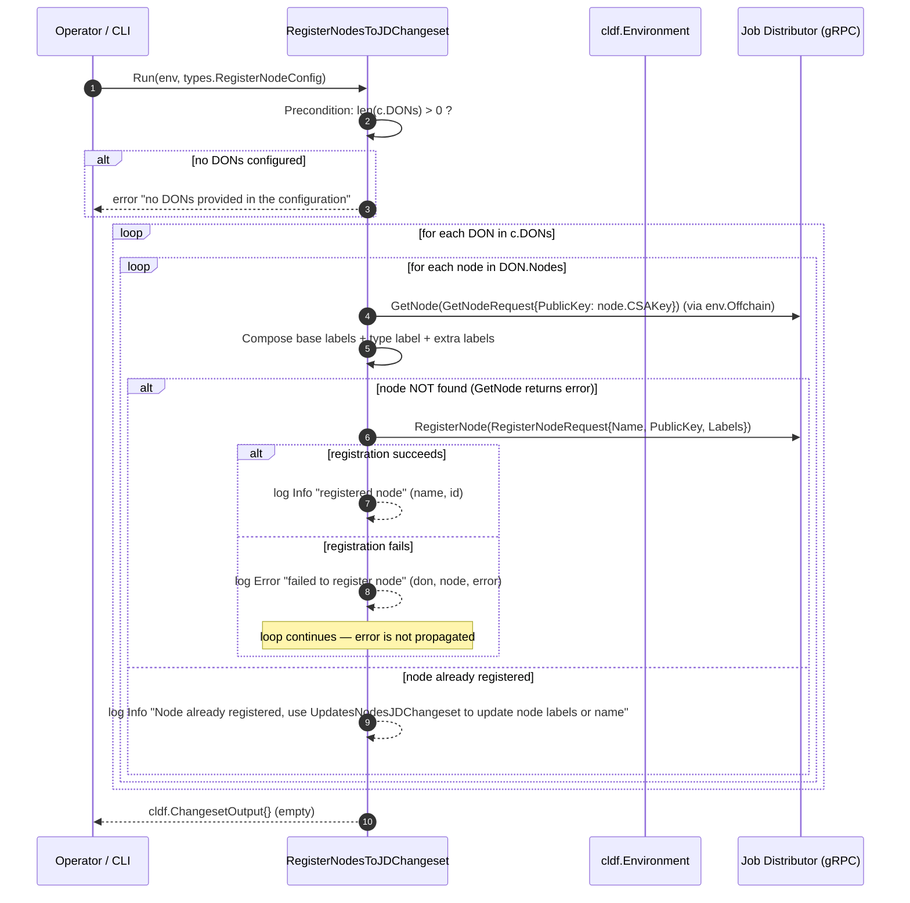

# Data Feeds — Job Distributor Node Registration

This module implements the off-chain node onboarding step of the Data Feeds product: a [Chainlink Deployments Framework (CLDF)](../data-feeds.md) changeset that reads node definitions from a JSON configuration file and registers each node with the **Job Distributor (JD)** service, tagged with a standardized set of product, environment, DON, and node-type labels.

- **Source file:** `chainlink/deployment/data-feeds/changeset/jd_register_nodes.go`
- **Package:** `github.com/smartcontractkit/chainlink/deployment/data-feeds/changeset`
- **Parent module:** [Data Feeds deployments](../data-feeds.md)

---

## Purpose and Core Functionality

`RegisterNodesToJDChangeset` is the changeset used to onboard Chainlink nodes into the Job Distributor's node registry before any Data Feeds jobs are proposed or accepted. Its responsibilities are:

1. **Read a declarative node inventory** (`types.RegisterNodeConfig`) describing DONs and their member nodes (name, CSA public key, bootstrap flag, extra labels).
2. **Look up each node by CSA public key** via `env.Offchain.GetNode` to determine whether it is already registered (idempotency check).
3. **Compose a deterministic label set** — base product/environment labels, a node-type label (`bootstrap` vs. `plugin`), and any operator-supplied extra labels.
4. **Register unknown nodes** via `env.Offchain.RegisterNode`, or log a skip message pointing operators to [`UpdatesNodesJDChangeset`](#relationship-to-other-changesets) when the node already exists.

The changeset performs **off-chain side effects only** — it returns an empty `cldf.ChangesetOutput{}` and writes nothing to the address book or datastore. On-chain deployment for Data Feeds (caches, aggregator proxies, feed configuration) is handled by sibling changesets; see the [data-feeds module overview](../data-feeds.md) and [data-feeds chain state & views](data-feeds_chain-state-views.md).

---

## Core Components

| Component | Kind | Description |
|---|---|---|
| `RegisterNodesToJDChangeset` | `cldf.ChangeSet` (exported var) | Entry point created with `cldf.CreateChangeSet(registerNodesToJDLogic, registerNodesToJDLogicPrecondition)`. Consumes `types.RegisterNodeConfig`. |
| `DONConfigSchema` | struct (exported) | Declarative description of one DON: `ID` (`int`), `Name` (`string`), and `Nodes` (`[]MinimalNodeCfg`). Serialized as JSON. |
| `MinimalNodeCfg` | struct (exported) | One node entry: `Name`, `CSAKey` (the node's CSA public key, used as the lookup identity), `IsBootstrap` (`bool`), and `Labels` (`[]*ptypes.Label` extra labels). |
| `productLabel` | package const | Hard-coded value `"data-feeds"` used for the `product`/`domain` labels and as the key of the product marker label. |
| `registerNodesToJDLogic` | function | Main logic: per-DON, per-node lookup → label composition → registration or skip. |
| `registerNodesToJDLogicPrecondition` | function | Validation: rejects the config with an error when `c.DONs` is empty. |

---

## Architecture and Component Relationships

The changeset sits in the deployment framework layer. It depends on:

- **`chainlink-deployments-framework`** (`cldf`, pinned at `v0.123.3` in `chainlink/deployment/go.mod`) for `CreateChangeSet`, the `Environment` handle (logger, context, off-chain client), and `ChangesetOutput`.
- **`chainlink-protos/job-distributor`** (`nodev1`, `ptypes`; pinned at `v0.20.1-0.20260701185448`) for the `GetNodeRequest` / `RegisterNodeRequest` RPC types and the shared `Label` type.
- **`deployment/environment/devenv`** for the node-type label constants (`LabelNodeTypeKey = "type"`, `LabelNodeTypeValueBootstrap = "bootstrap"`, `LabelNodeTypeValuePlugin = "plugin"`).
- **`deployment/data-feeds/changeset/types`** for the `RegisterNodeConfig` envelope.



The devenv `JobDistributor` wrapper (see [deployment-environment](../../Dev,_Test___Simulation_Environments/deployment-environment.md)) authenticates to the JD gRPC endpoint using the credentials and OAuth2 token source supplied in `JDConfig`; the changeset itself is agnostic to transport details and only uses the `OffchainClient` interface exposed by CLDF.

---

## Configuration Schema

`types.RegisterNodeConfig` is a list of DONs, each carrying its nodes:

```go
type RegisterNodeConfig struct {
    DONs []*DONConfigSchema `json:"dons" yaml:"dons"` // list of DONs to register
}

type DONConfigSchema struct {
    ID    int              `json:"id"`
    Name  string           `json:"name"`
    Nodes []MinimalNodeCfg `json:"nodes"`
}

type MinimalNodeCfg struct {
    Name        string          `json:"name"`
    CSAKey      string          `json:"csa_key"`
    IsBootstrap bool            `json:"is_bootstrap"`
    Labels      []*ptypes.Label `json:"labels"`
}
```

Example inventory file:

```json
{
  "dons": [
    {
      "id": 1,
      "name": "data-feeds-don-1",
      "nodes": [
        {
          "name": "bootstrap-node-0",
          "csa_key": "csa_abc123...",
          "is_bootstrap": true,
          "labels": []
        },
        {
          "name": "plugin-node-1",
          "csa_key": "csa_def456...",
          "is_bootstrap": false,
          "labels": [
            { "key": "tier", "value": "primary" }
          ]
        }
      ]
    }
  ]
}
```

**Precondition:** `registerNodesToJDLogicPrecondition` fails the changeset with `"no DONs provided in the configuration"` when the `dons` array is empty. No other schema validation is performed — node-level errors are handled at runtime (see [Error handling and idempotency](#error-handling-and-idempotency)).

---

## Label Model

For every node, the logic composes a final label set by concatenating three groups, in order:



| Key | Value | Source |
|---|---|---|
| `product` | `data-feeds` | `productLabel` const |
| `domain` | `data-feeds` | `productLabel` const |
| `data-feeds` | *(empty)* | Product marker label — the product name is used as the **key** with an empty value |
| `environment` | the CLDF environment name (`env.Name`) | `cldf.Environment` |
| `don_id` | string form of `DONConfigSchema.ID` | `strconv.Itoa` |
| `type` | `bootstrap` (`devenv.LabelNodeTypeValueBootstrap`) when `IsBootstrap` is true, otherwise `plugin` (`devenv.LabelNodeTypeValuePlugin`) | `devenv` label constants |
| *(any operator keys)* | operator values | `MinimalNodeCfg.Labels`, appended after the type label |

Label key/value rules (length and character constraints) are documented in `chainlink/deployment/environment/devenv/don.go` and originate from the Job Distributor's entity validation. The `type` label is the same convention used across devenv-based environments to distinguish OCR bootstrap peers from plugin (reporting) nodes.

---

## Registration Process Flow



Key implementation details:

- **Lookup happens before the error check.** `GetNode` is called first, the label set is composed regardless, and the `GetNode` error is then treated as "node not found" — triggering the `RegisterNode` branch. There is no distinction between "not found" and a transient RPC failure on lookup: both take the registration path.
- **Registration is keyed by CSA public key**, making the changeset safe to re-run: already-registered nodes are detected and skipped rather than duplicated.
- **Per-node failures are non-fatal.** A failed `RegisterNode` is logged at error level (including the DON and node names) and the loop proceeds to the next node; only the precondition can fail the changeset outright.
- **No persisted deployment artifacts.** The returned `ChangesetOutput` is empty — jobs, addresses, and datastore state are untouched.

---

## Error Handling and Idempotency

| Scenario | Behavior |
|---|---|
| Empty `dons` list | Changeset aborts with an error (precondition). |
| Node lookup fails / node absent | Node is registered with the composed label set. |
| `RegisterNode` RPC fails | Logged (`env.Logger.Errorw`), execution continues with remaining nodes; changeset still succeeds. |
| Node already registered under the same CSA key | No-op; info log directs the operator to `UpdatesNodesJDChangeset`. |
| Duplicate CSA keys within the config file | The first pass registers the node; subsequent entries encounter "already registered" (behavior depends on JD-side timing, as registration calls are sequential). |

> **Operational note:** because per-node errors are swallowed, a partially successful run can leave some nodes unregistered. Re-running the changeset is safe and will only attempt the missing nodes; use the update changeset to amend labels or names of existing registrations.

---

## Relationship to Other Changesets

`RegisterNodesToJDChangeset` belongs to a family of Job-Distributor-facing changesets in the same `data-feeds/changeset` package:

| Changeset | File | Role |
|---|---|---|
| `RegisterNodesToJDChangeset` | `jd_register_nodes.go` | **This module** — register new nodes with product labels. |
| `UpdatesNodesJDChangeset` | `jd_update_nodes.go` | Update an existing node's name and labels (optionally appending to current labels, looked up by node `ID`). This is the recommended follow-up for label/name changes. |
| `ProposeBtJobsToJDChangeset` | `jd_propose_bt_jobs.go` | Propose bootstrap job specs to registered nodes via the JD. |
| `DeleteJobsJDChangeset` | `jd_delete_jobs.go` | Delete jobs from the JD, either by job IDs or by workflow name. |

A typical Data Feeds onboarding sequence is: **deploy on-chain contracts → register nodes with the JD (this module) → propose jobs → nodes accept proposals**. The on-chain side is documented in the [data-feeds module overview](../data-feeds.md), and the resulting on-chain state inspection in [data-feeds chain state & views](data-feeds_chain-state-views.md); helper utilities shared across these changesets (e.g., `WorkflowMetadata`) are covered in [data-feeds shared utilities](data-feeds_shared-utilities.md), and the Solana cache deployment lifecycle in [data-feeds Solana cache](data-feeds_solana-cache.md).

---

## Integration with the Wider System

- **Job Distributor (off-chain service):** registered nodes, their CSA keys, and labels form the addressing/organization layer the JD uses to route job proposals. The node-side counterpart — the feeds service that manages JD connections (`FeedsManager`, `JobProposal` entities, RPC handlers) — is documented in [feeds service](../../Node_Platform_Services/feeds_service.md).
- **devenv environments:** the label constants used here (`type`, `bootstrap`, `plugin`) are shared with the test/deployment environment tooling, so nodes registered by this changeset are queryable by the same label filters used elsewhere in devenv workflows. See [deployment-environment](../../Dev,_Test___Simulation_Environments/deployment-environment.md).
- **Deployment framework conventions:** the changeset follows the standard CLDF `CreateChangeSet(logic, precondition)` pattern used by all product suites (Data Feeds, CCIP, Vault, Keystone); see [Deployment Framework Core & Product Deployments](../../Deployment_Framework_Core___Product_Deployments.md).

---

## References

- Source: `chainlink/deployment/data-feeds/changeset/jd_register_nodes.go`
- Config types: `chainlink/deployment/data-feeds/changeset/types/types.go` (`RegisterNodeConfig`)
- Label constants and rules: `chainlink/deployment/environment/devenv/don.go`
- JD client wrapper: `chainlink/deployment/environment/devenv/jd.go`
- Dependency versions: `chainlink/deployment/go.mod` (`chainlink-deployments-framework v0.123.3`, `chainlink-protos/job-distributor v0.20.1-0.20260701185448`)
- Sibling changesets: `chainlink/deployment/data-feeds/changeset/jd_update_nodes.go`, `jd_propose_bt_jobs.go`, `jd_delete_jobs.go`
