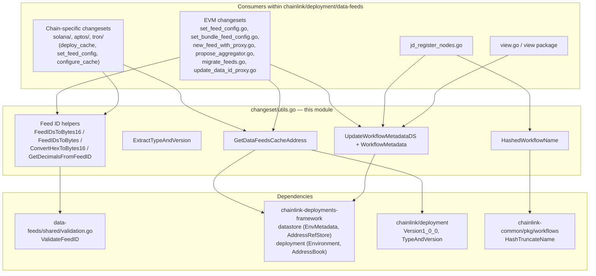
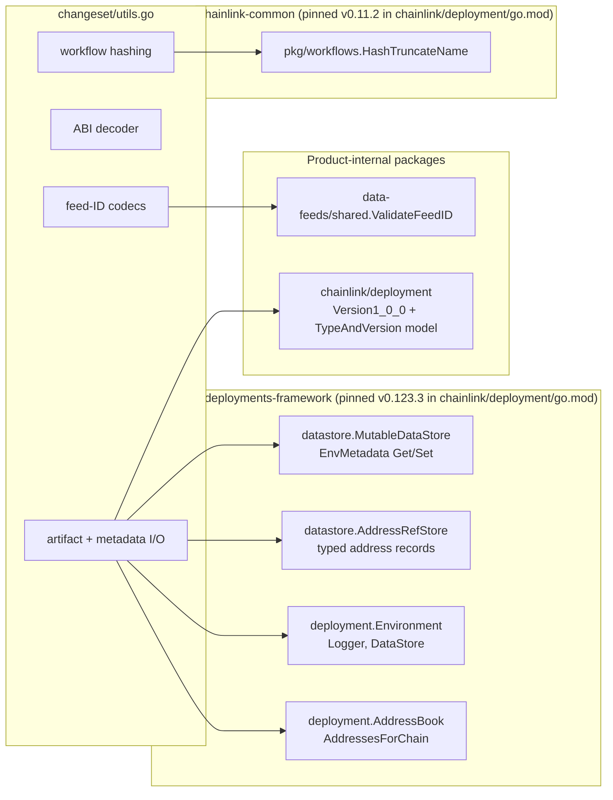
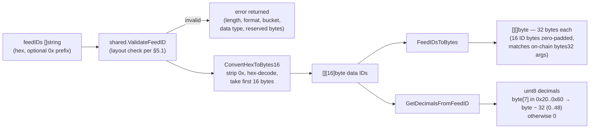
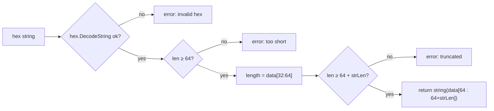
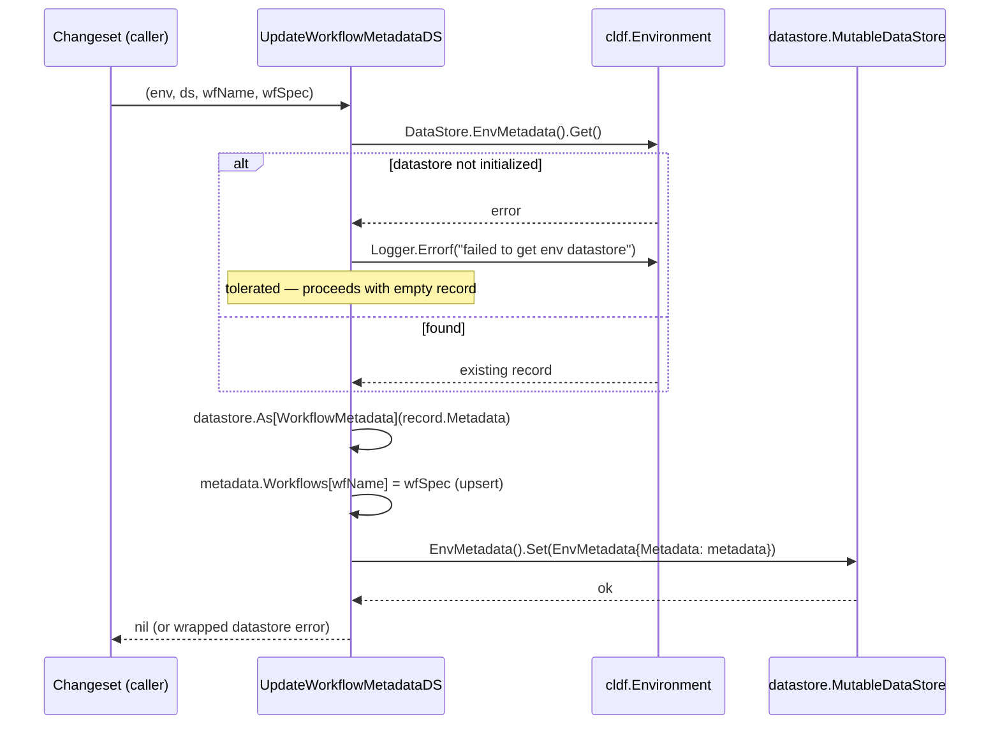
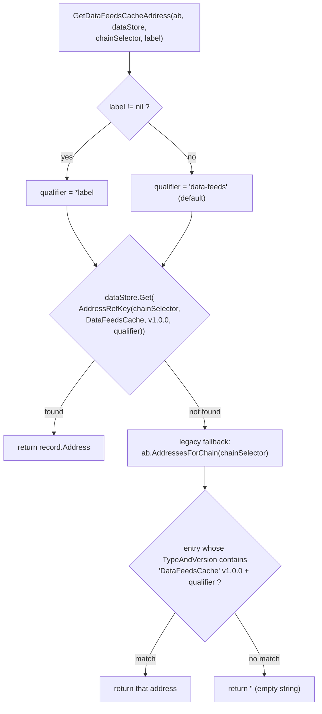
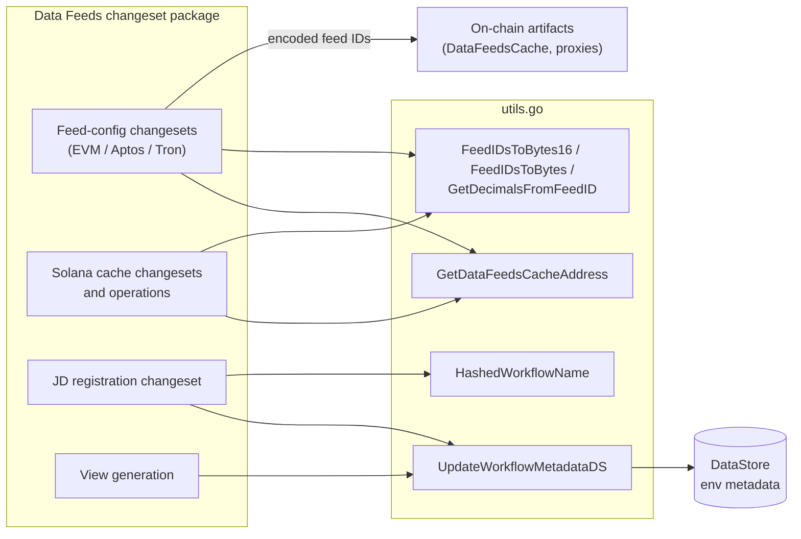

# Data Feeds Shared Utilities

> **Location:** `chainlink/deployment/data-feeds/changeset/utils.go` · **Go package:** `changeset` · **Go module:** `github.com/smartcontractkit/chainlink/deployment` (see [chainlink/deployment/go.mod](https://github.com/smartcontractkit/chainlink/blob/main/chainlink/deployment/go.mod))
>
> Sub-module of [Data Feeds](../data-feeds.md) · Siblings: [Chain State & Views](data-feeds_chain-state-views.md) · [JD Registration](data-feeds_jd-registration.md) · [Solana Cache Deployment](data-feeds_solana-cache.md)

## 1. Purpose and Scope

The **data-feeds shared-utilities** module is the support layer of the Data Feeds deployment package. It is a single, dependency-light file (`changeset/utils.go`) that exposes the cross-cutting primitives every Data Feeds changeset needs, so that chain-specific changesets (EVM, Aptos, Solana, Tron), the view layer, and the JD registration flow do not each re-implement them:

| Capability | Symbols in this module |
|---|---|
| **Feed ID validation & encoding** | `FeedIDsToBytes16`, `FeedIDsToBytes`, `ConvertHexToBytes16`, `GetDecimalsFromFeedID` (built on `data-feeds/shared.ValidateFeedID`) |
| **ABI payload decoding** | `ExtractTypeAndVersion` — extracts a dynamic `string` from an ABI-encoded hex payload |
| **Workflow naming** | `HashedWorkflowName` — deterministic 10-byte workflow identifiers |
| **Artifact resolution** | `GetDataFeedsCacheAddress` — DataStore-first, AddressBook-fallback lookup of the deployed `DataFeedsCache` |
| **Metadata persistence** | `WorkflowMetadata` (type) and `UpdateWorkflowMetadataDS` — read-modify-write upsert of workflow specs into the deployment framework's environment datastore |

### What this module is NOT

- It contains **no changesets, sequences, or operations** and performs **no on-chain transactions** — it is a pure helper library for the changeset layer (for the changeset/operation model, see [Data Feeds](../data-feeds.md) and [deployment-common](../deployment-common.md)).
- It does **not serve feeds at runtime** — the node-side Data Feeds execution lives in [Oracle Engines & Data Pipelines](../../Oracle_Engines___Data_Pipelines.md).
- Despite the similar name, it is unrelated to the node-core [shared utilities](../../Node_Application_Core___Interfaces/core_shared_utilities.md) (`cltest` mocks, null logger, ABI test helpers); this module serves the **deployment framework** exclusively.

## 2. Positioning within Data Feeds



> The exact wiring between changesets and these helpers is maintained in the parent module's architecture and [component interaction map](../data-feeds.md).

## 3. Component Catalog

| Symbol | Kind | Signature | Description |
|---|---|---|---|
| `WorkflowMetadata` | struct | `{ Workflows map[string]string }` | Environment-metadata payload: workflow name → workflow spec (JSON string) |
| `FeedIDsToBytes16` | func | `(feedIDs []string) ([][16]byte, error)` | Validates each feed ID, then converts it to a 16-byte array |
| `FeedIDsToBytes` | func | `(feedIDs []string) ([][]byte, error)` | Same, but zero-padded to 32-byte slices for on-chain `bytes32` arguments |
| `ConvertHexToBytes16` | func | `(hexStr string) ([16]byte, error)` | Strips an optional `0x` prefix, hex-decodes, returns the first 16 bytes |
| `ExtractTypeAndVersion` | func | `(hexStr string) (string, error)` | Decodes an ABI-encoded dynamic `string` (type-and-version) from raw hex |
| `HashedWorkflowName` | func | `(name string) [10]byte` | First 10 characters of the hex-encoded SHA-256 digest of the workflow name |
| `GetDecimalsFromFeedID` | func | `(feedID string) (uint8, error)` | Extracts decimals from the feed ID data-type byte (`0x20`–`0x60` ⇒ byte − 32) |
| `GetDataFeedsCacheAddress` | func | `(ab cldf.AddressBook, dataStore datastore.AddressRefStore, chainSelector uint64, label *string) string` | Resolves the `DataFeedsCache` address for a chain; returns `""` when unresolvable (never errors) |
| `UpdateWorkflowMetadataDS` | func | `(env cldf.Environment, ds datastore.MutableDataStore, wfName, wfSpec string) error` | Upserts a workflow spec into the environment datastore metadata |

## 4. Architecture and Dependencies

`utils.go` sits at the bottom of the Data Feeds changeset package and depends on four external surfaces:



Key dependency facts (verified in `chainlink/deployment/go.mod`):

- The **deployment framework** (`chainlink-deployments-framework`) provides `datastore` (the typed `AddressRefStore` / `EnvMetadata` stores) and the `cldf.Environment` / `cldf.AddressBook` abstractions.
- **`chainlink-common/pkg/workflows`** provides the canonical workflow-name hashing; this module adapts its `string` result into the `[10]byte` form expected by callers.
- The **feed-ID format rules** live in the product-shared package `data-feeds/shared` (`shared/validation.go::ValidateFeedID`), so both changesets and non-changeset code validate IDs identically.

## 5. Feed ID Handling

### 5.1 Feed ID layout (validated by `shared.ValidateFeedID`)

A feed ID is a 32-hex-character (16-byte) identifier with the following structure:

| Bytes | Field | Allowed values |
|---|---|---|
| 0 | Format | `0x01` or `0x02` |
| 1–4 | Random | any |
| 5–6 | Attribute bucket | `0x0003` or `0x0700` |
| 7 | Data type | `0x00`–`0x04`, or `0x20`–`0x60` (encodes decimals as `byte − 32`) |
| 8–15 | Reserved | must be `0x00` |

### 5.2 Conversion data flow



Implementation notes:

- `FeedIDsToBytes` pads each `[16]byte` into a fresh 32-byte slice (`copy(b, v[:])`), producing the left-aligned, zero-padded `bytes32` representation expected by `DataFeedsCache` and proxy contracts.
- `ConvertHexToBytes16` does **not** enforce length by itself; it takes the first 16 decoded bytes. Length guarantees come from calling it after `shared.ValidateFeedID` (as `FeedIDsToBytes16` does).
- All three entry points return wrapped errors rather than panicking; validation failures abort the whole batch (all-or-nothing conversion).

### 5.3 Typical usage

```go
ids, err := changeset.FeedIDsToBytes(req.FeedIDs)          // validated [][]byte for cache calls
if err != nil { return cldf.ChangesetOutput{}, err }

decimals, err := changeset.GetDecimalsFromFeedID(feedID)   // decimal places for a single feed
```

## 6. ABI Type-and-Version Extraction — `ExtractTypeAndVersion`

Some Data Feeds flows receive ABI-encoded payloads (e.g. contract responses) and need the embedded human-readable type-and-version string. The function assumes the standard ABI encoding of a **single dynamic `string`** argument:

| Offset (bytes) | Content |
|---|---|
| 0–31 | (offset word — ignored) |
| 32–63 | string length as a 32-byte big-endian integer |
| 64 … 64+len | UTF-8 string bytes |

Error cases: invalid hex, payload shorter than 64 bytes, negative length, or payload truncated before the declared string end.



## 7. Workflow Naming and Metadata Persistence

### 7.1 `HashedWorkflowName`

```go
HashedWorkflowName(name) // [10]byte, first 10 chars of hex(SHA-256(name))
```

It delegates to `chainlink-common/pkg/workflows.HashTruncateName` (the same primitive used by the workflow engine — see [Workflows runtime](../../Workflow___Capability_Runtime_(CRE_Engine)/workflows.md)) and converts the 10-character hex prefix into a fixed `[10]byte`. This yields a deterministic, compact workflow identifier derived from the human-readable workflow name, suitable for on-chain slots and DataStore keys.

### 7.2 `WorkflowMetadata` and `UpdateWorkflowMetadataDS`

`WorkflowMetadata` is the typed payload stored in the deployment framework's **environment metadata**:

- `Workflows map[string]string` — workflow name → workflow spec (JSON).

`UpdateWorkflowMetadataDS` performs a **read-modify-write upsert**, because the framework overwrites the entire environment-metadata record on every `Set()`:



Behavioral details:

- **Tolerant read:** if the environment datastore is not yet initialized, the `Get()` error is logged via `env.Logger.Errorf` and a fresh metadata record is created instead of failing the changeset.
- **Upsert semantics:** setting the same `wfName` again replaces its spec; other entries are preserved.
- **Typed cast:** `datastore.As[WorkflowMetadata](...)` fails with a wrapped error if the stored metadata is not of this type.
- **Persistence surface:** the spec is stored in the mutable datastore handed to the changeset (`ds.EnvMetadata().Set`), keeping workflow registration state alongside deployed-address references.

The stored metadata complements the rendered views: the view package later surfaces individual `Workflow` entries (`Name`, `Forwarder`, `Owner`) parsed from chain state — documented in [data-feeds_chain-state-views.md](data-feeds_chain-state-views.md).

## 8. DataFeedsCache Address Resolution — `GetDataFeedsCacheAddress`

Changesets frequently need the address of the already-deployed `DataFeedsCache` contract/program for a chain. Resolution is **DataStore-first with a legacy AddressBook fallback**:



Semantics worth knowing:

- The typed lookup uses `datastore.NewAddressRefKey(chainSelector, DataFeedsCache, deployment.Version1_0_0, qualifier)` — i.e., it is **version- and qualifier-aware**, matching exactly what the cache-deployment changesets record (see [data-feeds_solana-cache.md](data-feeds_solana-cache.md) for the Solana deployment flow that creates these records).
- The fallback scans the legacy address book by string-matching the `TypeAndVersion` representation (`"DataFeedsCache"` + version + label), keeping compatibility with deployments predating the typed datastore.
- The function **never returns an error**: an unresolvable address surfaces as `""`, which callers treat as "cache not deployed / not linked".
- If the chain is unknown to the address book, the fallback also yields `""`.

## 9. Consumers and Integration Map



Representative consumers in `chainlink/deployment/data-feeds/changeset/`:

| Consumer | Uses |
|---|---|
| `set_feed_config.go`, `set_bundle_feed_config.go`, `remove_feed.go`, `remove_feed_config.go` | Feed-ID conversion (`FeedIDsToBytes16`/`FeedIDsToBytes`) and cache address resolution |
| `new_feed_with_proxy.go`, `update_data_id_proxy.go`, `propose_aggregator.go`, `migrate_feeds.go` | Feed-ID conversion, cache resolution, ABI type-and-version handling |
| `solana/deploy_cache.go`, `solana/configure_cache.go`, `tron/deploy_cache.go`, `aptos/*` | Cache address resolution + datastore address records |
| `jd_register_nodes.go`, `view.go` | Workflow metadata upsert (`UpdateWorkflowMetadataDS`), workflow name hashing |

Downstream, the system-test/CRE environment drives these changesets via `ConfigureDataFeedsCacheInput` — see [system-tests](../../Dev,_Test___Simulation_Environments/system-tests.md).

## 10. Error-Handling and Concurrency Notes

- **Validation is all-or-nothing:** a single invalid feed ID fails the whole `FeedIDsToBytes16`/`FeedIDsToBytes` batch with the underlying `shared.ValidateFeedID` error (length, format byte, attribute bucket, data type, or non-zero reserved bytes).
- **Silent emptiness by design:** `GetDataFeedsCacheAddress` returns `""` for "not found" (including chain-lookup errors), so callers must distinguish "no cache" from a valid zero address.
- **Read-modify-write window:** because `UpdateWorkflowMetadataDS` reads the whole environment-metadata record, mutates it, and writes it back, concurrent changesets mutating the same datastore can overwrite each other's metadata; the framework's single-threaded changeset execution is the guard.
- **Zero-value safety:** after a failed/missing metadata read, the code initializes `metadata.Workflows` on first use, so first-time use on a fresh environment works without pre-seeding.

## 11. Testing

Unit coverage for these helpers lives in `chainlink/deployment/data-feeds/changeset/utils_test.go` (feed-ID conversion, ABI decoding, workflow hashing, and metadata upsert), following the repository's test conventions described in [chainlink build and tooling](../../Build,_CI___Release_Infrastructure/chainlink_build_and_tooling.md). The shared validation rules themselves are covered by `chainlink/deployment/data-feeds/shared/validation_test.go`.

## 12. Related Documentation

- Parent module: [Data Feeds](../data-feeds.md) — changeset/sequence/operation model, end-to-end Solana rollout.
- Sibling sub-modules: [Chain State & Views](data-feeds_chain-state-views.md) · [JD Registration](data-feeds_jd-registration.md) · [Solana Cache Deployment](data-feeds_solana-cache.md).
- Framework infrastructure shared by all products: [deployment-common](../deployment-common.md) and the [Deployment Framework overview](../../Deployment_Framework_Core___Product_Deployments.md).
- Workflow-name hashing origin: [Workflows (CRE Engine)](../../Workflow___Capability_Runtime_(CRE_Engine)/workflows.md).
- Runtime counterpart (feed serving): [Oracle Engines & Data Pipelines](../../Oracle_Engines___Data_Pipelines.md).
