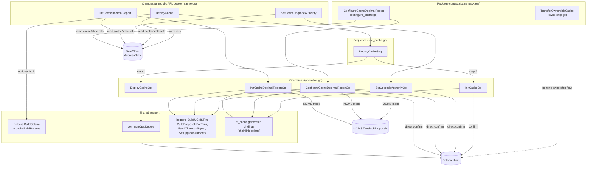
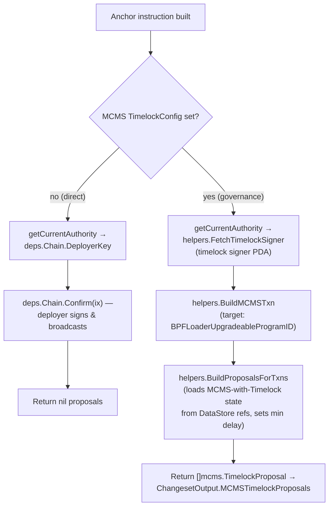
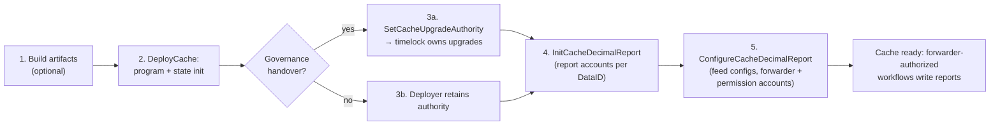
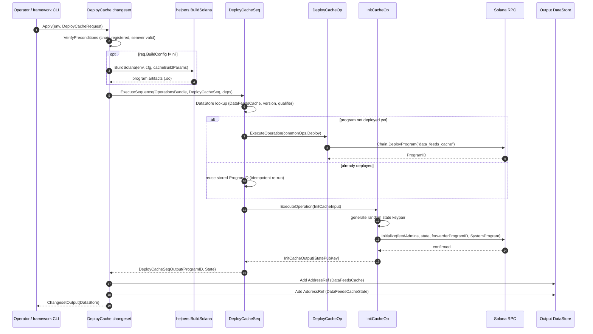
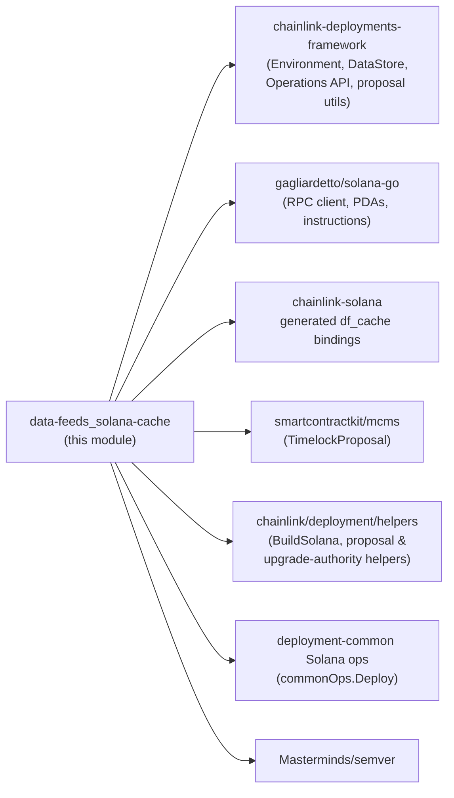

# Data Feeds — Solana Cache Deployment

> **Source files:**
> - `chainlink/deployment/data-feeds/changeset/solana/deploy_cache.go` (changesets)
> - `chainlink/deployment/data-feeds/changeset/solana/sequence/operation/operation.go` (operations)
> - `chainlink/deployment/data-feeds/changeset/solana/sequence/seq_cache.go` (deployment sequence)
>
> **Package:** `github.com/smartcontractkit/chainlink/deployment/data-feeds/changeset/solana` (Go module `github.com/smartcontractkit/chainlink/deployment`, pinned in [chainlink/deployment/go.mod](https://github.com/smartcontractkit/chainlink/blob/main/chainlink/deployment/go.mod))
> **Parent module:** [Data Feeds deployments](../data-feeds.md)

## 1. Purpose and Core Functionality

This module is the **Solana leg of the Data Feeds product deployment** within the [Deployment Framework](../../Deployment_Framework_Core___Product_Deployments.md). It deploys and configures the **`DataFeedsCache` Solana program** — the on-chain store that Data Feeds workflows write report values to — along with its **state account** and the per-feed **decimal report accounts**.

It provides three operator-facing **changesets** (`cldf.ChangeSetV2`):

1. **`DeployCache`** — deploys the cache program (optionally building the Anchor artifacts first) and initializes its state account with feed admins and the authorized forwarder program.
2. **`SetCacheUpgradeAuthority`** — hands the program's BPF upgrade authority to a new key (typically the **MCMS timelock signer PDA**) via the Solana BPF Loader `SetAuthority` instruction.
3. **`InitCacheDecimalReport`** — creates the initial decimal report accounts (PDAs) for a batch of Data IDs, writable by a designated feed admin.

These changesets orchestrate a **sequence** (`DeployCacheSeq`) and five **operations**, all built on the `chainlink-deployments-framework` Operations API. Every operation supports two execution modes:

- **Direct mode** — the environment's deployer key signs and confirms the Solana instruction immediately (used in dev/test environments).
- **MCMS timelock mode** — when a `TimelockConfig` is supplied, no transaction is sent; instead a signed-off `mcms.TimelockProposal` is emitted in `ChangesetOutput.MCMSTimelockProposals` for multi-sig governance execution (see [deployment-common / Solana MCMS](../deployment-common/deployment-common_solana-mcms.md)).

> **What this module is not:** it does not implement the cache runtime (the Anchor program lives in the `chainlink-solana` repository) nor the workflow logic that writes reports; the Solana-side runtime counterpart is documented in [chain_capability_solana](../../Workflow___Capability_Runtime_(CRE_Engine)/chain_capability_solana.md). This module only orchestrates **deployment and configuration** of the on-chain artifacts.

## 2. At a Glance

| Aspect | Detail |
|---|---|
| Changesets | `DeployCache`, `SetCacheUpgradeAuthority`, `InitCacheDecimalReport` (+ package-context `ConfigureCacheDecimalReport`, `TransferOwnershipCache`) |
| Sequence | `DeployCacheSeq` (`"deploy-cache-seq"`, v1.0.0) — deploys program, then initializes state |
| Operations | `DeployCacheOp`, `InitCacheOp`, `SetUpgradeAuthorityOp`, `ConfigureCacheDecimalReportOp`, `InitCacheDecimalReportOp` (all v1.0.0) |
| Contract types registered | `DataFeedsCache` (program) and `DataFeedsCacheState` (state account) as `datastore.AddressRef`s |
| On-chain target | Solana BPF program `data_feeds_cache` + its PDA-derived report/permission accounts |
| Governance | Direct deployer confirm **or** MCMS `TimelockProposal` generation (`BPFLoaderUpgradeableProgramID` as proposal target) |
| Key dependencies | `chainlink-deployments-framework v0.123.3`, `gagliardetto/solana-go v1.23.0`, `chainlink-solana` (generated `df_cache` bindings), `mcms`, `cld-changesets` — see `chainlink/deployment/go.mod` |
| Framework used by tests | `deploy_cache_test.go` (same package) |

## 3. Architecture and Component Relationships

The module follows the standard *changeset → sequence → operation* layering of the Deployment Framework:

**Layer responsibilities**

| Layer | Responsibility | Key types |
|---|---|---|
| Changesets | Precondition validation, datastore lookup/registration, request decoding | `DeployCache`, `SetCacheUpgradeAuthority`, `InitCacheDecimalReport` |
| Sequence | Two-step orchestration (deploy + initialize) with idempotent program lookup | `DeployCacheSeq`, `DeployCacheSeqInput`, `DeployCacheSeqOutput` |
| Operations | Single Solana instructions; direct confirm or MCMS proposal build | `InitCacheOp`, `DeployCacheOp`, `SetUpgradeAuthorityOp`, `ConfigureCacheDecimalReportOp`, `InitCacheDecimalReportOp` |
| Shared ops deps | `Deps{Env, Chain, Datastore}` threaded through every operation | `operation.Deps` |
| Proposal plumbing | Wrap Solana instructions as MCMS transactions and timelock proposals | `confirmInstructionOrBuildProposal`, `buildMCMSProposal`, `getCurrentAuthority` |

## 4. Core Components Reference

### 4.1 Changesets (`deploy_cache.go`)

| Changeset | Request | Preconditions | On-chain effect | Output |
|---|---|---|---|---|
| `DeployCache` | `DeployCacheRequest{ChainSel, BuildConfig, Qualifier, LabelSet, Version, FeedAdmins, ForwarderProgramID}` | Solana chain registered for `ChainSel`; `Version` is valid semver | Runs `DeployCacheSeq`: deploys program + initializes state | Fresh in-memory `DataStore` with `DataFeedsCache` (program) and `DataFeedsCacheState` (state) `AddressRef`s |
| `SetCacheUpgradeAuthority` | `SetCacheUpgradeAuthorityRequest{ChainSel, NewUpgradeAuthority, Qualifier, Version, MCMS}` | Chain registered; version valid; cache `AddressRef` exists; if `MCMS` set, a timelock signer must be resolvable from chain-scoped refs | BPF Loader `SetAuthority` instruction on the program's program-data account | `[]mcms.TimelockProposal` when in MCMS mode |
| `InitCacheDecimalReport` | `InitCacheDecimalReportRequest{ChainSel, Version, Qualifier, MCMS, DataIDs, FeedAdmin}` | Chain registered; version valid; every Data ID parses (≤128-bit); cache ref exists; `DataIDs` non-empty; `FeedAdmin` non-zero | `InitDecimalReports` instruction extended with per-DataID report PDAs as remaining accounts | `[]mcms.TimelockProposal` when in MCMS mode |

### 4.2 Operations (`operation.go`)

| Operation (ID) | Input → Output | Behavior |
|---|---|---|
| `DeployCacheOp` (`deploy-cache-op`) | `commonOps.DeployInput` → `DeployOutput{ProgramID}` | Delegates to the shared `commonOps.Deploy`, calling `Chain.DeployProgram` with program name `data_feeds_cache` |
| `InitCacheOp` (`init-cache-op`) | `InitCacheInput{ProgramID, ForwarderProgramID, ChainSel, FeedAdmins}` → `InitCacheOutput{StatePubKey}` | Generates a random state keypair, builds the Anchor `Initialize` instruction (feed admins, state, forwarder program, System Program) and confirms it with the state key as an additional signer |
| `SetUpgradeAuthorityOp` (`set-upgrade-authority-op`) | `SetUpgradeAuthorityInput{ChainSel, ProgramID, NewUpgradeAuthority, MCMS}` → `SetUpgradeAuthorityOutput{Proposals}` | Builds the BPF `SetAuthority` instruction (4-byte discriminator `[4,0,0,0]`) against the program-data PDA; signs with the current authority (deployer key or timelock signer PDA) |
| `InitCacheDecimalReportOp` (`init-cache-decimal-feed-op`) | `InitCacheDecimalReportInput` → `ConfigureCacheOutput{Proposals}` | Builds the Anchor `InitDecimalReports` instruction and appends the derived report PDAs to the account list |
| `ConfigureCacheDecimalReportOp` (`configure-cache-decimal-report-op`) | `ConfigureCacheDecimalReportInput` → `ConfigureCacheOutput{Proposals}` | Builds the Anchor `SetDecimalFeedConfigs` instruction (descriptions, `WorkflowMetadata` per sender, feed admin) and appends report + permission-flag PDAs |

**Operation output types** (the module's contract with the framework):

- `InitCacheOutput{StatePubKey solana.PublicKey}` — the newly created cache state account.
- `SetUpgradeAuthorityOutput{Proposals []mcms.TimelockProposal}` — populated only in MCMS mode.
- `ConfigureCacheOutput{Proposals []mcms.TimelockProposal}` — shared by both report operations; populated only in MCMS mode.

### 4.3 Contract types and datastore keys

Two `datastore.ContractType`s are defined in `deploy_cache.go`:

- `CacheContract = "DataFeedsCache"` — the deployed BPF program.
- `CacheState = "DataFeedsCacheState"` — the program's initialized state account.

All datastore lookups use composite keys of `(ChainSelector, ContractType, Version, Qualifier)` via `datastore.NewAddressRefKey`, which makes multiple versions/qualifiers of the cache coexist in one environment. This is the same addressing scheme consumed by the [chain state & views](data-feeds_chain-state-views.md) module and by `SetCacheUpgradeAuthority` / `InitCacheDecimalReport` preconditions.

## 5. Execution Modes: Direct Confirm vs MCMS Proposals

Every mutating operation funnels its Solana instruction through `confirmInstructionOrBuildProposal`, implementing the dual execution mode:

Key behaviors:

- **Authority resolution** (`getCurrentAuthority`): in direct mode the environment deployer key is the signer; in MCMS mode the signer must be the **timelock signer PDA** derived from the MCMS-with-Timelock state persisted in the DataStore (deployed by [deployment-common / Solana MCMS](../deployment-common/deployment-common_solana-mcms.md)).
- **Proposal targeting**: MCMS transactions are addressed to `solana.BPFLoaderUpgradeableProgramID`, since upgrade-authority changes and buffer writes are BPF-Loader operations rather than calls into the cache program itself.
- **Idempotent precondition checks**: `SetCacheUpgradeAuthority` verifies *before* applying that a timelock signer can be resolved when MCMS mode is requested, failing fast instead of producing a malformed proposal.

## 6. Deployment Lifecycle (Process Flow)

A typical Solana cache rollout proceeds through the following stages:

Detailed end-to-end trace of the primary `DeployCache` changeset:

Note the **idempotency** built into the sequence: if a `DataFeedsCache` reference already exists for the `(chain, version, qualifier)` key, the deploy step is skipped and only `InitCacheOp` runs, making re-execution safe.

## 7. Address and ID Derivation (PDA Scheme)

The cache program uses Solana Program-Derived Addresses for its per-feed storage. The module reproduces the on-chain derivation exactly (the report hash intentionally matches the Rust `hash::hash(&[data_id, sender, owner, name].concat())` in `chainlink-solana`'s `data-feeds-cache` program):

| Artifact | Seeds | Derived under | Used by |
|---|---|---|---|
| **Decimal report PDA** | `"decimal_report"` ‖ cache-state pubkey ‖ DataID (16 B) | cache program ID | `InitCacheDecimalReport` (`createRemainingAccounts`, seed `"decimal_report"`), `ConfigureCacheDecimalReport` (seed `"feed_config"`) |
| **Permission flag PDA** | `"permission_flag"` ‖ cache-state pubkey ‖ SHA-256(DataID ‖ sender ‖ owner[20] ‖ name[10]) | cache program ID | `ConfigureCacheDecimalReport` (`createPermissionFlagAccounts` + `createReportHash`) |
| **Forwarder authority PDA** | `"forwarder"` ‖ forwarder-state pubkey ‖ cache program ID | forwarder program ID | `ConfigureCacheDecimalReport` (`deriveForwarderAuthority`) — the delegated write authority recorded in `WorkflowMetadata` |
| **Timelock signer PDA** | derived from MCMS program/seed refs | timelock program | MCMS-mode authority (`helpers.FetchTimelockSigner`) |

**Data ID encoding** (`dataIDsToBytes` / `dataIDtoBytes`): operator-supplied decimal strings are parsed as `big.Int` (base auto-detected), rejected if longer than 128 bits, and copied big-endian-aligned into a `[16]byte` array. Any feed ID outside this 128-bit space fails `VerifyPreconditions` before any transaction is built.

## 8. Build Pipeline (Optional Artifact Provisioning)

`DeployCache` accepts an optional `BuildConfig *helpers.BuildSolanaConfig`. When supplied, `DeployCache.Apply` invokes `helpers.BuildSolana` with the package-level `cacheBuildParams` (defined in `config.go`):

- **Remote mode** (default): downloads prebuilt Solana program artifacts for a given `GitCommitSha` via `solutils`.
- **Local mode**: clones the `chainlink-solana` Anchor repository, synchronizes/replaces program keys (`declare_id!` replacement, optional vanity-key generation), runs `make build_contracts`, and copies `contracts/target/deploy` outputs to the destination directory used by `Chain.DeployProgram`.

The build configuration is environment-dependent (paths, git SHA, toolchain availability); the `ProgramFilesView` mapping points at `programs/data_feeds_cache/src/lib.rs` so upgrades can pin the existing program ID. Toolchain/build conventions for the repo are documented in [build-and-repo-tooling](../../Build,_CI___Release_Infrastructure/build-and-repo-tooling.md).

## 9. Dependencies

All versions are pinned in `chainlink/deployment/go.mod`. Cross-module relationships:

- **[Data Feeds module overview](../data-feeds.md)** — parent; describes the product-level changeset catalog and the end-to-end rollout.
- **[deployment-common / Solana MCMS](../deployment-common/deployment-common_solana-mcms.md)** — deploys the MCM/Timelock programs whose state this module consumes for authority resolution and proposal building; also provides the shared `Deploy` program-deployment operation.
- **[Keystone forwarder suite](../../CRE___Keystone_Deployment_Suite/cre-forwarder.md)** — deploys/configures the forwarder program whose `ProgramID` is baked into the cache state at initialization (it is the only program allowed to write reports).
- **[Chain state & views](data-feeds_chain-state-views.md)** and **[shared utilities](data-feeds_shared-utilities.md)** — read the `DataFeedsCache`/`DataFeedsCacheState` references this module writes and provide the workflow-metadata helpers consumed by report configuration.
- **[System tests](../../Dev,_Test___Simulation_Environments/system-tests.md)** — CRE system-test environments drive these changesets (e.g. `ConfigureDataFeedsCacheInput` in `system-tests/lib/cre/types.go`) with direct (non-MCMS) execution.

## 10. Testing

Unit/integration tests live alongside the changesets in `chainlink/deployment/data-feeds/changeset/solana/deploy_cache_test.go` (same package), exercising `VerifyPreconditions` and `Apply` against simulated Solana chains. Operations are individually addressable and versioned (`Version1_0_0`), so they can be replayed through the framework's `OperationsBundle` reporting for auditability.

## 11. Further Reading

- Parent module: [Data Feeds deployments](../data-feeds.md) · Grandparent: [Deployment Framework Core & Product Deployments](../../Deployment_Framework_Core___Product_Deployments.md)
- Sibling sub-modules: [JD registration](data-feeds_jd-registration.md), [chain state & views](data-feeds_chain-state-views.md), [shared utilities](data-feeds_shared-utilities.md)
- Governance plumbing: [deployment-common](../deployment-common.md) / [Solana MCMS-with-Timelock](../deployment-common/deployment-common_solana-mcms.md)
- Runtime counterparts: [chain_capability_solana](../../Workflow___Capability_Runtime_(CRE_Engine)/chain_capability_solana.md), [Oracle Engines & Data Pipelines](../../Oracle_Engines___Data_Pipelines.md)
