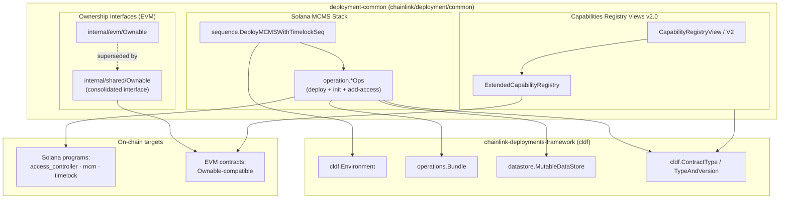
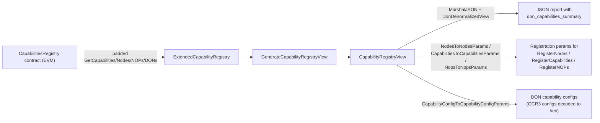

# Deployment Common — Shared Deployment Library

> **Module path:** `chainlink/deployment/common` · **Parent module:** [Deployment Framework Core & Product Deployments](../Deployment_Framework_Core___Product_Deployments.md) · **Go module:** `github.com/smartcontractkit/chainlink/deployment` (see [`chainlink/deployment/go.mod`](chainlink/deployment/go.mod))

## 1. Purpose and Scope

`deployment-common` is the shared foundation library of the on-chain deployment framework. It contains the reusable building blocks that every product deployment suite (CCIP, CRE/Keystone, Data Feeds, Vault, Tokens) composes to deploy and govern smart contracts across multiple blockchains. The module deliberately contains **no product logic of its own** — it provides three families of cross-product primitives:

1. **Contract ownership interfaces** — minimal, ABI-bound `Ownable` abstractions for EVM contracts, used by changesets and state views to inspect and transfer contract ownership without depending on full generated wrappers.
2. **Solana MCMS governance stack deployment** — an idempotent *operation + sequence* toolkit that deploys and initializes the Many-Chain Multi-Sig (MCMS) governance infrastructure (Access Controller, MCM, Timelock programs) on Solana chains, wiring up RBAC roles in a single callable sequence.
3. **Capabilities Registry views (v2.0)** — serialization-friendly, high-fidelity JSON views of the Capabilities Registry contract (capabilities, nodes, node operators, DONs) for post-deployment inspection, plus round-trip converters that turn views back into on-chain registration parameters.

### Design Principles

- **Idempotency everywhere:** every operation checks on-chain state before acting (e.g., "already initialized, skipping") so sequences can be safely re-run.
- **State + datastore bookkeeping:** deployed addresses are recorded both in the chain-scoped `MCMSWithTimelockState` and in the framework-wide `datastore` address book so later changesets can resolve contracts without re-deriving addresses.
- **Composition via the operations framework:** the module builds directly on `chainlink-deployments-framework` (`cldf`): `operations.NewOperation` / `operations.NewSequence`, the `operations.Bundle` execution context, `cldf.Environment`, and `cldf.ContractType` typed metadata (see [`chainlink/deployment/go.mod`](chainlink/deployment/go.mod) for the dependency pins).

## 2. Architecture Overview



### How the pieces fit together

| Sub-module | Location | Responsibility |
|---|---|---|
| **Ownership interfaces** | `changeset/internal/evm`, `changeset/internal/shared` | Minimal `Ownable` interface (read owner, propose/transfer, accept ownership) consumed by ownership changesets and `view.ContractMetaData` |
| **Solana MCMS stack** | `changeset/solana/mcms/sequence` (+ `changeset/solana/operations`) | Deploy & initialize Solana MCMS governance programs; grant timelock roles; record state |
| **Registry views** | `view/v2_0` | High-fidelity JSON views of the Capabilities Registry and converters back to registration params |

### Shared vocabulary — `ContractType` constants

The Solana operations and views share contract-type identifiers from [`chainlink/deployment/common/types/types.go`](chainlink/deployment/common/types/types.go):

- Governance stack programs: `ManyChainMultisigProgram`, `RBACTimelockProgram`, `AccessControllerProgram`
- Governance accounts: `ProposerAccessControllerAccount`, `ExecutorAccessControllerAccount`, `CancellerAccessControllerAccount`, `BypasserAccessControllerAccount`
- Governance instances: `ProposerManyChainMultisig`, `CancellerManyChainMultisig`, `BypasserManyChainMultisig`, `RBACTimelock`

## 3. Sub-module Documentation

Detailed documentation for each sub-module, including component responsibilities, code walkthroughs, and process diagrams (each page is generated from the module's core components):

| Sub-module | Page (final file) | Core components documented |
|---|---|---|
| **Ownership interfaces** | [deployment-common/deployment-common_ownership.md](deployment-common/deployment-common_ownership.md) | `Ownable` (internal/evm), `Ownable` (internal/shared) |
| **Solana MCMS deployment** | [deployment-common/deployment-common_solana-mcms.md](deployment-common/deployment-common_solana-mcms.md) | `DeployMCMSWithTimelockSeq`/`DeployMCMSWithTimelockOutput`, `InitAccessControllerOp`, `InitMCMOp`, `InitTimelockOp`, `AddAccessOp` and their input/output types |
| **Capabilities Registry views** | [deployment-common/deployment-common_registry-views.md](deployment-common/deployment-common_registry-views.md) | `CapabilityRegistryViewV2`, `CapabilityRegistryView`, `unpagniatedCapabilityRegistry`, `ExtendedCapabilityRegistry` |

## 4. Data Flow

### 4.1 Deploying the Solana MCMS governance stack

```mermaid
sequenceDiagram
    participant C as Changeset / caller
    participant SEQ as DeployMCMSWithTimelockSeq
    participant OP as operations (bundle)
    participant SOL as Solana chain
    participant DS as datastore
    participant ST as MCMSWithTimelockState

    C->>SEQ: DeployMCMSWithTimelockInput{MCMConfig, TimelockMinDelay}
    SEQ->>OP: DeployAccessControllerOp (program deploys)
    OP->>SOL: DeployProgram(access_controller)
    OP->>DS: Add AddressRef(program, v1.0.0)
    SEQ->>OP: InitAccessControllerOp ×4 (proposer/executor/canceller/bypasser)
    OP->>SOL: CreateAccount + Initialize (skips if exists)
    SEQ->>OP: DeployMCMProgramOp + InitMCMOp ×3
    OP->>SOL: Deploy mcm program; SetConfig per role
    OP->>DS: Add AddressRef
    SEQ->>OP: DeployTimelockOp + InitTimelockOp
    OP->>SOL: Deploy timelock; wait executable; Initialize with delay + role accounts
    SEQ->>OP: AddAccessOp ×4 (wire MCMS signer PDAs into timelock roles)
    OP->>SOL: BatchAddAccess instructions
    SEQ->>ST: Persist program IDs + PDA seeds
    SEQ-->>C: DeployMCMSWithTimelockOutput
```

### 4.2 Generating a Capabilities Registry view



## 5. Relationship to Other Modules

`deployment-common` is consumed by — and intentionally couples loosely to — the following suites (links go to their wiki pages):

- **[CRE & Keystone Deployment Suite](../CRE___Keystone_Deployment_Suite.md)** — the registry views import `deployment/cre/capabilities_registry/v2/changeset/pkg` (proto capability configs) and `deployment/cre/ocr3` (OCR3 oracle-config decoding); the CRE [capabilities registry changesets](../CRE___Keystone_Deployment_Suite/cre-capabilities-registry/cre-capabilities-registry_operations.md) and [workflow registry](../CRE___Keystone_Deployment_Suite/cre-workflow-registry/cre-workflow-registry_changeset.md) deploy the contracts these views read. Conversely, the CRE [forwarder changesets](../CRE___Keystone_Deployment_Suite/cre-forwarder/cre-forwarder_evm.md) use the shared `Ownable` interface for ownership transfers.
- **[CCIP Deployment Suite](../CCIP_Deployment_Suite.md)** — the Solana MCMS sequence provisions the governance stack used by CCIP Solana changesets such as [adding EVM↔Solana lanes](../CCIP_Deployment_Suite/ccip-changesets/ccip-changesets_crossfamily.md) and [Solana token pools](../CCIP_Deployment_Suite/ccip-changesets/ccip-changesets_solana.md); the [shared stateview](../CCIP_Deployment_Suite/ccip-shared/ccip-shared_stateview.md) then consumes the recorded state.
- **Sibling product suites** — [Data Feeds](data-feeds.md), [Vault](vault.md), and [Tokens](tokens.md) all assume an MCMS-with-timelock environment (frequently provisioned via this module's Solana sequence or the equivalent EVM stack) and follow the same changeset/operation/sequence conventions established here.
- **[Dev, Test & Simulation Environments](../Dev,_Test___Simulation_Environments.md)** — test environments stand up MCMS stacks so suites can exercise the same flows against ephemeral chains.

## 6. Operational Notes

- **Program artifacts:** Solana program binaries are resolved through `deployment/utils/solutils` (`Directory` maps program names → IDs, repos, and upgrade buffer sizes; MCMS programs live in the `chainlink-ccip` repo with 1 MiB buffers).
- **Upgrades:** `DeployInput.IsUpgrade` writes new program binaries to buffer accounts instead of redeploying; the timelock path additionally polls until the program account is `Executable` (up to 30 s) because validators may still be loading BPF after upgrade.
- **Role wiring:** the sequence grants the executor role directly to the deployer key — a deployment-time convenience that production post-processing should tighten to the executor MCMS.
- **Known quirks:** capability metadata may contain trailing NUL bytes on legacy deployments (handled defensively in `NewCapabilityView`); NOP↔node association is index-based (1-indexed) because the registry exposes no natural key.
