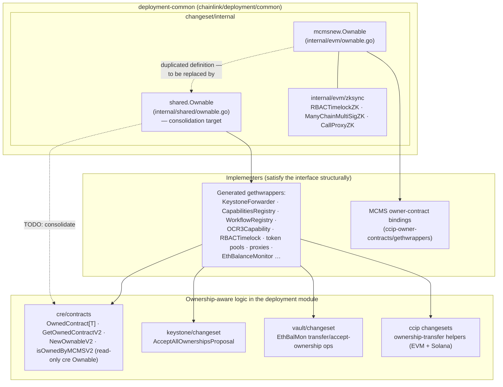
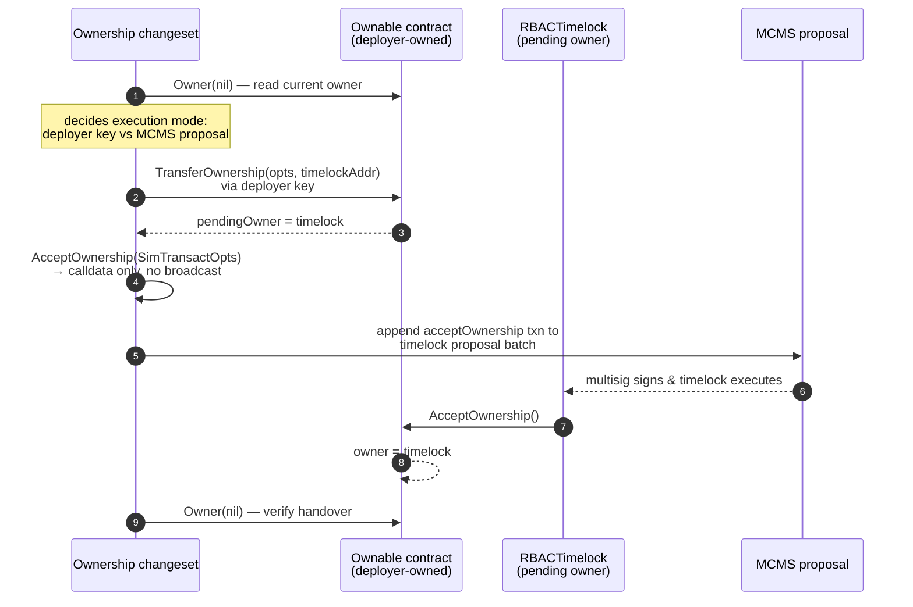
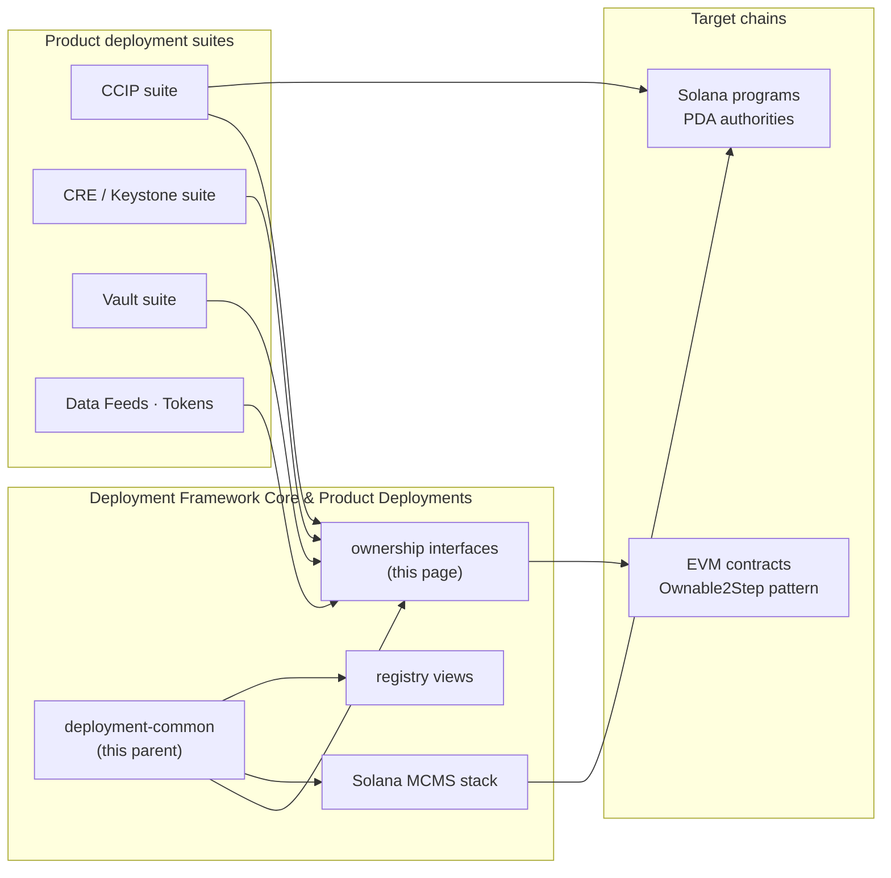

# Deployment Common — Contract Ownership Interfaces

> **Module path:** `chainlink/deployment/common/changeset/internal/{evm,shared}` · **Parent module:** [deployment-common](../deployment-common.md) · **Go module:** `github.com/smartcontractkit/chainlink/deployment` (see [`chainlink/deployment/go.mod`](chainlink/deployment/go.mod))

## 1. Purpose and Scope

`deployment-common_ownership` defines the **canonical `Ownable` interface for EVM contracts** used by the deployment framework. It is a deliberately tiny contract-boundary abstraction — four methods, no implementation — that lets changesets, ownership-transfer helpers, and view generators reason about *any* owned EVM contract without importing a specific generated gethwrapper.

The module contains exactly two components:

| Component | File | Package | Status |
|---|---|---|---|
| `Ownable` | [`chainlink/deployment/common/changeset/internal/evm/ownable.go`](chainlink/deployment/common/changeset/internal/evm/ownable.go) | `mcmsnew` | Original definition (bundled with the "new MCMS" owner-contract bindings and ZKsync deploy helpers) |
| `Ownable` | [`chainlink/deployment/common/changeset/internal/shared/ownable.go`](chainlink/deployment/common/changeset/internal/shared/ownable.go) | `shared` | **Consolidation target** — declared with `// TODO: remove other ownable interfaces in favor of this one` |

The two interfaces are **byte-for-byte identical**:

```go
type Ownable interface {
	Owner(opts *bind.CallOpts) (common.Address, error)
	TransferOwnership(opts *bind.TransactOpts, newOwner common.Address) (*gethtypes.Transaction, error)
	AcceptOwnership(opts *bind.TransactOpts) (*gethtypes.Transaction, error)
	Address() common.Address
}
```

### Why this interface exists

- **Two-step ownership transfer:** the `TransferOwnership` / `AcceptOwnership` pair encodes the `Ownable2Step` pattern used across Chainlink contracts: the current owner proposes a new owner, and the *new owner* must accept before the transfer takes effect. This is exactly the handshake required when handing a freshly deployed contract from the ephemeral deployer key to the MCMS timelock.
- **Structural decoupling:** generated gethwrappers (Keystone Forwarder, Capabilities/Workflow Registries, OCR3 capability, RBACTimelock, token pools, proxies, …) all expose these four methods. Any such wrapper satisfies `Ownable` implicitly, so generic ownership logic can be written once against the interface instead of once per contract type.
- **Internal by design:** both packages live under `changeset/internal/`, i.e. they are implementation details of the `chainlink/deployment` module rather than a public API. Product suites reach ownership behavior through changesets and operations, not by importing these interfaces directly (see §5).

### Scope boundaries

- **EVM-only.** The interface is typed against `go-ethereum` primitives (`bind.CallOpts`, `bind.TransactOpts`, `common.Address`, `*gethtypes.Transaction`, dependency pinned at `github.com/ethereum/go-ethereum v1.17.4` in [`chainlink/deployment/go.mod`](chainlink/deployment/go.mod)). Non-EVM families have their own analogues — e.g. the Solana closure-based transfer/accept builders in the CCIP suite (see [CCIP Deployment Suite](../../CCIP_Deployment_Suite.md)).
- **No on-chain logic.** The module holds no deployment, proposal, or persistence code; it only shapes the contract boundary that such code consumes.

## 2. Architecture and Component Relationships



### Component reference

#### `mcmsnew.Ownable` — `internal/evm/ownable.go`

| Method | Kind | Semantics |
|---|---|---|
| `Owner(opts *bind.CallOpts) (common.Address, error)` | read | Returns the current on-chain owner (nil `opts` = latest block). |
| `TransferOwnership(opts *bind.TransactOpts, newOwner common.Address) (*gethtypes.Transaction, error)` | write | Step 1 of the two-step handover: the **current owner** proposes `newOwner`. |
| `AcceptOwnership(opts *bind.TransactOpts) (*gethtypes.Transaction, error)` | write | Step 2: the **pending new owner** accepts, completing the transfer. |
| `Address() common.Address` | read | The bound contract address — used for logging, proposal assembly, and datastore lookups. |

The `mcmsnew` package ("new MCMS") groups the EVM-family bindings for the current owner-contract stack (`ccip-owner-contracts`), together with the ZKsync-specific deploy wrappers in [`chainlink/deployment/common/changeset/internal/evm/zksync/`](chainlink/deployment/common/changeset/internal/evm/zksync/) (`RBACTimelockZK`, `ManyChainMultiSigZK`, `CallProxyZK`), which deploy the same governance contracts via CREATE2 on ZKsync.

#### `shared.Ownable` — `internal/shared/ownable.go`

Identical interface, declared as the **single interface to rule them all**. The embedded TODO (`remove other ownable interfaces in favor of this one`) marks the migration end-state: every product suite and internal helper should type against `shared.Ownable`, and the duplicates (`mcmsnew.Ownable`, and the read-only variants discussed in §5) are eventually retired.

## 3. Process Flow — the Two-Step Ownership Handover

The typical lifecycle this interface models: a contract deployed by an EOA deployer key is handed over to the RBAC timelock governed by an MCMS multisig. The *transfer* is a normal deployer-key transaction; the *accept* must be executed **by the timelock**, which means it is encoded as calldata inside an MCMS timelock proposal.



Key properties visible in real consumers of this flow:

- **Simulation-only transactions for proposal building.** The vault suite's `EthBalMonAcceptOwnershipOperation` calls `ethBalMon.AcceptOwnership(cldf.SimTransactOpts())` purely to obtain calldata, which is then embedded in an `mcms.BatchOperation` (see [`chainlink/deployment/vault/changeset/ethbalmon_accept_ownership.go`](chainlink/deployment/vault/changeset/ethbalmon_accept_ownership.go), documented in [deployment-common: vault consumers](../vault.md)).
- **Batched multi-chain proposals.** Operations fan out per chain selector and merge their `BatchOperation`s into one `TimelockProposal` (same pattern in the CRE Solana MCMS transfer, `TransferSolanaMCMSOwnership`).
- **Read-back verification.** `Owner()` is the post-condition check used by suites to assert a contract is (or is not) timelock-owned before further configuration.

## 4. Related Interfaces and Consolidation Landscape

The interface exists in the context of several near-identical abstractions scattered through the codebase — the TODO comment on `shared.Ownable` is the acknowledgment that this fragmentation is temporary:

| Abstraction | Location | Signature shape | Role |
|---|---|---|---|
| `shared.Ownable` *(this module)* | `chainlink/deployment/common/changeset/internal/shared` | read + transfer + accept + address | Consolidation target |
| `mcmsnew.Ownable` *(this module)* | `chainlink/deployment/common/changeset/internal/evm` | identical | Legacy duplicate |
| `contracts.Ownable` | `chainlink/deployment/cre/contracts` | read-only: `Address` + `Owner` | CRE generic ownership helpers (`OwnedContract[T]`, `GetOwnedContractV2`, `NewOwnableV2`, `isOwnedByMCMSV2`, `GetOwnerTypeAndVersionV2`) — see [CRE contract-ownership](../../CRE___Keystone_Deployment_Suite/cre-core/cre-core_contract-ownership.md) |
| `solchangesets.OwnableContract` | `cld-changesets/legacy/pkg/family/solana/changesets` | Solana: `ProgramID` + `Seed` + `OwnerPDA` + `Type` | Chain-family analogue for Solana MCMS ownership transfer |
| `contract.OnlyOwner` guard | `chainlink-deployments-framework/chain/evm/operations/contract` | write-guard predicate | Restricts framework contract-write operations to the current owner |

Consolidation guidance for maintainers:

1. **New code** should reference `shared.Ownable` (or the product-suite equivalent only when a different method set is genuinely required, as with the read-only CRE helpers).
2. **Do not add a third definition** — if an existing wrapper lacks one of the four methods (e.g. a legacy one-step `Ownable` without `AcceptOwnership`), adapt at the call site rather than widening a copy of the interface.
3. **Removing duplicates is behavior-preserving** only if no package depends on the *identity* of a specific interface; since satisfaction is structural in Go, swapping `mcmsnew.Ownable` → `shared.Ownable` is a pure refactor.

## 5. How This Module Fits Into the System



- **Upstream dependency:** `chainlink-deployments-framework` (`cldf`) supplies `Environment`, the operations/sequences framework, the datastore address book, and the MCMS proposal builders that turn `AcceptOwnership` calldata into executable governance proposals (dependency pins in [`chainlink/deployment/go.mod`](chainlink/deployment/go.mod)).
- **Consumers:** changesets in the [CCIP Deployment Suite](../../CCIP_Deployment_Suite.md) (ownership-transfer helpers, proxy admin changesets), the [CRE & Keystone Deployment Suite](../../CRE___Keystone_Deployment_Suite.md) (`AcceptAllOwnershipsProposal`, forwarder configure/deploy flows), and the [Vault suite](../vault.md) (EthBalMon ownership operations) all drive the `Ownable` method set through their own wrapper types.
- **Sibling sub-modules:** the [Solana MCMS deployment toolkit](deployment-common_solana-mcms.md) provisions the timelock/MCMS stack that becomes the *new owner* in the handover above; the [Capabilities Registry views](deployment-common_registry-views.md) are the read-side counterpart that serializes post-handover registry state.

## 6. Maintenance Notes

- **Drift risk is low but real:** the two files are identical today; any semantic change (e.g. adding a `PendingOwner()` read or a renounce method) must land in `shared` first, then propagate — or better, complete the consolidation so only one definition survives.
- **The interface intentionally returns `*gethtypes.Transaction`** rather than a wrapper type: this matches go-ethereum generated bindings 1:1 and keeps call sites free of conversions, at the cost of coupling the interface to go-ethereum major versions.
- **ZKsync deployments** reach the same contracts through the `internal/evm/zksync` helpers, but the resulting wrappers implement the same four methods, so ownership flows are chain-dialect agnostic above this layer.
- **Testing:** ownership flows are exercised end-to-end in suite tests via the shared changeset test harness (`commonchangeset.Apply` auto-signs and executes any produced MCMS proposals) — e.g. `chainlink/deployment/ccip/changeset/v1_6/accept_ownership_test.go` asserts the deployer→timelock handover completes and `AssertTimelockOwnership` reads `Owner()` on every chain.
