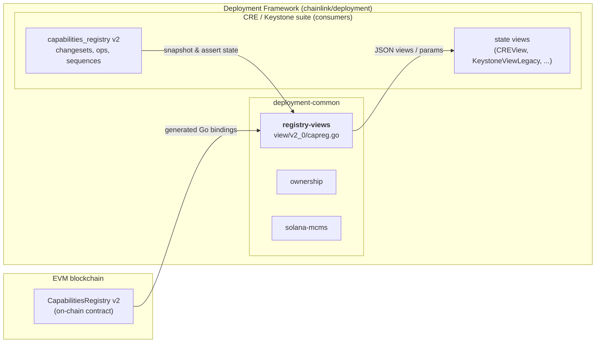
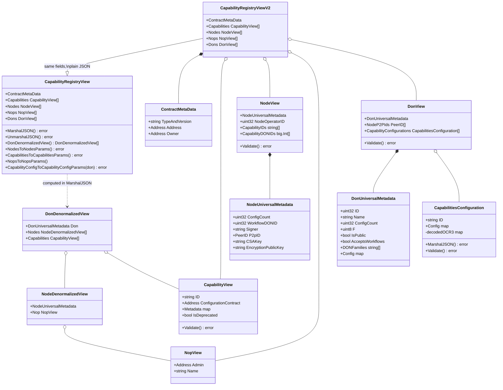
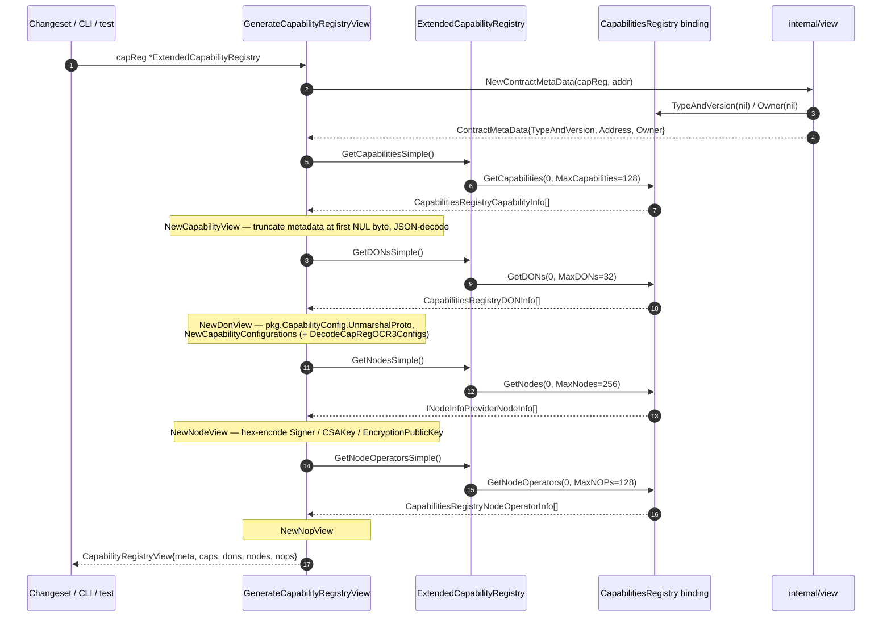
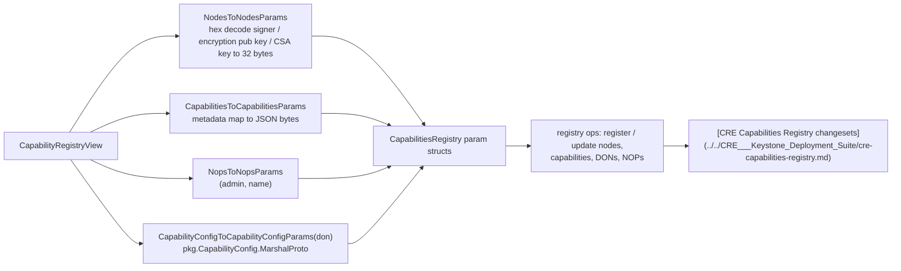
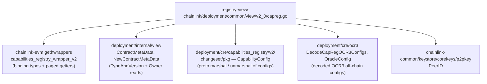

# Registry Views (`deployment/common/view/v2_0`)

> Source: `chainlink/deployment/common/view/v2_0/capreg.go`
> Core components: `CapabilityRegistryViewV2`, `unpagniatedCapabilityRegistry` (+ the supporting `CapabilityRegistryView`, `ExtendedCapabilityRegistry`, `GenerateCapabilityRegistryView` and the `*View` sub-structs defined in the same file)

## 1. Introduction

The **registry-views** module is the read-side ("view") counterpart of the deployment framework's write-side changesets and operations. It snapshots the on-chain state of the **Capabilities Registry v2** contract into plain, serialization-friendly Go structs that can be:

1. **Rendered as JSON** — stable, diffable, human- and CI-friendly output (including a denormalized per-DON summary).
2. **Validated** — structural invariants (hex-encoded 32-byte keys, proto-marshalable configs) are checked via `Validate()` methods.
3. **Round-tripped** — converted back into contract-call parameter structs so a captured state can be replayed through registry write operations.

Because views are plain data (no live contract pointers), they can travel across process boundaries, be persisted, embedded in changeset outputs, and asserted on in tests. The module intentionally contains no business logic of its own — all decision-making lives in the changesets and sequences of the consuming suites (see [CRE Capabilities Registry](../../CRE___Keystone_Deployment_Suite/cre-capabilities-registry.md)).

### Position in the system

The module is a child of [deployment-common](../deployment-common.md), the shared infrastructure package of the [Deployment Framework](../../Deployment_Framework_Core___Product_Deployments.md), alongside its siblings [ownership](deployment-common_ownership.md) (ownable-contract helpers) and [solana-mcms](deployment-common_solana-mcms.md) (Solana MCMS/timelock deployment).



## 2. Architecture and components

### 2.1 View struct hierarchy

The file defines one flat view variant and one "high-fidelity" variant, plus a family of sub-views:



| Type | Role |
|---|---|
| `CapabilityRegistryViewV2` | The plain, flat snapshot of the registry: contract metadata plus `Capabilities`, `Nodes`, `Nops`, `Dons` lists. Default JSON marshaling. |
| `CapabilityRegistryView` | The "high-fidelity" variant. Custom `MarshalJSON` adds a computed `don_capabilities_summary`; custom `UnmarshalJSON` reads the four collections and ignores the summary. Also hosts the denormalization and param-conversion helpers. |
| `ContractMetaData` (from `chainlink/deployment/internal/view`) | `TypeAndVersion`, `Address`, `Owner` — populated by `view.NewContractMetaData`, which calls `TypeAndVersion(nil)` and `Owner(nil)` on the contract binding. |
| `CapabilityView` | One registry capability: hex 32-byte `ID`, optional `ConfigurationContract`, JSON `Metadata` map, `IsDeprecated` flag. |
| `DonView` / `DonUniversalMetadata` | A DON: id, name, config count, fault tolerance `f`, visibility/workflow flags, DON families, decoded `Config` (proto), member `NodeP2PIds` and per-capability `CapabilityConfigurations`. |
| `CapabilitiesConfiguration` | Per-DON capability configuration: capability ID plus a proto-decoded config map, with an unexported `decodedOCR3` cache of decoded OCR3 off-chain configs. |
| `NodeView` / `NodeUniversalMetadata` | A registered node: hex-encoded 32-byte `Signer`, `CSAKey`, `EncryptionPublicKey`; `P2pID` (`p2pkey.PeerID`); owning `NodeOperatorID`; `CapabilityIDs`; DON memberships (`WorkflowDONID`, `CapabilityDONIDs`). |
| `NopView` | Node operator: admin address and name. |
| `DonDenormalizedView` / `NodeDenormalizedView` | Convenience joins: each DON with its nodes (each node joined with its NOP) and capabilities. |

### 2.2 Reading the registry: `unpagniatedCapabilityRegistry` and `ExtendedCapabilityRegistry`

The v2 registry binding exposes **paginated** getters. The module abstracts them behind the (typo included in the source) `unpagniatedCapabilityRegistry` interface — "unpaginated" — which four convenience getters implement by issuing single calls with fixed upper bounds:

| Constant | Value | Getter | Wrapped call |
|---|---|---|---|
| `MaxCapabilities` | 128 | `GetCapabilitiesSimple` | `GetCapabilities(opts, 0, 128)` |
| `MaxDONs` | 32 | `GetDONsSimple` | `GetDONs(opts, 0, 32)` |
| `MaxNodes` | 256 | `GetNodesSimple` | `GetNodes(opts, 0, 256)` |
| `MaxNOPs` | 128 | `GetNodeOperatorsSimple` | `GetNodeOperators(opts, 0, 128)` |

`ExtendedCapabilityRegistry` embeds `*capabilities_registry.CapabilitiesRegistry`, so it *is* the binding (usable wherever the binding is expected) while satisfying the interface — enforced at compile time by `var _ unpagniatedCapabilityRegistry = (*ExtendedCapabilityRegistry)(nil)`. Anything exceeding the bounds is not fetched by these convenience getters.

### 2.3 Factory: `GenerateCapabilityRegistryView`



## 3. Data flows

### 3.1 JSON serialization (read path output)

`CapabilityRegistryView.MarshalJSON` produces a **denormalized summary** in addition to the raw collections, which is what makes the JSON useful for eyeballing a deployment:

```mermaid
flowchart TD
    A["CapabilityRegistryView"] --> B["alias struct:<br/>ContractMetaData + capabilities + nodes + nops + dons"]
    A --> C["DonDenormalizedView()"]
    C --> C1["for each Don:<br/>match nodes via CapabilityDONIDs contains donID<br/>OR node.WorkflowDONID == don.ID"]
    C1 --> C2["join each node with its NOP<br/>(positional, 1-indexed NodeOperatorID)"]
    C --> C3["match capabilities via<br/>don.CapabilityConfigurations contains cap.ID"]
    B --> F["json.MarshalIndent"]
    C2 --> E['"don_capabilities_summary"']
    C3 --> E
    E --> F
```

Important semantics (documented in code):
- `DonDenormalizedView()` is **not definitive** — capabilities or nodes not associated with any DON only appear in the top-level lists. Use the full view as the source of truth.
- `UnmarshalJSON` deliberately does **not** restore `don_capabilities_summary`; it is derived data.

Per-capability-configuration rendering (`CapabilitiesConfiguration.MarshalJSON`):
1. Deep-copies the config map (never mutates the original).
2. Converts protojson base64 byte fields in each `config.ocr3Configs.<key>` entry (`signers`, `transmitters`, scalar `offchainConfig`) to `0x…` hex strings for readability.
3. If `decodedOCR3` was populated by `creocr3.DecodeCapRegOCR3Configs` at construction time, merges each `*OracleConfig` under `config.ocr3Configs.<key>.decodedOffchainConfig`.
4. Marshals only `{id, config}`.

Resulting JSON shape (illustrative):

```json
{
  "typeAndVersion": "CapabilitiesRegistry 2.0.0",
  "address": "0x…",
  "owner": "0x…",
  "capabilities": [{ "id": "0x…32-bytes…", "metadata": {…} }],
  "nodes": [{ "p2p_id": "…", "signer": "0x…", "node_operator_id": 1 }],
  "nops": [{ "admin": "0x…", "name": "nop-1" }],
  "dons": [{ "id": 1, "name": "workflow-don", "f": 1, "capability_configurations": [{ "id": "0x…", "config": { "ocr3Configs": { "core": { "signers": ["0x…"], "decodedOffchainConfig": { "deltaProgressMillis": 4000 } } } } }] }],
  "don_capabilities_summary": [{ "don": {…}, "nodes": [{…, "nop": {…}}], "capabilities": [{…}] }]
}
```

### 3.2 Round-trip to contract parameters (write path input)

The same view feeds registry **write** operations: view → params structs from the generated binding.



This is the mechanism that lets a changeset **clone or replay** registry state: snapshot a registry with `GenerateCapabilityRegistryView`, validate it, then convert the entities back to parameter structs for the corresponding operations.

## 4. Validation rules

Each sub-view exposes a `Validate()` method enforcing on-chain-compatible invariants:

| View | Rules |
|---|---|
| `CapabilityView` | `ID` must be hex and decode to exactly 32 bytes. |
| `DonView` | Every `CapabilityConfigurations[i]` must validate. |
| `CapabilitiesConfiguration` | `ID` must be hex, 32 bytes; `Config` must be proto-marshalable (`pkg.CapabilityConfig.MarshalProto` succeeds). |
| `NodeView` | `Signer` and `EncryptionPublicKey` must be hex, 32 bytes; every `CapabilityID` must be hex, 32 bytes. |

`NopView` and `DonUniversalMetadata` carry no separate validation.

## 5. Dependencies



| Dependency | Used for |
|---|---|
| `chainlink-evm/.../capabilities_registry_wrapper_v2` | Contract ABI bindings: `CapabilitiesRegistry`, `INodeInfoProviderNodeInfo`, `CapabilitiesRegistryCapabilityInfo`, `CapabilitiesRegistryDONInfo`, `CapabilitiesRegistryNodeOperatorInfo`, and the param structs for writes. |
| `chainlink/deployment/internal/view` | `ContractMetaData` (`TypeAndVersion`, `Address`, `Owner`) and its constructor `NewContractMetaData`, which performs two read calls on the binding. |
| `chainlink/deployment/cre/capabilities_registry/v2/changeset/pkg` | `CapabilityConfig` (a `map[string]any` wrapper) with `MarshalProto`/`UnmarshalProto` — the shared proto encoding for capability/DON configs. |
| `chainlink/deployment/cre/ocr3` | `DecodeCapRegOCR3Configs` unmarshals the raw `CapabilityConfig` proto, extracts `ocr3Configs`, and decodes each non-empty `OffchainConfig` into a `map[instanceName]*OracleConfig` (unique-reports flag, delta-timing, transmission schedule, phase durations, `maxFaultyOracles`, and the `ConsensusCap`/`ChainCap`/`Dontime` offchain config sub-structs). |
| `chainlink-common/keystore/corekeys/p2pkey` | `PeerID` type used for `DonView.NodeP2PIds` and `NodeUniversalMetadata.P2pID`. |

## 6. Edge cases and maintenance notes

- **Deprecated-capability metadata quirk**: some on-chain capabilities (e.g. `cap1` on Ethereum Sepolia) carry metadata consisting of NUL bytes. `NewCapabilityView` truncates the metadata at the first `\x00` before JSON-decoding; otherwise decoding would fail.
- **NOP↔node join is positional**: `nodeNop` matches `NodeOperatorID` against the 1-based index of the `Nops` slice because the registry provides no natural key. Reordering the slice silently changes node→NOP attribution; `nodeNop` returns an error when no NOP matches a node's operator ID.
- **Fixed read bounds**: the "simple" getters fetch at most `MaxNodes`/`MaxCapabilities`/`MaxDONs`/`MaxNOPs` entities per call; larger registries require direct use of the paginated binding getters.
- **Naming typo kept for compatibility**: the interface is spelled `unpagniatedCapabilityRegistry` (unpaginated). Renaming would be an API break for importers.
- **Debug print**: `CapabilitiesToCapabilitiesParams` currently contains a `fmt.Println("capInfo.Metadata:", …)` debug statement that pollutes CLI output; safe to remove.
- **Pointer-free JSON**: node keys are stored as hex strings and decoded back to `[32]byte` only when building write params, so views remain JSON-safe.

## 7. Versioning within `deployment/common/view`

- `view/v1_0` — legacy Capabilities Registry view and workflow-registry view (pre-v2 registry bindings).
- `view/v2_0` — **this module** (v2 registry bindings, OCR3-aware config decoding).
- `view/nops.go` — shared node-operator view helpers used by both versions.

When the registry contract evolves, add a new versioned package rather than mutating v2_0 in place, mirroring the v1_0 → v2_0 pattern.

## 8. Related documentation

- Parent package: [deployment-common](../deployment-common.md)
- Siblings: [ownership](deployment-common_ownership.md) · [solana-mcms](deployment-common_solana-mcms.md)
- Primary consumers: [CRE Capabilities Registry changesets and operations](../../CRE___Keystone_Deployment_Suite/cre-capabilities-registry.md), [CRE core state views](../../CRE___Keystone_Deployment_Suite/cre-core/cre-core_state-views.md), [Keystone state views](../../CRE___Keystone_Deployment_Suite/keystone/keystone_state_views.md)
- Suite overview: [Deployment Framework Core & Product Deployments](../../Deployment_Framework_Core___Product_Deployments.md)
