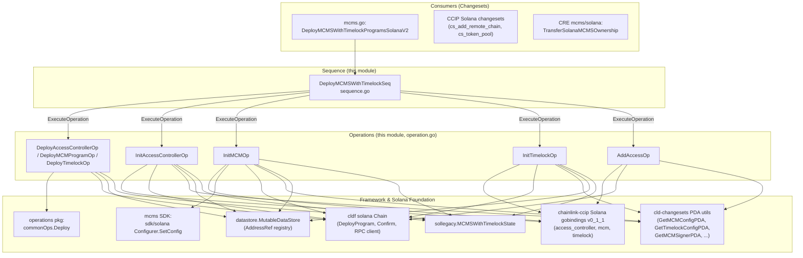
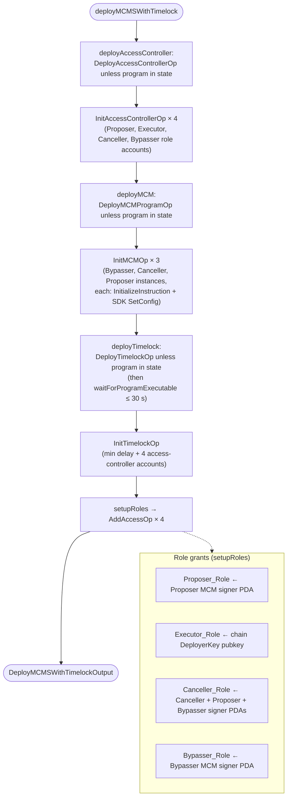
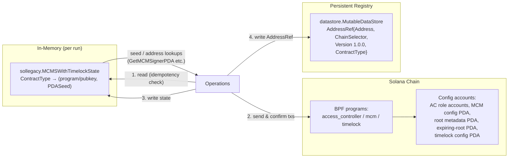
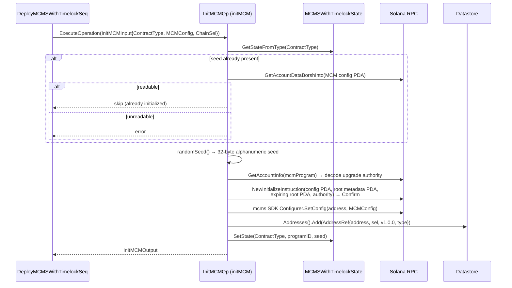
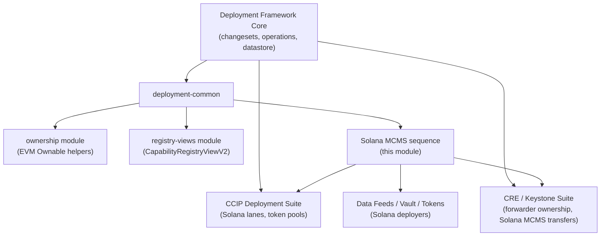

# deployment-common / Solana MCMS-with-Timelock Deployment Sequence

> **Source:** `chainlink/deployment/common/changeset/solana/mcms/sequence/` (`operation.go`, `sequence.go`)

## Overview

The `deployment-common_solana-mcms` module provides the **Operations-API ("V2") deployment sequence for the MCMS governance stack on Solana**. On Solana, governance contracts do not exist as EVM-style single-address contracts; instead, three BPF programs plus their derived accounts must be deployed and wired together:

1. **AccessController** program — with four separate *role accounts* (Proposer, Executor, Canceller, Bypasser).
2. **MCM (Many-Chain MultiSig)** program — instantiated **three times** (one instance per role: Proposer, Canceller, Bypasser), each identified by a unique Program-Derived-Address (PDA) seed.
3. **RBAC Timelock** program — initialized with a minimum delay and bound to the four access-controller role accounts.

The module packages this multi-step deployment as a single **`DeployMCMSWithTimelockSeq` sequence** built from idempotent, individually addressable **operations**. This mirrors the EVM `DeployMCMSWithTimelock` changesets but adapted to Solana's program/account model (BPF loader programs, PDA seeds, rent-exempt account creation, Borsh-deserialized config accounts).

It is the framework-level building block used by every product suite that needs Solana governance — most notably the [CCIP Deployment Suite](../../CCIP_Deployment_Suite/ccip-changesets.md) and the [CRE / Keystone Deployment Suite](../../CRE___Keystone_Deployment_Suite/cre-core.md).

---

## At a Glance

| Aspect | Detail |
|---|---|
| Package path | `chainlink/deployment/common/changeset/solana/mcms/sequence/` |
| Sequence | `DeployMCMSWithTimelockSeq` ("deploy-access-controller-seq", `Version1_0_0`) |
| Operations | `DeployAccessControllerOp`, `InitAccessControllerOp`, `DeployMCMProgramOp`, `InitMCMOp`, `DeployTimelockOp`, `InitTimelockOp`, `AddAccessOp` |
| Programs deployed | `access_controller`, `mcm`, `timelock` (names from `solutils.Directory`) |
| Entry point (caller) | `DeployMCMSWithTimelockProgramsSolanaV2` in `mcms/mcms.go` |
| State stores | `sollegacy.MCMSWithTimelockState` (in-memory) + `datastore.MutableDataStore` (`AddressRef`s) |
| Execution framework | `chainlink-deployments-framework/operations` (Bundle / Operation / Sequence) |
| Target runtime | Solana BPF programs via `gagliardetto/solana-go` RPC |

---

## Architecture and Component Relationships

The module follows the standard **Operations API layering**: a top-level *Sequence* orchestrates reusable *Operations*; operations delegate to low-level Solana bindings, PDA helpers, the MCMS SDK configurer, and the generic program-deploy operation.

### Dependency directions

- **Depends on (internal):** the generic Solana program-deploy operation (`deployment/common/changeset/solana/operations`) and program metadata (`deployment/utils/solutils`), plus contract-type constants from `deployment/common/types`.
- **Depends on (external):** `chainlink-deployments-framework` (operations bundle, datastore, Solana chain abstraction), `cld-changesets` (legacy Solana state + PDA derivation), `mcms` (multisig types and Solana SDK configurer), and `chainlink-ccip/chains/solana/gobindings` (Anchor-generated instruction bindings) — see [Dependencies](#dependencies).
- **Depended on by:** product deployment suites (CCIP, CRE/Keystone, Data Feeds) and the contract-ownership tooling that hands deployed programs over to the MCMS/Timelock.

---

## Core Components

### `sequence.go` — `DeployMCMSWithTimelockSeq`

| Component | Kind | Description |
|---|---|---|
| `DeployMCMSWithTimelockSeq` | `operations.NewSequence` | Orchestrates deploy → init → role setup for all three programs. |
| `DeployMCMSWithTimelockInput` | input type | `MCMConfig` (`cldfproposalutils.MCMSWithTimelockConfig`: Proposer/Canceller/Bypasser multisig configs) and `TimelockMinDelay` (`*big.Int`). |
| `DeployMCMSWithTimelockOutput` | output type | Currently empty; the sequence's results live in state/datastore. |
| `deployMCMSWithTimelock` | sequence body | Executes the eight operations in order (see [Deployment Process Flow](#deployment-process-flow)). |
| `deployAccessController` / `deployMCM` / `deployTimelock` | helpers | Skip-if-deployed wrappers around the `Deploy*Op`s; record the program ID in datastore and state. |
| `initAccessController` / `initMCM` / `initTimelock` | helpers | Fan-out helpers that run the corresponding `Init*Op` once per role/instance. |
| `setupRoles` | helper | Grants timelock roles via `AddAccessOp`. |
| `waitForProgramExecutable` | utility | Polls the RPC `GetAccountInfo` every 500 ms (30 s budget) until the program's `Executable` flag is set — handles validators still loading BPF. |

### `operation.go` — Operation catalog and low-level logic

| Operation | ID | Input → Output | Behavior |
|---|---|---|---|
| `DeployAccessControllerOp` / `DeployMCMProgramOp` / `DeployTimelockOp` | `deploy-access-controller` / `deploy-mcm-program` / `deploy-timelock-program` | `commonOps.DeployInput` → `DeployOutput{ProgramID}` | Thin parameterizations of the shared `commonOps.Deploy` function (over-allocated buffer sized via `solutils.GetProgramBufferBytes`). |
| `InitAccessControllerOp` | `init-access-controller` | `InitAccessControllerInput{ContractType, ChainSel}` → `InitAccessControllerOutput` | Creates a **fresh random keypair account**, funds it rent-exempt (`8 + 32 + 32 + (32×64) + 8` bytes: discriminator, owner, proposed owner, up-to-64-address access list), issues `CreateAccount` + `NewInitializeInstruction`, reads the account back via Borsh, and persists the address. |
| `InitMCMOp` | `init-mcm-program` | `InitMCMInput{ContractType, MCMConfig, ChainSel}` → `InitMCMOutput` | Generates a random 32-byte alphanumeric PDA **seed**, calls `NewInitializeInstruction` (config PDA, root-metadata PDA, expiring-root/op-count PDA, upgrade authority from program data), then invokes the **MCMS SDK `Configurer.SetConfig`** with the role's multisig config. |
| `InitTimelockOp` | `init-timelock-program` | `InitTimelockInput{ContractType, ChainSel, MinDelay}` → `InitTimelockOutput` | Generates a seed, calls `NewInitializeInstruction` with `minDelay` (defaults to `0` when nil) and the **four access-controller accounts** from state (Proposer/Executor/Canceller/Bypasser). |
| `AddAccessOp` | `add-access-op` | `AddAccessInput{Role, Accounts, ChainSel}` → `AddAccessOutput` | Builds a `BatchAddAccessInstruction` for the timelock config PDA, appending one account meta per address granted the role. |

Shared plumbing:

- **`Deps`** — `Env` (cldf environment), `State` (`*sollegacy.MCMSWithTimelockState`), `Datastore` (mutable address registry), `Chain` (cldf Solana chain with `DeployerKey`, RPC client, `Confirm`).
- **`randomSeed`** — produces a random `[32]byte` PDA seed from an alphanumeric alphabet; seeds are logged for recoverability.

---

## Deployment Process Flow

`deployMCMSWithTimelock` runs the full stack in a fixed order. Every step is **idempotent**: it first checks in-memory state (`State.GetStateFromType`) and, where applicable, reads the on-chain account data before acting.

**Role-grant semantics.** The deployer key holds the timelock *Executor* role directly (it can execute scheduled ops without an MCM quorum), while *Proposer*, *Canceller*, and *Bypasser* authority is routed through the signer PDAs of the corresponding MCM instances. Granting the Canceller role also includes the Proposer and Bypasser PDAs, so any of the three multisigs can cancel.

---

## State Management and Data Flow

The module maintains **dual bookkeeping** so that both the legacy address-book world and the newer datastore world see the same deployment facts:

Key behaviors:

- **Idempotency.** Each operation short-circuits when state or on-chain data already exists — e.g. `initMCM` returns early if the MCM config PDA is Borsh-readable, and the sequence's deploy helpers reuse an existing program ID instead of redeploying. A *deployed-but-unreadable* account is treated as an error rather than silently retried.
- **PDA addressing.** MCM and Timelock "instances" are addressed as `EncodeAddressWithSeed(programID, seed)`; all config/state accounts are canonical PDAs derived by the `cld-changesets` PDA helpers.
- **Versions.** Every `AddressRef` is recorded with `deployment.Version1_0_0`, matching the operation/sequence versions.
- **Recoverability.** Random PDA seeds are logged (`"generated MCM seed"`, `"generated Timelock seed"`), and the seeds are the only way to re-derive instance addresses, so logs serve as an audit trail.

### Walkthrough: `InitMCMOp` for one role

---

## Integration with the Deployment Framework

- **Operations API.** The module is built entirely on `chainlink-deployments-framework/operations`: `operations.NewOperation` / `operations.NewSequence` / `operations.ExecuteOperation` with an `operations.Bundle` carrying logger and context. This gives each operation metadata (ID, version, description) surfaced in execution reports.
- **Datastore-first.** The V2 path (`DeployMCMSWithTimelockProgramsSolanaV2` in `mcms/mcms.go`) loads existing state via `MaybeLoadMCMSWithTimelockChainStateV2` filtered by chain selector from the environment datastore, executes this sequence, and writes `AddressRef`s — replacing the older V1 function that used the address book directly.
- **Program inventory.** Program names, canonical IDs, and buffer sizes for `mcm`, `timelock`, and `access_controller` come from `deployment/utils/solutils` (`MCMSProgramNames`, `Directory`), so all suites deploy the same audited binaries.
- **Contract types.** All registry labels (`ManyChainMultiSigProgram`, `RBACTimelockProgram`, `AccessControllerProgram`, the four `*AccessControllerAccount` types, and the three per-role `*ManyChainMultiSig` types) are defined in `deployment/common/types/types.go` and are shared with the EVM-side ownership module ([deployment-common_ownership](deployment-common_ownership.md)).
- **Solana job validation / consumption.** Deployed MCMS/Timelock instances are subsequently consumed by Solana changesets — e.g. CCIP's `cs_add_remote_chain` and `cs_token_pool` (see [ccip-changesets_solana](../../CCIP_Deployment_Suite/ccip-changesets/ccip-changesets_solana.md)) — and by CRE's [contract-ownership tooling](../../CRE___Keystone_Deployment_Suite/cre-core/cre-core_contract-ownership.md), which proposes MCMS transfers of Solana program upgrade authority.

### Where this fits in the deployment framework

---

## Dependencies

Pinned in `chainlink/deployment/go.mod` (repo path shown below):

| Dependency | Purpose in this module |
|---|---|
| `github.com/smartcontractkit/chainlink-deployments-framework` (v0.123.3) | `operations` (Bundle/Operation/Sequence), `datastore` (AddressRef), `deployment` (Environment, ContractType, TypeAndVersion), `chain/solana` (Chain with `DeployProgram`, `Confirm`). |
| `github.com/smartcontractkit/cld-changesets` | `legacy/pkg/family/solana` (`MCMSWithTimelockState`, `PDASeed`, `EncodeAddressWithSeed`) and `pkg/family/solana` (PDA derivation helpers). |
| `github.com/smartcontractkit/mcms` (v0.55.2) | `types` (multisig `Config`, `ChainSelector`) and `sdk/solana` (`Configurer.SetConfig`). |
| `github.com/smartcontractkit/chainlink-ccip/chains/solana/gobindings` (v0.1.1) | Anchor bindings for `access_controller`, `mcm`, `timelock` (instruction builders, account structs, roles). |
| `github.com/gagliardetto/solana-go` / `binary` | RPC client, instruction building, system program `CreateAccount`, Borsh decoding. |
| `github.com/smartcontractkit/wsrpc` | Structured logging helpers (`logger.With`). |

---

## Operational Notes

- **Executor = deployer key.** `setupRoles` grants the deployer wallet the timelock *Executor* role outright. Deployer-key custody therefore equates to execution authority on that chain until roles are rotated.
- **Seeds are random per run.** MCM/Timelock instance addresses are only reproducible from the logged seeds or the stored state; never deploy through log-muting channels without datastore persistence enabled.
- **Program executability lag.** After deploying (especially when reusing an existing timelock program), the sequence polls for the `Executable` flag with a 30-second ceiling; validators that garbage-collect or lazily load BPF may require retries.
- **Buffer sizing.** All three programs deploy with `Overallocate: true` and the buffer sizes from the `solutils` directory (1 MiB each), which also makes the programs upgradable via buffer-account writes.
- **Timelock delay.** `TimelockMinDelay` is optional; `nil` initializes the timelock with delay `0` and can be changed later via the `UpdateTimelockDelaySolana` changeset in the parent `solana` changeset package.
- **Access-controller capacity.** Each access-controller account reserves space for up to **64** addresses; `AddAccessOp` grants beyond that would fail account reallocation.

---

## Related Documentation

- Parent module: [deployment-common](../deployment-common.md) — shared changeset utilities for all deployment suites.
- Sibling: [deployment-common_ownership](deployment-common_ownership.md) — EVM-side `Ownable` helpers for the same MCMS contract types.
- Sibling: [deployment-common_registry-views](deployment-common_registry-views.md) — `CapabilityRegistryViewV2` reporting.
- Consumers: [ccip-changesets](../../CCIP_Deployment_Suite/ccip-changesets.md) (incl. [Solana changesets](../../CCIP_Deployment_Suite/ccip-changesets/ccip-changesets_solana.md)), [cre-core contract-ownership](../../CRE___Keystone_Deployment_Suite/cre-core/cre-core_contract-ownership.md) (`TransferSolanaMCMSOwnership`), [data-feeds](../data-feeds.md) (Solana cache deployment).
- Framework overview: [Deployment_Framework_Core___Product_Deployments](../../Deployment_Framework_Core___Product_Deployments.md).
