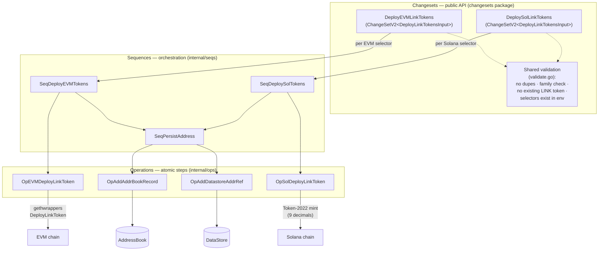
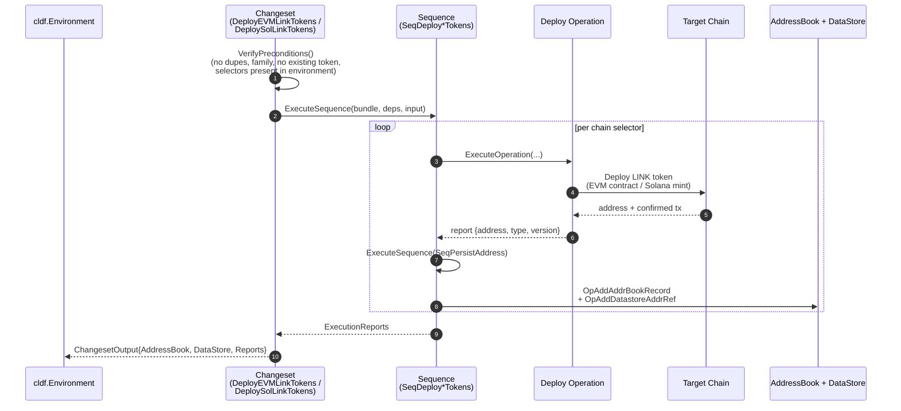
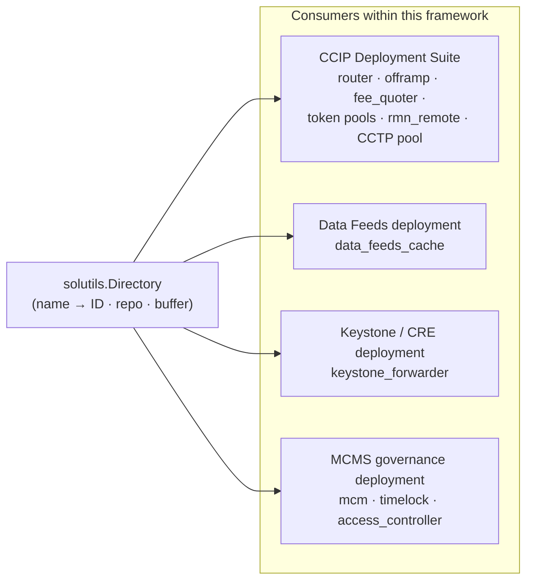

# Tokens — LINK Token Deployment Module

## 1. Overview

The `tokens` module (`chainlink/deployment/tokens`) is the product-deployment package responsible for deploying the **LINK token** — the canonical native asset of the Chainlink protocol — onto target blockchains. It currently supports two chain families:

| Family  | Token representation                                                                 | Deployment mechanism |
|---------|--------------------------------------------------------------------------------------|----------------------|
| EVM     | Burn/mint `LinkToken` contract, registered as `LinkToken` **v1.0.0** (`LinkTokenTypeAndVersion1`) | `link_token.DeployLinkToken` gethwrapper from `chainlink-evm/gethwrappers` |
| Solana  | SPL **Token-2022** mint with **9 decimals**, mint keypair generated locally and used as the token address | `tokens.CreateToken` helpers from `chainlink-ccip/chains/solana` |

The module is built on the [Chainlink Deployments Framework](https://github.com/smartcontractkit/chainlink-deployments-framework) (`chainlink-deployments-framework v0.123.3`, see `chainlink/deployment/go.mod`) and follows its **contract-first orchestration model**:

> **Changeset** (public entry point, guarded) → **Sequence** (multi-chain orchestration) → **Operation** (single atomic step).

Every successfully deployed token is registered in **both** the legacy `AddressBook` and the newer mutable `DataStore`, so downstream deployment suites can discover and reference the token address.

### Key characteristics

- **One canonical token type** — `LinkTokenTypeAndVersion1` (`Type="LinkToken"`, `Version=1.0.0`, defined in `internal/ops/ops_evm.go`) is the single `TypeAndVersion` identity shared by both chain families.
- **Idempotency guardrails** — changesets refuse to deploy if a LINK token already exists for a `(chain selector, qualifier)` pair in either the address book or the datastore, preventing accidental double deployments.
- **Runtime family validation** — each sequence re-validates that every chain selector belongs to the expected family (`EVM` / `Solana`) using `chain-selectors`, in addition to changeset-level preconditions.
- **Fully traced execution** — all operations run inside a `cldf operations.Bundle` and return execution reports that the changeset forwards to the caller in `ChangesetOutput.Reports`.

---

## 2. Architecture

### 2.1 Layered component model

The three layers are strict and one-directional: changesets never touch chain clients directly, and operations never orchestrate other operations across chains — that is the sequences' job.

### 2.2 Integration with the Deployments Framework

The module is a consumer of the framework primitives rather than an implementor of them (defined externally in `github.com/smartcontractkit/chainlink-deployments-framework`, pinned in `chainlink/deployment/go.mod`):

| Framework primitive | Role in this module |
|---------------------|---------------------|
| `cldf.Environment` | Injected into every changeset; provides `BlockChains` (EVM/Solana chain handles), `ExistingAddresses`, `DataStore` and the `OperationsBundle`. |
| `operations.NewOperation` / `NewSequence` | Versioned, named, report-producing execution units (`semver` identity per unit, all at `1.0.0` in this module). |
| `cldf.AddressBook` | Legacy registry of `chain → address → TypeAndVersion(+labels)`. |
| `datastore.MutableDataStore` | Newer registry of `AddressRef` records with selector, type, version, qualifier and label set. |
| `chain-selectors` | Source of truth for chain selector → family resolution. |

### 2.3 Deployment data flow

**Inputs and outputs:**

- **Input** (`DeployLinkTokensInput`, shared by both changesets): `ChainSelectors []uint64`, optional `Qualifier` (distinguishes multiple token instances on one chain) and `Labels` (tags applied in both registries).
- **Output** (`ChangesetOutput`): a memory `AddressBook` and `DataStore` containing the new records plus the sequence execution reports. Deployed addresses are also echoed in the sequence outputs (`SeqDeployEVMTokensOutput.Addresses` / `SeqDeploySolTokensOutput.Addresses`).

---

## 3. Sub-module documentation

The module is split into three sub-modules mirroring the framework's orchestration layers. Detailed documentation for each lives under `tokens/`:

| Sub-module | Scope | Documentation |
|------------|-------|---------------|
| **Changesets** | Public entry points `DeployEVMLinkTokens` and `DeploySolLinkTokens` (`ChangeSetV2[DeployLinkTokensInput]`), the shared `DeployLinkTokensInput`, and the precondition validators (`validateNoDupeSelectors`, `validateChainSelectorsFamily`, `validateNoExistingLinkToken`, `validateSelectorsInEnvironment`). | [tokens_changesets](tokens/tokens_changesets.md) |
| **Sequences** | Multi-chain orchestration: `SeqDeployEVMTokens` (`SeqDeployEVMTokensOutput`), `SeqDeploySolTokens` (`SeqDeploySolTokensOutput`) and the shared `SeqPersistAddress` bookkeeping sequence. | [tokens_sequences](tokens/tokens_sequences.md) |
| **Operations** | Atomic single-chain steps: `OpEVMDeployLinkToken`, `OpSolDeployLinkToken` (`OpSolDeployLinkTokenOutput`), `OpAddAddrBookRecord`, `OpAddDatastoreAddrRef`, and the `LinkTokenTypeAndVersion1` token identity. | [tokens_operations](tokens/tokens_operations.md) |

*Cross-references:* the changesets docs describe how the framework `Environment` is wired into sequence dependencies; the sequences docs show the deploy + persist composition per chain family; the operations docs document the chain-specific deployment details (EVM gethwrapper vs. Solana Token-2022) and the dual-registry persistence contracts. Each sub-module page links back to this overview.

---

## 4. Shared Solana utility — the program directory

`chainlink/deployment/utils/solutils/directory.go` (core component `programInfo`) is a **shared lookup registry** for Solana on-chain program artifacts. It is not token-specific, but it ships in the same `chainlink/deployment/utils` tree and is consumed by the sibling deployment suites of this framework.

**API:**

- `Directory` — a `map[string]programInfo` and the *source of truth* for program IDs and repositories.
- `GetProgramID(name string) string` — program ID by name (`""` if unknown).
- `GetProgramBufferBytes(name string) int` — upgrade buffer size in bytes (`0` if unknown or not upgradable).
- `programInfo` — `{ ID, Repo, ProgramBufferBytes }`, where `Repo` points at the artifact repository (`chainlink-ccip` or `chainlink-solana`) and the buffer size documents the space reservation needed for program upgrades.

**Program groups exposed:**

| Group | Programs | Primary consumers |
|-------|----------|-------------------|
| CCIP | `ccip_router`, `test_token_pool`, `burnmint_token_pool`, `lockrelease_token_pool`, `fee_quoter`, `test_ccip_receiver`, `ccip_offramp`, `external_program_cpi_stub`, `rmn_remote`, `cctp_token_pool` | [CCIP Cross-Chain Protocol](../CCIP_Cross-Chain_Protocol/ccip.md) |
| Data Feeds | `data_feeds_cache` | [Data Feeds deployment](data-feeds.md) (`data-feeds_solana-cache`) |
| Keystone | `keystone_forwarder` | [CRE/Keystone Deployment Suite — forwarder](../CRE___Keystone_Deployment_Suite/cre-forwarder.md) |
| MCMS | `mcm`, `timelock`, `access_controller` (+ base signer registry) | [Deployment common — Solana MCMS](deployment-common.md) |

> **Note:** the LINK token is deliberately **not** in this directory. On Solana the token is an SPL Token-2022 *mint account* created via the standard token program (`OpSolDeployLinkToken`), not a deployable BPF program, so it has no entry in `Directory`.

For related Solana funding/upgrade helpers in the same package (`fund.go`, `upgrade.go`, `artifacts.go`), see the [Dev, Test & Simulation Environments](../Dev,_Test___Simulation_Environments/devenv.md) documentation where local Solana environments are covered.

---

## 5. Domain concepts & invariants

| Concept | Meaning in this module |
|---------|------------------------|
| **ChainSelector** | `uint64` globally unique chain identifier from `chain-selectors`; validated to be in the right family at *both* changeset and sequence level. |
| **Qualifier** | String discriminator allowing multiple LINK tokens per chain in the DataStore (default `""`). |
| **Labels** | Free-form tags attached to address-book records and DataStore address refs. |
| **TypeAndVersion** | `LinkToken@1.0.0` identity emitted by every deploy operation and asserted by validation. |
| **AddressBook vs DataStore** | Dual persistence: legacy address book for backward compatibility, DataStore as the modern record system. `SeqPersistAddress` writes both atomically within the sequence. |

**Module invariants:**

1. A changeset never deploys before all four precondition checks pass (no duplicate selectors, family match, no existing LINK token for the qualifier, selectors present in the environment).
2. A sequence never deploys to a chain whose selector family doesn't match, even if reached through a different path.
3. A deploy operation always confirms the on-chain transaction before returning a report — EVM via `chain.Confirm(tx)`, Solana via `chain.Confirm(instructions, common.AddSigners(mint))` (the mint key must sign because it is created locally).
4. Persisted state (address book + datastore) is only written *after* a successful deployment confirmation.

---

## 6. Related documentation

- **Parent module:** [Deployment Framework Core & Product Deployments](../Deployment_Framework_Core___Product_Deployments.md)
- **Sibling product deployments:** [deployment-common](deployment-common.md) · [data-feeds](data-feeds.md) · [vault](vault.md)
- **Framework primitives** (operations, sequences, datastore): see [CCIP Deployment Suite](../CCIP_Cross-Chain_Protocol/ccip.md) and [CRE & Keystone Deployment Suite](../CRE___Keystone_Deployment_Suite/cre-core.md) for large-scale consumers of the same changeset/sequence/operation model.

## 7. Source references

| Code | Role |
|------|------|
| `chainlink/deployment/tokens/changesets/` | Public changesets (`deploy_evm_link_tokens.go`, `deploy_sol_link_tokens.go`) and validation (`validate.go`) |
| `chainlink/deployment/tokens/internal/seqs/` | Deployment sequences + `seq_persist_address.go` |
| `chainlink/deployment/tokens/internal/ops/` | EVM/Solana deploy operations + storage operations (`ops_storage.go`) |
| `chainlink/deployment/utils/solutils/directory.go` | Shared Solana program directory |
| `chainlink/deployment/go.mod` | Module manifest — pins `chainlink-deployments-framework v0.123.3`, `chain-selectors v1.0.112`, `chainlink-evm/gethwrappers`, `chainlink-ccip/chains/solana`, `gagliardetto/solana-go` |
