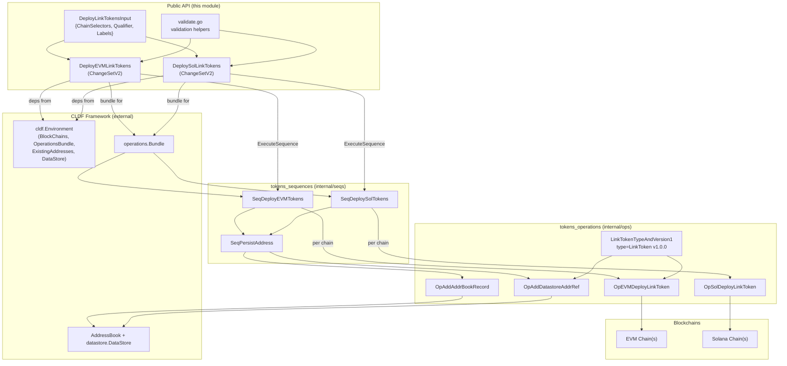
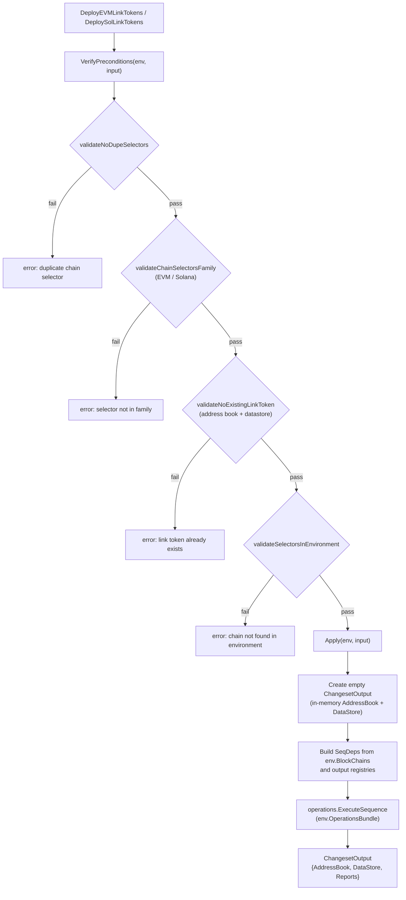
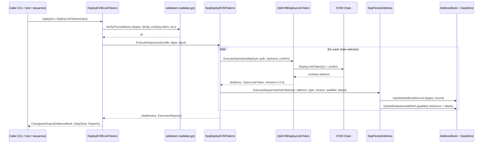

# Tokens Changesets (LINK Token Deployment)

> **Module path:** `chainlink/deployment/tokens/changesets` · **Go module:** `github.com/smartcontractkit/chainlink/deployment` (see [chainlink/deployment/go.mod](https://github.com/smartcontractkit/chainlink/blob/main/chainlink/deployment/go.mod))

## Introduction

The `tokens_changesets` module is the **public API surface** of the tokens deployment product ([Deployment Framework Core — Product Deployments](../../Deployment_Framework_Core___Product_Deployments.md)). It exposes declarative, reusable [changesets](tokens_operations.md) that deploy the canonical **burn/mint LINK token** contract to new blockchains and register the resulting contract addresses in the deployment framework's artifact registries (address book + datastore).

The module implements the Chainlink Deployment Framework (CLDF) `ChangeSetV2` contract: each changeset is a self-contained unit with a **precondition verification phase** and an **apply phase**, producing an auditable output that downstream tooling (MCMS proposals, state views, etc.) can consume. Internally it delegates all chain interaction to the sibling [tokens_sequences](tokens_sequences.md) and [tokens_operations](tokens_operations.md) modules, keeping this package thin, framework-facing, and safe for external consumers to import.

Sibling modules in the `tokens` product (documented separately, do not duplicate here):

- [tokens](../tokens.md) — product overview
- [tokens_operations](tokens_operations.md) — atomic deployment and storage operations (`OpEVMDeployLinkToken`, `OpSolDeployLinkToken`, `OpAddAddrBookRecord`, `OpAddDatastoreAddrRef`)
- [tokens_sequences](tokens_sequences.md) — multi-chain orchestration sequences (`SeqDeployEVMTokens`, `SeqDeploySolTokens`, `SeqPersistAddress`)

---

## Component Inventory

| Component | File | Kind | Purpose |
|---|---|---|---|
| `DeployLinkTokensInput` | `deploy_evm_link_tokens.go` | Input type | Shared input for all LINK deployment changesets: `ChainSelectors`, `Qualifier`, `Labels` |
| `DeployEVMLinkTokens` | `deploy_evm_link_tokens.go` | `cldf.ChangeSetV2[DeployLinkTokensInput]` | Deploys burn/mint LINK token to EVM chains; the recommended changeset for all new EVM deployments |
| `DeploySolLinkTokens` | `deploy_sol_link_tokens.go` | `cldf.ChangeSetV2[DeployLinkTokensInput]` | Deploys LINK token to Solana chains |
| `validateNoDupeSelectors` | `validate.go` | Validation helper | Rejects duplicate chain selectors in the input slice |
| `validateNoExistingLinkToken` | `validate.go` | Validation helper | Rejects deployment if a `LinkToken` contract already exists in the address book or datastore for a target chain/qualifier |
| `validateChainSelectorsFamily` | `validate.go` | Validation helper | Ensures every selector resolves (via `chain-selectors`) to the expected chain family (`EVM` or `Solana`) |
| `validateSelectorsInEnvironment` | `validate.go` | Validation helper | Ensures every selector is configured in the environment's `BlockChains` |

Supporting tests: `validate_test.go`, `deploy_evm_link_tokens_test.go`, `deploy_sol_link_tokens_test.go` cover the validation logic and both changesets end-to-end against simulated chains.

---

## Architecture

The changesets sit at the top of a three-layer execution pyramid mandated by CLDF: **changeset → sequence → operation**. This module only *composes and validates*; it performs no chain calls or persistence of its own.



### Layer responsibilities

1. **Changesets (this module)** — Validate the environment and input, then translate the declarative input into a single sequence execution. Each changeset owns a *fresh, empty* in-memory `AddressBook` and `DataStore` inside its `ChangesetOutput`, so all writes performed by nested operations are captured in the changeset's report rather than mutating the environment directly.
2. **Sequences ([tokens_sequences](tokens_sequences.md))** — Iterate over the requested chain selectors, re-check the chain family per selector, and coordinate "deploy → persist" per chain.
3. **Operations ([tokens_operations](tokens_operations.md))** — The only layer that talks to chains (deploy + confirm the token contract) or to the registries (`AddrBook.Save`, `Datastore.Addresses().Add`).

---

## Changeset Lifecycle

Both changesets implement the CLDF `ChangeSetV2[T]` interface with two entry points:



Key behavioral details:

- **Idempotency guard:** `validateNoExistingLinkToken` treats a missing address-book entry for a chain selector as *not an error* (the chain has no records yet) and proceeds; a matching `LinkToken` `TypeAndVersion` in either the address book or the datastore aborts the changeset with a descriptive error. This makes deployments safe to re-run for *new* chains while preventing accidental duplicate tokens.
- **Fresh-artifact output:** `Apply` never mutates `e.ExistingAddresses` or `e.DataStore` directly. New records are written into the changeset's own output registries, and the sequence's `ExecutionReports` are copied into `ChangesetOutput.Reports` for auditability/preview tooling.
- **Family enforcement is double-checked:** family validation happens once in the changeset (fail fast) and again inside each sequence per selector (defense in depth).

---

## Data Flow: A Typical EVM Deployment



The Solana flow is identical except that `OpSolDeployLinkToken` uses the chain's Solana client and returns a `MintPublicKey` (the Solana token mint address) rather than an EVM contract address — see [tokens_operations](tokens_operations.md) for the operation-level differences.

---

## Input Reference: `DeployLinkTokensInput`

| Field | Required | Default | Description |
|---|---|---|---|
| `ChainSelectors` | Yes | — | Chain selectors of the target chains. All must belong to a single family (EVM for `DeployEVMLinkTokens`, Solana for `DeploySolLinkTokens`) and be configured in the environment. Duplicates are rejected. |
| `Qualifier` | No | `""` | Tag stored with the deployed contract in the datastore, allowing multiple distinct LinkToken instances per chain. |
| `Labels` | No | `[]` | Labels attached to both the address-book record and the datastore reference. |

### Usage example

```go
out, err := operations.ExecuteChangeset(env, changesets.DeployEVMLinkTokens, changesets.DeployLinkTokensInput{
    ChainSelectors: []uint64{chainSelEthereumMainnet, chainSelArbitrumMainnet},
    Qualifier:      "2025-01-standard",
    Labels:         []string{"prod"},
})
// out.AddressBook / out.DataStore contain the new LINK token records;
// out.Reports contains per-operation execution reports.
```

---

## Output Reference: `cldf.ChangesetOutput`

| Field | Contents |
|---|---|
| `AddressBook` | In-memory address book holding one `LinkToken` record (type `LinkToken`, version `1.0.0`) per deployed chain, with the supplied labels. |
| `DataStore` | In-memory datastore holding one qualified `AddressRef` per deployed chain (selector, address, type/version, qualifier, labels). |
| `Reports` | CLDF execution reports from the underlying sequence, capturing every deploy/persist operation for audit trails and preview tooling. |

The deployed contract type/version is pinned by `ops.LinkTokenTypeAndVersion1` (`LinkToken @ 1.0.0`) defined in [tokens_operations](tokens_operations.md); this module and the datastore both key off that constant, which is why `validateNoExistingLinkToken` can detect prior deployments reliably.

---

## Integration with the Broader System

- **Framework contract:** The module consumes `cldf.Environment`, `ChangeSetV2`, `operations.Bundle`, `AddressBook`, and `datastore.DataStore` from the external `chainlink-deployments-framework` library, and `chain-selectors` for selector→family resolution. These dependencies are declared in [chainlink/deployment/go.mod](https://github.com/smartcontractkit/chainlink/blob/main/chainlink/deployment/go.mod).
- **Ownership/MCMS:** Deployed LINK tokens are simple contracts with no upgrade path; governance-sensitive deployments in this product family (e.g., MCMS-protected contracts) follow the shared patterns documented in [deployment-common](../deployment-common.md).
- **Environments:** The changesets run against any CLDF environment — simulated chains in tests (see the module's `*_test.go` files) or real chains assembled by the deployment environment tooling described in [deployment-environment](../../Dev,_Test___Simulation_Environments/deployment-environment.md).
- **Product consumers:** Token deployment is a prerequisite step for products that require LINK (e.g., paying for CCIP or VRF). The same address-book/datastore records produced here are the canonical source of truth consumed by other [Product Deployments](../../Deployment_Framework_Core___Product_Deployments.md) modules when wiring token addresses.

## Extending the Module

To support a new chain family (e.g., Aptos, Tron):

1. Add a new deploy operation in `internal/ops` (see [tokens_operations](tokens_operations.md)).
2. Add a new `SeqDeploy…Tokens` sequence in `internal/seqs` (see [tokens_sequences](tokens_sequences.md)).
3. Add a new `Deploy…LinkTokens` changeset here, reusing the shared `DeployLinkTokensInput` and the validation helpers in `validate.go` — passing the appropriate `chain_selectors.Family*` constant to `validateChainSelectorsFamily`. No changes to the validation layer should be needed unless a new invariant is introduced.
