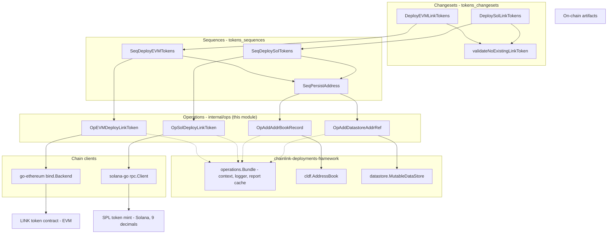
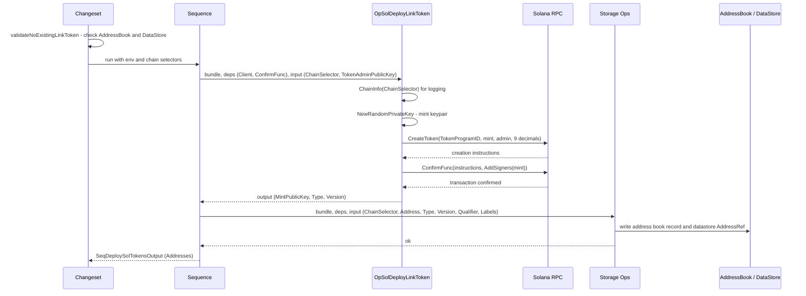

# Tokens Operations

The **tokens_operations** module is the atomic execution layer of the [tokens](../tokens.md) product deployment package (`chainlink/deployment/tokens`). It implements fine-grained, single-responsibility [deployment-framework operations](../../Deployment_Framework_Core___Product_Deployments.md) that (1) deploy LINK token contracts on EVM and Solana chains and (2) record the resulting on-chain addresses in the framework's two persistent registries — the environment **AddressBook** and the mutable **DataStore**.

Operations are deliberately kept minimal and composable: they are not meant to be invoked by end users directly. Instead, they are orchestrated by the sequences in [tokens_sequences](tokens_sequences.md), which are in turn driven by the changesets in [tokens_changesets](tokens_changesets.md).

- **Go package:** `github.com/smartcontractkit/chainlink/deployment/tokens/internal/ops` (an `internal/` package — importable only from within the `chainlink/deployment` module tree)
- **Source files:**
  - `chainlink/deployment/tokens/internal/ops/ops_evm.go`
  - `chainlink/deployment/tokens/internal/ops/ops_sol.go`
  - `chainlink/deployment/tokens/internal/ops/ops_storage.go`

## Component Inventory

| Component | File | Kind | Purpose |
|---|---|---|---|
| `OpEVMDeployLinkToken` | `ops_evm.go` | Deploy operation | Deploys the LINK token contract to an EVM chain via a go-ethereum contract backend. |
| `OpSolDeployLinkToken` | `ops_sol.go` | Deploy operation | Deploys the LINK token as an SPL token mint (Token Program, 9 decimals) on Solana. |
| `OpAddAddrBookRecord` | `ops_storage.go` | Bookkeeping operation | Persists a deployed contract's address/type/version/labels into the framework `cldf.AddressBook`. |
| `OpAddDatastoreAddrRef` | `ops_storage.go` | Bookkeeping operation | Persists an `AddressRef` (chain selector, type, version, qualifier) into the framework `datastore.MutableDataStore`. |
| `LinkTokenTypeAndVersion1` | shared package constant | Identity | Canonical `TypeAndVersion` identity for the v1 LINK token; shared by deploy ops, storage ops, sequences, and changeset validation. |

## Architecture

The module sits at the bottom of the tokens deployment stack. Changesets validate preconditions and orchestrate; sequences batch operations per chain; operations perform exactly one on-chain action (or one registry write) and report a typed result. The operations framework (`chainlink-deployments-framework`) supplies the execution `Bundle` (context, logger, report caching) and the two persistence backends.

### Operation Contract Pattern

Every operation in this module follows the framework's `operations.NewOperation(id, semver, description, fn)` contract. The framework assigns each operation a stable **ID**, a semantic **version**, and a human-readable **description**, which together key the operation report cache (per `ChainSelector` supplied in the input). The function receives a `Bundle` (providing `GetContext()` and `Logger`), typed `Deps` (injected chain access), and typed `Input`, and returns a typed `Output`.

```mermaid
classDiagram
    class operations_Bundle {
        +GetContext() context.Context
        +Logger
    }
    class OpEVMDeployLinkTokenDeps {
        +Auth *bind.TransactOpts
        +Backend bind.ContractBackend
        +ConfirmFunc func(tx *types.Transaction) (uint64, error)
    }
    class OpEVMDeployLinkTokenInput {
        +ChainSelector uint64
    }
    class OpSolDeployLinkTokenDeps {
        +Client *rpc.Client
        +ConfirmFunc func(instructions []solana.Instruction, opts ...common.TxModifier) error
    }
    class OpSolDeployLinkTokenInput {
        +ChainSelector uint64
        +TokenAdminPublicKey solana.PublicKey
    }
    class OpSolDeployLinkTokenOutput {
        +MintPublicKey solana.PublicKey
        +Type string
        +Version string
    }
    class OpAddAddrBookRecordDeps {
        +AddrBook cldf.AddressBook
    }
    class OpAddAddrBookRecordInput {
        +ChainSelector uint64
        +Address string
        +Type string
        +Version string
        +Labels []string
    }
    class OpAddDatastoreAddrRefDeps {
        +Datastore datastore.MutableDataStore
    }
    class OpAddDatastoreAddrRefInput {
        +ChainSelector uint64
        +Address string
        +Qualifier string
        +Type string
        +Version string
        +Labels []string
    }
```

## Component Reference

### `OpSolDeployLinkToken` — Solana LINK token deployment

Defined in `chainlink/deployment/tokens/internal/ops/ops_sol.go`. Registered as operation `sol-deploy-link-token`, version `1.0.0`, description *"Deploy Solana LINK Token Contract"*.

| Aspect | Detail |
|---|---|
| **Deps** | `Client *rpc.Client` — Solana JSON-RPC client; `ConfirmFunc func([]solana.Instruction, ...common.TxModifier) error` — caller-supplied transaction submission/confirmation policy. |
| **Input** | `ChainSelector uint64` — unique chain identifier, used only for the report cache key and logging; `TokenAdminPublicKey solana.PublicKey` — admin account for the token. |
| **Output** | `MintPublicKey solana.PublicKey` — the token's on-chain address; `Type`, `Version` — strings taken from the shared `LinkTokenTypeAndVersion1` identity. |
| **Token parameters** | Uses the standard `solana.TokenProgramID`; fixed `linkTokenDecimalsSolana = 9` decimals; default Solana commitment (`cldf_solana.SolDefaultCommitment`). |

Execution flow (as implemented in `ops_sol.go`):

1. Resolve human-readable chain metadata via `cldf_chain_utils.ChainInfo(in.ChainSelector)` for structured error logging; abort on unknown chain selector.
2. Generate a fresh mint keypair with `solana.NewRandomPrivateKey()` — the mint's public key becomes the token address.
3. Build token-creation instructions with `tokens.CreateToken(ctx, solana.TokenProgramID, mintPublicKey, TokenAdminPublicKey, 9, deps.Client, SolDefaultCommitment)` (helpers from `chainlink-ccip/chains/solana/utils/tokens`).
4. Submit and wait via `deps.ConfirmFunc(instructions, common.AddSigners(mint))` — the fresh mint key itself signs the creation transaction.
5. Return the mint public key plus the `LinkTokenTypeAndVersion1` type/version strings.

> **Note:** a new random mint keypair is generated on every execution, so this operation is intentionally **not idempotent** by itself; duplicate-deployment protection is enforced upstream by the changeset guard (see [Interaction with sibling modules](#interaction-with-sibling-modules)).

### `OpEVMDeployLinkToken` — EVM LINK token deployment

Defined in `chainlink/deployment/tokens/internal/ops/ops_evm.go`.

| Aspect | Detail |
|---|---|
| **Deps** | `Auth *bind.TransactOpts` — EVM signer/transact options; `Backend bind.ContractBackend` — go-ethereum contract backend; `ConfirmFunc func(*types.Transaction) (uint64, error)` — submits the deployment transaction and returns confirmation metadata. |
| **Input** | `ChainSelector uint64` — chain identifier for the report cache key and logging only (not used in op logic). |
| **Output** | The deployed LINK token contract address together with the shared type/version identity; sequences aggregate these into `SeqDeployEVMTokensOutput.Addresses []string`. |

This operation isolates all EVM specifics (signer, backend, transaction confirmation) behind injected dependencies, keeping the op logic itself chain-agnostic within the EVM family and easy to test with simulated backends.

### `OpAddAddrBookRecord` — AddressBook bookkeeping

Defined in `chainlink/deployment/tokens/internal/ops/ops_storage.go`.

| Aspect | Detail |
|---|---|
| **Deps** | `AddrBook cldf.AddressBook` — the deployment environment's address book. |
| **Input** | `ChainSelector`, `Address`, `Type`, `Version`, `Labels []string`. |
| **Effect** | Writes the contract record for the given chain selector into the address book. Downstream readers (e.g., changeset validation via `AddressesForChain`) match records by comparing `TypeAndVersion` against `LinkTokenTypeAndVersion1`. |

### `OpAddDatastoreAddrRef` — DataStore bookkeeping

Defined in `chainlink/deployment/tokens/internal/ops/ops_storage.go`.

| Aspect | Detail |
|---|---|
| **Deps** | `Datastore datastore.MutableDataStore` — the framework's mutable key-value datastore. |
| **Input** | `ChainSelector`, `Address`, `Qualifier`, `Type`, `Version`, `Labels []string`. |
| **Effect** | Persists an `AddressRef` keyed by the tuple (chain selector, contract type, version, qualifier). The changeset guard probes the same key shape via `datastore.NewAddressRefKey(...)`, so reads and writes stay symmetric. |

The `Qualifier` field exists only in the datastore record, allowing multiple same-typed contracts per chain to be disambiguated; the address book record carries only labels.

## Data Flow

The canonical end-to-end flow — Solana shown; the EVM path is structurally identical with `OpEVMDeployLinkToken` in place of `OpSolDeployLinkToken`:

Key data-flow properties:

- **Single source of identity.** The `Type`/`Version` strings returned by the deploy ops come from the package-level `LinkTokenTypeAndVersion1` constant, and the same constant is used by storage ops (writes) and changeset validation (reads). Adding a new token version means introducing a new identity constant and new ops, not mutating existing records.
- **Dual-write persistence.** Every deployed address is persisted twice — once to the `AddressBook` (legacy/common view) and once to the `DataStore` (keyed, qualifier-aware) — composed by `SeqPersistAddress` in [tokens_sequences](tokens_sequences.md).
- **Report caching.** `ChainSelector` participates in the operation report cache key, so parallel deployments across chains produce distinct, attributable reports even though the op logic itself never branches on it.

## Interaction with Sibling Modules

- **[tokens_changesets](tokens_changesets.md)** own preconditions. `validateNoExistingLinkToken` guards both persistence layers *before* any deployment: it scans the `AddressBook` per chain selector for any `TypeAndVersion` equal to `LinkTokenTypeAndVersion1`, then probes the `DataStore` with `datastore.NewAddressRefKey` for the same identity. This is the module's idempotency boundary.
- **[tokens_sequences](tokens_sequences.md)** own composition and fan-out. `SeqDeployEVMTokens` / `SeqDeploySolTokens` run the respective deploy op per chain and aggregate `Addresses []string`; `SeqPersistAddress` wraps both storage ops with combined `AddrBook` + `Datastore` deps and a single input struct (including `Qualifier`).
- **[tokens](../tokens.md)** is the parent module page describing the overall package layout.

## External Dependencies

Dependency versions are pinned in `chainlink/deployment/go.mod` (module `github.com/smartcontractkit/chainlink/deployment`):

| Dependency | Version (go.mod) | Used for |
|---|---|---|
| `smartcontractkit/chainlink-deployments-framework` | v0.123.3 | `operations.NewOperation` / `Bundle`, `cldf.AddressBook`, `datastore.MutableDataStore`, `cldf_solana` chain helpers |
| `smartcontractkit/chainlink-ccip/chains/solana` | v0.0.0-20260916… | `utils/tokens.CreateToken`, `utils/common` (`TxModifier`, `AddSigners`) |
| `gagliardetto/solana-go` | v1.23.0 | Solana keys (`NewRandomPrivateKey`, `PublicKey`), `rpc.Client`, instructions, `TokenProgramID` |
| `ethereum/go-ethereum` | v1.17.4 | `bind.TransactOpts`, `bind.ContractBackend`, `types.Transaction` |
| `Masterminds/semver/v3` | v3.5.0 | Operation semantic versioning (`semver.MustParse("1.0.0")`) |
| `smartcontractkit/chain-selectors` | v1.0.112 | Chain selector resolution backing `cldf_chain_utils.ChainInfo` |

## Design Notes and Invariants

1. **One operation, one effect.** Deploy ops touch the chain; storage ops touch a registry. No operation mixes the two, which keeps retries and reports precise.
2. **Dependency injection over globals.** All chain access (RPC clients, signers, confirmation policies) is injected via `Deps`, enabling hermetic testing and reuse across real, simulated, and test environments (see [Dev, Test & Simulation Environments](../../Dev,_Test___Simulation_Environments.md)).
3. **Non-idempotent deploys, idempotent guards.** Deploy ops always create fresh on-chain artifacts; safety is enforced by the changeset-level validation against both registries.
4. **Encapsulation.** The `internal/ops` package is invisible outside the `chainlink/deployment` module; the public surface of the tokens product is the changesets/sequences layer.
5. **Typed outputs, JSON-tagged inputs.** Inputs and outputs carry JSON tags, making operation reports serializable and diffable in deployment reports.

## See Also

- [tokens](../tokens.md) — parent module: package overview and shared token identity
- [tokens_changesets](tokens_changesets.md) — entry points, preconditions, and validation
- [tokens_sequences](tokens_sequences.md) — per-chain orchestration and address persistence
- [Deployment Framework Core & Product Deployments](../../Deployment_Framework_Core___Product_Deployments.md) — framework concepts (changesets → sequences → operations, AddressBook/DataStore)
- [vault](../vault.md) and [data-feeds](../data-feeds.md) — sibling product deployments built on the same framework patterns
