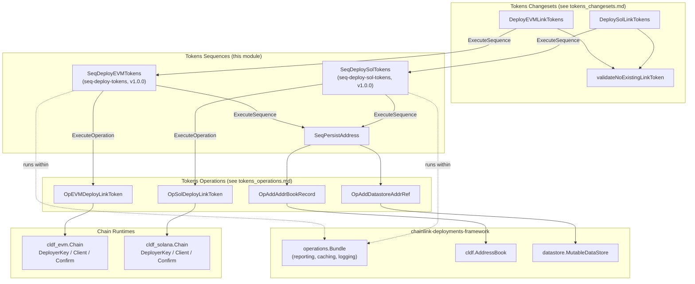
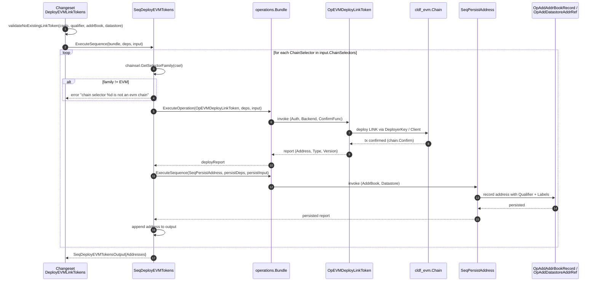
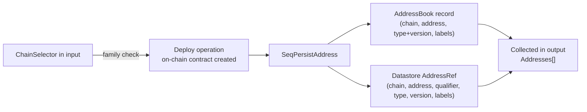

# Tokens Sequences (`chainlink/deployment/tokens/internal/seqs`)

## Introduction

The **tokens_sequences** module implements the *sequence layer* of the LINK token deployment toolkit. In the [chainlink-deployments-framework](https://github.com/smartcontractkit/chainlink-deployments-framework) operations model, a **sequence** is a versioned, composable unit of deployment work that orchestrates one or more **operations** and/or nested **sequences** against a `operations.Bundle` execution context. Sequences are the highest-granularity building blocks that [tokens changesets](tokens_changesets.md) invoke, and they in turn delegate all on-chain and storage side effects to [tokens operations](tokens_operations.md).

This module provides three sequences:

| Sequence | File | Purpose |
|---|---|---|
| `SeqDeployEVMTokens` | `chainlink/deployment/tokens/internal/seqs/seq_deploy_evm_tokens.go` | Deploy LINK token contracts across **multiple EVM chains** in a single call. |
| `SeqDeploySolTokens` | `chainlink/deployment/tokens/internal/seqs/seq_deploy_solana_tokens.go` | Deploy LINK token mints across **multiple Solana chains** in a single call. |
| `SeqPersistAddress` | `chainlink/deployment/tokens/internal/seqs/seq_persist_address.go` | Record a single deployed contract address in the **AddressBook** and **Datastore**. |

All sequences target the **LINK token** specifically. They are consumed by the product-level changesets `DeployEVMLinkTokens` and `DeploySolLinkTokens`, which are documented in [tokens changesets](tokens_changesets.md). The underlying deploy and persistence primitives live in [tokens operations](tokens_operations.md).

---

## Architecture Overview

The module sits in the middle tier of the deployment framework's three-tier model:

1. **Changesets** (public API, validation, environment wiring) — see [tokens changesets](tokens_changesets.md)
2. **Sequences** (this module) — multi-chain orchestration loops
3. **Operations** (single side-effecting steps) — see [tokens operations](tokens_operations.md)

Key architectural properties:

- **Family gatekeeping.** Both deploy sequences verify each incoming chain selector resolves to the expected chain family (`chainsel.FamilyEVM` / `chainsel.FamilySolana`) via `chain-selectors` before doing any work, failing fast with a descriptive error otherwise.
- **Per-chain fan-out, shared bookkeeping.** One invocation fans out across N chains; every successfully deployed contract address is funneled through the shared `SeqPersistAddress` sequence so address book and datastore records stay consistent regardless of chain family.
- **Dependency injection via `Deps` structs.** Sequences never construct chain clients themselves; they receive `map[uint64]cldf_evm.Chain` / `map[uint64]cldf_solana.Chain` plus `cldf.AddressBook` and `datastore.MutableDataStore`, keeping them testable and runtime-agnostic.
- **Versioned sequences.** Each sequence is registered with a semantic version (`semver.MustParse("1.0.0")`), enabling the framework to track and report sequence versions in execution reports.

---

## Sequence Reference

### `SeqDeployEVMTokens` — Multi-chain EVM LINK deployment

- **Sequence ID:** `seq-deploy-tokens`, **Version:** `1.0.0`
- **Description:** "Deploy LINK token contracts across multiple chains"
- **Deps (`SeqDeployEVMTokensDeps`):**

| Field | Type | Role |
|---|---|---|
| `EVMChains` | `map[uint64]cldf_evm.Chain` | EVM chain runtimes keyed by chain selector. Supplies `DeployerKey` (auth), `Client` (backend), and `Confirm`. |
| `AddrBook` | `cldf.AddressBook` | Address book to persist deployed contract addresses. |
| `Datastore` | `datastore.MutableDataStore` | Mutable datastore for tagged contract references. |

- **Input (`SeqDeployEVMTokensInput`):**

| Field | Type | JSON | Description |
|---|---|---|---|
| `ChainSelectors` | `[]uint64` | `chainSelectors` | Selectors of the chains on which to deploy LINK. |
| `Qualifier` | `string` | `qualifier` | Tag applied to the deployed contracts in address book and datastore. |
| `Labels` | `[]string` | `labels` | Labels applied to the deployed contracts in address book and datastore. |

- **Output (`SeqDeployEVMTokensOutput`):** `Addresses []string` — the deployed LINK contract addresses, one per input selector (in input order for successful runs).

**Behavior per chain selector:**

1. Resolve the selector's family with `chainsel.GetSelectorFamily`; error if unknown.
2. Reject non-EVM families with `chain selector %d is not an evm chain`.
3. Execute `ops.OpEVMDeployLinkToken` (deps: `chain.DeployerKey` as `Auth`, `chain.Client` as `Backend`, `chain.Confirm` as `ConfirmFunc`; input: `ChainSelector`).
4. Execute `SeqPersistAddress` with the deployed `Address`, `Type`, `Version`, plus the caller-supplied `Qualifier` and `Labels`.
5. Append the address to the output list.

### `SeqDeploySolTokens` — Multi-chain Solana LINK deployment

- **Sequence ID:** `seq-deploy-sol-tokens`, **Version:** `1.0.0`
- **Description:** "Deploy Solana LINK token contracts across multiple chains"
- **Deps (`SeqDeploySolTokensDeps`):** `SolChains map[uint64]cldf_solana.Chain`, `AddrBook cldf.AddressBook`, `Datastore datastore.MutableDataStore` (same roles as the EVM variants).
- **Input (`SeqDeploySolTokensInput`):** identical shape to `SeqDeployEVMTokensInput` (`ChainSelectors`, `Qualifier`, `Labels`).
- **Output (`SeqDeploySolTokensOutput`):** `Addresses []string` — the **mint public keys** of the deployed SPL LINK tokens.
- **Contract:** all provided selectors must reference Solana chains; any other family aborts the sequence.

**Behavior per chain selector:**

1. Resolve and validate the family is `chainsel.FamilySolana`.
2. Execute `ops.OpSolDeployLinkToken` (deps: `chain.Client`, `chain.Confirm`; input: `ChainSelector` and `TokenAdminPublicKey` taken from `chain.DeployerKey.PublicKey()`).
3. Execute `SeqPersistAddress` using `deployReport.Output.MintPublicKey.String()` as the address (on Solana, the mint *is* the token address).
4. Append the mint address to the output list.

> **EVM vs. Solana nuances.** On EVM the persisted identity is the contract `Address` produced by the deploy operation; on Solana it is the `MintPublicKey`. The two sequences also differ trivially in ordering (EVM appends to the output before persisting, Solana persists before appending); both fail fast on the first error, so partial outputs are never reported as success.

### `SeqPersistAddress` — Address bookkeeping

A small, reusable sequence shared by both deploy flows. Its inputs and dependencies:

| Kind | Fields |
|---|---|
| `SeqPersistAddressDeps` | `AddrBook cldf.AddressBook`, `Datastore datastore.MutableDataStore` |
| `SeqPersistAddressInput` | `ChainSelector uint64`, `Address string`, `Type string`, `Version string`, `Qualifier string`, `Labels []string` |

It fans the record out to the two storage operations from [tokens operations](tokens_operations.md):

- `OpAddAddrBookRecord` — writes a `cldf.TypeAndVersion`-style record (chain selector, address, type, version, labels) into the `AddressBook`.
- `OpAddDatastoreAddrRef` — writes a tagged address reference (chain selector, address, qualifier, type, version, labels) into the `Datastore`.

This separation means any future flow that deploys a contract (not just LINK tokens) can reuse `SeqPersistAddress` to get identical bookkeeping semantics.

---

## Data Flow: EVM Deployment Walkthrough

The sequence below shows the complete interaction for a single `SeqDeployEVMTokens` invocation with two chain selectors. The Solana flow is structurally identical, substituting `OpSolDeployLinkToken` / `cldf_solana.Chain` and persisting the mint public key.

**State transitions of a deployment record:**

---

## Framework Integration & Runtime Context

This module is part of the `github.com/smartcontractkit/chainlink/deployment` Go module, which pins the operations framework it builds on:

- `github.com/smartcontractkit/chainlink-deployments-framework v0.123.3` — provides `operations.NewSequence`, `operations.ExecuteOperation`, `operations.ExecuteSequence`, the `operations.Bundle`, `cldf.AddressBook`, `datastore.MutableDataStore`, and the `cldf_evm` / `cldf_solana` chain abstractions (see `chainlink/deployment/go.mod`).
- `github.com/smartcontractkit/chain-selectors v1.0.112` — provides `GetSelectorFamily`, `FamilyEVM`, and `FamilySolana` used for selector validation.
- `github.com/Masterminds/semver/v3 v3.5.0` — sequence version registration.
- `github.com/ethereum/go-ethereum` (`bind.TransactOpts`, `bind.ContractBackend`) and `github.com/gagliardetto/solana-go` — chain-specific types surfaced through the operations' `Deps` structs.

Because sequences execute through `operations.Bundle`, every nested `ExecuteOperation` / `ExecuteSequence` call is captured in a hierarchical execution report, giving callers structured observability (operation IDs, versions, timings, inputs/outputs) without the sequences themselves needing logging or telemetry code.

**Idempotency and tagging semantics.** The sequences themselves are not idempotent — redeploying to a chain that already has a LINK token produces a second contract. Uniqueness is enforced one layer up: [tokens changesets](tokens_changesets.md) run `validateNoExistingLinkToken`, which rejects deployment if the address book or datastore already contains a LINK token (`ops.LinkTokenTypeAndVersion1`) for any requested chain selector and qualifier. `Qualifier` and `Labels` flow through the sequences untouched and become the disambiguating metadata in the datastore.

**Failure semantics.** All three sequences fail fast: the first selector whose family check, deploy operation, or persistence step fails aborts the entire sequence with that error, and no `Addresses` output is returned as success. Framework reports still capture which steps completed, which aids recovery and re-planning in the changeset layer.

---

## Relationships to Other Modules

- **Parent:** [tokens](../tokens.md) — the LINK token deployment toolkit within the [Deployment Framework Core & Product Deployments](../../Deployment_Framework_Core___Product_Deployments.md) documentation.
- **[tokens operations](tokens_operations.md)** — the leaf operations (`OpEVMDeployLinkToken`, `OpSolDeployLinkToken`, `OpAddAddrBookRecord`, `OpAddDatastoreAddrRef`) this module orchestrates. All chain interaction and storage I/O happens there; sequences contain no direct chain calls.
- **[tokens changesets](tokens_changesets.md)** — the public entry points (`DeployEVMLinkTokens`, `DeploySolLinkTokens`) and pre-deployment validation (`validateNoExistingLinkToken`) that wrap these sequences. Changesets own environment construction (populating the `EVMChains`/`SolChains` maps, address book, and datastore from a `cldf.Environment`) — see [Deployment Framework Core & Product Deployments](../../Deployment_Framework_Core___Product_Deployments.md) for the framework-wide changeset/operation/sequence lifecycle.
- **Sibling deployment suites** such as [CCIP Deployment Suite](../../CCIP_Deployment_Suite.md) and [CRE & Keystone Deployment Suite](../../CRE___Keystone_Deployment_Suite.md) follow the same changeset → sequence → operation pattern; those suites commonly depend on a LINK token existing on their target chains, which is exactly what these sequences provision.
