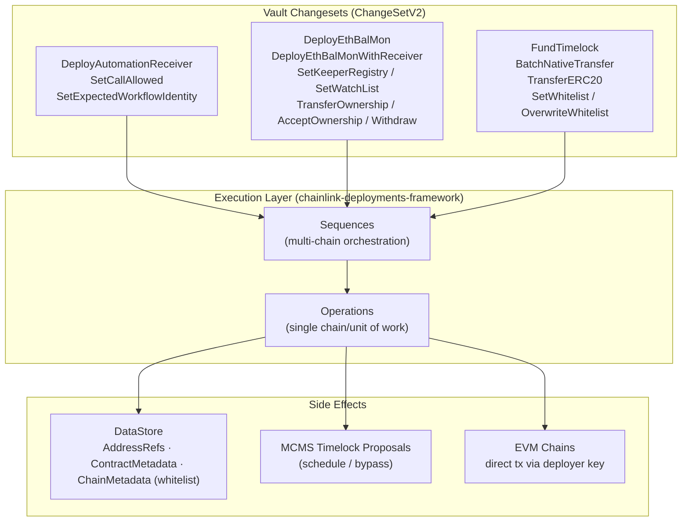
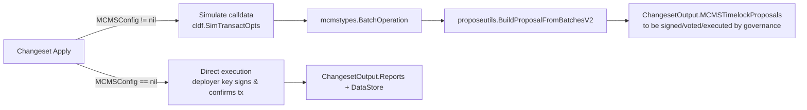
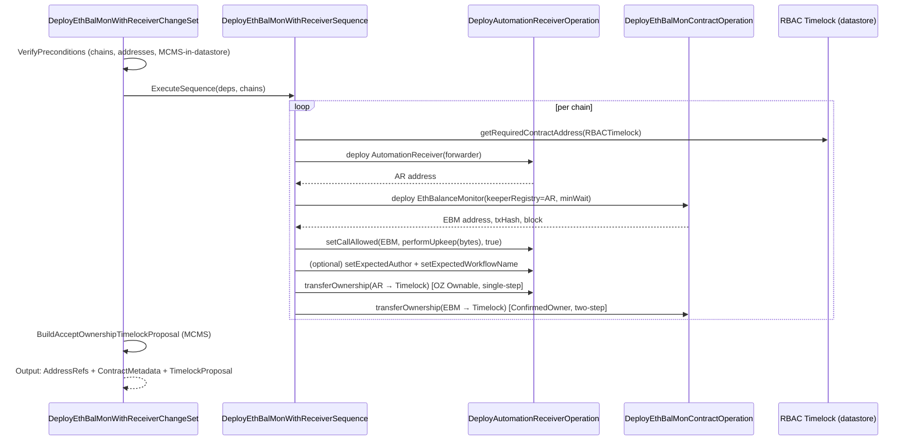
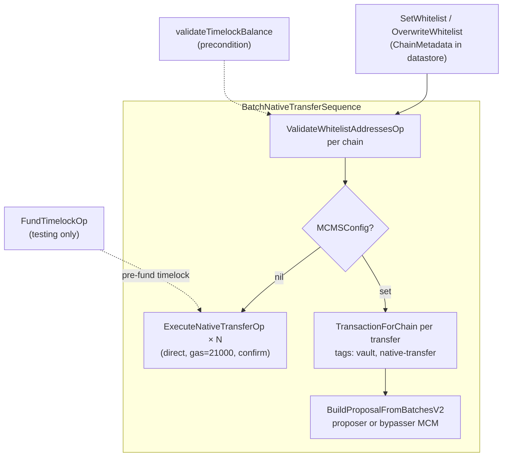

# Vault — Treasury & Balance Monitoring Deployment Changesets

> **Source location:** `chainlink/deployment/vault/` (`changeset/`, `view/`, `types/`)
> **Part of:** [Deployment Framework Core & Product Deployments](../Deployment_Framework_Core___Product_Deployments.md)

## 1. Purpose

The **vault** module provides [changesets](https://github.com/smartcontractkit/chainlink/tree/develop/deployment#changsets) for managing **treasury operations** and **on-chain balance monitoring** across multiple EVM chains, built on top of the `chainlink-deployments-framework` and secured by **MCMS (Multi-Chain Multi-Sig)** governance. Its responsibilities fall into three functional areas:

1. **AutomationReceiver lifecycle** — deploy and configure the CRE `AutomationReceiver` contract (the "keeper registry" adapter that only accepts reports from authorized workflows) and wire its call permissions.
2. **EthBalMon (Ethereum Balance Monitor) lifecycle** — deploy the `EthBalanceMonitor` contract, wire it to an AutomationReceiver, and manage its watch list, keeper registry, ownership and funds.
3. **Treasury operations** — whitelisted batch native/ERC-20 transfers from timelock-owned funds, timelock funding (test-only), and whitelist state management in the deployment datastore.

Everything is expressed as versioned **Changeset → Sequence → Operation** steps so that every deployment is repeatable, reported, and either executed *directly* by a deployer key or converted into an **MCMS timelock proposal** for governance approval.

## 2. Architecture Overview

### 2.1 Layered model

| Layer | Role | Examples |
|---|---|---|
| **Changeset** (`cldf.ChangeSetV2[T]`) | Entry point: `VerifyPreconditions` + `Apply`; validates multi-chain config, picks a deterministic *primary chain*, builds `VaultDeps`, runs a sequence, folds results (datastore refs + MCMS proposals) into `cldf.ChangesetOutput` | `DeployEthBalMonChangeSet`, `BatchNativeTransferChangeset` |
| **Sequence** (`operations.NewSequence`) | Per-chain fan-out; composes operations, aggregates `BatchOperation`s into one MCMS proposal per changeset run | `DeployEthBalMonSequence`, `SetCallAllowedSequence` |
| **Operation** (`operations.NewOperation`) | Single unit of work: deploy a contract, send a tx, or *simulate & encode calldata* for an MCMS batch | `DeployAutomationReceiverOperation`, `FundTimelockOp`, `ExecuteNativeTransferOp` |
| **Infrastructure** | Shared helpers used by all layers | `VaultDeps`, `getRequiredContractAddress`, `GetContractAddressWithQualifier`, `validateChainSelector`, `ethBalMonMCMSContractTypeForProposal`, whitelist read/write |

### 2.2 Execution modes

Every changeset that produces privileged state mutations supports two execution modes:

* **Direct mode** — used for bootstrapping steps (contract deployment, `setCallAllowed` while the deployer still owns the receiver, timelock funding in test environments).
* **MCMS mode** — used for privileged operations on timelock-owned contracts (`setWatchList`, `withdraw`, `transferOwnership`, `acceptOwnership`, whitelist-gated transfers). Calldata is generated against the contract binding (`chainlink-evm` gethwrappers: `automation_receiver.AutomationReceiver`, `eth_balance_monitor_wrapper.EthBalanceMonitor`) using `cldf.SimTransactOpts()`, then wrapped as an `mcms.TimelockProposal`. The MCMS contract used (proposer vs. bypasser) is resolved via `ethBalMonMCMSContractTypeForProposal` (`ethbalmon_mcms.go`).

### 2.3 State model (deployment datastore)

The module persists everything it deploys or configures into the framework datastore, returned as `ChangesetOutput.DataStore`:

- **`AddressRef`s** — `AutomationReceiver` and `EthBalMon` contract addresses per chain selector (type labels `AutomationReceiver` / `EthBalMon`, version `1.0.0`).
- **`ContractMetadata`** — deploy tx hash, block number, keeper registry address, min wait period, timelock/MCMS addresses, ownership-transfer tx hash.
- **`ChainMetadata`** — the per-chain **whitelist** (`types.WhitelistMetadata{Addresses []WhitelistAddress}`), written by the whitelist changesets and read by validation + the view.

A read-only projection of this state is exposed by the `view` package (`view/view.go`): `Vault(e cldf.Environment, …)` implements `cldf.ViewStateV2` and returns `VaultView{TimelockBalances, WhitelistedAddresses}` built from `changeset.GetTimelockBalances` and `changeset.GetWhitelistedAddresses`.

## 3. Sub-modules

The module is documented in three generated sub-module pages under [`vault/`](vault/), mirroring its functional split (all shared configuration types live in `chainlink/deployment/vault/changeset/types/types.go` and are referenced from each page):

### 3.1 Automation Receiver → [vault_automation_receiver.md](vault/vault_automation_receiver.md)

Deploying and configuring the CRE `AutomationReceiver` contract:

- `DeployAutomationReceiverChangeSet` + `DeployAutomationReceiverSequence` (`automation_receiver_deploy.go`) — deploy, `setCallAllowed`, optional workflow-identity pinning, ownership transfer to Timelock; emits `DeployAutomationReceiverSequenceOutput`.
- `SetCallAllowedChangeSet` + `SetCallAllowedSequence` / `SetCallAllowedProposalOperation` (`automation_receiver_set_call_allowed.go`) — MCMS proposal to allow/disallow a `(target, selector)` pair; defines `SetCallAllowedProposalOpInput/Output`, `SetCallAllowedSequenceOutput`.
- `SetExpectedWorkflowIdentityChangeSet` + sequence/proposal operation (`automation_receiver_set_expected_workflow_identity.go`) — MCMS proposal setting `setExpectedAuthor` + `setExpectedWorkflowName` atomically (required, or the receiver reverts with `WorkflowIdentityNotConfigured`).
- Config types: `AutomationReceiverChainConfig`, `DeployAutomationReceiverInput`.

### 3.2 EthBalMon Lifecycle → [vault_ethbalmon.md](vault/vault_ethbalmon.md)

Deploying and managing the `EthBalanceMonitor` contract:

- `DeployEthBalMonChangeSet` + `DeployEthBalMonSequence` (`ethbalmon_deploy.go`) — deploy + ownership transfer + accept-ownership proposal; hosts the reusable operations `DeployAutomationReceiverOperation`, `SetCallAllowedOperation`, `SetExpectedWorkflowIdentityOperation`, `TransferAutomationReceiverOwnershipOperation`, `DeployEthBalMonContractOperation`, `TransferOwnershipOperation`, and `BuildAcceptOwnershipTimelockProposal`.
- `DeployEthBalMonWithReceiverChangeSet` (`ethbalmon_automation_receiver_deploy.go`) — combined AR+EBM deployment with full wiring (`DeployEthBalMonWithReceiverSequenceOutput`).
- Timelock-proposal changesets: `EthBalMonAcceptOwnership`, `EthBalMonTransferOwnership`, `SetKeeperRegistryAddress`, `EthBalMonSetWatchList`, `EthBalMonWithdraw` (each file defines its `…OpInput/Output` and `…SeqOutput` triple).
- Config types: `DeployEthBalMonWithReceiverChainConfig`, `EthBalMonSetWatchListChainConfig`, `EthBalMonTransferOwnershipChainConfig`, `EthBalMonWithdrawChainConfig`, `SetKeeperRegistryChainConfig`.

### 3.3 Treasury Operations → [vault_treasury.md](vault/vault_treasury.md)

Vault treasury management and shared infrastructure:

- `FundTimelockChangeset` (`fund_timelock.go`, **testing only**) — `FundTimelockOp`, `GetTimelockBalances`, funding-requirement computation (`FundTimelockOutput`).
- `BatchNativeTransferChangeset` (`batch_native_transfer.go`) — whitelisted multi-chain native transfers, direct or MCMS.
- `TransferERC20Changeset` (`transfer_erc20.go`) — MCMS-only ERC-20 transfers via `TransferERC20Sequence`.
- `SetWhitelistChangeset` / `OverwriteWhitelistChangeset` (`manage_whitelist.go`) — whitelist state as chain metadata, with merge/overwrite reducers and `GetWhitelistedAddresses`.
- Shared primitives (`operations.go`): `VaultDeps`, `ValidateWhitelistAddressesOp`, `ExecuteNativeTransferOp`, `BatchNativeTransferSequence`, `TransferERC20Sequence`.
- State type: `BatchNativeTransferState` (timelock balances, whitelisted addresses, validation errors).

## 4. Key Cross-Cutting Flows

### 4.1 Combined EthBalMon + AutomationReceiver deployment

This is the flagship flow (`DeployEthBalMonWithReceiverSequence`): it stands up a complete balance-monitoring stack per chain and returns both contracts and a ready-made accept-ownership proposal.

Notable safety properties:

- The AutomationReceiver's **inbound identity guard** (`expectedAuthor`/`expectedWorkflowName`) must be set or the receiver reverts reports with `WorkflowIdentityNotConfigured`; it is set at deploy time (both fields together) or later via the `SetExpectedWorkflowIdentity` MCMS changeset.
- Ownership handover differs per contract: the AR uses OZ `Ownable` (single-step transfer to timelock), while EthBalMon uses `ConfirmedOwner` (two-step: transfer + **MCMS `acceptOwnership`**).
- The default `minWaitPeriodSeconds` is 60 when unset (`effectiveMinWaitPeriodSeconds`).

### 4.2 Whitelisted treasury transfer

The preconditions (`validation.go`) enforce: non-empty transfers, EVM-family chain selectors present in the environment, non-zero/positive amounts, no duplicate recipients, **whitelist membership**, and sufficient timelock native balance (via `GetTimelockBalances`).

## 5. Dependencies

### On other modules

| Dependency | Used for |
|---|---|
| [`deployment-common`](deployment-common.md) (same parent module) | `commontypes.RBACTimelock`, `ProposerManyChainMultisig`, `BypasserManyChainMultisig` contract types resolved from the datastore; shared deployment conventions. |
| [`Dev, Test & Simulation Environments`](../Dev,_Test___Simulation_Environments.md) | The system-tests CRE feature consumes this module — see `system-tests/lib/cre/features/vault/vault.go` ([system-tests](../Dev,_Test___Simulation_Environments/system-tests.md)) and the vault secrets/workflow helpers, which exercise the AutomationReceiver + EthBalMon contracts deployed by these changesets. |
| [Workflow & Capability Runtime (CRE Engine)](../Workflow___Capability_Runtime_(CRE_Engine).md) | The `AutomationReceiver` contract is the CRE-automation adapter; workflow identity (author + name) matches CRE workflow metadata. |

### External frameworks / libraries

| Library | Role |
|---|---|
| `chainlink-deployments-framework` | `cldf.Environment`, `ChangeSetV2`, `operations` (Bundle/Sequence/Operation), `datastore` (AddressRef/ContractMetadata/ChainMetadata), `proposalutils.TimelockConfig`, `BuildProposalFromBatchesV2` |
| `mcms` | `TimelockProposal`, `BatchOperation`, `Transaction`, `TimelockActionSchedule` / `TimelockActionBypass` |
| `chainlink-evm/gethwrappers` | Contract bindings & deployers: `automation-cre/…/automation_receiver`, `eth_balance_monitor_wrapper` |
| `chain-selectors` | Chain-selector family validation (EVM-only) |
| Module manifest | `chainlink/deployment/go.mod` — module `github.com/smartcontractkit/chainlink/deployment` pins the framework and MCMS versions |

## 6. Repository artifacts of note

- `chainlink/deployment/vault/README.md` — user-facing walkthrough of `BatchNativeTransfer`, `FundTimelock` (testing-only caveat) and `SetWhitelist`, including the prescribed execution order (whitelist → fund → transfer).
- `chainlink/deployment/vault/view/view.go` — `VaultView` state reporter (`cldf.ViewStateV2`).
- `chainlink/deployment/vault/changeset/` — all changesets; each changeset has a sibling `_test.go` with simulated-chain coverage.
