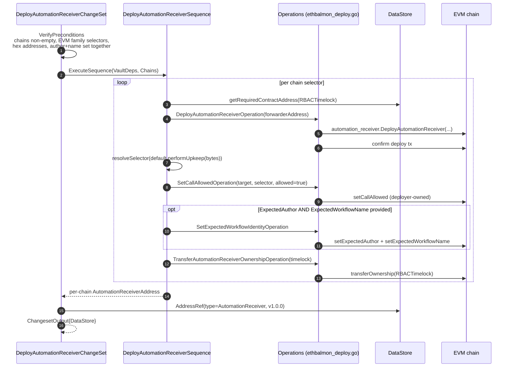
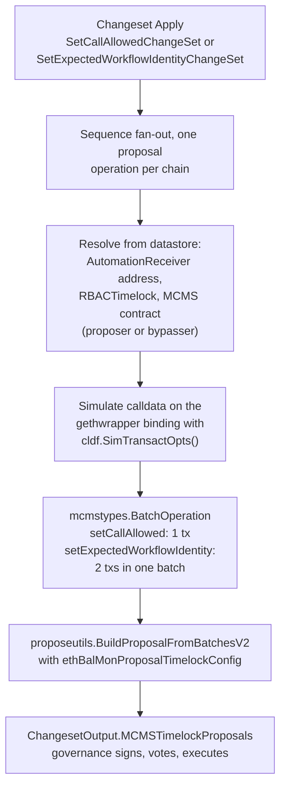
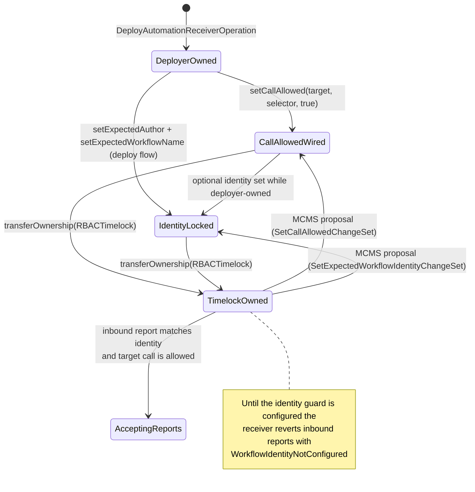
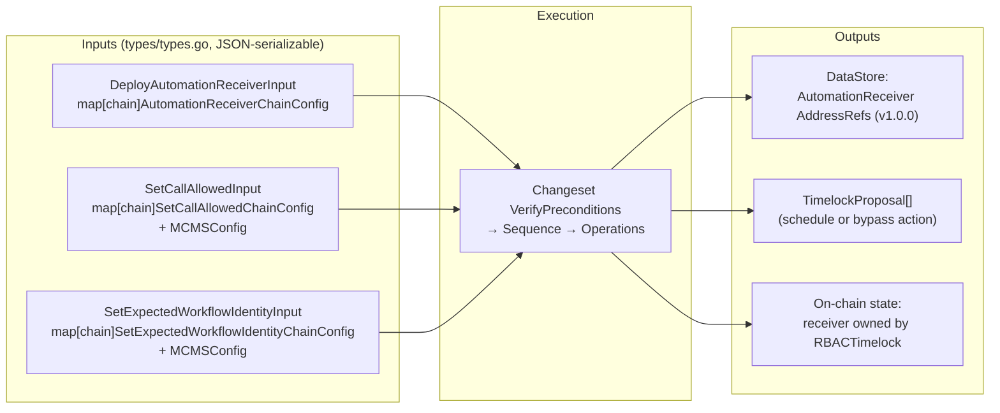

# AutomationReceiver — Deploy & Configuration Changesets

> **Source location:** `chainlink/deployment/vault/changeset/automation_receiver_deploy.go`, `automation_receiver_set_call_allowed.go`, `automation_receiver_set_expected_workflow_identity.go`, `types/types.go`
> **Go module:** `github.com/smartcontractkit/chainlink/deployment` (manifest: `chainlink/deployment/go.mod`)
> **Part of:** [Vault product deployments](../vault.md) · [Deployment Framework Core & Product Deployments](../../Deployment_Framework_Core___Product_Deployments.md)

## 1. Purpose

This module deploys and lifecycle-manages the **CRE `AutomationReceiver`** contract — the on-chain entry point that Chainlink Automation uses to execute upkeeps authorized by a CRE (Chainlink Runtime Environment) workflow. The receiver enforces two on-chain guards:

1. **Inbound identity guard** — reports are only accepted from the configured workflow *author* and *workflow name*. Until both are set (`setExpectedAuthor` + `setExpectedWorkflowName`), the contract reverts every inbound report with `WorkflowIdentityNotConfigured`.
2. **Outbound call guard** — `performUpkeep(bytes)` may only invoke `(target, selector)` pairs explicitly permitted via `setCallAllowed`. The default selector is `performUpkeep(bytes)`, resolved from its Keccak-256 signature.

The module exposes three versioned **Changesets** (framework contract `cldf.ChangeSetV2[T]`), each decomposed into the standard **Changeset → Sequence → Operation** layers of the `chainlink-deployments-framework`:

| Changeset | File | Execution mode | Output |
|---|---|---|---|
| `DeployAutomationReceiverChangeSet` | `automation_receiver_deploy.go` | **Direct** (deployer key signs all txs) | `DataStore` with per-chain `AutomationReceiver` address refs |
| `SetCallAllowedChangeSet` | `automation_receiver_set_call_allowed.go` | **MCMS proposal** (governance) | `MCMSTimelockProposals` (one `TimelockProposal`) |
| `SetExpectedWorkflowIdentityChangeSet` | `automation_receiver_set_expected_workflow_identity.go` | **MCMS proposal** (governance) | `MCMSTimelockProposals` (one `TimelockProposal`) |

All sequences and operations are pinned at semantic version `1.0.0`.

## 2. Architecture & Component Relationships

```mermaid
flowchart TB
    subgraph CS["Changesets (ChangeSetV2 entry points)"]
        CS1["DeployAutomationReceiverChangeSet<br/>automation_receiver_deploy.go"]
        CS2["SetCallAllowedChangeSet<br/>automation_receiver_set_call_allowed.go"]
        CS3["SetExpectedWorkflowIdentityChangeSet<br/>automation_receiver_set_expected_workflow_identity.go"]
    end

    subgraph SEQ["Sequences"]
        S1["DeployAutomationReceiverSequence<br/>(direct execution)"]
        S2["SetCallAllowedSequence<br/>(MCMS proposal)"]
        S3["SetExpectedWorkflowIdentitySequence<br/>(MCMS proposal)"]
    end

    subgraph OPS["Operations (reused from ethbalmon_deploy.go)"]
        O1["DeployAutomationReceiverOperation"]
        O2["SetCallAllowedOperation"]
        O3["SetExpectedWorkflowIdentityOperation"]
        O4["TransferAutomationReceiverOwnershipOperation"]
        O5["SetCallAllowedProposalOperation"]
        O6["SetExpectedWorkflowIdentityProposalOperation"]
    end

    subgraph INFRA["Shared infrastructure"]
        D1["VaultDeps<br/>(operations.go)"]
        D2["getRequiredContractAddress · lowestChainSelector<br/>(ethbalmon_deploy.go · utils.go)"]
        D3["validateChainSelector · validateEthAddress<br/>(validation.go)"]
        D4["ethBalMonMCMSContractTypeForProposal ·<br/>ethBalMonProposalTimelockConfig<br/>(ethbalmon_mcms.go)"]
    end

    subgraph SIDE["Side effects"]
        CH["EVM chain<br/>(deployer-signed txs)"]
        DS["ChangesetOutput.DataStore<br/>AutomationReceiver AddressRefs"]
        PR["ChangesetOutput.MCMSTimelockProposals"]
    end

    CS1 --> S1
    CS2 --> S2
    CS3 --> S3
    S1 --> O1
    S1 --> O2
    S1 --> O3
    S1 --> O4
    S2 --> O5
    S3 --> O6
    O1 --> CH
    O2 --> CH
    O3 --> CH
    O4 --> CH
    CS1 --> DS
    S2 --> PR
    S3 --> PR
    CS1 -.-> D1
    CS2 -.-> D1
    CS3 -.-> D1
    CS1 -.-> D2
    CS1 -.-> D3
    CS2 -.-> D3
    CS3 -.-> D3
    O5 -.-> D4
    O6 -.-> D4
```

### 2.1 Component inventory

| Component | Layer | Responsibility |
|---|---|---|
| `deployAutomationReceiver` / `DeployAutomationReceiverChangeSet` | Changeset | Validates multi-chain input, executes the deploy sequence with a deployer key, records `AutomationReceiver` `AddressRef`s in a fresh memory datastore |
| `DeployAutomationReceiverSequenceOutput`, `DeployAutomationReceiverSequence`, `DeployAutomationReceiverSequenceInput/PerChainOutput` | Sequence | Per-chain fan-out: deploy → `setCallAllowed` → optional identity lock → ownership transfer to timelock |
| `setCallAllowed` / `SetCallAllowedChangeSet` | Changeset | Builds a governance proposal granting/revoking a `(target, selector)` pair on already-deployed, **timelock-owned** receivers |
| `SetCallAllowedSequence`, `SetCallAllowedSequenceInput/Output`, `SetCallAllowedProposalOpInput/OpOutput`, `SetCallAllowedProposalOperation` | Sequence + Operation | Resolves addresses from the datastore, simulates `setCallAllowed` calldata, emits one `BatchOperation` per chain, aggregates into a `TimelockProposal` |
| `setExpectedWorkflowIdentity` / `SetExpectedWorkflowIdentityChangeSet` | Changeset | Builds a governance proposal that atomically sets the inbound identity guard (`setExpectedAuthor` + `setExpectedWorkflowName`) on timelock-owned receivers |
| `SetExpectedWorkflowIdentitySequence`, `SetExpectedWorkflowIdentityProposalOpInput/OpOutput`, `SetExpectedWorkflowIdentityProposalOperation` | Sequence + Operation | Same proposal shape as above but with **two transactions in one batch** |
| `AutomationReceiverChainConfig`, `DeployAutomationReceiverInput` and related input types | Types (`types/types.go`) | Declarative, JSON-serializable configuration for each changeset |
| `AutomationReceiverContractType = "AutomationReceiver"` | Types constant | Datastore / MCMS contract-type label used for address resolution |

### 2.2 Shared dependencies (within the vault changeset package)

The AutomationReceiver changesets do not define their own low-level plumbing; they reuse the infrastructure documented in [Vault overview](../vault.md) and shared with the [EthBalMon lifecycle](vault_ethbalmon.md):

| Helper | Defined in | Used for |
|---|---|---|
| `VaultDeps` | `operations.go` | Carrier for deployer auth, representative EVM chain, environment and datastore |
| `getRequiredContractAddress` | `ethbalmon_deploy.go` | Strict datastore lookup (errors on missing/empty address) for `RBACTimelock`, `AutomationReceiver`, and MCMS contracts |
| `lowestChainSelector` | `utils.go` | Deterministic *primary chain* selection so changeset output is reproducible for identical input (Go map iteration order is random) |
| `validateChainSelector`, `validateEthAddress` | `validation.go` | Preconditions: selector must resolve to the **EVM** family and exist in the environment; addresses must be valid hex |
| `parseSelectorHex` | `automation_receiver_set_call_allowed.go` | Parses `0x`-prefixed 4-byte selectors; `resolveSelector` (deploy flow) defaults to `performUpkeep(bytes)` |
| `ethBalMonMCMSContractTypeForProposal` | `ethbalmon_mcms.go` | Maps the requested timelock action to the datastore contract type — `ProposerManyChainMultisig` for `schedule` (default), `BypasserManyChainMultisig` for `bypass` |
| `ethBalMonProposalTimelockConfig` | `ethbalmon_mcms.go` | Normalizes `nil` MCMS config to a zero-min-delay schedule config |

## 3. Process Flows

### 3.1 Deploy flow — `DeployAutomationReceiverChangeSet` (always direct execution)

Because every privileged call in this flow is executed **while the deployer still owns the contract**, no MCMS proposal is produced; ownership ends with the `RBACTimelock`, which must already be registered in the environment datastore (it is deployed by the shared timelock/MCMS stack — see [deployment-common](../deployment-common.md)).

Key behaviours:

- **Primary chain selection** — the changeset picks the lowest chain selector from the input map to build `VaultDeps` (only the deployer key / environment of the representative chain is needed; work is per-chain inside the sequence).
- **Identity at deploy time (optional but recommended)** — `AutomationReceiverChainConfig.ExpectedAuthor` / `ExpectedWorkflowName` are validated as *both-or-neither*. Setting them during deploy makes the receiver usable immediately, because the identity cannot be set post-transfer without a governance proposal.
- **Datastore output** — one `ds.AddressRef` per chain with contract type `AutomationReceiver`, version `1.0.0` and an empty label set (unlike the EthBalMon deploy, no `ContractMetadata` is emitted).

### 3.2 Governance flows — `SetCallAllowedChangeSet` and `SetExpectedWorkflowIdentityChangeSet`

Once the receiver is owned by the `RBACTimelock`, state changes must go through MCMS. Both changesets follow an identical shape; they differ only in the calldata generated (one transaction vs. two).

Notable details:

- Calldata is generated against the `chainlink-evm` binding `automation_receiver.NewAutomationReceiver(...)` using simulation transact opts — no transaction is broadcast by these changesets.
- The identity proposal batches `SetExpectedAuthor` and `SetExpectedWorkflowName` **atomically**: either both land (the guard becomes active) or neither does, avoiding a half-configured receiver.
- Identity (author + workflow name) is stable across workflow redeploys — unlike pinning a workflow id — so the guard normally needs to be configured only once per receiver.
- `SetCallAllowedInput.Allowed` permits both granting and revoking a `(target, selector)` pair.

### 3.3 Receiver lifecycle (state view)

## 4. Data Flow & Configuration Reference

### `AutomationReceiverChainConfig` (deploy-time, per chain)

| Field | Required | Meaning |
|---|---|---|
| `ForwarderAddress` | ✔ | CRE forwarder passed to the `AutomationReceiver` constructor |
| `TargetAddress` | ✔ | Contract the receiver is allowed to call via `setCallAllowed` (typically an EthBalMon) |
| `Selector` | ✖ | 4-byte hex selector; defaults to `performUpkeep(bytes)` when empty |
| `ExpectedAuthor`, `ExpectedWorkflowName` | ✖ (both-or-neither) | Locks the inbound identity guard at deploy time |

### Post-deploy proposal inputs

- `SetCallAllowedChainConfig` — `TargetAddress`, `Selector` (mandatory, must parse), `Allowed`. The receiver address is always resolved from the datastore.
- `SetExpectedWorkflowIdentityChainConfig` — `ExpectedAuthor` and `ExpectedWorkflowName` (both mandatory; the receiver cannot function without them).
- `MCMSConfig` (`cldfproposalutils.TimelockConfig`) — optional on all proposal changesets; `MCMSAction` selects proposer vs. bypasser MCMS, `MinDelay` must be ≥ 0.

## 5. Security & Execution Model

1. **Least privilege by construction** — the deploy changeset performs every privileged call *before* ownership transfer, then hands the contract to the `RBACTimelock`. After that, the only way to mutate it is through the MCMS proposal changesets in this module.
2. **Deterministic proposals** — the identity changeset selects its representative chain with `lowestChainSelector` so the same input yields byte-identical proposals (Go map iteration is randomized); preconditions reject negative `MinDelay` values.
3. **Atomic identity configuration** — author and workflow name travel in one timelock batch, preventing partially configured guards.
4. **Datastore as source of truth** — proposal operations never accept contract addresses in config for the receiver/timelock/MCMS; they are strictly resolved via `getRequiredContractAddress`, so proposals always target contracts registered by prior changesets.

## 6. Integration with the Rest of the System

| Integration | Role of this module | See |
|---|---|---|
| **EthBalMon** | The receiver is deployed as the `KeeperRegistryAddress` of `EthBalanceMonitor`, and EthBalMon is the typical `TargetAddress` in `setCallAllowed`. The combined `DeployEthBalMonWithReceiver` changeset composes both lifecycles. | [vault_ethbalmon](vault_ethbalmon.md) |
| **Timelock / MCMS stack** | Preconditions assume `RBACTimelock` and proposer/bypasser MCMS contracts exist in the datastore; they are deployed and ownership-transferred by the shared deployment-common changesets. | [deployment-common](../deployment-common.md) · [Solana/MCMS helpers](../deployment-common/deployment-common_solana-mcms.md) |
| **CRE forwarders** | `ForwarderAddress` refers to a CRE EVM forwarder contract deployed via the CRE/Keystone deployment suite. | [CRE forwarder changesets](../../CRE___Keystone_Deployment_Suite/cre-forwarder.md) · [Keystone forwarders](../../CRE___Keystone_Deployment_Suite/keystone/keystone_forwarders.md) · [EVM forwarder contract bindings](../../Workflow___Capability_Runtime_(CRE_Engine)/chain_capability_evm/chain_capability_evm_forwarder_contracts.md) |
| **OCR3 / vault plugin** | The receiver complements the OCR3-based vault deployment (DKG + plugin configuration) used to bring vault DONs online. | [cre-ocr3](../../CRE___Keystone_Deployment_Suite/cre-ocr3.md) |
| **CRE capability runtime** | The runtime-side counterpart of the vault/secret flows is the vault capability (`SecretsService`), executed by workflows whose identity this receiver pins. | [Vault capability types](../../Workflow___Capability_Runtime_(CRE_Engine)/core_capabilities_runtime/core_capabilities_runtime_vault_types.md) |
| **System tests** | End-to-end vault tests spin up the receiver + EthBalMon stack and exercise workflow secrets against it. | [system-tests](../../Dev,_Test___Simulation_Environments/system-tests.md) |
| **Treasury operations** | Independent sibling area of the vault package (whitelisted timelock transfers); it shares the datastore/MCMS helpers but not the receiver contract. | [vault_treasury](vault_treasury.md) |

## 7. Testing

Unit tests live alongside the changesets in the same package:

- `automation_receiver_deploy_test.go` — deploy sequence behaviour, validation errors, datastore refs.
- `automation_receiver_set_call_allowed_test.go` — proposal batch generation and selector parsing.
- `automation_receiver_set_expected_workflow_identity_test.go` — two-transaction batch, both-or-neither preconditions.

These complement the multi-chain smoke coverage in the [system-tests](../../Dev,_Test___Simulation_Environments/system-tests.md) vault feature.

## 8. Source Files

| File | Contents |
|---|---|
| `chainlink/deployment/vault/changeset/automation_receiver_deploy.go` | Deploy changeset + `DeployAutomationReceiverSequence`, `resolveSelector` |
| `chainlink/deployment/vault/changeset/automation_receiver_set_call_allowed.go` | `SetCallAllowedChangeSet`, sequence, proposal operation, `parseSelectorHex` |
| `chainlink/deployment/vault/changeset/automation_receiver_set_expected_workflow_identity.go` | Identity-guard changeset, sequence, proposal operation |
| `chainlink/deployment/vault/changeset/types/types.go` | All input/config types and the `AutomationReceiver` contract-type constant |
| `chainlink/deployment/vault/changeset/ethbalmon_deploy.go` | Shared per-chain operations (`DeployAutomationReceiverOperation`, `SetCallAllowedOperation`, `SetExpectedWorkflowIdentityOperation`, `TransferAutomationReceiverOwnershipOperation`) and `getRequiredContractAddress` |
| `chainlink/deployment/vault/changeset/operations.go` | `VaultDeps` |
| `chainlink/deployment/vault/changeset/validation.go` | `validateChainSelector`, `validateEthAddress` |
| `chainlink/deployment/vault/changeset/utils.go` | `lowestChainSelector`, datastore address lookup helpers |
| `chainlink/deployment/vault/changeset/ethbalmon_mcms.go` | MCMS contract-type / timelock-config helpers |
| `chainlink/deployment/go.mod` | Go module manifest (`github.com/smartcontractkit/chainlink/deployment`) |
