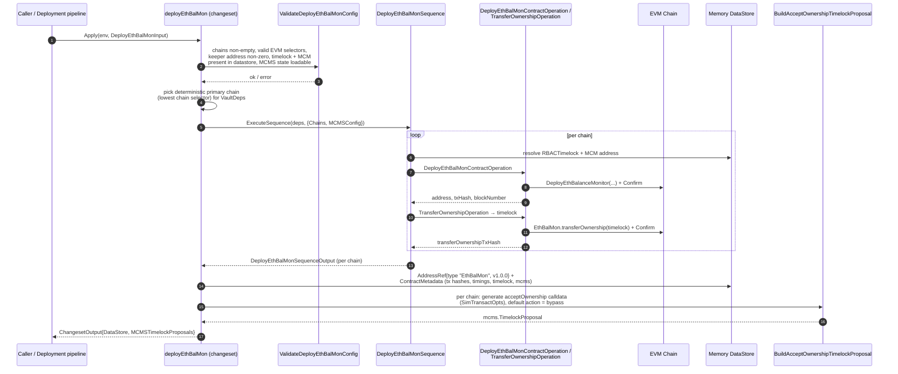
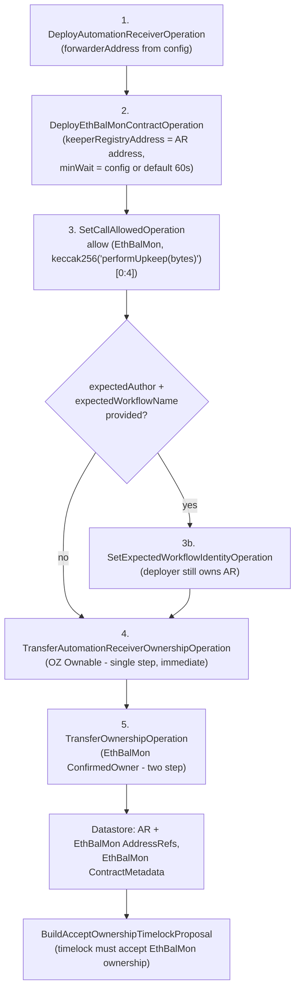
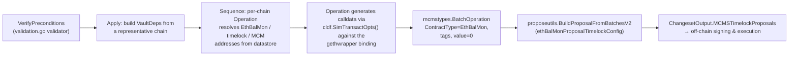
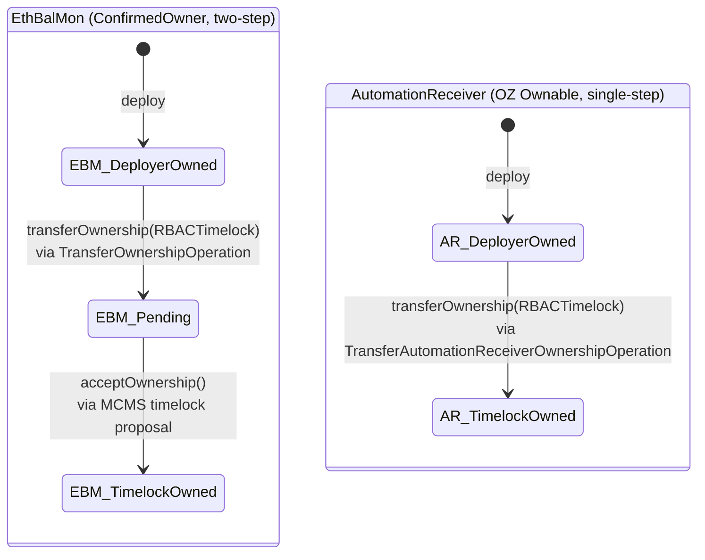

# Vault — EthBalMon (Ethereum Balance Monitor) Deployment Module

> **Module location:** `chainlink/deployment/vault/changeset/` (files `ethbalmon_*.go`, `types/types.go`) — part of the [Vault deployment suite](../vault.md) within the [Deployment Framework & Product Deployments](../../Deployment_Framework_Core___Product_Deployments.md) domain.

## 1. Introduction

`vault_ethbalmon` provides the deployment-framework **changesets, sequences, and operations** for deploying and operating the **EthBalanceMonitor (EthBalMon)** smart contract across multiple EVM chains.

EthBalMon is an on-chain balance watchdog: it maintains a *watch list* of addresses with per-address minimum balances and top-up amounts, and an authorized "keeper registry" periodically invokes `performUpkeep(bytes)` so the contract can refill addresses that have dropped below their threshold. The module supports two ways of wiring that authorized caller:

| Mode | Changeset | Keeper registry source |
|---|---|---|
| **Standalone** | `DeployEthBalMonChangeSet` | Explicit address in config (e.g. a Chainlink Automation registry / forwarder) |
| **CRE-wired** | `DeployEthBalMonWithReceiverChangeSet` | A freshly deployed `AutomationReceiver` contract, wired to EthBalMon via `setCallAllowed` |

Beyond deployment, the module ships the full post-deployment **governance lifecycle** — accept ownership, transfer ownership, repoint the keeper registry, replace the watch list, and withdraw funds — all expressed as **MCMS timelock proposals** so privileged mutations are executed by on-chain governance rather than an EOA.

The module is built on the [chainlink-deployments-framework (cldf)](https://github.com/smartcontractkit/chainlink-deployments-framework) `ChangeSetV2` → `Sequence` → `Operation` model (see `chainlink/deployment/go.mod`: `chainlink-deployments-framework v0.123.3`, `mcms v0.55.2`, `chainlink-evm/gethwrappers` for contract bindings, and `cld-changesets` for legacy proposal utilities).

## 2. Architecture

### 2.1 Layered design

Each public capability is a **changeset** (entry point, precondition validation, orchestration, output assembly). Changesets run **sequences**, which fan out per-chain **operations** — the atomic units that either sign-and-confirm a transaction or generate calldata for an MCMS batch.

```mermaid
flowchart TB
    subgraph CHG["Changesets (ChangeSetV2)"]
        CS1["DeployEthBalMonChangeSet<br/>(ethbalmon_deploy.go)"]
        CS2["DeployEthBalMonWithReceiverChangeSet<br/>(ethbalmon_automation_receiver_deploy.go)"]
        CS3["EthBalMonAcceptOwnership"]
        CS4["EthBalMonTransferOwnership"]
        CS5["SetKeeperRegistryAddress"]
        CS6["EthBalMonSetWatchList"]
        CS7["EthBalMonWithdraw"]
    end

    subgraph SEQ["Sequences (operations.NewSequence)"]
        SQ1["DeployEthBalMonSequence"]
        SQ2["DeployEthBalMonWithReceiverSequence"]
        SQ3["EthBalMonAcceptOwnershipSequence"]
        SQ4["EthBalMonTransferOwnershipSequence"]
        SQ5["SetKeeperRegistrySequence"]
        SQ6["EthBalMonSetWatchListSequence"]
        SQ7["EthBalMonWithdrawSequence"]
    end

    subgraph OPS["Operations (operations.NewOperation)"]
        OP1["DeployEthBalMonContractOperation"]
        OP2["DeployAutomationReceiverOperation"]
        OP3["SetCallAllowedOperation"]
        OP4["SetExpectedWorkflowIdentityOperation"]
        OP5["TransferAutomationReceiverOwnershipOperation"]
        OP6["TransferOwnershipOperation"]
        OP7["EthBalMonAcceptOwnershipOperation"]
        OP8["EthBalMonTransferOwnershipOperation"]
        OP9["SetKeeperRegistryOperation"]
        OP10["EthBalMonSetWatchListOperation"]
        OP11["EthBalMonWithdrawOperation"]
        OP12["BuildAcceptOwnershipTimelockProposal"]
    end

    subgraph SVC["Shared infrastructure"]
        DEPS["VaultDeps<br/>(Chain, Auth, DataStore, Environment)"]
        GETADDR["GetContractAddress /<br/>getRequiredContractAddress"]
        VAL["Validators (validation.go)"]
        MCMH["MCMS helpers (ethbalmon_mcms.go)"]
        DS["cldf DataStore<br/>(AddressRef + ContractMetadata)"]
        PB["proposeutils.BuildProposalFromBatchesV2"]
    end

    subgraph TARGETS["On-chain / framework targets"]
        EBMC["EthBalanceMonitor<br/>(chainlink-evm gethwrappers)"]
        ARC["AutomationReceiver<br/>(automation-cre gethwrappers)"]
        EVMC["EVM Chains<br/>(env.BlockChains.EVMChains)"]
        MCMS["MCMS Timelock Proposal<br/>(RBACTimelock + Proposer/Bypasser MCM)"]
    end

    CS1 --> SQ1
    CS2 --> SQ2
    CS3 --> SQ3
    CS4 --> SQ4
    CS5 --> SQ5
    CS6 --> SQ6
    CS7 --> SQ7

    SQ1 --> OP1 & OP6
    SQ2 --> OP2 & OP1 & OP3 & OP4 & OP5 & OP6
    SQ3 --> OP7
    SQ4 --> OP8
    SQ5 --> OP9
    SQ6 --> OP10
    SQ7 --> OP11

    CS1 & CS2 --> OP12
    OP7 & OP8 & OP9 & OP10 & OP11 --> PB
    OP12 --> PB
    PB --> MCMS

    CS1 & CS2 & CS3 & CS4 & CS5 & CS6 & CS7 --> VAL
    OPS --> DEPS
    DEPS --> GETADDR & DS & EVMC
    OP1 --> EBMC
    OP2 & OP3 & OP4 & OP5 --> ARC
    OP6 & OP7 & OP8 & OP9 & OP10 & OP11 --> EBMC
    CS1 & CS2 --> DS
    MCMH --> OPS
```



### 2.2 Contracts under management

| Contract | Binding | Ownership model | Role |
|---|---|---|---|
| **EthBalanceMonitor** | `chainlink-evm/gethwrappers/generated/eth_balance_monitor_wrapper` | Two-step (`ConfirmedOwner`-style: `transferOwnership` → `acceptOwnership`) | The monitored top-up engine; owner controls watch list, keeper registry address, withdrawal |
| **AutomationReceiver** | `chainlink-evm/gethwrappers/automation-cre/.../automation_receiver` | Single-step (OpenZeppelin `Ownable`) | CRE-facing executor that forwards `performUpkeep` into EthBalMon; has an inbound workflow-identity guard |
| **RBACTimelock / Proposer MCM / Bypasser MCM** | `chainlink/deployment/common/types/types.go` (`RBACTimelock`, `ProposerManyChainMultisig`, `BypasserManyChainMultisig`) | — | Governance plane; addresses are **resolved from the datastore**, never taken from config |

## 3. Component inventory

### 3.1 Changesets (`cldf.ChangeSetV2[T]`)

| Changeset | Input type (`types/types.go`) | File | Effect |
|---|---|---|---|
| `DeployEthBalMonChangeSet` | `DeployEthBalMonInput` | `ethbalmon_deploy.go` | Deploys EthBalMon per chain, transfers ownership to timelock, emits accept-ownership MCMS proposal |
| `DeployEthBalMonWithReceiverChangeSet` | `DeployEthBalMonWithReceiverInput` | `ethbalmon_automation_receiver_deploy.go` | Full CRE wiring: deploy AR + EthBalMon, allowlist `performUpkeep`, optionally pin workflow identity, transfer both ownerships, emit accept-ownership proposal |
| `EthBalMonAcceptOwnership` | `EthBalMonAcceptOwnershipInput` | `ethbalmon_accept_ownership.go` | Generates an MCMS proposal calling `acceptOwnership` on deployed EthBalMon instances |
| `EthBalMonTransferOwnership` | `EthBalMonTransferOwnershipInput` | `ethbalmon_transfer_ownership.go` | Generates an MCMS proposal calling `transferOwnership(newOwner)` |
| `SetKeeperRegistryAddress` | `EthBalMonSetKeeperRegistryAddressInput` | `ethbalmon_set_keeper_registry_address.go` | Generates an MCMS proposal repointing the authorized keeper/executor address |
| `EthBalMonSetWatchList` | `EthBalMonSetWatchListInput` | `ethbalmon_set_watchlist.go` | Generates an MCMS proposal replacing the full watch list (addresses + min balances + top-up amounts as parallel slices) |
| `EthBalMonWithdraw` | `EthBalMonWithdrawInput` | `ethbalmon_withdraw.go` | Generates an MCMS proposal withdrawing native tokens to a payee |

### 3.2 Operations

**Directly executed** (deployer-signed, confirmed on-chain — used only while the deployer still owns the contracts):

| Operation | Purpose |
|---|---|
| `DeployEthBalMonContractOperation` | Deploys `EthBalanceMonitor(keeperRegistryAddress, minWaitPeriodSeconds)` and confirms |
| `DeployAutomationReceiverOperation` | Deploys `AutomationReceiver(forwarderAddress)` and confirms |
| `SetCallAllowedOperation` | Allows/disallows a `(target, 4-byte selector)` pair on the AutomationReceiver |
| `SetExpectedWorkflowIdentityOperation` | Sets `expectedAuthor` + `expectedWorkflowName` on the AR (two txs) while the deployer still owns it |
| `TransferAutomationReceiverOwnershipOperation` | Single-step OZ `Ownable.transferOwnership` → RBACTimelock |
| `TransferOwnershipOperation` | Two-step `EthBalMon.transferOwnership` → RBACTimelock (pending until the MCMS accept proposal executes) |

**Proposal-generating** (build calldata with `cldf.SimTransactOpts()`, emit `mcmstypes.BatchOperation` — no on-chain execution):

`EthBalMonAcceptOwnershipOperation`, `EthBalMonTransferOwnershipOperation`, `SetKeeperRegistryOperation`, `EthBalMonSetWatchListOperation`, `EthBalMonWithdrawOperation` — each returns the batch plus the resolved `TimelockAddress` and `MCMSAddress` for its chain, and the enclosing sequence folds them into one `mcms.TimelockProposal` via `proposeutils.BuildProposalFromBatchesV2`.

### 3.3 Shared helpers

| Symbol | Location | Notes |
|---|---|---|
| `VaultDeps` | `operations.go` | `{Chain, Auth, DataStore, Environment}` threaded through every sequence/operation |
| `getRequiredContractAddress` | `ethbalmon_deploy.go` | Wraps `GetContractAddress` (`utils.go`) — datastore lookup by `(chainSelector, contractType)`, errors on empty |
| `effectiveMinWaitPeriodSeconds` | `ethbalmon_deploy.go` | Maps unset/`0` → `defaultEthBalMonMinWaitPeriodSeconds = 60` |
| `ethBalMonMCMSContractTypeForAction` / `ForProposal` | `ethbalmon_mcms.go` | `TimelockActionBypass` → `BypasserManyChainMultisig`, otherwise → `ProposerManyChainMultisig` |
| `deployEthBalMonAcceptOwnershipMCMSAction` / `TimelockConfig` | `ethbalmon_mcms.go` | Accept-ownership proposal **defaults to bypass** when `MCMSConfig` is nil/unset (historical behavior) |
| `ethBalMonProposalTimelockConfig` | `ethbalmon_mcms.go` | Nil config → `TimelockConfig{MinDelay: 0}` (schedule via proposer MCM) |
| Validators | `validation.go` | See [§7](#7-validation-matrix) |

## 4. Core flows

### 4.1 Standalone deploy (`DeployEthBalMonChangeSet`)



### 4.2 Combined CRE deploy (`DeployEthBalMonWithReceiverChangeSet`)

`VerifyPreconditions` first enforces: non-empty chains, valid EVM selectors, valid `forwarderAddress`, `expectedAuthor`/`expectedWorkflowName` set **together or not at all**, and MCMS contracts present in the datastore. The sequence then runs the following per chain:



After step 5 the contracts are fully wired: the AR (owned by the timelock) is the only address allowed to call `EthBalMon.performUpkeep`, and — once the returned MCMS proposal is executed — the timelock owns both contracts.

### 4.3 Governance / admin proposal changesets

`EthBalMonAcceptOwnership`, `EthBalMonTransferOwnership`, `SetKeeperRegistryAddress`, `EthBalMonSetWatchList`, and `EthBalMonWithdraw` share one template — they **never execute on-chain themselves**, they produce an MCMS timelock proposal for signers:



Correspondence between changeset and proposed contract call:

| Changeset | Proposed EthBalMon call | Proposal action default |
|---|---|---|
| `EthBalMonAcceptOwnership` | `acceptOwnership()` | schedule (proposer MCM) |
| `EthBalMonTransferOwnership` | `transferOwnership(newOwner)` | schedule (proposer MCM) |
| `SetKeeperRegistryAddress` | `setKeeperRegistryAddress(newKeeper)` | schedule (proposer MCM) |
| `EthBalMonSetWatchList` | `setWatchList(addresses[], minBalancesWei[], topUpAmountsWei[])` | schedule (proposer MCM) |
| `EthBalMonWithdraw` | `withdraw(amount, payee)` | schedule (proposer MCM) |
| Deploy changesets' post-deploy step | `acceptOwnership()` | **bypass** (when `MCMSConfig` nil/unset) |

## 5. Ownership & security model

EthBalMon and the AutomationReceiver use different ownership primitives, which drives the asymmetry in the deploy flow:



Key security properties:

- **Privileged state changes are governance-gated.** Once the timelock owns the contracts, watch-list updates, keeper re-pointing, ownership changes, and withdrawals can only happen through MCMS proposals that the module generates (to be signed and executed by the [MCMS governance stack](../../CCIP_Deployment_Suite.md#ccip-shared) or equivalent tooling).
- **The receiver rejects unconfigured identity.** The AutomationReceiver reverts inbound reports with `WorkflowIdentityNotConfigured` until `expectedAuthor` + `expectedWorkflowName` are set. These pin the workflow *owner address* and *name* — deliberately stable across workflow redeploys, unlike the workflow ID — so the guard can be locked once at deploy time (or later via the [AutomationReceiver changesets](vault_automation_receiver.md)).
- **Least privilege wiring.** `SetCallAllowedOperation` authorizes exactly one `(target, selector)` pair per AR — in the combined deploy, only `EthBalMon.performUpkeep(bytes)` (selector derived via `crypto.Keccak256`).
- **Proposals need gas.** Timelocks must hold native balance for MCMS execution; funding is handled by the [treasury changesets](vault_treasury.md) (the `FundTimelock` changeset there is test-only).

## 6. Datastore artifacts

On success, deploy changesets return `cldf.ChangesetOutput.DataStore` (an in-memory store to be merged by the pipeline) containing:

**Address refs**

| Type | Version | Labels |
|---|---|---|
| `EthBalMon` (`EthBalMonContractType`) | 1.0.0 | `EthBalMon`, `EthBalMonV1_0_0` |
| `AutomationReceiver` (`AutomationReceiverContractType`, combined flow only) | 1.0.0 | — |

**Contract metadata** (attached to the EthBalMon address): `deployTxHash`, `deployBlockNumber`, `keeperRegistryAddress` (the AutomationReceiver address in the combined flow — it *is* the authorized keeper), `minWaitPeriodSeconds`, `automationReceiverAddress`, `timelockAddress`, `mcmsAddress`, `transferOwnershipTxHash`.

All subsequent EthBalMon changesets resolve the target contract through `getRequiredContractAddress(deps.DataStore, chainSelector, "EthBalMon")` — i.e. the datastore is the single source of truth for deployed addresses; chain selectors must be valid EVM selectors known to the environment (checked by `validateChainSelector` using `chain-selectors`).

## 7. Validation matrix

All validators live in `chainlink/deployment/vault/changeset/validation.go` and run in each changeset's `VerifyPreconditions` **before** any state change.

| Changeset | Validator | Checks |
|---|---|---|
| DeployEthBalMon | `ValidateDeployEthBalMonConfig` + `validateDeployEthBalMonMCMSInDatastore` | Non-empty chains; valid EVM selector in environment; `keeperRegistryAddress` valid, non-zero hex; `MCMSConfig.MinDelay >= 0`; RBACTimelock + selected MCM (bypasser vs proposer) present in datastore; MCMS-with-timelock state loadable |
| DeployEthBalMonWithReceiver | inline in `VerifyPreconditions` | As above plus: valid `forwarderAddress`; `expectedAuthor`/`expectedWorkflowName` both set or both empty; valid `expectedAuthor` |
| AcceptOwnership | `ValidateEthBalMonAcceptOwnershipConfig` | Non-empty chains; chains exist in environment |
| TransferOwnership | `ValidateEthBalMonTransferOwnershipConfig` | `newOwner` valid, non-zero hex; chains exist |
| SetKeeperRegistryAddress | `ValidateSetKeeperRegistryAddressConfig` | `newKeeperRegistryAddress` valid, non-zero hex; chains exist |
| SetWatchList | `ValidateEthBalMonSetWatchListConfig` | Parallel slices `addresses`/`minBalancesWei`/`topUpAmountsWei` equal length & non-empty; each address valid, non-zero; amounts `>= 0`; chains exist |
| Withdraw | `ValidateEthBalMonWithdrawConfig` | `amount > 0`; `payee` valid, non-zero hex; chains exist |

## 8. Configuration reference (`types/types.go`)

```go
// Standalone deploy
type DeployEthBalMonInput struct {
    Chains     map[uint64]DeployEthBalMonChainConfig // keeperRegistryAddress + optional SetMinWaitPeriodSeconds
    MCMSConfig *cldfproposalutils.TimelockConfig     // nil/unset action ⇒ bypass for accept-ownership
}

// Combined CRE deploy
type DeployEthBalMonWithReceiverInput struct {
    Chains     map[uint64]DeployEthBalMonWithReceiverChainConfig // forwarderAddress, SetMinWaitPeriodSeconds,
                                                                 // ExpectedAuthor + ExpectedWorkflowName (both-or-neither)
    MCMSConfig *cldfproposalutils.TimelockConfig
}

// Admin changesets (all also carry optional MCMSConfig)
type EthBalMonAcceptOwnershipInput       struct{ Chains []uint64; ... }                 // chain list
type EthBalMonTransferOwnershipInput     struct{ Chains map[uint64]EthBalMonTransferOwnershipChainConfig; ... }  // newOwner
type EthBalMonSetKeeperRegistryAddressInput struct{ Chains map[uint64]SetKeeperRegistryChainConfig; ... }         // new_keeper_registry_address
type EthBalMonSetWatchListInput          struct{ Chains map[uint64]EthBalMonSetWatchListChainConfig; ... }       // addresses + parallel wei slices
type EthBalMonWithdrawInput              struct{ Chains map[uint64]EthBalMonWithdrawChainConfig; ... }           // amount + payee
```

Defaults worth remembering: `SetMinWaitPeriodSeconds` unset or `0` ⇒ **60 s** (`defaultEthBalMonMinWaitPeriodSeconds`); proposal-generating changesets with `MCMSConfig == nil` use **schedule** via the proposer MCM with `MinDelay: 0`, while the deploy flow's accept-ownership step defaults to **bypass**.

## 9. How this module fits into the system

- **Within the Vault suite** — EthBalMon deployments register addresses in the same datastore consumed by the [treasury changesets](vault_treasury.md) (timelock funding/whitelisting) and the `Vault` view (`chainlink/deployment/vault/view/view.go`).
- **Within CRE** — the combined deploy depends on a **CRE forwarder** address (deployed via the [CRE/Keystone deployment suite](../../CRE___Keystone_Deployment_Suite.md)) and the workflow identity pinned on the receiver corresponds to workflows authored by the [Workflow & Capability Runtime (CRE Engine)](../../Workflow___Capability_Runtime_(CRE_Engine).md).
- **Execution environment** — everything runs inside a `cldf.Environment` whose EVM chains, operations bundle, logger, and datastore come from the shared [deployment framework](../../Deployment_Framework_Core___Product_Deployments.md).
- **System tests** — the CRE system-test vault feature (`chainlink/system-tests/lib/cre/features/vault/vault.go`) exercises these changesets end-to-end.

## 10. Testing

Per-file tests live alongside the code: `ethbalmon_deploy_test.go`, `ethbalmon_automation_receiver_deploy_test.go`, `ethbalmon_accept_ownership_test.go`, `ethbalmon_transfer_ownership_test.go`, `ethbalmon_set_keeper_registry_address_test.go`, `ethbalmon_set_watchlist_test.go`, `ethbalmon_withdraw_test.go`. Run them from the deployment module (`chainlink/deployment/go.mod`), e.g. `go test ./vault/changeset/... -run TestEthBalMon`.

## 11. Related documentation

- [Vault overview](../vault.md) — suite layout, framework conventions
- [Vault — AutomationReceiver changesets](vault_automation_receiver.md) — standalone receiver deploy, `setCallAllowed`, `setExpectedWorkflowIdentity` as MCMS proposals
- [Vault — Treasury changesets](vault_treasury.md) — timelock funding, native/ERC-20 transfers, whitelist management
- [Deployment Framework & Product Deployments](../../Deployment_Framework_Core___Product_Deployments.md) — changeset/sequence/operation framework, datastore, MCMS
- [CRE & Keystone Deployment Suite](../../CRE___Keystone_Deployment_Suite.md) — forwarders and OCR3 job deployment that precede EthBalMon wiring
- [Workflow & Capability Runtime (CRE Engine)](../../Workflow___Capability_Runtime_(CRE_Engine).md) — the workflow layer whose identity the receiver validates
