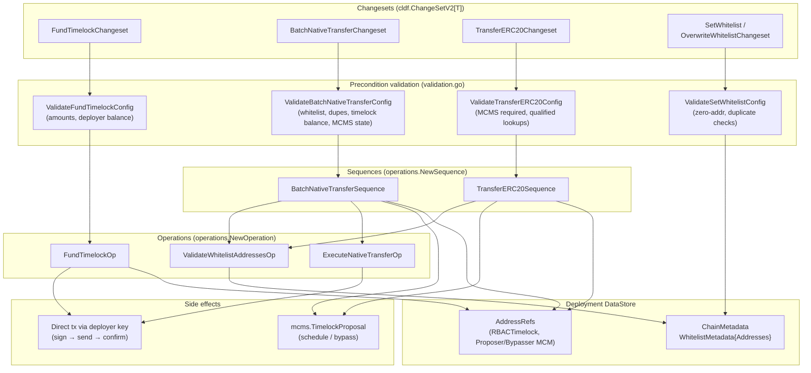
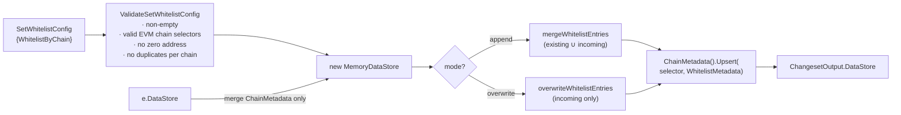
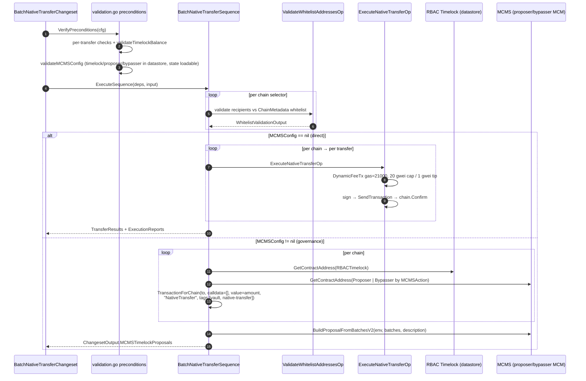
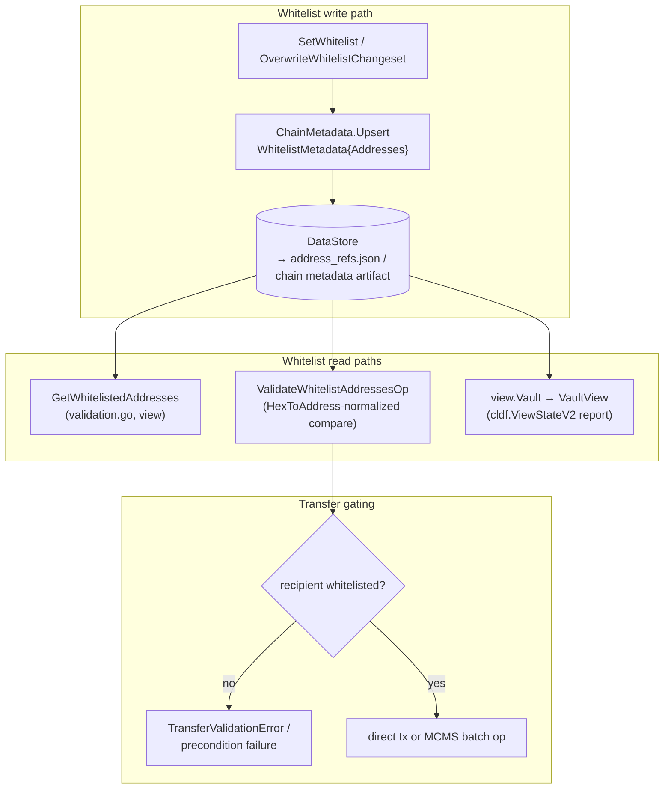

# Vault — Treasury Operations

> **Source location:** `chainlink/deployment/vault/changeset/` (`fund_timelock.go`, `batch_native_transfer.go`, `transfer_erc20.go`, `manage_whitelist.go`, `operations.go`, `types/types.go`)
> **Part of:** [Vault module](../vault.md) · [Deployment Framework Core & Product Deployments](../../Deployment_Framework_Core___Product_Deployments.md)
> **Sibling sub-modules:** [Automation Receiver](vault_automation_receiver.md) · [EthBalMon Lifecycle](vault_ethbalmon.md)

## 1. Purpose

The **vault_treasury** sub-module implements the *treasury operations* surface of the [vault changesets](../vault.md): moving native tokens and ERC-20 tokens out of RBAC **Timelock** contracts across multiple EVM chains, safeguarded by an **address whitelist** persisted in the deployment datastore, and either executed **directly** by a deployer key (test/devnet) or converted into **MCMS Timelock proposals** for governance sign-off (production).

It exposes four changesets plus the shared primitives (operations, validation, datastore lookups) they are built on:

| Changeset | File | Purpose | Execution modes |
|---|---|---|---|
| `FundTimelockChangeset` | `fund_timelock.go` | Fund timelock contracts with native tokens. **Testing only** — in production, timelocks are funded through governance processes. | Direct only |
| `BatchNativeTransferChangeset` | `batch_native_transfer.go` | Batch native-token (ETH/BNB/…) transfers to whitelisted recipients across chains | Direct **or** MCMS |
| `TransferERC20Changeset` | `transfer_erc20.go` | Batch ERC-20 `transfer(address,uint256)` calls from timelocks across chains | MCMS only |
| `SetWhitelistChangeset` / `OverwriteWhitelistChangeset` | `manage_whitelist.go` | Manage the whitelist state (append-merge or full overwrite) in datastore `ChainMetadata` | Datastore only (no on-chain tx) |

The prescribed production execution order (from `chainlink/deployment/vault/README.md`):

1. **SetWhitelist** — register approved destination addresses.
2. Fund the timelocks *via governance* (`FundTimelockChangeset` exists for test environments only).
3. **BatchNativeTransfer** / **TransferERC20** — execute or propose the transfers.

## 2. Architecture Overview



### 2.1 Layered responsibilities

| Layer | Representative components | Responsibility |
|---|---|---|
| **Changeset** | `fundTimelockChangeset`, `batchNativeTransferChangeset`, `transferERC20Changeset`, `whitelistChangeset` | `VerifyPreconditions` (config + on-chain/datastore checks) then `Apply`; fan out per chain; fold results into `cldf.ChangesetOutput` (datastore / MCMS proposals / execution reports) |
| **Sequence** | `BatchNativeTransferSequence`, `TransferERC20Sequence` | Multi-chain orchestration: validate all transfers per chain, then either execute directly or aggregate `mcmstypes.BatchOperation`s into a single `mcms.TimelockProposal` |
| **Operation** | `FundTimelockOp`, `ExecuteNativeTransferOp`, `ValidateWhitelistAddressesOp` | Single unit of work: sign/broadcast/confirm a native transfer, fund a timelock, or validate addresses against the whitelist |
| **Types** | `types.NativeTransfer`, `types.ERC20Transfer`, `types.BatchNativeTransferConfig`, `types.FundTimelockConfig`, `types.SetWhitelistConfig`, `types.BatchNativeTransferState`, … | JSON-serializable configuration and state projections |
| **Shared helpers** | `GetContractAddress`, `GetContractAddressWithQualifier` (`utils.go`), `recipientAddressesFromNativeTransfers`, `lowestChainSelector` | Datastore address lookups and deterministic input reduction |

### 2.2 Shared dependency injection

All operations and sequences receive `VaultDeps` (defined in `operations.go`):

```go
type VaultDeps struct {
    Chain       cldf_evm.Chain        // representative EVM chain (RPC client + deployer key)
    Auth        *bind.TransactOpts    // deployer signing options
    DataStore   datastore.DataStore   // address refs + chain metadata (whitelist)
    Environment cldf.Environment      // full environment (BlockChains, OperationsBundle, Logger)
}
```

The changeset picks the *primary chain* (first key of the config's transfer map) only to seed `VaultDeps` for the direct-execution path; per-chain operations re-resolve the correct chain from `Environment.BlockChains.EVMChains()`.

## 3. Whitelist Management (`manage_whitelist.go`)

The whitelist is **pure deployment state**: it lives in the datastore as `ChainMetadata` keyed by chain selector, holding `types.WhitelistMetadata{Addresses []WhitelistAddress}`. No on-chain contract is involved.

Two exported changesets share one implementation, parameterized by *mode* and a *reducer*:

| Changeset | Mode | Reducer | Semantics |
|---|---|---|---|
| `SetWhitelistChangeset` | `append` | `mergeWhitelistEntries` | Existing entries are kept; new addresses are appended; re-submitted addresses get their `Description` updated and `Labels` merged-in only when non-empty |
| `OverwriteWhitelistChangeset` | `overwrite` | `overwriteWhitelistEntries` | The per-chain list is replaced wholesale (empty input yields an empty list) |

**Datastore scoping detail (important):** `Apply` builds a *fresh* `datastore.NewMemoryDataStore()` and copies over **only chain metadata** via `mergeChainMetadataOnly`. A full datastore merge would carry every `AddressRef` from the environment (the catalog may hold duplicate contract keys — e.g. qualifier `""` vs. address-type from `deploy_timelock_vault` — and passing those through would upsert unwanted rows into `address_refs.json` even though this changeset only touches whitelist metadata).



Read-side helpers:

- `GetWhitelistedAddresses(e, chainSelectors)` — reads `WhitelistMetadata` from `ChainMetadata` per chain and returns `[]WhitelistEntry{Address, Labels, Qualifier: "whitelist-<address>"}`; errors if the datastore is nil.
- `getChainWhitelist` / `getChainWhitelistMutable` — tolerant readers: a missing `ChainMetadata` record returns an empty whitelist rather than an error.
- `validateWhitelist(e, cfg)` — batch-checks a `BatchNativeTransferConfig` and collects `types.TransferValidationError{ChainSelector, Address, Error}` entries for recipients that are not whitelisted (the stricter per-transfer variant runs inside `validation.go` preconditions).

## 4. Fund Timelock (`fund_timelock.go`) — testing only

`FundTimelockChangeset` transfers native tokens **from the deployer key** to the RBAC Timelock on each configured chain. It exists so simulated/test environments can pre-fund timelocks; production funding must go through governance.

- **Preconditions** (`ValidateFundTimelockConfig`): non-empty `FundingByChain`; every amount positive; for each resolvable chain, the deployer's native balance must cover the funding amount (queried via `chain.Client.BalanceAt`).
- **Apply**: per chain, resolves the timelock via `GetContractAddress(DataStore, selector, commontypes.RBACTimelock)`, executes `FundTimelockOp`, and logs the funding tx hash. Returns a datastore output that merges `e.DataStore` into a new memory store (so the runtime catalog sees the same refs).
- **`FundTimelockOp`** (`operations.go`): builds an `ethTypes.DynamicFeeTx` with `Gas: 50000` ("higher for timelock"), `GasFeeCap: 20 gwei`, `GasTipCap: 1 gwei`, signs it with the deployer signer, broadcasts, and waits for confirmation via `chain.Confirm`.
- **Inspection helpers**:
  - `GetTimelockBalances(e, chainSelectors)` → `map[uint64]*types.TimelockNativeBalanceInfo` (address + balance); chains without a recorded timelock are skipped with a debug log.
  - `calculateFundingRequirements(e, BatchNativeTransferConfig)` → `map[uint64]*FundingRequirement` summing planned transfer amounts per chain against the current timelock balance — a planning aid for pre-funding before a batch transfer.

## 5. Batch Native Transfer (`batch_native_transfer.go` + `operations.go`)

`BatchNativeTransferChangeset` is the core treasury workflow. Its `Apply` verifies every chain selector exists in the environment, seeds `VaultDeps`, and delegates to **`BatchNativeTransferSequence`** with `BatchNativeTransferSequenceInput{TransfersByChain, MCMSConfig, Description}`.



### 5.1 Precondition validation (`validation.go`)

`ValidateBatchNativeTransferConfig` enforces, per chain:

- chain selector is valid and EVM-family (`validateChainSelector`, backed by `chain-selectors`);
- the transfer list is non-empty;
- each `NativeTransfer` (`validateNativeTransfers`):
  - recipient is not the zero address;
  - amount is non-nil and strictly positive;
  - no duplicate recipient within the chain;
  - recipient **is whitelisted** (comparison against `GetWhitelistedAddresses`, normalized with `common.HexToAddress(...).Hex()`);
- the summed per-chain amount fits the current timelock balance (`validateTimelockBalance` via `GetTimelockBalances`);
- when `MCMSConfig != nil` (`validateMCMSConfig`): `MinDelay >= 0`, and per chain the datastore holds `RBACTimelock`, `ProposerManyChainMultisig`, and `BypasserManyChainMultisig` addresses plus loadable MCMS timelock chain state (`evmstate.MaybeLoadMCMSWithTimelockChainState` with the empty-qualifier address set).

### 5.2 Direct execution vs. MCMS proposals

| | Direct mode (`MCMSConfig == nil`) | MCMS mode (`MCMSConfig != nil`) |
|---|---|---|
| Who signs | Deployer key (`chain.DeployerKey.Signer`) | Governance signers on the proposer (or bypasser) MCM |
| Tx shape | `DynamicFeeTx{Gas: 21000, GasFeeCap: 20 gwei, GasTipCap: 1 gwei}`, value = amount, empty data | `mcmstypes.Transaction` with value = amount, empty calldata, tag `NativeTransfer`, tags `[vault, native-transfer]` |
| Confirmation | `chain.Confirm(signedTx)` awaited inline | None — a `[]mcms.TimelockProposal` is returned for the sign/vote/execute pipeline |
| Contract used | n/a | `BypasserManyChainMultisig` when `MCMSConfig.MCMSAction == TimelockActionBypass`, else `ProposerManyChainMultisig` |
| Output | `BatchNativeTransferSequenceOutput.TransferResults` → `ChangesetOutput.Reports` | `BatchNativeTransferSequenceOutput.MCMSTimelockProposals` → `ChangesetOutput.MCMSTimelockProposals` |

A default description ("Batch Native Token Transfer") is applied when `Description` is empty.

## 6. ERC-20 Transfer (`transfer_erc20.go` + `operations.go`)

`TransferERC20Changeset` moves ERC-20 tokens **held by the timelocks** and is **MCMS-only**: `TransferERC20Sequence` returns an error when `MCMSConfig == nil` ("MCMSConfig is required for ERC20 transfers") — a deployer key can never spend timelock-owned tokens directly.

Pipeline:

1. **Preconditions** (`ValidateTransferERC20Config`): non-empty config; `MCMSConfig` present; per chain — valid selector, non-empty transfer list, and `RBACTimelock` **and** `ProposerManyChainMultisig` resolvable via `GetContractAddressWithQualifier` using `MCMSConfig.TimelockQualifierPerChain[chainSelector]`; then `validateERC20MCMSConfig`.
2. **Sequence** (`TransferERC20Sequence`): per chain, `ValidateWhitelistAddressesOp` validates each `ERC20Transfer.Payee` against the whitelist.
3. **Proposal generation** (`generateERC20MCMSProposals`):
   - encodes calldata with an inline minimal ERC-20 ABI (`transfer(address,uint256)`) via `encodeERC20TransferCalldata`;
   - emits `TransactionForChain(chainSelector, tr.Token, data, big.NewInt(0), "ERC20Transfer", []string{"vault", "erc20-transfer"})` — the **token contract** is the call target, value is zero, and the amount lives in calldata;
   - resolves timelock/proposer-or-bypasser addresses *with qualifier* and builds an `mcmsevmsdk.Inspector` per chain;
   - aggregates all chains into one `mcms.TimelockProposal` via `BuildProposalFromBatchesV2` (default description "Vault ERC20 Transfer").

Output: `TransferERC20SequenceOutput{ValidationResults, MCMSTimelockProposals, Description}` → `ChangesetOutput{MCMSTimelockProposals, Reports}`.

## 7. Data Model (`types/types.go`)

| Type | Role |
|---|---|
| `NativeTransfer{To, Amount}` | One native transfer; amount in wei |
| `ERC20Transfer{Payee, Token, Amount}` | One ERC-20 transfer; amount in **token units**, token = contract address |
| `BatchNativeTransferConfig{TransfersByChain, MCMSConfig, Description}` | Input to `BatchNativeTransferChangeset`; `MCMSConfig` (`cldfproposalutils.TimelockConfig`) switches execution mode |
| `TransferERC20Config{TransfersByChain, MCMSConfig, Description}` | Input to `TransferERC20Changeset` (MCMS required) |
| `FundTimelockConfig{FundingByChain}` | Chain selector → native amount for `FundTimelockChangeset` |
| `WhitelistAddress{Address, Description, Labels}` | One whitelist entry |
| `SetWhitelistConfig{WhitelistByChain}` | Input to the whitelist changesets |
| `WhitelistMetadata{Addresses}` | Per-chain whitelist persisted as `ChainMetadata` |
| `TimelockNativeBalanceInfo{TimelockAddr, Balance}` | One timelock balance reading |
| `TransferValidationError{ChainSelector, Address, Error}` | Whitelist/balance validation failure entry |
| `BatchNativeTransferState{TimelockBalances, WhitelistedAddresses, ValidationErrors}` | Aggregated treasury state projection (balances + whitelist + validation errors), consumed by the [vault state view](../vault.md#23-state-model-deployment-datastore) `view.Vault` / `VaultView` |

Operation I/O types (`operations.go`): `ValidateWhitelistAddressesInput/Output`, `FundTimelockInput/Output` (`ChainSelector`, `TimelockAddress`, `Amount`, `TxHash`), `ExecuteNativeTransferInput/Output` (`ChainSelector`, `To`, `Amount`, `TxHash`), `BatchNativeTransferSequenceInput/Output` (`ValidationResults`, `FundingResults`, `TransferResults`, `MCMSTimelockProposals`), `TransferERC20SequenceInput/Output`.

## 8. Whitelist Lifecycle — End-to-End Data Flow



Because the whitelist is validated both at *precondition time* (fail-fast before any tx/proposal) and again inside the sequence (`ValidateWhitelistAddressesOp`, producing per-chain `ValidationResults`), a stale whitelist cannot silently pass a transfer through: a discrepancy surfaces as an operation error even if the changeset-level check was bypassed.

## 9. Related Governance Helper

`transfer_from_datastore.go` (same package) provides `TransferMCMSOwnershipFromDataStore`, which hands MCMS contract ownership to the timelock by reading `Proposer`/`Canceller`/`Bypasser` addresses from the runtime catalog datastore — used when *deploy* and *transfer* run in the same pipeline (e.g. `staging_testnet`). It composes `mcmschangesets.TransferToMCMSWithTimelockV2` rather than the treasury operations, but resolves contracts with the same `datastore` filter conventions (`AddressRefByChainSelector` / `ByType` / `ByQualifier`).

## 10. Dependencies

### Internal (same repository)

| Dependency | Used for |
|---|---|
| [`deployment-common`](../deployment-common.md) | `commontypes.RBACTimelock`, `ProposerManyChainMultisig`, `BypasserManyChainMultisig` contract-type labels resolved from the datastore |
| Vault view (`view/view.go`) | Surfaces `GetTimelockBalances` + `GetWhitelistedAddresses` as the `VaultView` state report (see [vault module](../vault.md)) |
| [System tests](../../Dev,_Test___Simulation_Environments/system-tests.md) | The CRE vault feature exercises these contracts in end-to-end environments |

### External (pinned in `chainlink/deployment/go.mod`)

| Library | Role |
|---|---|
| `chainlink-deployments-framework` (v0.123.3) | `cldf.Environment`, `ChangeSetV2`, `operations` (Bundle/Operation/Sequence), `datastore` (AddressRef / ChainMetadata / MemoryDataStore), `proposalutils.TimelockConfig`, `TransactionForChain` |
| `mcms` (v0.55.2) | `TimelockProposal`, `BatchOperation`, `Transaction`, `TimelockActionSchedule` / `TimelockActionBypass` |
| `cld-changesets` (legacy `mcms/proposeutils`) | `BuildProposalFromBatchesV2` proposal assembly |
| `go-ethereum` (v1.17.4) | `DynamicFeeTx` construction/signing, `abi.JSON` ERC-20 calldata encoding, client `BalanceAt` / `SendTransaction` |
| `chain-selectors` (v1.0.112) | EVM-family chain-selector validation in preconditions |

## 11. Testing

Each changeset has a sibling `_test.go` with simulated-chain coverage (`fund_timelock_test.go`, `batch_native_transfer_test.go`, `transfer_erc20_test.go`, `manage_whitelist_test.go`). Tests exercise both execution modes (direct + MCMS proposal generation), whitelist append/overwrite semantics, and precondition failures (zero addresses, insufficient timelock balance, missing MCMS contracts in the datastore). See the [vault module page](../vault.md) for how these fit into the broader changeset test conventions.
