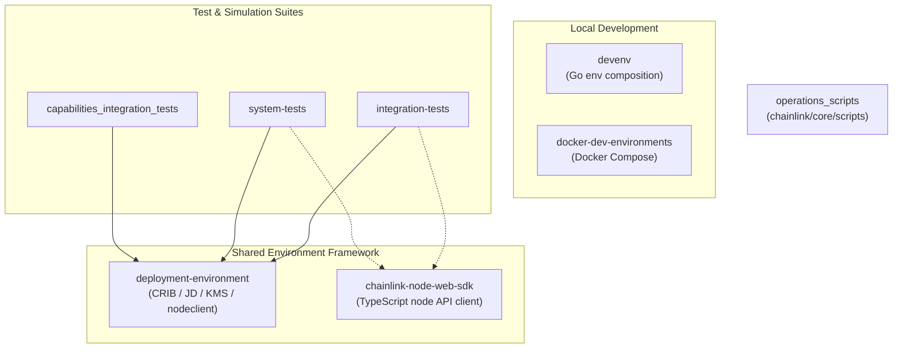
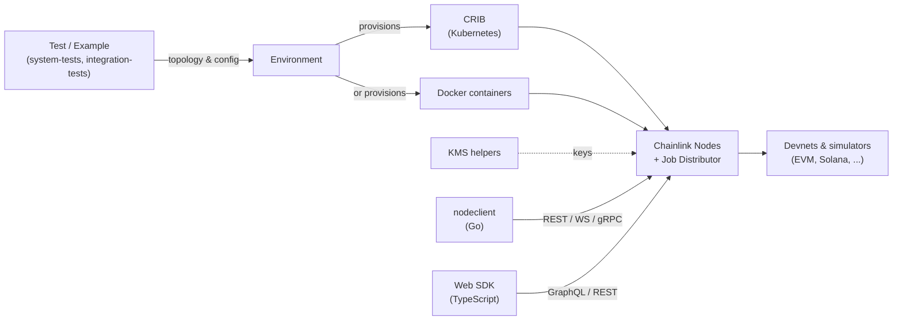
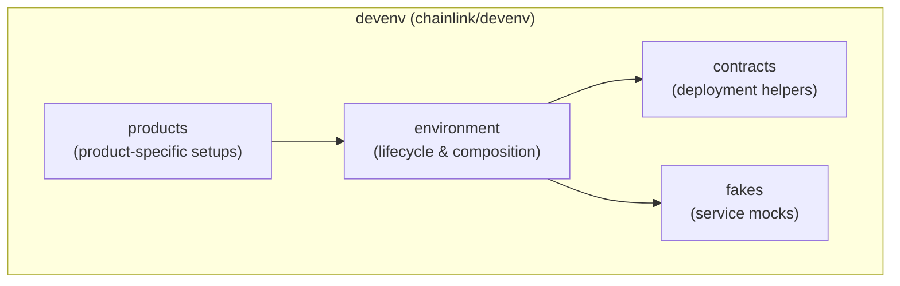

# Dev, Test & Simulation Environments

## Purpose

The **Dev, Test & Simulation Environments** module groups everything needed to build, run, and validate Chainlink systems outside of production. It is a cross-cutting module (it has no single root path) that spans several top-level directories and provides:

- **Local development environments** — fast, in-process and Docker-based environments for iterating on nodes, contracts, and workflows.
- **A shared environment framework** — reusable building blocks for spinning up full node networks (nodes + Job Distributor), on Kubernetes (CRIB) or Docker, with key management and API clients.
- **Operational scripts** — CLI scripts for deploying and managing product contract infrastructure (CCIP, VRF, CRE).
- **Test suites** — integration tests, CRE system tests, and capability integration tests that exercise the whole stack end-to-end.
- **A node Web SDK** — a TypeScript client for programmatically interacting with running Chainlink nodes.

## Architecture

The module is organized in three layers: developer-facing local environments, a shared environment framework, and the test/simulation suites built on top of it.

At runtime, a test suite or developer workflow describes an environment (topology, config, chains); the shared framework provisions it, and the clients are used to drive and observe the nodes:

The lightweight `devenv` framework composes local environments from contracts, fakes, and product-specific setup:

## Core Components

| Component | Repository Path | Description | Documentation |
| --- | --- | --- | --- |
| `devenv` | `chainlink/devenv` | Go framework for composing local development environments: environment lifecycle, contract deployment helpers, service fakes, and product-specific setups. | [devenv](<Dev,_Test___Simulation_Environments/devenv.md>) |
| `docker-dev-environments` | `chainlink/tools/docker` | Docker-based dev environments: node deployment, devnet simulators, a workflow-dev overlay, and an attached observability stack. | [docker-dev-environments](<Dev,_Test___Simulation_Environments/docker-dev-environments.md>) |
| `operations_scripts` | `chainlink/core/scripts` | Operational/deployment scripts for CCIP, VRF, and CRE environments, plus shared chain-common helpers. | [operations_scripts](<Dev,_Test___Simulation_Environments/operations_scripts.md>) |
| `deployment-environment` | `chainlink/deployment/environment` | Shared programmatic environment framework: CRIB (Kubernetes) environments, Job Distributor test utilities, KMS key handling, and the Go `nodeclient`. | [deployment-environment](<Dev,_Test___Simulation_Environments/deployment-environment.md>) |
| `chainlink-node-web-sdk` | `chainlink/deployment/environment/web/sdk` | TypeScript SDK for the node web API: client, generated GraphQL bindings, and shared types. | [chainlink-node-web-sdk](<Dev,_Test___Simulation_Environments/chainlink-node-web-sdk.md>) |
| `integration-tests` | `chainlink/integration-tests` | Docker-driven integration test suite: build tooling, contract helpers, test configuration, and CCIP smoke tests. | [integration-tests](<Dev,_Test___Simulation_Environments/integration-tests.md>) |
| `system-tests` | `chainlink/system-tests/lib` | CRE system-test library: environment setup, topology node definitions, capability feature tests, workflow deployment helpers, and `benchspy` benchmarking. | [system-tests](<Dev,_Test___Simulation_Environments/system-tests.md>) |
| `capabilities_integration_tests` | `capabilities/integration_tests` | Integration tests for capabilities (triggers, actions, etc.) validated against real node environments. | [capabilities_integration_tests](<Dev,_Test___Simulation_Environments/capabilities_integration_tests.md>) |

## Relationship to Other Modules

The environments in this module host and exercise artifacts produced by the rest of the repository:

- **Node images** built from the Node Application Core & Interfaces module are deployed by the Docker and CRIB environments.
- **Contracts and change-sets** from the Deployment Framework modules (CCIP, CRE/Keystone, Data Feeds) are deployed into environments via `operations_scripts` and the test contract helpers.
- **Capabilities and workflows** from the CRE engine are validated end-to-end by `system-tests` and `capabilities_integration_tests`.

In short, this module is the entry point for anyone who wants to run, simulate, or test a Chainlink stack locally or in CI.