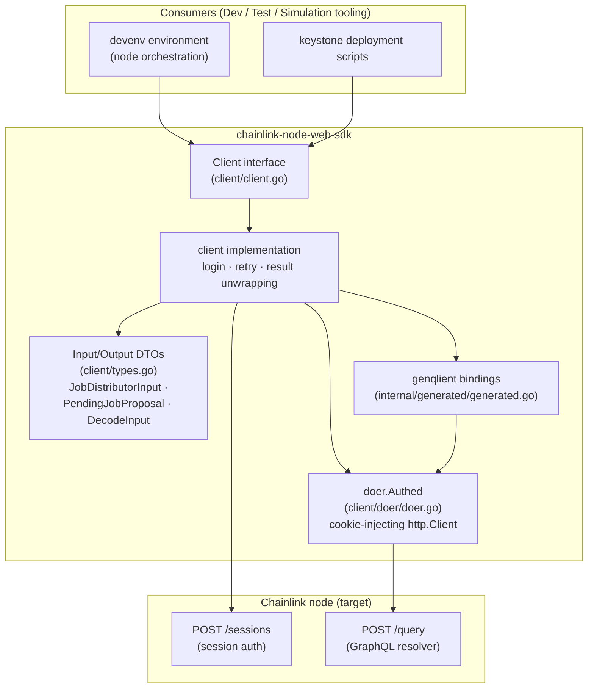
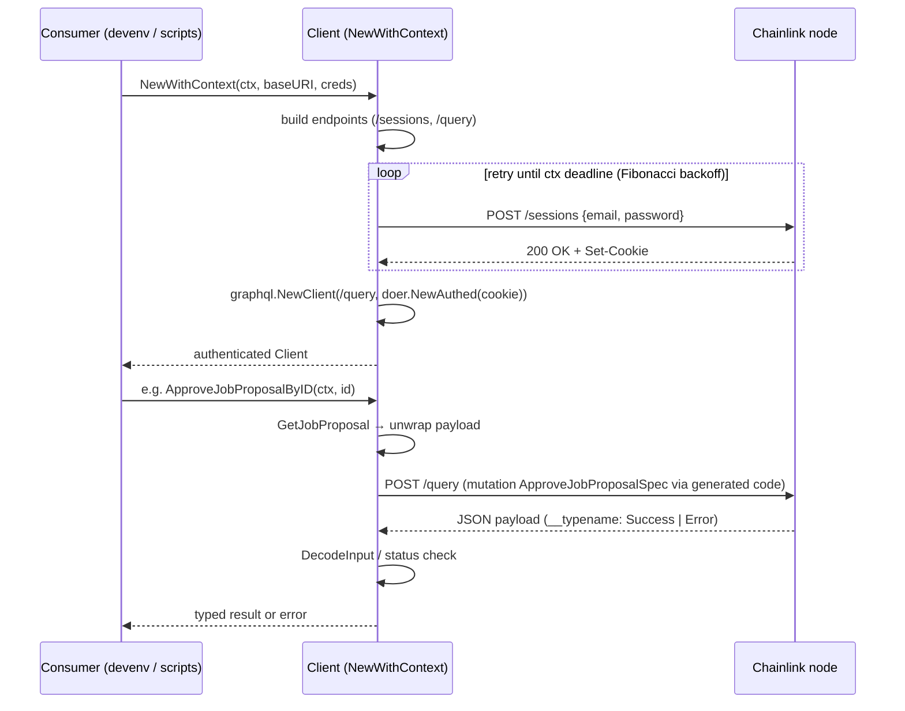
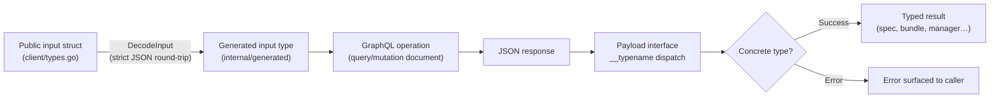
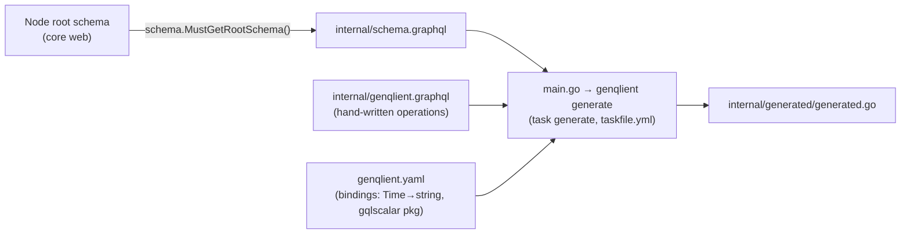

# Chainlink Node Web SDK

> **Module location:** `chainlink/deployment/environment/web/sdk` (Go module: `github.com/smartcontractkit/chainlink/deployment`)
>
> **Parent module:** [Dev, Test & Simulation Environments](../Dev,_Test___Simulation_Environments.md)

## Overview

The **Chainlink Node Web SDK** is a Go client library for programmatically driving a running [Chainlink node](../Node_Application_Core___Interfaces.md) through its **web API**. It gives deployment and test tooling a typed, compiled interface for everything the node's *feeds-manager* surface exposes: registering **Job Distributors** (feeds managers), reviewing and approving **job proposals**, inspecting **jobs** and **bridges**, and discovering node **keys** (CSA, P2P, per-chain accounts, OCR2 key bundles).

The public surface is the `Client` interface in [`client/client.go`](chainlink-node-web-sdk/chainlink-node-web-sdk_client.md). Its implementation authenticates with the node's session endpoint, then issues **GraphQL** operations against the node's `/query` endpoint. All GraphQL request/response marshalling is performed by code **generated with [genqlient](https://github.com/Khan/genqlient)** (see [Generated GraphQL Bindings](chainlink-node-web-sdk/chainlink-node-web-sdk_generated-graphql.md)) — the schema used for generation is a snapshot of the node's own root schema, which itself is documented in the [Web API / GraphQL API](../Node_Application_Core___Interfaces/web_api/web_api_graphql_api.md) sub-module.

### Key characteristics

| Aspect | Detail |
|---|---|
| **Transport** | HTTP: `POST /sessions` (login) and `POST /query` (GraphQL), both relative to a configured node base URI |
| **Auth** | Session cookie: credentials are exchanged for a `Set-Cookie` session token at construction time; the cookie is replayed on every GraphQL request |
| **GraphQL layer** | [genqlient](https://github.com/Khan/genqlient)-generated typed operations (`internal/generated/generated.go`) over `github.com/Khan/genqlient/graphql` |
| **Resilience** | Login is retried with Fibonacci backoff (`github.com/sethvargo/go-retry`) until the context deadline (default 10s) |
| **Strictness** | Inputs are decoded to generated types via a strict JSON round-trip that rejects unknown fields (`DecodeInput`) |
| **Consumers** | `devenv` environment automation ([devenv](devenv.md)) and keystone deployment scripts (see `chainlink/deployment/environment/web/sdk/README.md`) |

## Architecture

### Component map

### Request lifecycle

### Data flow through the layers

## Functionality provided by the `Client`

The full method catalog and implementation details are documented in [SDK Client](chainlink-node-web-sdk/chainlink-node-web-sdk_client.md). In summary:

1. **Session authentication** — `New`/`NewWithContext` log into the node with email/password, storing the session cookie; login failures are retried with backoff. Requests are authenticated via [`client/doer/doer.go::Authed`](chainlink-node-web-sdk/chainlink-node-web-sdk_client.md).
2. **Key discovery & management** — CSA public key, P2P peer ID, EVM account address per chain, multi-chain account keys (Aptos, Sui, Solana), OCR2 key bundles (list, filter by chain type, create new bundles).
3. **Jobs** — `GetJob` / `ListJobs` with pagination; job specs are returned as the polymorphic `JobSpec` union (OCR, OCR2, VRF, FluxMonitor, Cron, Workflow, CCIP, …).
4. **Job Distributors (feeds managers)** — get/list/create/update feeds managers, plus per-chain configuration (`CreateJobDistributorChainConfig`, `DeleteJobDistributorChainConfig`).
5. **Job proposal lifecycle** — get proposal, list pending proposals across all feeds managers, approve (by spec ID or proposal ID), reject, cancel, and update spec definitions.

### How this fits the node's web API

The operations mirror the node-side GraphQL resolvers and payloads (e.g. `CreateFeedsManagerInput`, `FeedsManagerParts`, `JobPartsSpec*`, `NotFoundError` unions) which are defined server-side in `chainlink/core/web` and documented in [Web API – GraphQL API](../Node_Application_Core___Interfaces/web_api/web_api_graphql_api.md) and the REST controllers in [Web API – REST Controllers](../Node_Application_Core___Interfaces/web_api/web_api_rest_controllers.md). The SDK intentionally performs *workflow composition* on top of single operations — for example `ListPendingJobProposals` fans out over the feeds managers returned by one query, and `ApproveJobProposalByID` chains `GetJobProposal` into `ApproveJobProposalSpec`.

## Sub-modules

| Sub-module | Contents | Documentation |
|---|---|---|
| **sdk-client** | `Client` interface, `client` implementation, authentication & retry, `doer.Authed` | [chainlink-node-web-sdk_client](chainlink-node-web-sdk/chainlink-node-web-sdk_client.md) |
| **sdk-types** | Public input/output DTOs, `DecodeInput`, chain-type aliases | [chainlink-node-web-sdk_types](chainlink-node-web-sdk/chainlink-node-web-sdk_types.md) |
| **sdk-generated-graphql** | genqlient-generated operations, payload unions, fragments, enums | [chainlink-node-web-sdk_generated-graphql](chainlink-node-web-sdk/chainlink-node-web-sdk_generated-graphql.md) |

## Code generation workflow

The generated layer is **never hand-edited**; it is regenerated from the node's live schema:

Details of this loop (source files: `chainlink/deployment/environment/web/sdk/main.go`, `genqlient.yaml`, `taskfile.yml`, `internal/genqlient.graphql`):

- `main.go` fetches the node's root GraphQL schema, snapshots it into `internal/schema.graphql`, then runs genqlient's generator.
- `genqlient.yaml` binds schema types to Go (`Time` → `string`) and maps the `gqlscalar` package used by the node's schema.
- To add a new server capability, add an operation to `internal/genqlient.graphql`, run `task generate`, then extend the `Client` interface and implementation (per the package [README](https://github.com/smartcontractkit/chainlink/tree/main/deployment/environment/web/sdk/README.md)). Workflow-only changes (composing existing operations) need no regeneration.

## Related modules

- [Deployment Environment](deployment-environment.md) — sibling harness (CRIB, node client models, JD test utils) that the SDK complements for node interaction.
- [Node Application Core & Interfaces](../Node_Application_Core___Interfaces.md) — the node under test, including the web API this SDK targets.
- [Developer Toolchain (CLI, SDKs & API Clients)](../Developer_Toolchain_(CLI,_SDKs___API_Clients).md) — other client tooling in the ecosystem.
