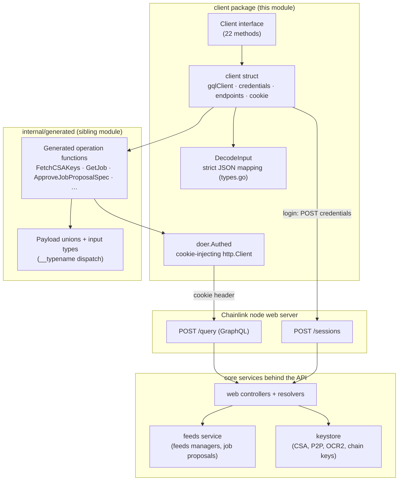
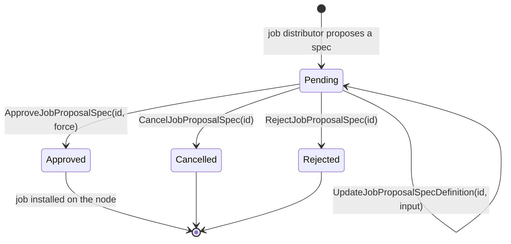
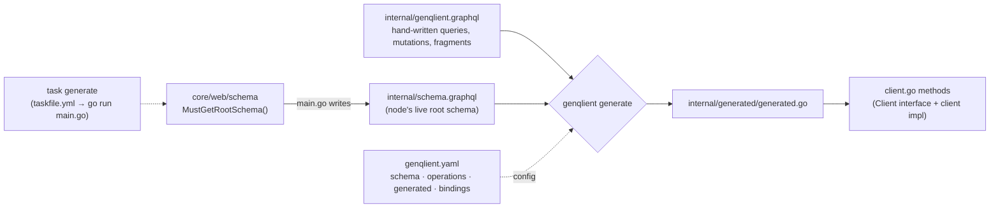

# Chainlink Node Web SDK — Client

## 1. Overview

The `chainlink-node-web-sdk_client` module (`chainlink/deployment/environment/web/sdk/client`) provides the primary programmatic entry point for talking to a **running Chainlink node's web server** from Go. It exposes a single `Client` interface that wraps the node's two HTTP surfaces:

| Node endpoint | Purpose | Transport |
|---|---|---|
| `POST {baseURI}/sessions` | Session-based authentication (email + password) | REST |
| `POST {baseURI}/query` | All node operations (keys, jobs, feeds managers, job proposals) | GraphQL |

The implementation is built on [genqlient](https://github.com/Khan/genqlient)-generated GraphQL bindings and is designed for **deployment, dev-environment, and test tooling**: it lets automated harnesses bootstrap a node — fetch CSA/P2P/chain keys, register *feeds managers* (job distributors) and their chain configs, provision OCR2 key bundles, and approve/reject/cancel **job proposals** — without any manual operator interaction.

- Source: `chainlink/deployment/environment/web/sdk/client/client.go` (module `github.com/smartcontractkit/chainlink/deployment`)
- Parent module: [chainlink-node-web-sdk](../chainlink-node-web-sdk.md)
- Package README: `chainlink/deployment/environment/web/sdk/README.md` — *"This package exports a `Client` for interacting with the `feeds-manager` service of core."*

## 2. Position in the System

The SDK sits in the **Dev, Test & Simulation Environments** layer of the repository, between automated test harnesses and a live node's web server:

- **Consumers** — Per the package README, real-world usage lives in `chainlink/devenv/don.go` and `keystone/scripts/main.go`; it is used to wire nodes into dev networks and simulation environments ([devenv](../devenv.md), [deployment-environment](../deployment-environment.md)). The node-side HTTP client of the same environment framework is documented separately in [deployment-environment nodeclient](../deployment-environment/deployment-environment_nodeclient.md).
- **Server-side counterpart** — The GraphQL schema served at `/query` is the node's own schema (`chainlink/core/web/schema/schema.graphql`); the SDK's generated types are bound to the node's scalar package `core/web/gqlscalar`. The serving side (controllers, resolvers, session middleware) is documented in [Node Application Core & Interfaces → Web API](../../Node_Application_Core___Interfaces/web_api.md).
- **Domain counterpart** — Feeds managers and job proposals managed through this SDK are the domain of the node's [Feeds Service](../../Node_Platform_Services/feeds_service.md).

> ℹ️ **Orientation note**: despite living under "web/sdk", this client is *not* a public operator SDK. It is an internal helper that exists so tests and deployment tooling can drive nodes exactly the way an operator would via the node's web UI/API.

## 3. Architecture

The module is a thin, layered client. All network behaviour is concentrated in three collaborating pieces: the `client` implementation, a cookie-injecting `http.Client` wrapper (`doer.Authed`), and the generated GraphQL layer.



### 3.1 Core components (client.go)

| Component | Kind | Responsibility |
|---|---|---|
| `Client` | interface | The full public API surface (22 methods). Consumers depend on this, never on the concrete type. |
| `client` | struct | Implementation. Holds `gqlClient graphql.Client`, `credentials Credentials`, `endpoints`, and the session `cookie`. |
| `Credentials` | struct | `{Email, Password}` — JSON-marshalled into the `/sessions` login request. |
| `endpoints` | struct | Derived from the base URI: `Sessions` (`/sessions`) and `Query` (`/query`). |
| `OCR2KeyBundle` | struct | Local projection of an OCR2 key bundle: `ID`, `ChainType`, `ConfigPublicKey`, `OnChainPublicKey`, `OffChainPublicKey`. |
| `login()` | method | REST authentication against `/sessions`; captures the `Set-Cookie` header. |

### 3.2 The authed doer (`client/doer/doer.go`)

`doer.Authed` is a minimal decorator around `http.DefaultClient` that injects the session cookie into every outgoing request:

```go
func (a *Authed) Do(req *http.Request) (*http.Response, error) {
    req.Header.Set("cookie", a.cookie)
    return a.wrapped.Do(req)
}
```

This is the only shared credential state between the REST login step and all subsequent GraphQL calls — the cookie obtained at construction time is replayed on every `/query` request.

## 4. Client Interface — API Surface

The 22 `Client` methods fall into four functional domains. Generated GraphQL operation names are documented in the [generated-graphql sibling module](chainlink-node-web-sdk_generated-graphql.md); the operation source lives in `internal/genqlient.graphql`.

### 4.1 Key & account management

| Method | Behaviour |
|---|---|
| `FetchCSAPublicKey(ctx)` | `FetchCSAKeys` query → first CSA key's `PublicKey`; error if none exist. |
| `FetchP2PPeerID(ctx)` | `FetchP2PKeys` query → first P2P key's `PeerID`. |
| `FetchAccountAddress(ctx, chainID)` | `FetchAccounts` (ethKeys) → address of an **enabled** EVM chain matching `chainID`. |
| `FetchKeys(ctx, chainType)` | `FetchKeys` query → key IDs for `aptos`, `sui`, or `solana` chains; unsupported chain types error. |
| `FetchOCR2KeyBundleID(ctx, chainType)` | `FetchOCR2KeyBundles` → first bundle matching the requested chain type. |
| `ListOCR2KeyBundles(ctx)` | Full projection of all OCR2 bundles into `OCR2KeyBundle`. |
| `CreateOCR2KeyBundle(ctx, chainType)` | `CreateOCR2KeyBundle` mutation → ID of the newly created bundle. |

### 4.2 Jobs & bridges

| Method | Behaviour |
|---|---|
| `GetJob(ctx, id)` | `GetJob` query with the full `JobParts` fragment (all spec variants, incl. CCIP, OCR2, Workflow, …). |
| `ListJobs(ctx, offset, limit)` | Paginated `ListJobs` query. |
| `GetBridge` / `ListBridges` | Implemented on the concrete `client` type (bridges domain) but **not yet declared on the `Client` interface**. |

### 4.3 Feeds managers (job distributors)

| Method | Behaviour |
|---|---|
| `CreateJobDistributor(ctx, JobDistributorInput)` | `CreateFeedsManager` mutation → new manager ID; converts `SingleFeedsManagerError` into a Go error. |
| `UpdateJobDistributor(ctx, id, JobDistributorInput)` | `UpdateFeedsManager` mutation. |
| `GetJobDistributor(ctx, id)` | `GetFeedsManager` query → `FeedsManagerParts`. |
| `ListJobDistributors(ctx)` | `ListFeedsManagers` query. |
| `CreateJobDistributorChainConfig(ctx, JobDistributorChainConfigInput)` | `CreateFeedsManagerChainConfig` mutation → chain-config ID (covers FluxMonitor, OCR1, OCR2 job config incl. plugins). |
| `DeleteJobDistributorChainConfig(ctx, id)` | `DeleteFeedsManagerChainConfig` mutation. |

### 4.4 Job proposals

| Method | Behaviour |
|---|---|
| `GetJobProposal(ctx, id)` | `GetJobProposal` query → proposal with all specs and the latest spec. |
| `ApproveJobProposalSpec(ctx, specID, force)` | `ApproveJobProposalSpec` mutation; success requires status `APPROVED`, decoded into `JobProposalApprovalSuccessSpec`. |
| `CancelJobProposalSpec(ctx, specID)` | `CancelJobProposalSpec` mutation; success requires status `CANCELLED`. |
| `RejectJobProposalSpec(ctx, specID)` | `RejectJobProposalSpec` mutation (response passed through). |
| `UpdateJobProposalSpecDefinition(ctx, specID, input)` | `UpdateJobProposalSpecDefinition` mutation. |
| `ListPendingJobProposals(ctx)` | **Composed operation**: walks every feeds manager from `ListFeedsManagers` and collects proposals whose latest spec is `PENDING` into `PendingJobProposal` records. |
| `ApproveJobProposalByID(ctx, proposalID, force)` | **Composed operation**: `GetJobProposal` → resolve latest spec ID → `ApproveJobProposalSpec`. |

The job-proposal operations drive the proposal lifecycle of the node's feeds manager service (domain details: [Feeds Service](../../Node_Platform_Services/feeds_service.md)):



## 5. Construction & Authentication

`Client` instances are created with `NewWithContext(ctx, baseURI, creds)` (the older `New` is deprecated and simply applies a 10-second background context). Construction performs a **blocking, retried login** — an instance is only returned once a session cookie has been obtained.

```mermaid
sequenceDiagram
    participant C as Caller
    participant S as client
    participant N as Node POST /sessions

    C->>S: NewWithContext(ctx, baseURI, Credentials)
    S->>S: endpoints = {baseURI + "/sessions", baseURI + "/query"}

    loop retry.Do — Fibonacci backoff (start 2s), capped at ctx deadline (default 10s)
        S->>N: POST {email, password} (JSON)
        alt HTTP 200 + Set-Cookie header
            N-->>S: Set-Cookie: <session>=…; …
            S->>S: store first ;-segment of header as c.cookie
        else non-200 / network error / no Set-Cookie
            N-->>S: failure detail
            S->>S: wrap as retry.RetryableError
        end
    end

    S->>S: gqlClient = graphql.NewClient("/query", doer.NewAuthed(c.cookie))
    S-->>C: ready Client (authenticated)
```

Implementation notes:

- Retry policy: `retry.Do(ctx, retry.WithMaxDuration(time.Until(deadline), retry.NewFibonacci(2*time.Second)), …)` via `github.com/sethvargo/go-retry` — a Fibonacci backoff starting at 2s and bounded by the caller's context deadline (or 10s if none is set). This tolerates nodes that are still booting up in test environments.
- Cookie extraction: the raw `Set-Cookie` header is split on `;` and only the first attribute (the cookie pair) is retained; it is later replayed verbatim by `doer.Authed`.
- Failure surface: the constructor returns a wrapped `"failed to login to node"` error after the retry budget is exhausted.

## 6. Request Execution Flow

After construction, every operation follows the same pipeline: a hand-written `client` method delegates to a generated operation function, which posts GraphQL to `/query` through the authed doer, then unpacks the payload union.

```mermaid
sequenceDiagram
    participant C as Caller
    participant M as client method
    participant G as generated op function
    participant D as doer.Authed
    participant N as Node POST /query

    C->>M: ApproveJobProposalSpec(ctx, specID, force)
    M->>G: generated.ApproveJobProposalSpec(ctx, gqlClient, specID, force)
    G->>D: GraphQL document + variables
    D->>N: POST /query (header: cookie)
    N-->>D: payload union: Success | NotFoundError | JobAlreadyExistsError
    D-->>G: HTTP response body
    G-->>M: typed payload (__typename-dispatched struct)
    M->>M: type-assert success branch; DecodeInput(spec) into local type
    M-->>C: *JobProposalApprovalSuccessSpec — or — error
```

Two layers of mapping occur:

1. **Inbound (wire → local)**: generated types model GraphQL interfaces as payload unions; unmarshalling switches on `__typename` (see [generated-graphql module](chainlink-node-web-sdk_generated-graphql.md)). Client methods then type-assert the success variant and re-decode it into SDK-local types with `DecodeInput`.
2. **Outbound (local → wire)**: SDK input types such as `JobDistributorInput` and `JobDistributorChainConfigInput` are converted to generated `…Input` types via `DecodeInput` before invoking mutations.

## 7. Error Handling Conventions

The module follows a consistent set of conventions:

- **GraphQL unions → Go errors.** Every mutation/query response includes error variants (`NotFoundError`, `InputErrors`, `SingleFeedsManagerError`, `JobAlreadyExistsError`). Client methods match on the success variant; anything else is converted into an `errors.New`/`fmt.Errorf` with a stable message (e.g. `"failed to create feeds manager"`, `"failed to get job proposal"`).
- **Post-condition verification.** Approve/cancel re-check the returned spec status (`SpecStatusApproved` / `SpecStatusCancelled`) and fail loudly if the server did not reach the expected state ("job proposal spec not cancelled").
- **Missing-data guards.** Empty result sets produce explicit errors that hint at root causes — e.g. `"no ocr2 keybundle found, check if ocr2 is enabled"`, `"no CSA keys found"`, `"no account found for chain %s"`.
- **Strict input decoding.** `DecodeInput` (in `types.go`) marshals the input to JSON and decodes with `DisallowUnknownFields`, catching field-name drift between SDK types and generated GraphQL inputs at runtime. It rejects non-pointer or nil output targets. Behaviour is covered by `client/types_test.go`.
- **Retryability is scoped to login.** Only the construction-time login is retried; GraphQL operations fail fast and surface transport errors from genqlient.

Input/output value types (`JobDistributorInput`, `JobDistributorChainConfigInput`, `PendingJobProposal`, `JobProposalApprovalSuccessSpec`, `OCR2ChainType` constants for `evm`, `solana`, `starknet`, `aptos`, `tron`, `ton`) are detailed in the [types sibling module](chainlink-node-web-sdk_types.md).

## 8. Schema Synchronization & Code Generation

The SDK is kept in lock-step with the node's GraphQL API through a small code-generation loop rooted in the SDK package (`main.go`, `genqlient.yaml`, `taskfile.yml`):



Key facts (paths relative to `chainlink/deployment/environment/web/sdk/`):

- `main.go` pulls the **same root schema object the node serves** (`github.com/smartcontractkit/chainlink/v2/core/web/schema` → `MustGetRootSchema()`, mirroring `core/web/schema/schema.graphql` documented in [Web API](../../Node_Application_Core___Interfaces/web_api.md)), writes it to `internal/schema.graphql`, then invokes `genqlient/generate.Main()`.
- `genqlient.yaml` wires schema + operations (`internal/genqlient.graphql`) to the output package (`internal/generated/generated.go`), binds the `Time` scalar to `string`, and binds unknown scalar packages to `core/web/gqlscalar`.
- Hand-written operations in `internal/genqlient.graphql` define the queries/mutations and shared fragments (`JobParts` with one fragment per job spec type — OCR2, OCR, FluxMonitor, DirectRequest, Cron, VRF, Webhook, BlockhashStore, BlockHeaderFeeder, Bootstrap, Gateway, Workflow, StandardCapabilities, Stream, CCIP; `FeedsManagerParts`; `BridgeParts`).
- Regeneration is `task generate` (requires the [go-task](https://taskfile.dev/) CLI). Per the README: add operations to `genqlient.graphql`, regenerate, then extend the `Client` interface and `client` implementation. Operations that merely **compose** existing ones (like `ListPendingJobProposals`, `ApproveJobProposalByID`) need no regeneration.

This workflow is what guarantees the SDK's compile-time compatibility with the node's schema; when the node's API changes, [regenerate](#8-schema-synchronization--code-generation) and fix any `DecodeInput`/type-assertion fallout surfaced by the strict decoding.

## 9. Usage Example

Illustrative flow used by dev-environment tooling (see `devenv/don.go` and `keystone/scripts/main.go` for real integrations):

```go
ctx, cancel := context.WithTimeout(context.Background(), time.Minute)
defer cancel()

node, err := sdkclient.NewWithContext(ctx, "http://localhost:6688", sdkclient.Credentials{
    Email:    "notreal@chainlink.node",
    Password: "p3NtbdcVh7JEHf9NQ/Pfv3VFEIs2iDFwN6WM5Uv90gE=",
})
if err != nil {
    return err // login retried until deadline; error here means the node is unreachable/misconfigured
}

// 1. Harvest node identity material
csa, _ := node.FetchCSAPublicKey(ctx)
peerID, _ := node.FetchP2PPeerID(ctx)
ocr2BundleID, _ := node.FetchOCR2KeyBundleID(ctx, sdkclient.OCR2ChainTypeEvm)
accountAddr, _ := node.FetchAccountAddress(ctx, "1337")

// 2. Register a job distributor and its chain config
jdID, err := node.CreateJobDistributor(ctx, sdkclient.JobDistributorInput{
    Name: "jd", URI: "grpc://job-distributor:8000", PublicKey: csaPubKey,
})
chainCfgID, err := node.CreateJobDistributorChainConfig(ctx, sdkclient.JobDistributorChainConfigInput{
    JobDistributorID: jdID,
    ChainID:          "1337",
    ChainType:        "evm",
    AccountAddr:      *accountAddr,
    Ocr2Enabled:      true,
    Ocr2KeyBundleID:  ocr2BundleID,
    Ocr2P2PPeerID:    *peerID,
    // …
})

// 3. Drain pending job proposals proposed by the distributor
pending, _ := node.ListPendingJobProposals(ctx)
for _, p := range pending {
    if _, err := node.ApproveJobProposalByID(ctx, p.ProposalID, false); err != nil {
        return fmt.Errorf("approve %s: %w", p.ProposalID, err)
    }
}
```

## 10. Dependencies & Build Context

Defined in `chainlink/deployment/go.mod` (module `github.com/smartcontractkit/chainlink/deployment`):

| Dependency | Role |
|---|---|
| `github.com/Khan/genqlient v0.8.1` | GraphQL client + code generation for the generated layer. |
| `github.com/sethvargo/go-retry v0.3.0` | Fibonacci retry loop for login. |
| stdlib (`net/http`, `encoding/json`, `context`, `reflect`) | REST login, strict decoding, context plumbing. |

There is no build-time coupling to the node binary itself; the coupling is **schema-time only** (via `core/web/schema` during `task generate`). Testing within the package is limited to unit tests of the decoding layer (`types_test.go`); end-to-end coverage comes from the consumers in the [devenv](../devenv.md) and system-test environments.

## 11. Related Documentation

- [chainlink-node-web-sdk](../chainlink-node-web-sdk.md) — parent module overview.
- [chainlink-node-web-sdk / generated-graphql](chainlink-node-web-sdk_generated-graphql.md) — generated payload unions, input types, and `__typename` dispatch.
- [chainlink-node-web-sdk / types](chainlink-node-web-sdk_types.md) — SDK-local input/output types and `DecodeInput`.
- [Node Application Core & Interfaces → Web API](../../Node_Application_Core___Interfaces/web_api.md) — the server side: controllers, resolvers, GraphQL schema, session middleware.
- [Node Platform Services → Feeds Service](../../Node_Platform_Services/feeds_service.md) — the feeds manager / job proposal domain behind the SDK's distributor and proposal operations.
- [Dev, Test & Simulation Environments](../../Dev,_Test___Simulation_Environments.md) — sibling environment modules that consume this SDK.
