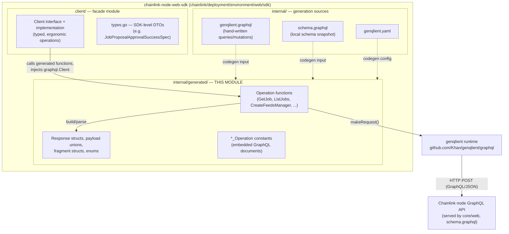
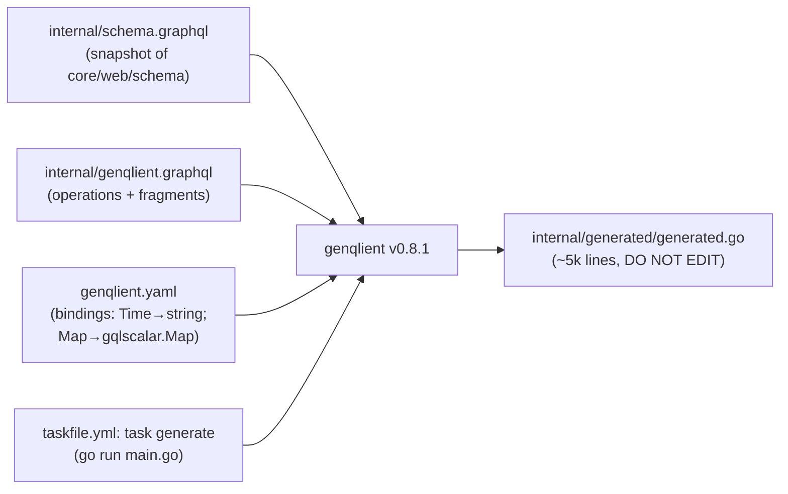
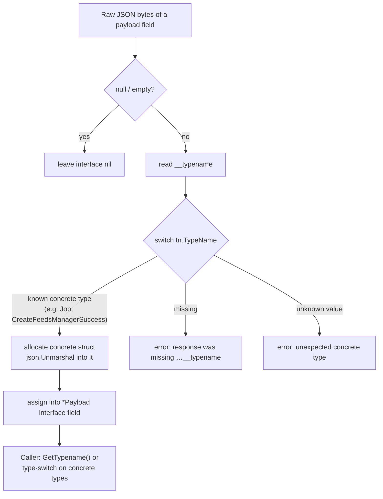
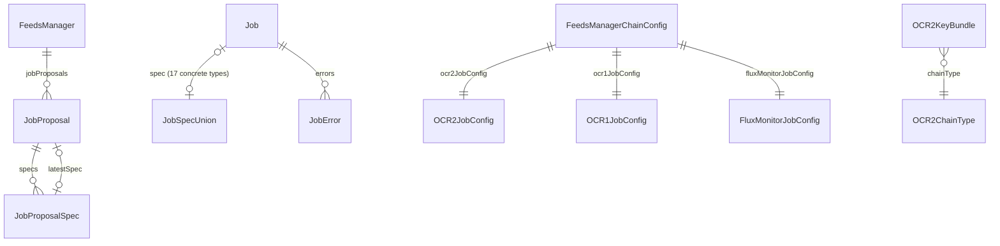

# Chainlink Node Web SDK — Generated GraphQL Layer (`internal/generated`)

## Introduction

The **`generated-graphql`** module is the auto-generated GraphQL client binding layer of the **Chainlink Node Web SDK** (`chainlink/deployment/environment/web/sdk`). It is produced by [genqlient](https://github.com/Khan/genqlient) and lives in a single file:

```
chainlink/deployment/environment/web/sdk/internal/generated/generated.go   // "Code generated by github.com/Khan/genqlient, DO NOT EDIT."
```

It provides strongly-typed Go functions, request/response structs, payload unions, fragment structs, and enums for the subset of the **Chainlink node's GraphQL API** that the dev/test tooling needs — primarily the *feeds-manager* (a.k.a. *Job Distributor*) workflow: key inventory, job/job-proposal management, and feeds-manager registration (see `chainlink/deployment/environment/web/sdk/README.md`).

Because the file is generated, this module should be understood as a **stable, mechanical projection** of:

1. The node's GraphQL schema — `chainlink/core/web/schema/schema.graphql` (snapshot in `internal/schema.graphql`), and
2. The hand-written operations — `internal/genqlient.graphql`,

driven by the configuration in `internal/../genqlient.yaml` and regenerated via the SDK's Taskfile (`taskfile.yml`: `task generate` → `go run main.go`).

---

## Role in the System

This module is one of three sub-modules of the [Chainlink Node Web SDK](../chainlink-node-web-sdk.md):



- The [client facade](chainlink-node-web-sdk_client.md) (see its `Client` interface) is the **only intended consumer** of this module's generated functions; it unwraps payload unions and maps them onto SDK-level types from the [types module](chainlink-node-web-sdk_types.md).
- The [dev & test environments](../../Dev,_Test___Simulation_Environments.md) consume the facade, not the generated code directly. The SDK README points to `devenv/don.go` and `keystone/scripts/main.go` as real-world usage examples (see [devenv environment](../devenv/devenv_environment.md)).
- On the server side, the operations hit the node's GraphQL resolvers — the same surface documented in [Web API → GraphQL API](../../Node_Application_Core___Interfaces/web_api/web_api_graphql_api.md).

---

## Code Generation Pipeline

The module is fully described by three artifacts in the SDK directory (verified in-repo):

| Artifact | Path | Purpose |
|---|---|---|
| Config | `chainlink/deployment/environment/web/sdk/genqlient.yaml` | Schema source, operations source, output path, type bindings |
| Operations | `chainlink/deployment/environment/web/sdk/internal/genqlient.graphql` | Hand-written `query`/`mutation` documents and fragments |
| Generator entry | `chainlink/deployment/environment/web/sdk/taskfile.yml` | `task generate` → `go run main.go` |

Key configuration decisions in `genqlient.yaml`:

- `schema: ./internal/schema.graphql` — generation is pinned to a **local snapshot** of the node schema (`chainlink/core/web/schema/schema.graphql`), decoupling SDK builds from a live node.
- `bindings: Time: type: string` — the GraphQL `Time` scalar maps to Go `string` rather than `time.Time`.
- `package_bindings: github.com/smartcontractkit/chainlink/v2/core/web/gqlscalar` — the GraphQL `Map` scalar maps to `gqlscalar.Map`, so the generated models reuse the node's own scalar type for free-form JSON objects (`relayConfig`, `pluginConfig`, `gatewayConfig`, `ocrKeyBundleIDs`).

This creates a deliberate **coupling to the core module**: `chainlink/deployment/go.mod` declares `require github.com/Khan/genqlient v0.8.1` and `replace github.com/smartcontractkit/chainlink/v2 => ../`, so within the monorepo the SDK and node scalar types always stay in sync.



---

## Generated API Surface

### Queries (read operations)

| Generated function | Signature (abbreviated) | Server root field (per `core/web/schema/schema.graphql`) |
|---|---|---|
| `FetchAccounts` | `(ctx, client)` → `*FetchAccountsResponse` | `ethKeys` — EVM accounts w/ ETH/LINK balances |
| `FetchCSAKeys` | `(ctx, client)` → `*FetchCSAKeysResponse` | `csaKeys` |
| `FetchKeys` | `(ctx, client)` → `*FetchKeysResponse` | `solanaKeys`, `aptosKeys`, `suiKeys` |
| `FetchOCR2KeyBundles` | `(ctx, client)` → `*FetchOCR2KeyBundlesResponse` | `ocr2KeyBundles` |
| `FetchP2PKeys` | `(ctx, client)` → `*FetchP2PKeysResponse` | `p2pKeys` |
| `GetBridge` | `(ctx, client, id)` → `*GetBridgeResponse` | `bridge(id)` |
| `GetFeedsManager` | `(ctx, client, id)` → `*GetFeedsManagerResponse` | `feedsManager(id)` |
| `GetJob` | `(ctx, client, id)` → `*GetJobResponse` | `job(id)` |
| `GetJobProposal` | `(ctx, client, id)` → `*GetJobProposalResponse` | `jobProposal(id)` |
| `ListBridges` | `(ctx, client, offset, limit)` → `*ListBridgesResponse` | `bridges(offset, limit)` |
| `ListFeedsManagers` | `(ctx, client)` → `*ListFeedsManagersResponse` | `feedsManagers` |
| `ListJobs` | `(ctx, client, offset, limit)` → `*ListJobsResponse` | `jobs(offset, limit)` |

### Mutations (write operations)

| Generated function | Signature (abbreviated) | Possible payload concrete types |
|---|---|---|
| `ApproveJobProposalSpec` | `(ctx, client, id, force)` | `...Success`, `JobAlreadyExistsError`, `NotFoundError` |
| `CancelJobProposalSpec` | `(ctx, client, id)` | `...Success`, `NotFoundError` |
| `CreateFeedsManager` | `(ctx, client, CreateFeedsManagerInput)` | `...Success`, `DuplicateFeedsManagerError`, `InputErrors`, `NotFoundError`, `SingleFeedsManagerError` |
| `CreateFeedsManagerChainConfig` | `(ctx, client, CreateFeedsManagerChainConfigInput)` | `...Success`, `InputErrors`, `NotFoundError` |
| `CreateOCR2KeyBundle` | `(ctx, client, chainType)` | `...Success` only |
| `DeleteFeedsManagerChainConfig` | `(ctx, client, id)` | `...Success`, `NotFoundError` |
| `RejectJobProposalSpec` | `(ctx, client, id)` | `...Success`, `NotFoundError` |
| `UpdateFeedsManager` | `(ctx, client, id, UpdateFeedsManagerInput)` | `...Success`, `InputErrors`, `NotFoundError` |
| `UpdateJobProposalSpecDefinition` | `(ctx, client, id, UpdateJobProposalSpecDefinitionInput)` | `...Success`, `NotFoundError` |

Every operation function follows the identical genqlient template — build a `graphql.Request` with the embedded document constant and typed variables struct, then call the injected client:

```go
func GetJob(ctx_ context.Context, client_ graphql.Client, id string) (data_ *GetJobResponse, err_ error) {
    req_ := &graphql.Request{OpName: "GetJob", Query: GetJob_Operation, Variables: &__GetJobInput{Id: id}}
    data_ = &GetJobResponse{}
    resp_ := &graphql.Response{Data: data_}
    err_ = client_.MakeRequest(ctx_, req_, resp_)
    return data_, err_
}
```

### Enums

| Enum | Values |
|---|---|
| `ErrorCode` | `NOT_FOUND`, `INVALID_INPUT`, `UNPROCESSABLE` |
| `JobProposalStatus` | `PENDING`, `APPROVED`, `REJECTED`, `CANCELLED`, `DELETED`, `REVOKED` |
| `SpecStatus` | `UNKNOWN`, `PENDING`, `APPROVED`, `REJECTED`, `CANCELLED`, `REVOKED` |
| `OCR2ChainType` | `EVM`, `SOLANA`, `STARKNET`, `APTOS`, `TRON`, `TON`, `SUI`, `STELLAR` |

Each enum also gets an `All…` slice for exhaustiveness checks.

### The `JobSpec` union (17 concrete spec types)

`JobPartsSpecJobSpec` is the generated Go interface for the polymorphic `Job.spec` field. `__unmarshalJobPartsSpecJobSpec` dispatches on `__typename` to one of: `BlockHeaderFeederSpec`, `BlockhashStoreSpec`, `BootstrapSpec`, `CCIPSpec`, `CCVCommitteeVerifierSpec`, `CCVExecutorSpec`, `CronSpec`, `DirectRequestSpec`, `FluxMonitorSpec`, `GatewaySpec`, `OCR2Spec`, `OCRSpec`, `StandardCapabilitiesSpec`, `StreamSpec`, `VRFSpec`, `WebhookSpec`, `WorkflowSpec`.

Callers type-switch on these (or check `GetTypename()`) to extract job-type-specific configuration such as `VRFSpec.BatchFulfillmentEnabled` or `OCRSpec.KeyBundleID`.

---

## Type-System Conventions (what to expect when reading the file)

1. **Payload unions as Go interfaces.** Every mutation returning `…Payload` (a GraphQL interface with error/success implementors) becomes a Go interface with an unexported marker method (`implementsGraphQLInterface…Payload()`) and a `GetTypename() string`. Concrete implementors (`…Success`, `NotFoundError`, `InputErrors`, …) all satisfy it.
2. **Discriminated (un)marshaling.** For each payload interface, genqlient emits `__unmarshal…` / `__marshal…` helpers that switch on the JSON `__typename` discriminator. Missing `__typename` and unknown type names are hard errors rather than silent nils.
3. **Fragments as structs + embedding.** Shared field sets (`JobParts`, `FeedsManagerParts`, `BridgeParts`) become standalone structs that are **embedded** into per-operation selections (`GetJobJob` embeds `JobParts`, etc.) with `json:"-"`.
4. **The `__premarshal` pattern.** Because embedded fragment structs are excluded from default JSON handling, every affected type gets a custom `MarshalJSON`/`UnmarshalJSON` pair plus a `__premarshalX` flat struct that re-materializes the flattened wire shape. This makes the models round-trip-safe (useful for test fixtures and logging).
5. **Internal input wrappers.** `__ApproveJobProposalSpecInput`, `__CreateFeedsManagerInput`, etc. are genqlient-internal variable envelopes; facade code should use the public input types (`CreateFeedsManagerInput`, `UpdateFeedsManagerInput`, `CreateFeedsManagerChainConfigInput`, `UpdateJobProposalSpecDefinitionInput`).
6. **Name mangling.** Types embed the full operation/selection path, producing verbose but unambiguous names such as `CreateFeedsManagerCreateFeedsManagerCreateFeedsManagerSuccessFeedsManager` — i.e. `[Operation][PayloadInterface][ConcreteType][Field]`.
7. **Getter forwarding.** Embedded fragment fields get explicit forwarding getters (`GetId`, `GetName`, …) so values are reachable through interfaces.

---

## Request Lifecycle & Data Flow

```mermaid
sequenceDiagram
    participant T as Test harness / script
    participant S as sdk client.Client (facade)
    participant G as generated.GetJob
    participant Q as graphql.Client (genqlient runtime)
    participant N as Chainlink node (core/web GraphQL)

    T->>S: GetJob(ctx, id)
    S->>G: GetJob(ctx, gqlClient, id)
    G->>Q: MakeRequest(ctx, {OpName: "GetJob", Query: GetJob_Operation, Variables: {id}})
    Q->>N: HTTP POST — GraphQL document + variables
    N-->>Q: {"job": {"__typename": "Job", "spec": {"__typename": "VRFSpec", ...}}} or {"__typename": "NotFoundError"}
    Q-->>G: graphql.Response{Data: *GetJobResponse}
    Note over G: __unmarshalGetJobJobJobPayload →<br/>__unmarshalJobPartsSpecJobSpec (nested spec union)
    G-->>S: *GetJobResponse, err
    S->>S: type-switch payload; map Success → SDK DTO
    S-->>T: concrete result or error
```

Error handling is **in-band**: transport failures surface as `err`, but business failures (`NotFoundError`, `InputErrors`, `DuplicateFeedsManagerError`, …) arrive as *successful* GraphQL responses whose payload discriminates to an error concrete type. Consumers must inspect the payload union — the facade `Client` encapsulates this so its callers receive plain results or Go errors.



---

## Domain Model Covered by the Operations



Conceptually, the generated models cover four resource families of the node:

1. **Jobs & Job Proposals** — `JobParts`, per-type spec fragments, `JobProposal`, `JobProposalSpec` (definition/version/status lifecycle), spec approve/reject/cancel/update mutations.
2. **Feeds Managers (Job Distributors)** — registration/update plus per-chain config (`FluxMonitorJobConfig`, `OCR1JobConfig`, `OCR2JobConfig` incl. `Plugins` flags: commit/execute/median/mercury/rebalancer).
3. **Key Inventory** — CSA, P2P, EVM accounts (with balances/chains), Solana/Aptos/Sui keys, OCR2 key bundles (create + list).
4. **Bridges** — get/list with pagination metadata (`PaginationMetadata.total`).

---

## Facade ↔ Generated Layer Mapping

The [client facade](chainlink-node-web-sdk_client.md) re-exports this functionality under simplified names (note the `FeedsManager` → `JobDistributor` renaming). This table is the authoritative mapping for navigating between the two layers:

| Facade `Client` method (client/client.go) | Generated function used | Facade output type |
|---|---|---|
| `GetJob` | `generated.GetJob` | `*generated.GetJobResponse` (returned as-is) |
| `ListJobs` | `generated.ListJobs` | `*generated.ListJobsResponse` (returned as-is) |
| `GetJobDistributor` | `generated.GetFeedsManager` | `generated.FeedsManagerParts` (unwrapped) |
| `ListJobDistributors` | `generated.ListFeedsManagers` | `*generated.ListFeedsManagersResponse` |
| `CreateJobDistributor` | `generated.CreateFeedsManager` | new manager ID (unwrapped from Success) |
| `UpdateJobDistributor` | `generated.UpdateFeedsManager` | error if payload is an error type |
| `CreateJobDistributorChainConfig` | `generated.CreateFeedsManagerChainConfig` | config ID (unwrapped) |
| `DeleteJobDistributorChainConfig` | `generated.DeleteFeedsManagerChainConfig` | error if NotFound |
| `CreateOCR2KeyBundle` | `generated.CreateOCR2KeyBundle` | bundle ID (unwrapped) |
| `ListOCR2KeyBundles` | `generated.FetchOCR2KeyBundles` | `[]OCR2KeyBundle` |
| `FetchKeys` / `FetchOCR2KeyBundleID` | `generated.FetchKeys` / `generated.FetchOCR2KeyBundles` | key IDs |
| `GetJobProposal` | `generated.GetJobProposal` | `*generated.GetJobProposalJobProposal` |
| `ApproveJobProposalSpec` / `ApproveJobProposalByID` | `generated.ApproveJobProposalSpec` | `*JobProposalApprovalSuccessSpec` ([types module](chainlink-node-web-sdk_types.md)) |
| `CancelJobProposalSpec` | `generated.CancelJobProposalSpec` | cancelled spec struct |
| `RejectJobProposalSpec` | `generated.RejectJobProposalSpec` | `*generated.RejectJobProposalSpecResponse` |
| `UpdateJobProposalSpecDefinition` | `generated.UpdateJobProposalSpecDefinition` | `*generated.UpdateJobProposalSpecDefinitionResponse` |

The facade does **not** re-model query responses for jobs — it intentionally leaks `*generated.GetJobResponse` / `*generated.ListJobsResponse`, so consumers of the facade still work directly with generated types for job inspection (including the `JobPartsSpecJobSpec` type-switch).

---

## Server-Side Counterpart

Every generated document resolves against the node's schema in `chainlink/core/web/schema/schema.graphql`:

- Root types: `Query` (`bridge(s)`, `feedsManager(s)`, `job(s)`, `jobProposal`, `csaKeys`, `ethKeys`, `p2pKeys`, `ocr2KeyBundles`, `solanaKeys`, `aptosKeys`, `suiKeys`, …) and `Mutation` (`approveJobProposalSpec`, `createFeedsManager…`, `createOCR2KeyBundle(chainType:)`, `updateJobProposalSpecDefinition`, …).
- Custom scalars: `Time` (bound to Go `string`), `Map` (bound to `gqlscalar.Map`), `Bytes`.
- Resolvers and input types mirrored by this module (`CreateFeedsManagerInput`, `UpdatePasswordInput`, …) are implemented in `chainlink/core/web/resolver` — see [Web API → GraphQL API](../../Node_Application_Core___Interfaces/web_api/web_api_graphql_api.md) for the server-side view; the [Node Application Core & Interfaces](../../Node_Application_Core___Interfaces.md) page covers the surrounding web layer.

When the node schema evolves, the SDK flow is: update `internal/schema.graphql` (snapshot), add/adjust operations in `internal/genqlient.graphql`, run `task generate`, then extend the facade `Client` per the SDK README — never edit `generated.go` by hand.

---

## Maintenance Notes

- **Regeneration is the only sanctioned change path.** The file header states `DO NOT EDIT`; `taskfile.yml`'s `generate` task runs the generator via `go run main.go` (requires [go-task](https://taskfile.dev/) and Go ≥ 1.26.5 per the README).
- **Generator version pinning**: `github.com/Khan/genqlient v0.8.1` in `chainlink/deployment/go.mod`; upgrades may change naming/mangling conventions of the generated types.
- **Core-module coupling**: the `gqlscalar` package binding ties the SDK to `chainlink/v2`; the `replace` directive in `chainlink/deployment/go.mod` keeps them co-ordinated inside the monorepo. External consumers of the `chainlink/deployment` module inherit this via its go.mod.
- **Fragment-heavy documents**: operations like `GetJob`/`ListJobs` embed ~15 spec fragments, so regenerating after schema changes can ripple widely — prefer additive schema changes and re-verify facade unwrap logic for new payload error types.

## Dependencies Summary

| Dependency | Direction | Purpose |
|---|---|---|
| `github.com/Khan/genqlient` (runtime `graphql.Client`) | imported | Request construction/transport contract (`MakeRequest`) |
| `github.com/smartcontractkit/chainlink/v2/core/web/gqlscalar` | imported | `Map` scalar type for free-form JSON fields |
| `chainlink/core/web/schema/schema.graphql` | source-of-truth (snapshot) | Schema from which all types are projected |
| [Client facade module](chainlink-node-web-sdk_client.md) | consumer | Wraps and unwraps generated operations |
| [Types module](chainlink-node-web-sdk_types.md) | sibling | Facade-level DTOs populated from generated payloads |
| [Devenv / test harnesses](../devenv/devenv_environment.md) | downstream | Use the facade to provision nodes, keys, jobs, and feeds managers |

## Related Documentation

- Parent SDK overview: [Chainlink Node Web SDK](../chainlink-node-web-sdk.md)
- Sibling modules: [client](chainlink-node-web-sdk_client.md) · [types](chainlink-node-web-sdk_types.md)
- Broader environment: [Dev, Test & Simulation Environments](../../Dev,_Test___Simulation_Environments.md)
- Server-side GraphQL surface: [Web API → GraphQL API](../../Node_Application_Core___Interfaces/web_api/web_api_graphql_api.md)
