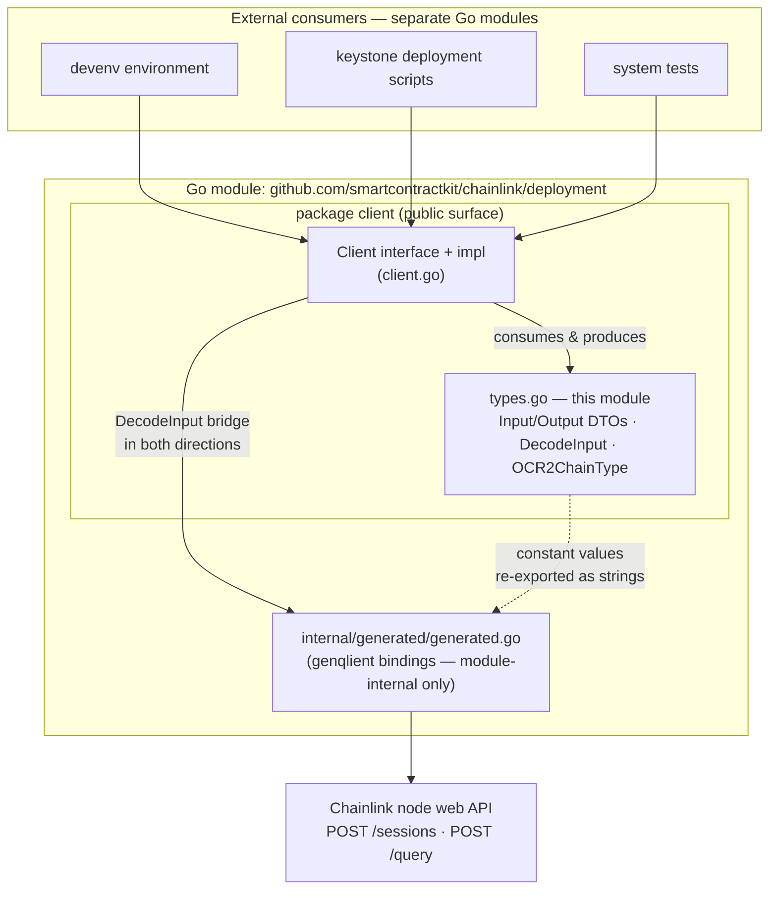
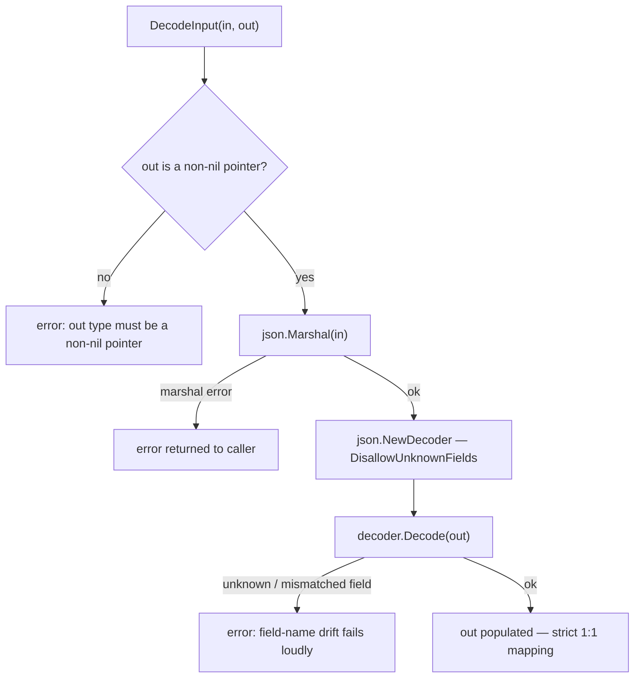
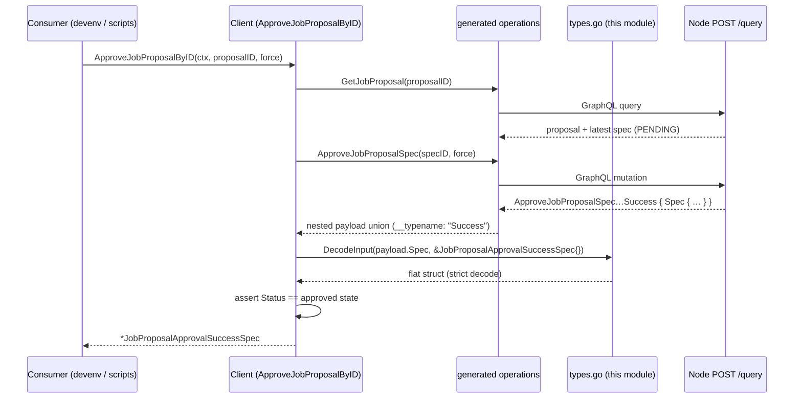

# Chainlink Node Web SDK — Types

## 1. Overview

The `chainlink-node-web-sdk_types` module is the **hand-written data layer** of the Chainlink Node Web SDK. It consists of a single source file, `chainlink/deployment/environment/web/sdk/client/types.go` (Go module `github.com/smartcontractkit/chainlink/deployment`, per `chainlink/deployment/go.mod`), which defines every **public input/output DTO** the SDK exchanges, the **strict decoder** that bridges those DTOs to the generated GraphQL bindings, and the **OCR2 chain-type constants** re-exported from the generated package.

The file exists to solve three problems that the auto-generated layer cannot solve on its own:

1. **Ergonomics** — genqlient generates deeply nested, `__typename`-dispatched payload types (e.g. `ApproveJobProposalSpecApproveJobProposalSpecApproveJobProposalSpecSuccess`). `types.go` provides flat, consumer-friendly projections such as the core component [`JobProposalApprovalSuccessSpec`](#jobproposalapprovalsuccespec--core-component) that hide that nesting.
2. **Vocabulary translation** — the SDK speaks of **Job Distributors** while the node's GraphQL schema speaks of **Feeds Managers**. The mapping lives here (e.g. the `JobDistributorID` field of `JobDistributorChainConfigInput` is serialised as `"feedsManagerID"`).
3. **Encapsulation** — the generated bindings live under `internal/generated/` and are therefore *only importable within the `deployment` module*. External consumers (the `devenv`, keystone-script and system-test modules are separate Go modules) can only obtain these values through the public `client` package — of which `types.go` is the contract half.

| Aspect | Detail |
|---|---|
| **Source** | `chainlink/deployment/environment/web/sdk/client/types.go` |
| **Go module** | `github.com/smartcontractkit/chainlink/deployment` (`chainlink/deployment/go.mod`) |
| **Core component** | `JobProposalApprovalSuccessSpec` |
| **Package visibility** | `public` (`…/web/sdk/client`); sibling of the generated `internal/generated` package |
| **Depends on** | `internal/generated/generated.go` (enum re-exports, decode targets) |
| **Depended on by** | The [`Client`](chainlink-node-web-sdk_client.md) interface & implementation |
| **Consumers** | `devenv` environment automation ([devenv](../devenv.md)), keystone deployment scripts, system tests |
| **Testing** | `client/types_test.go` covers the strict-decoding behaviour |

## 2. Position in the System

Within the SDK's three-layer design ([client](chainlink-node-web-sdk_client.md) → [types](chainlink-node-web-sdk_types.md) → [generated bindings](chainlink-node-web-sdk_generated-graphql.md)), this module is the *translation stratum*: no networking, no business logic — just the shapes of data crossing the boundary between Go consumers and the node's [GraphQL API](../../Node_Application_Core___Interfaces/web_api/web_api_graphql_api.md).



Because `internal/generated` cannot be imported by the consumer modules, `types.go` is also the place where selected *generated* values (the OCR2 chain-type enum constants) are re-exported as plain strings so that callers never need the generated package.

The node-side counterparts of these DTOs are the resolver input types (`createFeedsManagerInput`, `createFeedsManagerChainConfigInput`, …) and job-proposal payloads documented in [Web API – GraphQL API](../../Node_Application_Core___Interfaces/web_api/web_api_graphql_api.md); the domain they act on (feeds managers, job proposals) is the node's [Feeds Service](../../Node_Platform_Services/feeds_service.md).

## 3. Component Catalog

All exported identifiers of `types.go` (the module has no unexported members — the entire file is its public contract):

| Symbol | Kind | Role |
|---|---|---|
| `JobDistributorInput` | struct (input DTO) | Payload for registering/updating a feeds manager (job distributor). |
| `JobDistributorChainConfigInput` | struct (input DTO) | Per-chain configuration for a feeds manager: account addresses plus FluxMonitor / OCR1 / OCR2 job settings. |
| `JobProposalApprovalSuccessSpec` | struct (output DTO) | **Core component.** Flat projection of the spec returned when a job proposal spec is successfully approved. |
| `PendingJobProposal` | struct (output DTO) | Flat projection of a job proposal whose latest spec is `PENDING`, enriched with the owning job-distributor ID. |
| `DecodeInput` | function | Strict JSON round-trip converting between SDK DTOs and generated GraphQL types; rejects unknown fields. |
| `OCR2ChainType` | type alias (`= string`) + 6 constants | Re-export of the generated `OCR2ChainType*` enum values: `evm`, `solana`, `starknet`, `aptos`, `tron`, `ton`. |

## 4. Type Reference

### 4.1 Input DTOs (SDK → node)

#### `JobDistributorInput`

Describes a feeds manager to create or update. Consumed by `CreateJobDistributor` and `UpdateJobDistributor` (behaviour: [SDK Client](chainlink-node-web-sdk_client.md)).

| Go field | JSON tag | Notes |
|---|---|---|
| `Name` | `name` | Human-readable distributor name. |
| `URI` | `uri` | Job Distributor endpoint URI. |
| `PublicKey` | `publicKey` | Distributor public key. |

The client converts this struct via `DecodeInput` into the corresponding generated input types required by the `CreateFeedsManager` / `UpdateFeedsManager` mutations (server-side schema: `createFeedsManagerInput` / `updateFeedsManagerInput` — [GraphQL API](../../Node_Application_Core___Interfaces/web_api/web_api_graphql_api.md)).

#### `JobDistributorChainConfigInput`

Full per-chain configuration for a feeds manager — the single largest DTO in the module. Consumed by `CreateJobDistributorChainConfig`.

| Group | Go fields (JSON tags in parentheses where they differ from the field name) |
|---|---|
| **Ownership / linkage** | `JobDistributorID` (`feedsManagerID`) ⚠ · `ChainID` (`chainID`) · `ChainType` (`chainType`) |
| **Chain account** | `AccountAddr` (`accountAddr`) · `AccountAddrPubKey` (`accountAddrPubKey`) · `AdminAddr` (`adminAddr`) |
| **FluxMonitor** | `FluxMonitorEnabled` (`fluxMonitorEnabled`) |
| **OCR1** | `Ocr1Enabled` · `Ocr1IsBootstrap` · `Ocr1Multiaddr` · `Ocr1P2PPeerID` · `Ocr1KeyBundleID` |
| **OCR2** | `Ocr2Enabled` · `Ocr2IsBootstrap` · `Ocr2Multiaddr` · `Ocr2ForwarderAddress` · `Ocr2P2PPeerID` · `Ocr2KeyBundleID` · `Ocr2Plugins` |

> ⚠ **Vocabulary translation in the wire contract.** `JobDistributorID` carries the JSON tag `feedsManagerID`: the SDK's "job distributor" naming is serialised to the node's "feeds manager" terminology. Because `DecodeInput` marshals through JSON, **the JSON tags are the wire contract** — they must match the node's GraphQL field names exactly or the strict decoder fails (see [§4.3](#43-decodeinput--the-strict-bridge)).

### 4.2 Output / Projection DTOs (node → SDK)

#### `JobProposalApprovalSuccessSpec` — core component

The flat, typed result returned by `ApproveJobProposalSpec` and the composed `ApproveJobProposalByID` operation. It is decoded out of the deeply nested generated success payload:

```
generated.ApproveJobProposalSpec…Success                  (payload union, __typename: "Success")
    └── .Spec   generated.ApproveJobProposalSpec…SuccessSpecJobProposalSpec
            └── DecodeInput ──►  client.JobProposalApprovalSuccessSpec
```

| Go field | JSON tag | Meaning |
|---|---|---|
| `ID` | `id` | Approved job proposal spec ID. |
| `Definition` | `definition` | Full TOML job definition now installed on the node. |
| `Version` | `version` | Spec version number (`int`). |
| `Status` | `status` | Spec status — the client verifies it equals the approved state post-mutation. |
| `StatusUpdatedAt` | `statusUpdatedAt` | Timestamp string (see note below). |
| `CreatedAt` | `createdAt` | Timestamp string. |
| `UpdatedAt` | `updatedAt` | Timestamp string. |

> ℹ **Why all timestamps are `string`:** `genqlient.yaml` binds the schema's `Time` scalar to `string`, so generated — and therefore these hand-written — DTOs carry RFC-3339-ish strings rather than `time.Time`. The binding is configured in the SDK's code-generation loop, described in the [parent module](../chainlink-node-web-sdk.md#code-generation-workflow).

#### `PendingJobProposal`

Produced by the composed `ListPendingJobProposals` operation, which fans out over every feeds manager (`ListFeedsManagers`) and collects proposals whose latest spec is `PENDING`:

| Go field | JSON tag | Meaning |
|---|---|---|
| `ProposalID` | `proposalId` | Job proposal ID. |
| `SpecID` | `specId` | ID of the pending spec — the value to pass to `ApproveJobProposalSpec`. |
| `ProposalStatus` | `proposalStatus` | Overall proposal status. |
| `SpecStatus` | `specStatus` | Always `PENDING` for records produced by this operation. |
| `Definition` | `definition` | Proposed job definition TOML. |
| `Version` | `version` | Spec version (`int`). |
| `JobDistributorID` | `jobDistributorId` | Feeds manager the proposal came from (note: camelCase `jobDistributorId`, matching the generated schema). |

This DTO is the natural counterpart of the Job-Distributor-side proposal flow driven through [deployment-environment](../deployment-environment.md) tooling (e.g. the `JobApprover` harness in [jdtestutils](../deployment-environment/deployment-environment_jdtestutils.md)): the distributor proposes, operators/tests discover pending items via `ListPendingJobProposals`, then approve or reject them through the SDK.

### 4.3 `DecodeInput` — the strict bridge

```go
func DecodeInput(in, out any) error
```

A direction-agnostic helper used internally by the client implementation for **both** mapping directions:

- **Outbound (SDK → wire):** `JobDistributorInput` / `JobDistributorChainConfigInput` are marshalled and decoded into the generated `…Input` structs before invoking mutations.
- **Inbound (wire → SDK):** generated success payloads (e.g. the nested approve-spec payload) are re-decoded into flat locals such as `JobProposalApprovalSuccessSpec`.

Behaviour contract:



Key properties:

- **Strictness by design.** `DisallowUnknownFields` turns any drift between `types.go` JSON tags and the generated types' field names into a runtime error instead of silent data loss. This is the mechanism that keeps the hand-written layer honest against schema changes, and it is covered by `client/types_test.go`.
- **Pointer-checked target.** Non-pointer or nil `out` values are rejected up-front with a dedicated error message.
- **JSON is the lingua franca.** Everything round-trips through `encoding/json`, so the `json:"…"` tags in `types.go` — not the Go field names — define the mapping to GraphQL schema fields.

### 4.4 `OCR2ChainType` — re-exported chain-type constants

```go
type OCR2ChainType = string

const (
    OCR2ChainTypeEvm      = string(generated.OCR2ChainTypeEvm)      // "evm"
    OCR2ChainTypeSolana   = string(generated.OCR2ChainTypeSolana)
    OCR2ChainTypeStarknet = string(generated.OCR2ChainTypeStarknet)
    OCR2ChainTypeAptos    = string(generated.OCR2ChainTypeAptos)
    OCR2ChainTypeTron     = string(generated.OCR2ChainTypeTron)
    OCR2ChainTypeTon      = string(generated.OCR2ChainTypeTon)
)
```

- The alias to `string` means callers may also pass raw string literals; the constants exist for readability and to stay in sync with the node's enum.
- The values are **re-exported from the generated package** (`internal/generated`), which is not importable outside the `deployment` module — this is the only channel through which external modules receive these enum values.
- Consumed by `FetchOCR2KeyBundleID(ctx, chainType)` and `CreateOCR2KeyBundle(ctx, chainType)` on the [Client](chainlink-node-web-sdk_client.md). (The separate `FetchKeys(ctx, chainType)` surface for Aptos/Sui/Solana chain keys uses its own chain-type strings — see the client module page for that distinction.)

## 5. Data Flow & Mappings

### 5.1 Client method ↔ type ↔ generated counterpart

| `types.go` symbol | Direction | `Client` method(s) | Generated / node-side counterpart |
|---|---|---|---|
| `JobDistributorInput` | → node | `CreateJobDistributor`, `UpdateJobDistributor` | `CreateFeedsManager` / `UpdateFeedsManager` mutation inputs (`createFeedsManagerInput` / `updateFeedsManagerInput` server-side) |
| `JobDistributorChainConfigInput` | → node | `CreateJobDistributorChainConfig` | `CreateFeedsManagerChainConfigInput` (server-side `createFeedsManagerChainConfigInput`) |
| `JobProposalApprovalSuccessSpec` | ← node | `ApproveJobProposalSpec`, `ApproveJobProposalByID` | `ApproveJobProposalSpec…Success` payload union → `.Spec` |
| `PendingJobProposal` | ← node (composed) | `ListPendingJobProposals` | Projection over `ListFeedsManagers` + `GetJobProposal` results |
| `OCR2ChainType` constants | → node (enum values) | `FetchOCR2KeyBundleID`, `CreateOCR2KeyBundle` | Generated `OCR2ChainType*` enum |
| `DecodeInput` | both | used internally by the client implementation | — |

### 5.2 Lifecycle of the core component — approving a job proposal



The same flattening pattern applies to `ListPendingJobProposals` → `[]PendingJobProposal`; the rejected/cancelled/update operations instead pass the generated response types through unchanged (see [generated-graphql module](chainlink-node-web-sdk_generated-graphql.md)).

## 6. Design Conventions

The module follows a small set of conventions that make it predictable to extend and review:

1. **JSON tags are the contract.** Every field carries an explicit tag matching the node's GraphQL field name (`feedsManagerID`, `publicKey`, `statusUpdatedAt`, …). `DecodeInput`'s strictness enforces the match at runtime.
2. **Flat projections over nested unions.** Instead of exposing generated `__typename`-dispatched payload structs, outputs are flattened to single-purpose DTOs (`JobProposalApprovalSuccessSpec`, `PendingJobProposal`).
3. **Strings for time and enums.** Timestamps are `string` (genqlient binds `Time` → `string`); the OCR2 chain type is an alias of `string` with re-exported constants — no dependency on generated Go types leaks to consumers.
4. **Vocabulary translation happens here.** SDK naming ("Job Distributor") is mapped to node naming ("Feeds Manager") at the tag level, so the rest of the SDK and all consumers can use one consistent vocabulary.
5. **Strict decoding over permissive.** Unknown fields error rather than warn, catching schema drift early in CI and test environments where this SDK is exercised.

## 7. Extending the Type Layer

- **Adding a field to an input/output DTO:** add it to `types.go` with the JSON tag exactly matching the node's GraphQL field name; if a new GraphQL operation is needed, add it to the SDK's hand-written `internal/genqlient.graphql` and run the generation task — the loop is described in the [parent module](../chainlink-node-web-sdk.md#code-generation-workflow). If the tag and generated field drift, `DecodeInput` fails immediately in tests.
- **Workflow-only changes** (new client methods composing existing operations) require **no regeneration** — only new usage of existing types or new DTOs in `types.go`.
- **New chain type support for OCR2:** the constants are generated from the node schema; if the node's `OCR2ChainType` enum grows, regenerate and add the re-export constant here.

## 8. Related Documentation

- [chainlink-node-web-sdk](../chainlink-node-web-sdk.md) — parent module: SDK overview, transport/auth model, code-generation workflow.
- [chainlink-node-web-sdk_client](chainlink-node-web-sdk_client.md) — the `Client` interface and implementation that consume/produce the types documented here.
- [chainlink-node-web-sdk_generated-graphql](chainlink-node-web-sdk_generated-graphql.md) — the genqlient bindings these DTOs bridge to and are decoded from.
- [Web API – GraphQL API](../../Node_Application_Core___Interfaces/web_api/web_api_graphql_api.md) and [Web API – REST Controllers](../../Node_Application_Core___Interfaces/web_api/web_api_rest_controllers.md) — the node-side schema, resolvers and controllers behind the wire contract.
- [Feeds Service](../../Node_Platform_Services/feeds_service.md) — node-side domain owning feeds managers and job proposals.
- [devenv](../devenv.md), [deployment-environment](../deployment-environment.md) — the harnesses that consume the SDK in dev, test and simulation environments.
