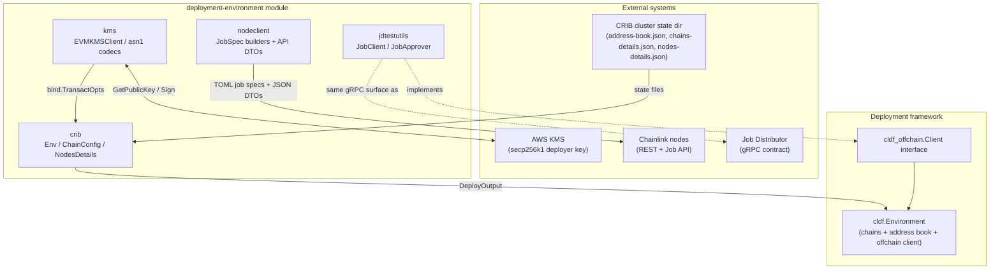
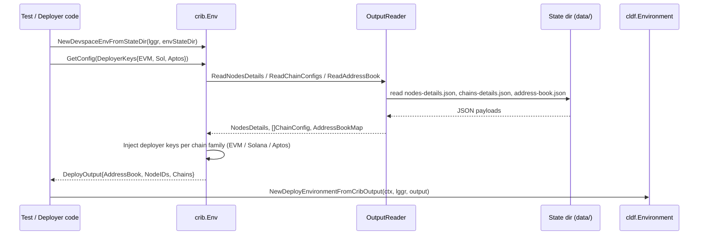
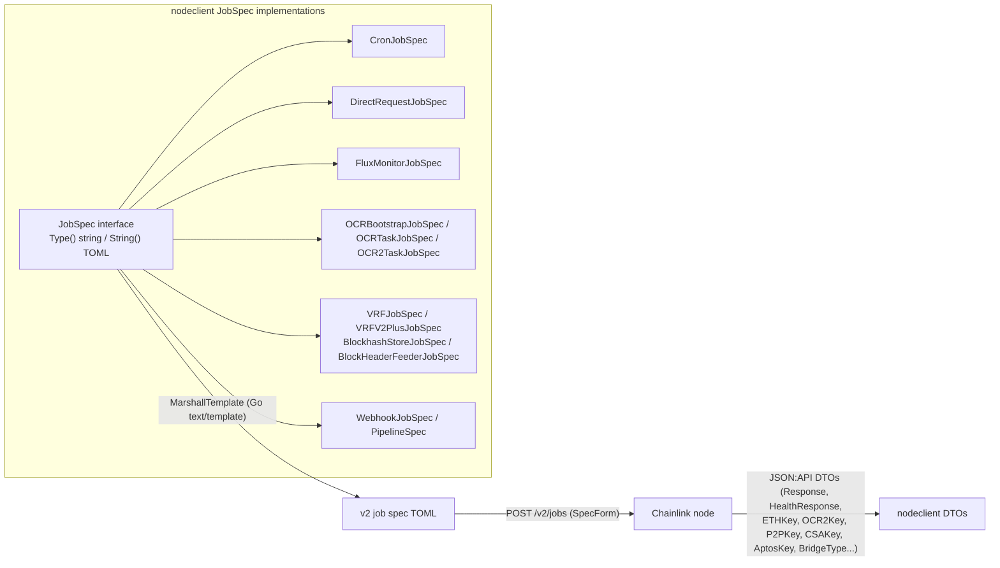
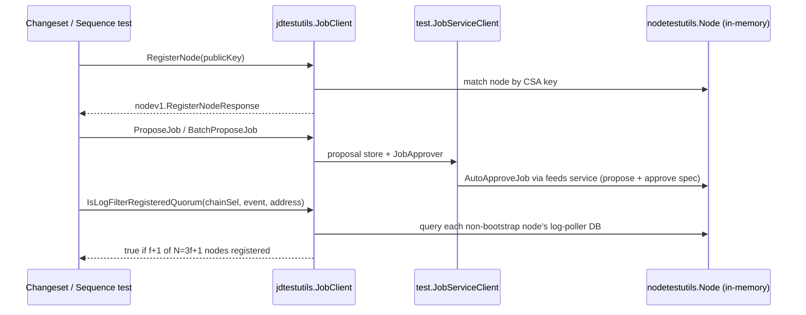

# Deployment Environment

The **deployment-environment** module provides the reusable building blocks that stand up, sign for, and talk to Chainlink nodes inside deployment and test environments. It lives inside the `chainlink/deployment` Go module (see `chainlink/deployment/go.mod`), which pins the [chainlink-deployments-framework](../Deployment_Framework_Core___Product_Deployments.md), the Job Distributor protos (`chainlink-protos/job-distributor`), `aws-sdk-go` for KMS signing, and the Chainlink core (`chainlink/v2`) via a `replace` directive.

Whereas the sibling [devenv](devenv.md) page documents the legacy `chainlink/devenv` harness, this module covers the newer packages under `chainlink/deployment/environment/...` (plus `chainlink/deployment/internal/jdtestutils`), which are consumed by the deployment framework, CCIP changeset tests, and system tests.

## Purpose and Scope

The module answers four practical questions that every deployment/test environment must solve:

| Question | Sub-module | Package |
|---|---|---|
| *How do I adopt an externally provisioned CRIB cluster into a deployment-framework environment?* | CRIB state adapter | `chainlink/deployment/environment/crib` |
| *How do I sign deployer transactions when the key lives in AWS KMS?* | KMS EVM signer | `chainlink/deployment/environment/devenv/internal/kms` |
| *How do I model the Chainlink node REST API and generate v2 job specs?* | Node client models | `chainlink/deployment/environment/nodeclient` |
| *How do I fake the Job Distributor offchain client in unit/integration tests?* | JD test utilities | `chainlink/deployment/internal/jdtestutils` |

## Architecture Overview

The four sub-modules are independent of one another and are composed at the environment-construction layer:

1. **CRIB adapter** (`crib`) reads a CRIB state directory and returns a `DeployOutput{AddressBook, NodeIDs, Chains}`. `crib/types.go` then converts it into a `cldf.Environment` via `NewDeployEnvironmentFromCribOutput`, so contract changesets written for [Deployment Framework Core](../Deployment_Framework_Core___Product_Deployments.md) run unchanged against a real cluster.
2. **KMS signer** (`kms`) lets a deployment use an AWS-KMS-resident secp256k1 key as the EVM deployer. It produces `go-ethereum` `bind.TransactOpts`, which the CRIB adapter injects into each EVM `ChainConfig` via `SetDeployerKey`.
3. **Node client models** (`nodeclient`) are the wire layer for nodes: request/response DTOs for the node's JSON API (sessions, health, keys, bridges, chains) and a `JobSpec` interface whose TOML-generating implementations cover cron, direct-request, flux monitor, OCR/OCR2, VRF/VRFv2Plus, blockhash-store, blockheader-feeder, and webhook jobs.
4. **JD test utilities** (`jdtestutils`) implement the same `cldf_offchain.Client` surface a real Job Distributor client exposes, backed by in-memory maps, enabling changeset/sequence tests without a running JD (see [Feeds Service](../Node_Platform_Services.md) for the real service semantics being emulated).

## Sub-modules

Detailed documentation for each sub-module:

| Sub-module | Documentation | Scope |
|---|---|---|
| CRIB state adapter | [deployment-environment_crib](deployment-environment/deployment-environment_crib.md) | `crib` package — `Env`, `ChainConfig`, `NodesDetails`, state-file conventions, and conversion to a deployment-framework environment |
| KMS EVM signer | [deployment-environment_kms](deployment-environment/deployment-environment_kms.md) | `devenv/internal/kms` package — AWS KMS client, ASN.1 codecs (`asn1SubjectPublicKeyInfo`, `asn1ECDSASig`), and Ethereum-compatible `bind.TransactOpts` |
| Node client models | [deployment-environment_nodeclient](deployment-environment/deployment-environment_nodeclient.md) | `nodeclient` package — JSON:API DTOs and the `JobSpec` TOML builders (cron, direct request, flux monitor, OCR/OCR2, VRF/VRFv2Plus, blockhash-store, blockheader-feeder, webhook) |
| JD test utilities | [deployment-environment_jdtestutils](deployment-environment/deployment-environment_jdtestutils.md) | `internal/jdtestutils` package — in-memory Job Distributor client, node registry, log-filter quorum checks, and `JobApprover` auto-approval |

## Data Flows

### 1. Adopting a CRIB cluster

Notes:

- Missing `nodes-details.json` is tolerated with a warning ("not necessary for testing"), because node IDs are only needed for offchain operations; a missing address book or chain config is a hard error.
- `ChainConfig.ChainType` selects the deployer-key setter (`SetDeployerKey`, `SetSolDeployerKey`, `SetAptosDeployerKey`), using the chain-type constants from `chainlink-common/keystore/corekeys`.

### 2. KMS-backed EVM signing

```mermaid
flowchart LR
    A["Tx to sign"] --> B["EVMKMSClient.SignHash"]
    B -->|"kms.Sign<br/>(ECDSA_SHA256, digest)"| C["AWS KMS"]
    C -->|"ASN.1 DER sig (r,s)"| D["kmsToEthSig"]
    D -->|"EIP-2 low-s normalization"| E["recoverEthSignature<br/>(Ecrecover v=0/1 probe)"]
    E --> F["65-byte Ethereum sig"]
    F --> G["bind.TransactOpts signerFn"]
    G --> H["go-ethereum tx broadcast"]
```

Key details (see `chainlink/deployment/environment/devenv/internal/kms/kms_client.go`):

- `asn1SubjectPublicKeyInfo` unpacks the KMS `GetPublicKey` response (X.509 SubjectPublicKeyInfo) into a secp256k1 ECDSA key, cached as a singleton on the client.
- `asn1ECDSASig` parses the KMS signature; `kmsToEthSig` flips `s` when `s > secp256k1N/2` (EIP-2) and `recoverEthSignature` brute-forces the recovery id `v` by comparing `crypto.Ecrecover` output against the known public key.
- Configuration comes from `KMS_DEPLOYER_KEY_ID`, `KMS_DEPLOYER_KEY_REGION`, and `AWS_PROFILE` via `ConfigFromEnvVars`; sessions are built either from a shared profile or from ambient credentials.

### 3. Job-spec provisioning to nodes

`OCR2TaskJobSpec` composes its TOML from `job.OCR2OracleSpec` from Chainlink core services, and the DTO layer mirrors the node's JSON:API responses (including key-export formats `ExportedEVMKey`, `VRFExportKey`, `OCR2ExportKey`) plus per-chain chain/node models for Cosmos, Solana, StarkNet, and Tron.

### 4. Faking the Job Distributor

Highlights of the test double (`chainlink/deployment/internal/jdtestutils/client.go`):

- Implements `cldf_offchain.Client` and the job-distributor gRPC node/job services over in-memory `mapNodeStore` state, so deployment tests need no offchain infrastructure.
- `IsLogFilterRegistered` requires *all* non-bootstrap nodes to have the filter; `IsLogFilterRegisteredQuorum` tolerates up to `f` unhealthy nodes (per-node errors count as "not registered"), matching the CCIP DON's `f+1` observation requirement.
- `autoApprovalNode.AutoApproveJob` drives the real feeds service lifecycle (propose → list specs → approve) against each in-memory node's app, exercising the same [Feeds Service](../Node_Platform_Services.md) code paths a production JD would.

## Relationship to Other Modules

- **[Dev, Test & Simulation Environments](../Dev,_Test___Simulation_Environments.md)** — parent module group. The [devenv](devenv.md) page documents the legacy `chainlink/devenv` harness (with its own `Cfg`, VRF product specs, and fake services); this module's `devenv/internal/kms` belongs to the *newer* `chainlink/deployment/environment/devenv` package used by `crib`. [docker-dev-environments](docker-dev-environments.md) provides the Compose stacks these adapters often target, [integration-tests](integration-tests.md) and [system-tests](system-tests.md) are consumers of node-client models and CRIB-style environments, and the [chainlink-node-web-sdk](chainlink-node-web-sdk.md) is the GraphQL counterpart to the REST models documented here.
- **[Deployment Framework Core & Product Deployments](../Deployment_Framework_Core___Product_Deployments.md)** — `crib` and `jdtestutils` produce/consume `cldf.Environment`, `cldf_offchain.Client`, and address-book types from the deployments framework; changesets for CCIP, CRE/Keystone, Data Feeds, and Vault run inside environments assembled by this module.
- **[Node Platform Services](../Node_Platform_Services.md)** — the feeds service (job proposals/approvals) emulated by `jdtestutils`, and the node services whose APIs `nodeclient` models.
- **[CCIP Cross-Chain Protocol](../CCIP_Cross-Chain_Protocol.md)** — `IsLogFilterRegisteredQuorum` and CRIB lane configuration exist to support CCIP DON testing topologies.
- **[Shared Foundation Libraries & Domain Types](../Shared_Foundation_Libraries___Domain_Types.md)** — keystore chain-type constants (`corekeys`) and the `logger` interface used by `crib.Env` come from `chainlink-common`.

## Source Artifacts

- `chainlink/deployment/environment/crib/env.go`, `types.go`, `data.go` — CRIB state adapter
- `chainlink/deployment/environment/devenv/internal/kms/kms_client.go` — AWS KMS EVM signer
- `chainlink/deployment/environment/nodeclient/chainlink_models.go` (+ `chainlink.go`) — node API DTOs and job-spec builders
- `chainlink/deployment/internal/jdtestutils/client.go` (+ `node_store.go`) — in-memory Job Distributor client
- `chainlink/deployment/go.mod` — module boundary and pinned dependencies (`aws-sdk-go`, `chainlink-protos/job-distributor`, `chainlink-deployments-framework`, `chainlink/v2` via replace)
