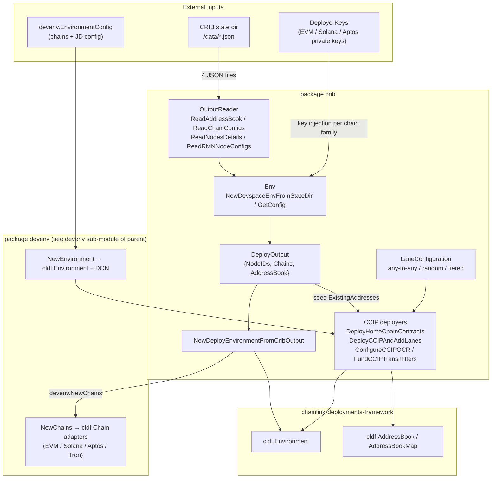
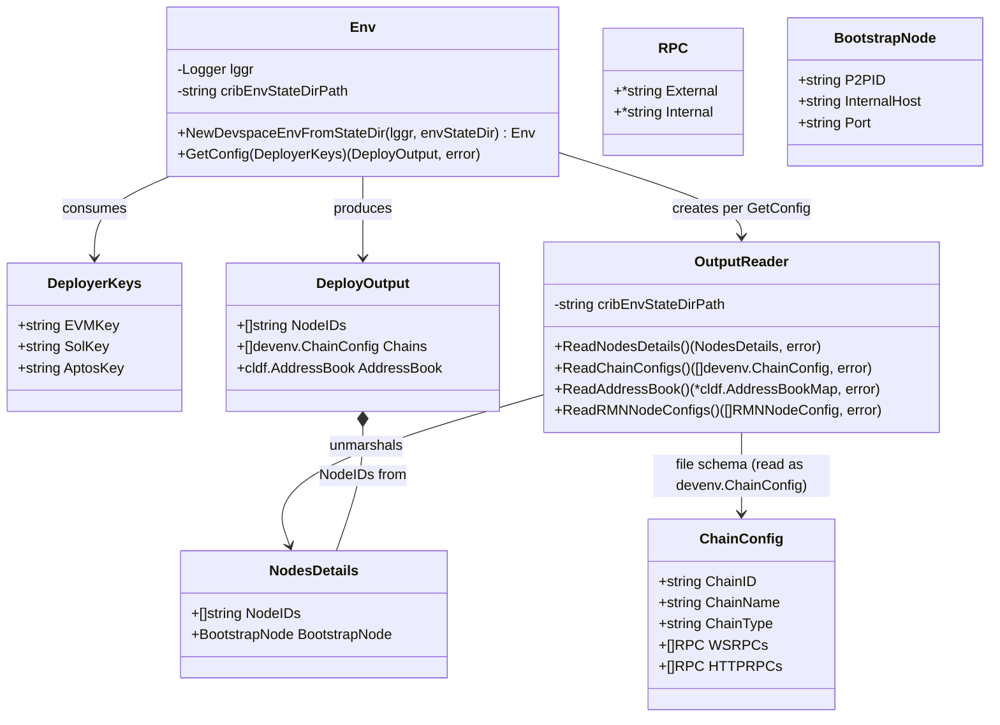
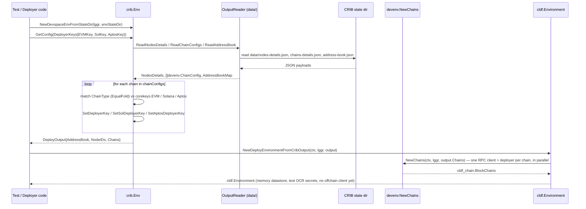
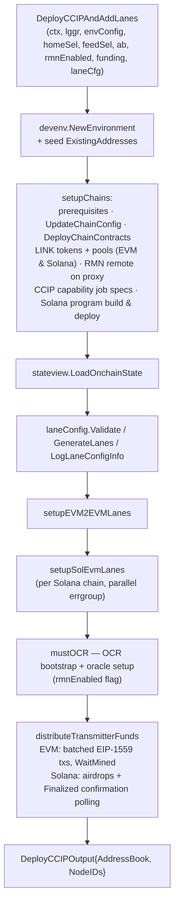
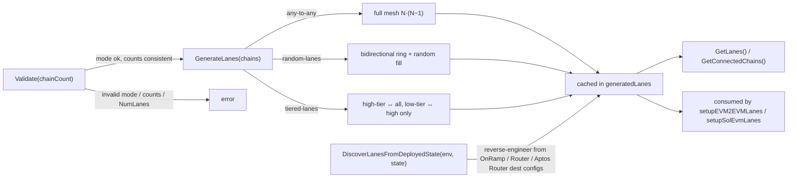

# CRIB Environment Adapter (`deployment/environment/crib`)

The **CRIB adapter** is the bridge between a [CRIB](https://github.com/smartcontractkit/crib)-provisioned Chainlink cluster (a Kubernetes-based environment spun up via Devspace) and the [Chainlink deployment framework](../../Deployment_Framework_Core___Product_Deployments.md). It lives in the `chainlink/deployment` Go module (see `chainlink/deployment/go.mod`) at package `chainlink/deployment/environment/crib` and answers one question: *given the state directory that CRIB exported after provisioning a multi-chain, multi-node environment, how do I turn that into a working `cldf.Environment` that deployment changesets can run against?*

This page documents the whole `crib` package. For the surrounding sub-modules (KMS signing, node client models, JD test doubles), see the parent [deployment-environment](../deployment-environment.md) page; for the older legacy harness, see [devenv](../devenv.md).

## Purpose and Scope

The package has four responsibilities:

1. **State adoption** (`env.go`, `data.go`) — read CRIB's exported state directory (address book, chain configs, node details, RMN identities) and assemble a `DeployOutput` with deployer keys injected per chain family.
2. **Environment bridging** (`types.go`) — convert `DeployOutput` into a `cldf.Environment` so changesets written for devnets run unchanged against a real CRIB cluster.
3. **CCIP orchestration** (`ccip_deployer.go`, `helpers.go`) — high-level deploy/configure/fund entry points that apply the full CCIP changeset stack (home chain, chain contracts, token pools, lanes, OCR) to the adopted environment.
4. **Lane topology** (`lane_config.go`) — declarative lane (source→destination chain) configuration for load and topology testing, including generation modes and reverse-engineering of lanes from deployed state.

## Architecture Overview

## Core Types (`env.go`)

`env.go` defines the wire shapes of CRIB's exported state plus the `Env` façade that consumes them. Note that these are the **producer-side schema** (what CRIB tooling writes); the reader unmarshals chain details into the richer runtime struct `devenv.ChainConfig` (see [devenv chain adapters](#relationships-to-other-modules)), of which the crib types are a JSON-compatible subset.

| Type | Fields | Role |
|---|---|---|
| `Env` | `lggr`, `cribEnvStateDirPath` | Façade holding the logger and the CRIB state directory path. |
| `RPC` | `External *string`, `Internal *string` | One RPC endpoint in both in-cluster (`Internal`) and outside-cluster (`External`) URL flavours. |
| `ChainConfig` | `ChainID`, `ChainName`, `ChainType`, `WSRPCs []RPC`, `HTTPRPCs []RPC` | Per-chain connection config. `ChainID` is a string to accommodate non-EVM families; `ChainType` is the chain family (`EVM`, `SOLANA`, `APTOS`, …). |
| `BootstrapNode` | `P2PID`, `InternalHost`, `Port` | Identity and in-cluster address of the P2P bootstrap node. |
| `NodesDetails` | `NodeIDs []string`, `BootstrapNode` | The set of Chainlink node IDs CRIB provisioned plus the bootstrap node coordinates. |
| `DeployerKeys` | `EVMKey`, `SolKey`, `AptosKey` | Private keys (hex / base58 / `0x`-hex respectively) handed to `Env.GetConfig`. |

### State directory contract

`OutputReader` (`data.go`) resolves every artifact as `<stateDir>/data/<FileName>`:

| Constant | File | Consumed by | Error tolerance |
|---|---|---|---|
| `AddressBookFileName` | `address-book.json` | `Env.GetConfig` | **Hard error** if missing. JSON: `map[chainSelector]map[address]TypeAndVersion`, wrapped into a `cldf.AddressBookMap`. |
| `ChainsConfigsFileName` | `chains-details.json` | `Env.GetConfig` | **Hard error** if missing. JSON array of `devenv.ChainConfig`. |
| `NodesDetailsFileName` | `nodes-details.json` | `Env.GetConfig` | **Tolerated** — logged as a warning (`"No nodes details found, not necessary for testing.."`) and `NodeIDs` stays empty, because node IDs only matter for offchain operations. |
| `RMNNodeIdentitiesFileName` | `rmn-node-identities.json` | `OutputReader.ReadRMNNodeConfigs` | Read on demand for RMN/OCR bootstrap configuration. |

The shipped fixture `chainlink/deployment/environment/crib/testdata/lanes-deployed-state/` contains CRIB-produced example payloads (`ccip-v2-scripts-address-book.json`, `ccip-v2-scripts-chains-details.json`, `ccip-v2-scripts-nodes-details.json`), which the package tests use as reference data.

## Data Flow: CRIB State → `cldf.Environment`

Implementation notes:

- `Env.GetConfig` (`env.go`) dispatches key injection **case-insensitively** on `ChainConfig.ChainType` using the chain-family constants from `chainlink-common/keystore/corekeys` (part of the [keystore runtime](../../Shared_Foundation_Libraries___Domain_Types.md)). There is no branch for `TRON`; Tron chains rely on the framework's CTF-default signer generator instead.
- `NewDeployEnvironmentFromCribOutput` (`types.go`) constructs the environment with a **sealed in-memory datastore**, `focr.XXXGenerateTestOCRSecrets()`, and a `nil` offchain client (there is a standing TODO to populate it from a DON input). Contract deployment works, but any changeset needing a live Job Distributor must supply one separately — see the [JD test utilities](deployment-environment_jdtestutils.md) for the in-process alternative.
- The context provider is a lambda returning `context.Background()`, allowing the framework's environment to swap contexts dynamically.

### Deployer key injection per chain family

| Family | Setter (`devenv/chain.go`) | Key format | Behaviour |
|---|---|---|---|
| EVM | `SetDeployerKey` | hex ECDSA | Builds `bind.TransactOpts` bound to the chain ID. If no key is provided, falls back to **AWS KMS** via `kms.ConfigFromEnvVars` — see [KMS deployer signer](deployment-environment_kms.md). |
| SOLANA | `SetSolDeployerKey` | base58 | Decodes into `solana.PrivateKey`. Requires a key (no KMS fallback). |
| APTOS | `SetAptosDeployerKey` | `0x`-prefixed hex | Decodes an Ed25519 key and derives an `aptos.Account` signer. Requires a key. |

## CCIP Deployment Orchestration (`ccip_deployer.go`)

The CCIP deployers compose the changeset stack from the [CCIP Deployment Suite](../../CCIP_Deployment_Suite.md) on top of an adopted or freshly constructed environment:

| Function | Purpose |
|---|---|
| `DeployHomeChainContracts` | Deploys MCMS-with-timelock contracts plus the CCIP home chain changeset (Capability Registry, RMN static/dynamic test configs, node operators, P2P IDs). Funds Solana deployers first (`solutils.FundAccounts`). Returns a `deployment.CapabilityRegistryConfig` (for node `Capabilities.ExternalRegistry`) and the accumulated address book. |
| `DeployCCIPAndAddLanes` | The full post-node-init CCIP setup: chain prerequisites, chain contracts, LINK tokens and pools on EVM + Solana, lane wiring, OCR setup, transmitter funding. |
| `ConfigureCCIPOCR` | Re-applies only the OCR configuration changesets on an **existing** deployment (used by CRIB to redeploy a DON without redeploying contracts). |
| `FundCCIPTransmitters` | Funds node transmitter accounts only (EVM native via EIP-1559, Solana via airdrops). |

Funding helpers (`helpers.go`) run EVM and Solana funding **concurrently** through `errgroup`: EVM transmitters receive `evmFundingEth` in batched EIP-1559 transactions with mined-receipt verification; Solana transmitters receive `solFunds = 1000` SOL via airdrops, with adaptive timeouts and commitment-level polling up to `Finalized`.

## Lane Configuration (`lane_config.go`)

`LaneConfiguration` describes which unidirectional lanes (`LaneConfig{SourceChain, DestinationChain}`) the deployment should wire, for CCIP load/topology testing:

| Mode | Semantics | Validation rules (`Validate(chainCount)`) |
|---|---|---|
| `"any-to-any"` (default fallback) | Full mesh: every ordered pair of distinct chains. | None beyond mode presence. |
| `"random-lanes"` | `NumLanes` random lanes, guaranteed bidirectional ring first (each chain is both a source and a destination), then random fill without duplicates. | `NumLanes > 0`, `NumLanes ≤ N·(N−1)`, and `NumLanes ≥ 2N` (minimum for full bidirectional coverage). |
| `"tiered-lanes"` | High-tier chains connect to **all** chains; low-tier chains connect only to high-tier chains (all bidirectional). | `HighTierChainCount + LowTierChainCount == chainCount`. |

Tier assignment is deterministic via `getTierChainSelectors`: priority selectors (the home chain `3379446385462418246`, the simulated Solana `12463857294658392847`, the EVM feed chain `12922642891491394802`) come first, then remaining EVM chains ordered by chain ID from `90000001` upward.

`DiscoverLanesFromDeployedState` supports the reverse direction: it reads the deployed OnRamp (EVM), Solana Router, and Aptos Router destination configurations from `stateview.CCIPOnChainState` and rebuilds the lane list, enabling re-runs against an environment whose lanes were configured elsewhere (e.g., an earlier CRIB job).

## Relationships to Other Modules

- **[Parent: deployment-environment](../deployment-environment.md)** — situates `crib` among its sibling adapters; the [KMS deployer signer](deployment-environment_kms.md) backs EVM key injection, the [node client](deployment-environment_nodeclient.md) models the nodes CRIB provisions, and the [JD test utilities](deployment-environment_jdtestutils.md) can stand in for the offchain client the CRIB environment currently leaves nil.
- **[devenv](../devenv.md)** — `crib` consumes `devenv.ChainConfig` (the runtime superset of the crib wire type) and `devenv.NewChains`/`devenv.NewEnvironment` to build chain adapters and the DON. Note the distinction from the legacy `chainlink/devenv` harness documented on that page.
- **[Deployment Framework Core & Product Deployments](../../Deployment_Framework_Core___Product_Deployments.md)** — `DeployOutput`/`cldf.Environment`/`AddressBook` are the framework's types; changesets applied by the CCIP deployers are registered the same way as product changesets there.
- **[CCIP Deployment Suite](../../CCIP_Deployment_Suite.md)** and **[CCIP Cross-Chain Protocol](../../CCIP_Cross-Chain_Protocol.md)** — the deployers orchestrate the v1.5.1/v1.6 changesets, operations and sequences (chain contracts, token pools, RMN, lanes) defined there, and validate against `stateview.CCIPOnChainState`.
- **[Shared Foundation Libraries & Domain Types](../../Shared_Foundation_Libraries___Domain_Types.md)** — chain-family constants from `chainlink-common/keystore/corekeys` and the `chainlink-common/pkg/logger` interface used by `Env`.
- **[system-tests](../system-tests.md)** and **[integration-tests](../integration-tests.md)** — downstream consumers of CRIB-style environments; the CRE system-test environment libraries follow the same adopt-then-deploy pattern.

## Testing

- `env_test.go::TestShouldProvideEnvironmentConfig` exercises `NewDevspaceEnvFromStateDir` + `GetConfig` against the `testdata/lanes-deployed-state` fixture, asserting a non-empty `DeployOutput` (node IDs, address book, chains). It is gated by `tests.SkipFlakey` (ticket `DX-291`).
- `lane_config_test.go` and `helpers_test.go` cover lane generation/validation and the deterministic tier-selector ordering, respectively.

## Source Artifacts

- `chainlink/deployment/environment/crib/env.go` — `Env`, `DeployerKeys`, `RPC`, `ChainConfig`, `BootstrapNode`, `NodesDetails`, state-file name constants
- `chainlink/deployment/environment/crib/data.go` — `OutputReader` and the `<stateDir>/data` JSON readers
- `chainlink/deployment/environment/crib/types.go` — `DeployOutput`, `DeployCCIPOutput`, `NewDeployEnvironmentFromCribOutput`
- `chainlink/deployment/environment/crib/ccip_deployer.go` — CCIP orchestration entry points and changeset composition
- `chainlink/deployment/environment/crib/lane_config.go`, `helpers.go` — lane topology and funding utilities
- `chainlink/deployment/environment/devenv/chain.go`, `environment.go` — `ChainConfig` runtime struct, `SetDeployerKey` family, `NewChains`
- `chainlink/deployment/go.mod` — module boundary; pins `chainlink-deployments-framework`, `chainlink-ccip`, `chain-selectors`, `aws-sdk-go` (KMS), and `chainlink/v2` via `replace`
