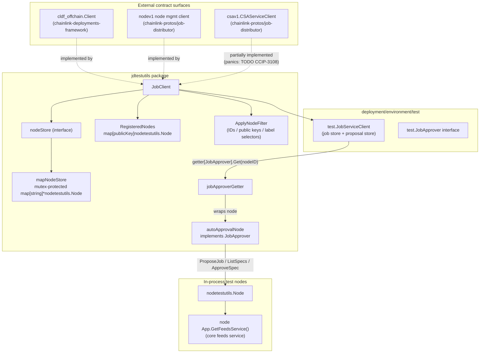
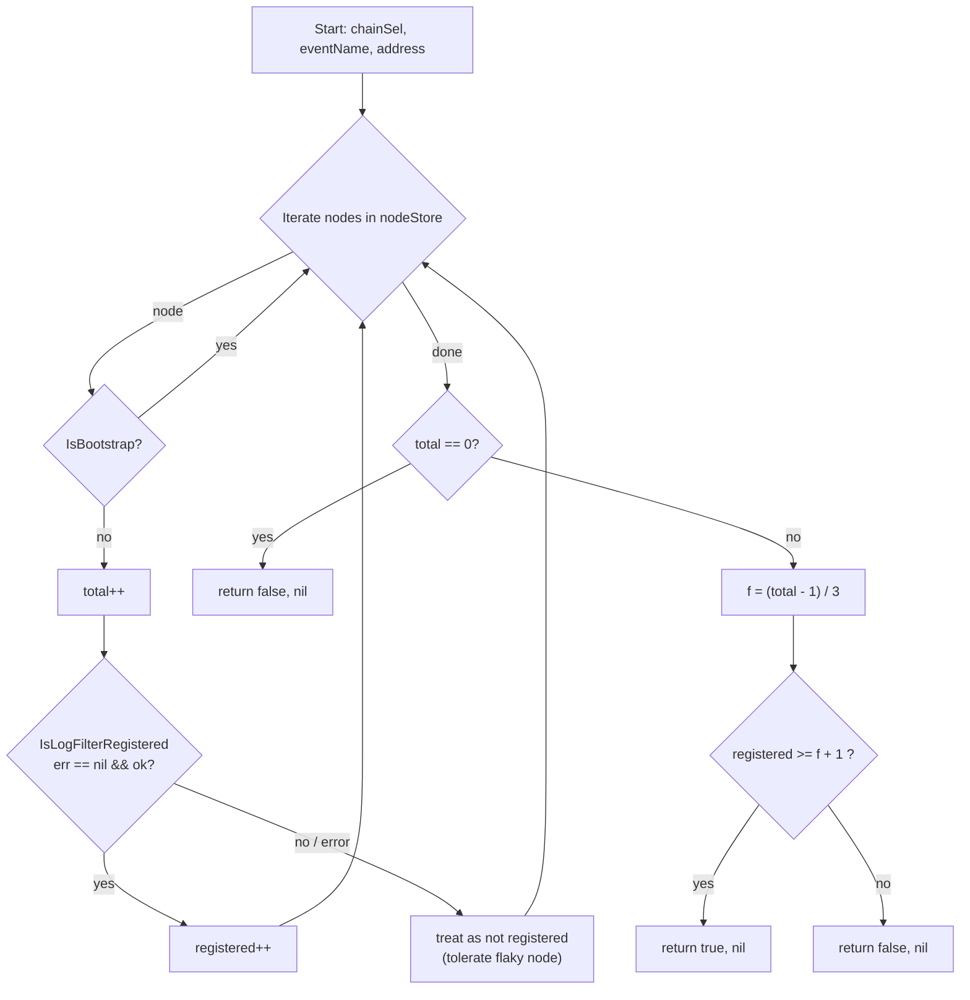
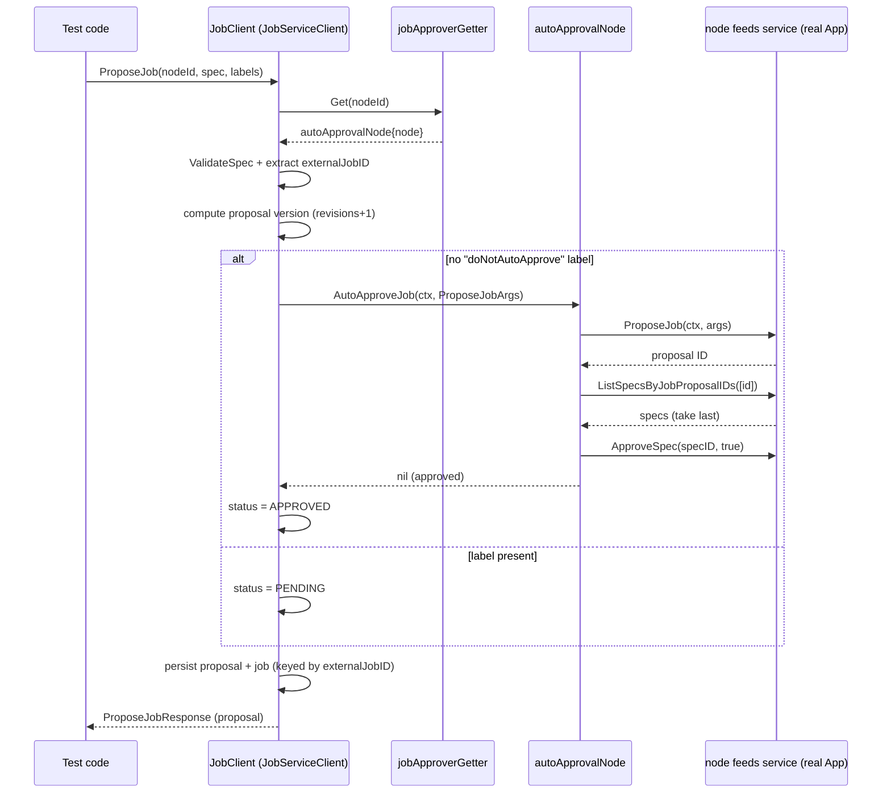
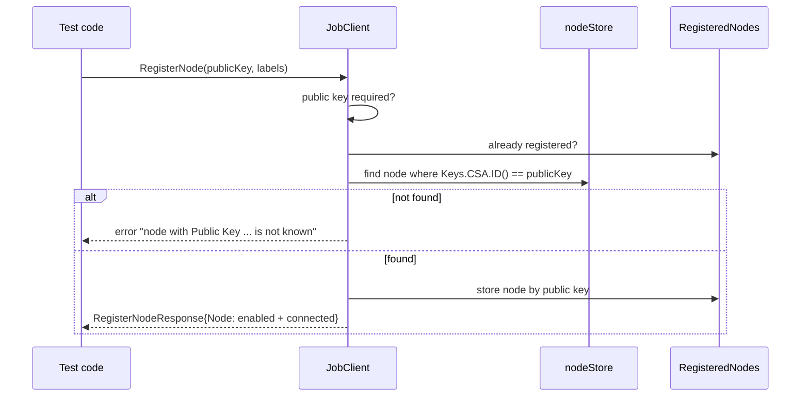

# Deployment Environment — Job Distributor Test Utilities (`jdtestutils`)

## 1. Introduction

The `jdtestutils` package (`chainlink/deployment/internal/jdtestutils`) provides an **in-memory, offline fake of the Chainlink Job Distributor (JD)**. It allows deployment and system tests to exercise the JD-facing parts of the deployment framework — node registration, node listing/filtering, job proposal auto-approval, and log-poller readiness checks — **without running a real Job Distributor service or making network calls to remote nodes**.

The module is intentionally small: it is a single package with three files (`client.go`, `node_store.go`, `client_test.go`) built around one central type, [`JobClient`](#2-architecture-overview), plus the [`JobApprover`](#3-core-components) abstraction that connects the fake JD to real, in-process Chainlink nodes.

> **Where this fits:** this module is a child of the [deployment-environment](../deployment-environment.md) module, which also covers the CRIB-based environment, KMS helpers, and the node client models. It belongs to the broader [Dev, Test & Simulation Environments](../../Dev,_Test___Simulation_Environments.md) group.

## 2. Architecture Overview

`JobClient` is the façade of the module. It satisfies:

- the **`cldf_offchain.Client`** interface from the external [`chainlink-deployments-framework`](https://github.com/smartcontractkit/chainlink-deployments-framework) module (enforced via `var _ cldf_offchain.Client = &JobClient{}`), so it can be plugged wherever the deployment framework expects an offchain/JD client, and
- several **Job Distributor gRPC client surfaces** from `chainlink-protos/job-distributor/v1` (`nodev1` node management, `csav1` CSA keys), reimplemented in memory.

Internally it composes three things:

| Composition member | Provided by | Role |
|---|---|---|
| `RegisteredNodes map[string]nodetestutils.Node` | this package | nodes registered by CSA public key |
| `nodeStore` (implemented by `mapNodeStore`) | `node_store.go` | mutex-protected, ID-keyed in-process node store |
| `*test.JobServiceClient` | `chainlink/deployment/environment/test` | embedded in-memory job/proposal service with auto-approval hooks |

The runtime "nodes" behind the fake are **`nodetestutils.Node`** values — heavyweight, in-process Chainlink node applications created by [nodetestutils](#6-relationship-to-other-modules) (each wraps a real `chainlink.Application`, keys, chain configs, and a feeds service).

### Go module context

The package lives in the `github.com/smartcontractkit/chainlink/deployment` Go module (`chainlink/deployment/go.mod`), which:

- `replace`s `github.com/smartcontractkit/chainlink/v2 => ../` (it compiles against the local node core),
- depends on `github.com/smartcontractkit/chainlink-deployments-framework` (source of `cldf_offchain.Client`), and
- depends on `github.com/smartcontractkit/chainlink-protos/job-distributor` (source of the gRPC request/response types the fake implements).

## 3. Core Components

### 3.1 `JobClient`

Central façade implementing the JD/offchain client surface. Key operations:

| Group | Method | Behaviour |
|---|---|---|
| Node lifecycle | `RegisterNode` | Requires a CSA public key; rejects duplicates; looks up the node by CSA key ID; records it in `RegisteredNodes`; returns a `nodev1.Node` marked `IsEnabled`/`IsConnected`. |
| Node lifecycle | `UpdateNode` | Updates **name and labels only** (overwrites, does not merge); public key changes are not supported. |
| Node lifecycle | `GetNode`, `ListNodes` | Read from the `nodeStore`; `ListNodes` auto-attaches a `p2p_id` label per node and applies `ApplyNodeFilter`. |
| Node lifecycle | `EnableNode`, `DisableNode` | **Not implemented — panics** (TODO CCIP-3108). |
| Chain config | `ListNodeChainConfigs` | Requires a filter naming exactly one node ID; delegates to `node.JDChainConfigs()`. |
| Log poller | `ReplayLogs(selectorToBlock)` | Replays logs on **every** node in the store. |
| Log poller | `IsLogFilterRegistered` | **Strict mode:** returns `true` only if **all** non-bootstrap nodes have the filter registered; any per-node error aborts. |
| Log poller | `IsLogFilterRegisteredQuorum` | **Quorum mode:** tolerates up to `f` unhealthy nodes (see below). |
| CSA keys | `GetKeypair`, `ListKeypairs` | **Not implemented — panics** (TODO CCIP-3108). |

#### Quorum semantics of `IsLogFilterRegisteredQuorum`

For a BFT-style network of `N` non-bootstrap nodes, `f` is derived from `N = 3f + 1`. The check passes when at least **`f + 1`** non-bootstrap nodes have the `(chainSel, eventName, address)` log filter registered in their log-poller DB. Per-node errors (e.g., a transient RPC `DeadlineExceeded` on an overloaded node) are treated as *"not registered"* instead of failing the check, so a single flaky node cannot block a wait. This mirrors the CCIP DON guarantee that only `f + 1` observations are needed to commit and execute a message.

### 3.2 `JobApprover`, `autoApprovalNode`, and `jobApproverGetter`

The module defines its own `JobApprover` interface — `AutoApproveJob(ctx, *feeds.ProposeJobArgs) error` — which mirrors the `test.JobApprover` interface used by the embedded `test.JobServiceClient`.

- **`autoApprovalNode`** wraps a `*nodetestutils.Node` and implements `JobApprover` by driving the **real feeds service inside the node application**:
  1. `App.GetFeedsService().ProposeJob(ctx, p)` — creates the job proposal (using a fixed `FeedsManagerID = 1` set by the caller in `test.JobServiceClient`),
  2. `App.GetFeedsService().ListSpecsByJobProposalIDs(...)` — resolves the proposed spec (takes the last one if several exist for the proposal ID),
  3. `App.GetFeedsService().ApproveSpec(ctx, specID, true)` — auto-approves it.
- **`jobApproverGetter`** adapts the `nodeStore` to the `getter[test.JobApprover]` contract expected by `test.NewJobServiceClient`, so any node lookup by ID yields a ready-to-use `JobApprover`.

### 3.3 `ApplyNodeFilter`

A package-level helper implementing JD-style server-side filtering over `nodev1.Node` values:

- filter by **IDs** and **public keys** (membership check), and
- filter by **label selectors** supporting the `IN` (comma-separated values), `EQ`, and `EXIST` operations (an unimplemented selector op panics).

It is used by `JobClient.ListNodes` and is also reused by `JDNodeService.ListNodes` in `deployment/environment/test`, keeping filtering semantics identical across both fakes.

### 3.4 `nodeStore` / `mapNodeStore`

A small, mutex-protected abstraction over `map[string]*nodetestutils.Node` (`put`, `get`, `list`, `asMap`, `delete`) with sentinel-wrapped `errNoExist` errors. It is the source of truth for the node registry that backs `GetNode`/`ListNodes`/`UpdateNode` and the job-approver getter.

> **Thread-safety note:** `mapNodeStore` is synchronized, but the exported `RegisteredNodes` map on `JobClient` is **not** mutex-protected — avoid concurrent `RegisterNode` calls if that matters for your test.

## 4. Key Flows

### 4.1 Job proposal with automatic approval

`test.JobServiceClient.ProposeJob` (embedded in `JobClient`) validates the TOML job spec, extracts the `externalJobID`, computes the next proposal version, and then delegates approval to the per-node `JobApprover`. A job can opt out of auto-approval with the `doNotAutoApprove` label (`test.LabelDoNotAutoApprove`), in which case the proposal is stored as `PENDING`.

### 4.2 Node registration

## 5. Design Notes & Limitations

- **In-process by design.** Nothing here opens sockets: `JobClient` reimplements JD gRPC client interfaces in memory, and approval flows call node applications directly. This keeps test environments fast, hermetic, and CI-friendly.
- **Two fake layers, one contract.** The node-management surface lives in `jdtestutils` (this module) while the job/proposal surface lives in `deployment/environment/test` and is embedded into `JobClient`. Both share filter semantics through `ApplyNodeFilter` and both auto-approve jobs through the same `JobApprover` abstraction.
- **Unimplemented surfaces panic** (`GetKeypair`, `ListKeypairs`, `EnableNode`, `DisableNode` — tracked as TODO CCIP-3108), which makes accidental use of unsupported APIs loud in tests rather than silently succeeding.
- **Strict vs. quorum readiness.** `IsLogFilterRegistered` (all nodes, fail on error) is appropriate for small topologies or strict assertions; `IsLogFilterRegisteredQuorum` is appropriate for larger CCIP-style DONs where transient per-node flakiness must not block waits.
- **`UpdateNode` overwrites** name/labels rather than merging and does not support public-key updates — check labels carefully when building on top of this helper.

## 6. Relationship to Other Modules

| Related module | Relationship |
|---|---|
| [deployment-environment](../deployment-environment.md) | Parent module. Siblings: [crib](deployment-environment_crib.md) (CRIB-hosted environments), [nodeclient](deployment-environment_nodeclient.md) (real-node API client models used to drive actual nodes), [kms](deployment-environment_kms.md) (KMS signing helpers). `jdtestutils` is the JD-fake counterpart: it stands in for the JD when nodes are in-process. |
| [Node Platform Services — feeds service](../../Node_Platform_Services/feeds_service.md) | `autoApprovalNode` drives the node's embedded feeds service (`ProposeJob` / `ListSpecsByJobProposalIDs` / `ApproveSpec`) — the same domain service that a real Feeds Manager would exercise remotely. |
| [Node Application Core & Interfaces](../../Node_Application_Core___Interfaces/node_application.md) | The wrapped `nodetestutils.Node` values hold a full `chainlink.Application`; job approval and log-filter checks ultimately execute inside that application. |
| [Dev, Test & Simulation Environments — system-tests](../system-tests.md) and [integration-tests](../integration-tests.md) | Downstream consumers: CCIP/CRE system and integration tests build environments from in-process nodes and use JD-shaped clients (this fake) to register nodes, propose jobs, and wait for log-filter readiness. |

## 7. Source References

- `chainlink/deployment/internal/jdtestutils/client.go` — `JobClient`, `JobApprover`, `autoApprovalNode`, `jobApproverGetter`, `ApplyNodeFilter`
- `chainlink/deployment/internal/jdtestutils/node_store.go` — `nodeStore` interface and `mapNodeStore`
- `chainlink/deployment/environment/test/job_service_client.go` — embedded `test.JobServiceClient` (proposal/job stores, auto-approval orchestration, `LabelDoNotAutoApprove`)
- `chainlink/deployment/utils/nodetestutils/node.go` — in-process `Node` model (`App`, `Keys`, `Chains`, `IsBootstrap`, `Labels`)
- `chainlink/deployment/go.mod` — module wiring (`chainlink-deployments-framework`, `chainlink-protos/job-distributor`, local `chainlink/v2` replace)
