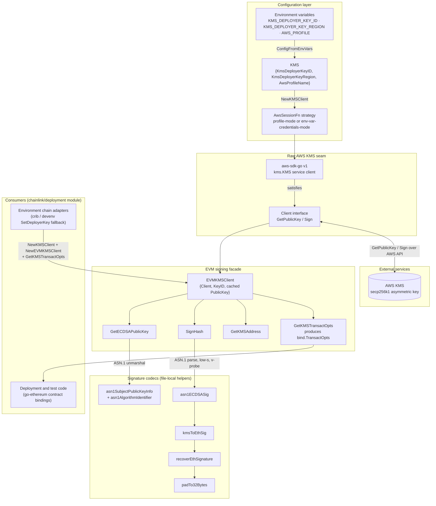
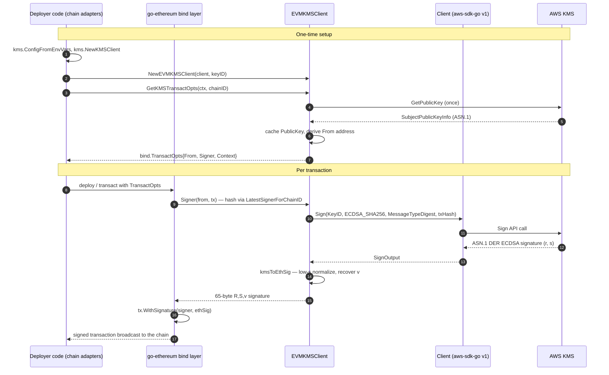
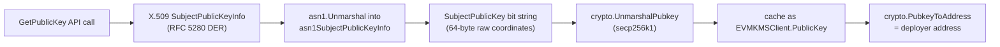
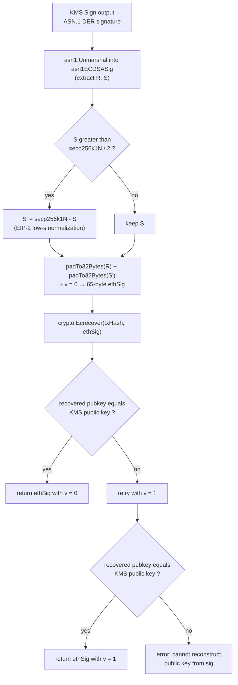

# KMS Deployer Signer (`deployment/environment/devenv/internal/kms`)

The **KMS deployer signer** lets Chainlink deployment and test environments sign EVM transactions with an **AWS KMS-resident secp256k1 key**, so the raw private key never has to exist in an environment variable, secret file, or local keystore. It lives in the `internal` package `chainlink/deployment/environment/devenv/internal/kms` of the `chainlink/deployment` Go module and answers one question: *given a KMS key ID, how do I get a `go-ethereum` `bind.TransactOpts` that deploys contracts as if it were a locally-held private key?*

This is the EVM signing backend used by the environment adapters of the parent [deployment-environment](../deployment-environment.md) module: when a deployment does not provide a hex EVM deployer key, the chain adapters fall back to KMS via `kms.ConfigFromEnvVars` (see the [CRIB adapter's deployer-key injection table](deployment-environment_crib.md)).

## Purpose and Scope

**In scope** — a minimal, self-contained signing stack built from three layers:

1. **Configuration & session bootstrap** — load the KMS key ID, region, and AWS profile (`KMS` struct, `ConfigFromEnvVars`) and build an AWS session (`AwsSessionFn` strategies).
2. **Raw KMS seam** — the `Client` interface (`GetPublicKey` / `Sign`) that decouples the EVM logic from the AWS SDK client, so it can be faked in tests.
3. **EVM signing facade** — `EVMKMSClient`, which converts KMS operations into Ethereum primitives: public-key retrieval and address derivation, transaction-hash signing, and `bind.TransactOpts` generation.

**Out of scope** — this package is *not* the node keystore. The runtime key management stack (encrypted key storage, per-service keyrings, gRPC keystore exposure) is documented in [Node Platform Services → Keystore](../../Node_Platform_Services/keystore/keystore_node_keyring.md). That stack's AWS KMS integration (`chainlink-common/keystore/kms`, aws-sdk-go **v2** with `DescribeKey`/`ListKeys` and context-aware calls) is covered in [Keystore KMS](../../Node_Platform_Services/keystore/keystore_kms.md); the package on this page deliberately uses the older aws-sdk-go **v1** API and a much smaller surface, because deployment tooling only needs sign + public-key operations. Both packages, however, replicate the same ASN.1 `ECDSASig{R, S}` shape (`kms/asn1.go` there, `asn1ECDSASig` here) for parsing KMS signatures.

The `internal/` path element makes the package importable only from within the `chainlink/deployment` module — deployment framework products (CCIP, CRE, Data Feeds changesets) never import it directly; they benefit from it through the environment adapters.

## Architecture Overview



The layers are strictly directional: the facade depends on the seam, the seam depends on configuration, and nothing in the package depends on a concrete consumer.

## Core Components (`kms_client.go`)

### Configuration and session bootstrap

| Component | Signature / Shape | Role |
|---|---|---|
| `KMS` | struct `{KmsDeployerKeyID, KmsDeployerKeyRegion, AwsProfileName string}` | The complete configuration needed to reach one KMS key. |
| `ConfigFromEnvVars()` | `func() (KMS, error)` | Reads `KMS_DEPLOYER_KEY_ID`, `KMS_DEPLOYER_KEY_REGION`, `AWS_PROFILE`; returns an error naming the first missing variable (all three are **required**). |
| `NewKMSClient(config KMS)` | `func(KMS) (Client, error)` | Validates that key ID and region are non-empty, selects the session strategy, and returns the concrete `kms.New(...)` service client (which satisfies `Client`). |
| `AwsSessionFn` | `func(config KMS) *session.Session` | Strategy type for session construction. |
| `awsSessionFromProfileFn` | package var | Session with `SharedConfigEnable` and the given `Profile` — used when `AwsProfileName` is set. |
| `awsSessionFromEnvVarsFn` | package var | Session with only `Region` set — used when the profile is empty; credentials come from the ambient chain (env vars, IMDS, etc.). Both strategies set `CredentialsChainVerboseErrors: true` to make credential failures diagnosable. |

### Raw client seam

`Client` is the package's only abstraction boundary:

```go
type Client interface {
    GetPublicKey(input *kms.GetPublicKeyInput) (*kms.GetPublicKeyOutput, error)
    Sign(input *kms.SignInput) (*kms.SignOutput, error)
}
```

It mirrors exactly the two AWS KMS operations the EVM logic needs (no context parameter — this is the aws-sdk-go **v1** style, deliberately kept per the `//nolint:staticcheck` markers in the source; see `chainlink/deployment/go.mod`, which pins `github.com/aws/aws-sdk-go v1.55.8`). A source TODO notes the intent to generate a mockery double for this interface and test against a regular Ethereum key (see [Testing Notes](#testing-notes)).

### EVM signing facade (`EVMKMSClient`)

| Method | Behaviour |
|---|---|
| `NewEVMKMSClient(client, keyID)` | Constructor; no network calls. |
| `GetECDSAPublicKey()` | Fetches the public key once from KMS, parses it (see below), and caches it as a **singleton** on the client — one instance is bound to exactly one key. |
| `GetKMSAddress()` | Derives the Ethereum deployer address: `crypto.PubkeyToAddress(*publicKey)`. |
| `SignHash(hash)` | Calls KMS `Sign` with `MessageTypeDigest` + `SigningAlgorithmSpecEcdsaSha256` (KMS signs the **pre-computed digest** — the caller supplies the transaction hash), then converts the ASN.1 response into a 65-byte Ethereum signature. |
| `GetKMSTransactOpts(ctx, chainID)` | Produces `*bind.TransactOpts{From, Signer, Context}`. The `Signer` closure rejects addresses other than the KMS-derived one (`bind.ErrNotAuthorized`), hashes each transaction with `types.LatestSignerForChainID(chainID)` (EIP-155 replay protection; supports legacy and typed transactions), signs via `SignHash`, and applies `tx.WithSignature(signer, ethSig)`. Returns an error if `chainID` is nil. |

### ASN.1 codecs and signature-conversion helpers

These unexported types/functions implement the two wire-format translations the AWS blog series *"Use AWS KMS to securely manage Ethereum accounts"* describes (cited in the source):

| Component | Purpose |
|---|---|
| `asn1SubjectPublicKeyInfo` / `asn1AlgorithmIdentifier` | Unpack the X.509 **SubjectPublicKeyInfo** (RFC 5280) structure returned by `GetPublicKey`; `SubjectPublicKey` is an `asn1.BitString` holding the raw 64-byte secp256k1 coordinates that `crypto.UnmarshalPubkey` consumes. |
| `asn1ECDSASig` | Parses the ASN.1 DER signature `{R, S asn1.RawValue}` returned by `Sign`. |
| `padTo32Bytes` | Left-pads R/S to exactly 32 bytes after trimming leading zeros, as required by the 32-byte-fixed Ethereum format. |
| `kmsToEthSig` | Orchestrates conversion: parse → **low-s normalization** (below) → recovery-id probe. |
| `recoverEthSignature` | Reconstructs the Ethereum recovery id `v ∈ {0,1}` by brute-force: build `R‖S‖0`, run `crypto.Ecrecover`, compare the hex of the recovered public key against the KMS public key; if it mismatches, retry with `v = 1`; error `"can not reconstruct public key from sig"` if neither works. |
| `secp256k1N` / `secp256k1HalfN` | Package vars: the secp256k1 group order and its half, used for EIP-2 normalization. |

```mermaid
classDiagram
    class KMS {
        +string KmsDeployerKeyID
        +string KmsDeployerKeyRegion
        +string AwsProfileName
    }
    class Client {
        <<interface>>
        +GetPublicKey(input) (*kms.GetPublicKeyOutput, error)
        +Sign(input) (*kms.SignOutput, error)
    }
    class EVMKMSClient {
        +Client Client
        +string KeyID
        -ecdsa.PublicKey PublicKey
        +GetKMSAddress() (common.Address, error)
        +GetKMSTransactOpts(ctx, chainID) (*bind.TransactOpts, error)
        +SignHash(hash) ([]byte, error)
        +GetECDSAPublicKey() (*ecdsa.PublicKey, error)
    }
    class asn1SubjectPublicKeyInfo {
        +asn1AlgorithmIdentifier AlgorithmIdentifier
        +asn1.BitString SubjectPublicKey
    }
    class asn1AlgorithmIdentifier {
        +asn1.ObjectIdentifier Algorithm
        +asn1.ObjectIdentifier Parameters
    }
    class asn1ECDSASig {
        +asn1.RawValue R
        +asn1.RawValue S
    }
    class bind_TransactOpts {
        +common.Address From
        +Signer Signer
        +context.Context Context
    }
    NewKMSClient(..) ..> Client : creates (aws-sdk-go v1)
    EVMKMSClient --> Client : GetPublicKey / Sign
    EVMKMSClient ..> asn1SubjectPublicKeyInfo : parses GetPublicKey output
    EVMKMSClient ..> asn1ECDSASig : parses Sign output
    EVMKMSClient ..> bind_TransactOpts : produces
```

## Data Flows

### 1. End-to-end transaction signing



Note that the public key is fetched lazily and at most once per `EVMKMSClient` instance; all subsequent operations (address derivation, signature verification during `v` probing, hash signing) reuse the cached key.

### 2. Public-key retrieval and address derivation



### 3. KMS signature → Ethereum signature conversion



Two Ethereum-compatibility details are encoded here:

- **EIP-2 low-s rule** — Ethereum rejects signatures whose `s` exceeds `secp256k1N/2`. KMS may return the "high" form, so `kmsToEthSig` flips `s → N − s` when needed; this does not change the signature's validity on the curve.
- **Recovery-id probing** — the KMS signature carries no `v`; the correct recovery id (0 or 1) is discovered deterministically by verifying which candidate reproduces the known public key via `crypto.Ecrecover`. The result is the standard 65-byte `R (32) ‖ S (32) ‖ v (1)` buffer that go-ethereum's `Signer` implementations accept.

## Configuration Reference

`ConfigFromEnvVars` (the path the chain adapters use) requires all three variables:

| Variable | `KMS` field | Required | Notes |
|---|---|---|---|
| `KMS_DEPLOYER_KEY_ID` | `KmsDeployerKeyID` | Yes | Identifies the asymmetric secp256k1 KMS key (anything `GetPublicKey`/`Sign` accept: key ID, ARN, alias). |
| `KMS_DEPLOYER_KEY_REGION` | `KmsDeployerKeyRegion` | Yes | AWS region hosting the key; becomes the session region. |
| `AWS_PROFILE` | `AwsProfileName` | Required by `ConfigFromEnvVars` | Selects a shared-config profile. When `ConfigFromEnvVars` is bypassed and `AwsProfileName` is left empty, `NewKMSClient` instead builds a session from ambient credentials (env-var credential chain) — the two entry points intentionally have slightly different strictness. |

Failure semantics:

- `ConfigFromEnvVars` fails fast with an error naming the first missing variable.
- `NewKMSClient` independently validates the key ID and region before any AWS call.
- `GetKMSTransactOpts` rejects a nil `chainID`; the `Signer` closure rejects any `from` address other than the KMS-derived one.
- AWS-side failures (bad key, permissions, credentials) surface wrapped at each call site (`failed to call kms.Sign() on hash`, `can not get public key from KMS for KeyId=...`).

Typical usage from an environment adapter:

```go
cfg, err := kms.ConfigFromEnvVars()          // KMS_DEPLOYER_KEY_ID, KMS_DEPLOYER_KEY_REGION, AWS_PROFILE
raw, err := kms.NewKMSClient(cfg)            // aws-sdk-go v1 service client
signer := kms.NewEVMKMSClient(raw, cfg.KmsDeployerKeyID)
opts, err := signer.GetKMSTransactOpts(ctx, chainID)
// pass opts into go-ethereum contract bindings / deployers
```

## Testing Notes

- The `Client` interface is the designed test seam: a fake `Client` replaying canned `GetPublicKeyOutput`/`SignOutput` payloads lets the ASN.1 parsing, low-s normalization, and recovery-id probing be tested without AWS (the package ships `kms_client_test.go`).
- Per the source TODO, mockery generation for `Client` and a cross-check against a regular (non-KMS) Ethereum key behind the same interface were planned but not yet landed.
- Because `EVMKMSClient` caches its public key, a fake and a real client are interchangeable only if the fake's public key stays consistent with the signatures it returns (otherwise `recoverEthSignature` fails its reconstruction check — this is a useful accidental invariant for test doubles).

## Package Placement, Dependencies and Build Context

- **Module**: `github.com/smartcontractkit/chainlink/deployment` (Go 1.27.1), which `replace`s `github.com/smartcontractkit/chainlink/v2 => ../` and pins `github.com/aws/aws-sdk-go v1.55.8` and `github.com/ethereum/go-ethereum v1.17.4` (see `chainlink/deployment/go.mod`). The `//nolint:staticcheck` markers acknowledge the deprecated v1 SDK is used across this package on purpose.
- **Location**: `chainlink/deployment/environment/devenv/internal/kms/` — the `internal` segment restricts visibility to the `chainlink/deployment` module. Note this is the *newer* `deployment/environment/devenv` tree, distinct from the legacy `chainlink/devenv` harness documented in [devenv](../devenv.md).
- **Key dependencies**: `aws-sdk-go/service/kms` (GetPublicKey/Sign), go-ethereum `abi/bind`, `core/types` (`LatestSignerForChainID`), `crypto` (`UnmarshalPubkey`, `PubkeyToAddress`, `Ecrecover`), `crypto/secp256k1` (coordinate marshalling), standard-library `encoding/asn1` for both wire formats.

## Relationships to Other Modules

- **[Parent: deployment-environment](../deployment-environment.md)** — situates this signer among its sibling adapters; the parent's "KMS-backed EVM signing" flow is the summary version of this page.
- **[CRIB environment adapter](deployment-environment_crib.md)** — primary consumer: `SetDeployerKey` falls back to this package (via `ConfigFromEnvVars`) when no hex EVM key is provided, injecting the resulting `bind.TransactOpts` into each EVM `ChainConfig`.
- **[Node client models](deployment-environment_nodeclient.md)** and **[JD test utilities](deployment-environment_jdtestutils.md)** — sibling sub-modules of the same parent; node provisioning and offchain faking, orthogonal to signing.
- **[Keystore KMS](../../Node_Platform_Services/keystore/keystore_kms.md)** — the runtime (node-side) AWS KMS client on aws-sdk-go v2 with a broader operation set; shares the ASN.1 `ECDSASig` parsing shape but serves the node keystore rather than deployment tooling. Its position in the runtime stack is described in [Node Platform Services → Keystore](../../Node_Platform_Services/keystore/keystore_node_keyring.md).
- **[Deployment Framework Core & Product Deployments](../../Deployment_Framework_Core___Product_Deployments.md)** — the changesets and operations that ultimately execute with KMS-backed `TransactOpts` inside environments assembled by the adapters above.
- **[Dev, Test & Simulation Environments](../../Dev,_Test___Simulation_Environments.md)** — parent module group; [system tests](../system-tests.md) and [integration tests](../integration-tests.md) are downstream consumers of environments whose deployer keys may come from KMS.

## Source Artifacts

- `chainlink/deployment/environment/devenv/internal/kms/kms_client.go` — the entire package: config, `Client` seam, `EVMKMSClient`, ASN.1 codecs, signature conversion, session strategies
- `chainlink/deployment/environment/devenv/internal/kms/kms_client_test.go` — package tests
- `chainlink/deployment/go.mod` — module boundary, `aws-sdk-go` v1 / `go-ethereum` pins, `chainlink/v2` replace directive
