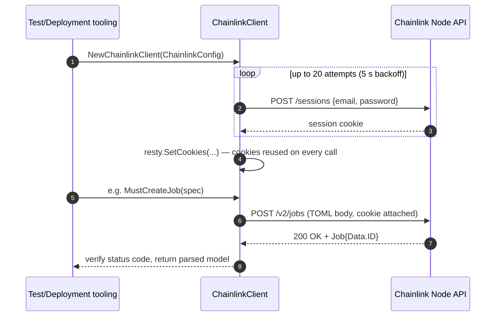
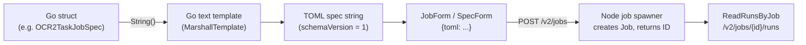
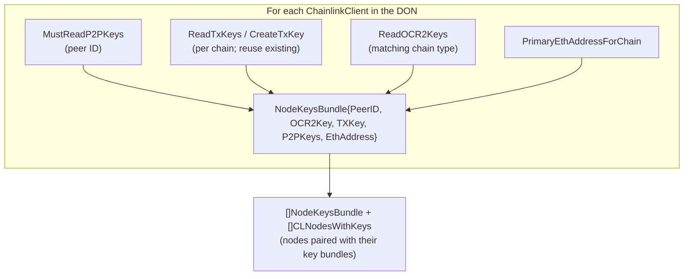
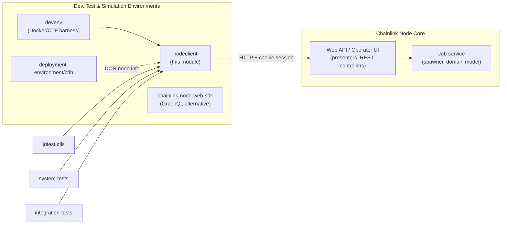

# deployment-environment/nodeclient

> **Package:** `nodeclient` (`chainlink/deployment/environment/nodeclient/`) — part of the `github.com/smartcontractkit/chainlink/deployment` Go module (see [`chainlink/deployment/go.mod`](https://github.com/smartcontractkit/chainlink/blob/main/chainlink/deployment/go.mod))
>
> **Parent:** [deployment-environment](../deployment-environment.md) · **Grandparent:** [Dev, Test & Simulation Environments](../../Dev,_Test___Simulation_Environments.md)

## 1. Introduction

The **nodeclient** module provides a Go HTTP client for the **operator/admin REST API of a running Chainlink node** (`/v2/...` endpoints). It is the primary programmatic "remote control" used by test harnesses and deployment tooling to bootstrap, configure, and observe Chainlink nodes without manually clicking through the Operator UI.

It deliberately targets **test, simulation, and deployment environments** rather than production: it hard-codes well-known test credentials, skips TLS certificate verification, and exposes convenience helpers (key export, native-token funding, pprof profiling) that only make sense in ephemeral environments.

Core capabilities:

| Capability | Description |
|---|---|
| **Session authentication** | Email/password login against `/sessions`, cookie reuse for subsequent calls, with boot-time retry (nodes may still be starting). |
| **Job lifecycle** | Create / read / delete v2 jobs from Go structs that render TOML job specs; read job runs. |
| **Bridge management** | CRUD for external adapter (bridge) registrations. |
| **Key management** | Create, read, delete, export, and import node keys: OCR, OCR2, P2P, EVM/ETH, chain-specific TX keys, CSA, VRF, Aptos. |
| **Non-EVM chain registration** | Register chains and nodes for Cosmos, Solana, StarkNet, and Tron relays. |
| **Node operations** | Send native tokens, track EVM forwarders, replay the log poller, health checks, and pprof profiling sessions. |
| **Kubernetes integration** | A K8s-flavoured client that can connect to nodes deployed via Helm charts and trigger node image upgrades. |

---

## 2. Architecture

The package consists of three source files with a clean separation between **transport**, **domain/API models**, and **infrastructure-specific behavior**:

```mermaid
flowchart TB
    subgraph nodeclient["package nodeclient"]
        CC["ChainlinkClient<br/>(chainlink.go)<br/>resty HTTP client + session auth"]
        MODELS["API models & job specs<br/>(chainlink_models.go)<br/>JSON:API envelopes, key models,<br/>JobSpec TOML templates"]
        K8S["ChainlinkK8sClient<br/>(chainlink_k8s.go)<br/>Helm chart operations"]
        CC -->|"renders specs from"| MODELS
        MODELS -.->|"request/response DTOs"| CC
        K8S -->|"embeds *" ChainlinkClient"| CC
    end

    subgraph consumers["Consumers (test & deployment tooling)"]
        DEVENV["deployment/environment/devenv<br/>(DON bootstrap)"]
        NODETEST["deployment/utils/nodetestutils<br/>(in-process node harness)"]
        JDTU["deployment/internal/jdtestutils<br/>(JD job approval)"]
        SYSTESTS["system-tests / integration-tests<br/>(chainlink-testing-framework)"]
    end

    subgraph node["Chainlink Node"]
        API["Operator REST API<br/>/sessions, /v2/jobs, /v2/keys/*,<br/>/v2/chains/*, /v2/transfers, /health"]
    end

    DEVENV --> CC
    NODETEST --> CC
    JDTU --> CC
    SYSTESTS --> K8S
    CC -->|"HTTPS (TLS skip-verify,<br/>cookie session)"| API
```

### 2.1 Component reference

| File | Components | Role |
|---|---|---|
| `chainlink.go` | `ChainlinkClient`, `NewChainlinkClient`, `initRestyClient`, `VerifyStatusCode`, `VerifyStatusCodeWithResponse`, `CreateNodeKeysBundle` | All HTTP operations against the node API. Built on [`resty`](https://github.com/go-resty/resty) with a `zerolog` logger per client. |
| `chainlink_models.go` | `ChainlinkConfig`, `Session`, `Response`/`ResponseSlice`, `Job`/`Spec`/`SpecForm`/`JobForm`, key models (`OCR2Key`, `P2PKey`, `ETHKey`, `TxKey`, `CSAKey`, `VRFKey`, `AptosKey`, …), `JobSpec` implementations | Data transfer objects mirroring the node's JSON:API responses, plus a TOML-rendering framework for job specs. |
| `chainlink_k8s.go` | `ChainlinkK8sClient`, `ConnectChainlinkNodes`, `ConnectChainlinkNodeURLs`, `ConnectChainlinkNodeURL` | Extends `ChainlinkClient` with Helm chart identity (`ChartName`, `PodName`) and node image upgrade support via `chainlink-testing-framework`. |
| `chainlink_models_test.go` | `TestOCR2TaskJobSpec_String` | Golden tests for TOML rendering, including nested `relayConfig` with ChainReader/Codec configs. |

---

## 3. Authentication & connection lifecycle

Every `ChainlinkClient` is initialized through `initRestyClient`, which performs session-based authentication before any other call can be made:



Key behaviors:

- **Boot retry** — connections are retried up to 20 times with a 5-second sleep because Kubernetes pods may still be starting when clients are created (`chainlink_k8s.go` and the `CTF` environments rely on this).
- **TLS** — certificate verification is disabled (`InsecureSkipVerify`), acceptable only for test infrastructure.
- **Debugging** — setting `RESTY_DEBUG=true` enables resty request/response logging.
- **Per-call status validation** — `VerifyStatusCode` / `VerifyStatusCodeWithResponse` compare actual vs. expected HTTP codes; the `Must*` method family (e.g. `MustCreateJob`, `MustReadP2PKeys`) turns failed status checks into Go errors.

---

## 4. Job specification framework

The heart of `chainlink_models.go` is the `JobSpec` interface:

```go
type JobSpec interface {
    Type() string                 // job type identifier
    String() (string, error)      // renders the TOML job spec
}
```

Each implementation is a plain Go struct whose fields carry `toml` tags. `String()` renders a Go text template (via the `MarshallTemplate` helper) into the exact TOML schema (version 1) expected by the node's job service — the same domain model described in [Node Platform Services → Job Service](../../Node_Platform_Services/job_service.md). The rendered TOML is submitted as a `JobForm{TOML}` / `SpecForm{TOML}` envelope.

### 4.1 Spec rendering data flow



### 4.2 Supported job spec types

| Spec struct | `Type()` | Purpose / pipeline notes |
|---|---|---|
| `CronJobSpec` | `cron` | CRON-scheduled observation sources. |
| `PipelineSpec` | `common_pipeline` | Minimal bridge fetch → `jsonparse` pipeline. |
| `DirectRequestJobSpec` + `DirectRequestTxPipelineSpec` | `directrequest` / `directrequest_pipeline` | Legacy oracle request flow: `ethabidecodelog` → bridge fetch → parse → `ethabiencode` → `ethtx` submit. |
| `FluxMonitorJobSpec` | `fluxmonitor` | Price-feed polling with threshold/idle/poll timers. |
| `OCRBootstrapJobSpec` | `offchainreporting` | OCR v1 bootstrap node (no observation source, `isBootstrapPeer = true`). |
| `OCRTaskJobSpec` | `offchainreporting` | OCR v1 oracle node; resolves `p2pv2Bootstrappers` by **reading P2P keys from bootstrap `ChainlinkClient`s at render time**. |
| `OCR2TaskJobSpec` | dynamic (`o.JobType`, e.g. `offchainreporting2`) | Multi-chain OCR2/plugin jobs; embeds the core [`job.OCR2OracleSpec`](../../Node_Application_Core___Interfaces.md) (relay, plugin type, relay config, plugin config) and marshals `relayConfig` with `go-toml/v2`. |
| `VRFJobSpec` / `VRFV2PlusJobSpec` | `vrf` | VRF coordinator jobs; V2+ adds batch fulfillment, backoff and polling controls. |
| `VRFV2PlusTxPipelineSpec` | `vrf_pipeline_v2plus` | VRF fulfillment pipeline: decode log → `vrfv2plus` proof → gas estimate → simulated fulfillment (optional `latest`/`pending` sim block). |
| `BlockhashStoreJobSpec` / `BlockHeaderFeederJobSpec` | `blockhashstore` / `blockheaderfeeder` | VRF v2+ supporting jobs (blockhash storage / header feeding). |
| `WebhookJobSpec` | `webhook` | Externally initiated jobs (external initiator + spec). |

Helper utilities:

- `ObservationSourceSpecBridge` — generates a standard bridge-fetch + JSON-parse observation source snippet.
- `P2PData.P2PV2Bootstrapper()` — formats the `peerID@ip:port` bootstrapper string (default port `6690`).
- `getOptionalSimBlock` — validates/renders optional simulation-block parameters.

---

## 5. API surface map

The client methods map one-to-one onto node operator API endpoints:

| Domain | Endpoints | Key models |
|---|---|---|
| **Auth / health** | `POST /sessions`, `GET /health` | `Session`, `HealthResponse`, `HealthResponseDetail` |
| **Jobs** | `GET/POST /v2/jobs`, `GET/DELETE /v2/jobs/{id}`, `GET /v2/jobs/{jobID}/runs` | `Job`, `JobForm`, `ResponseSlice`, `JobRunsResponse`, `TaskRun`, `DecodeLogTaskRun` |
| **Specs (legacy)** | `POST /v2/specs`, `GET/DELETE /v2/specs/{id}` | `Spec`, `SpecData` |
| **Bridges** | `GET/POST /v2/bridge_types`, `GET/DELETE /v2/bridge_types/{name}` | `BridgeType`, `BridgeTypeAttributes`, `Bridges` |
| **OCR keys** | `POST/GET /v2/keys/ocr`, `DELETE /v2/keys/ocr/{id}` | `OCRKey(s)`, `OCRKeyAttributes` (prefixes `ocrcfg_`/`ocroff_`/`ocrsad_` are trimmed on read) |
| **OCR2 keys** | `POST /v2/keys/ocr2/{chain}`, `GET /v2/keys/ocr2`, `DELETE /v2/keys/ocr2/{id}`, `POST /v2/keys/ocr2/export/{id}` | `OCR2Key(s)`, `OCR2ExportKey` |
| **P2P keys** | `POST/GET /v2/keys/p2p`, `DELETE /v2/keys/p2p/{id}` | `P2PKey(s)` (`p2p_` prefix trimmed on read) |
| **EVM keys** | `GET /v2/keys/eth`, `PUT /v2/keys/eth/{keyId}`, `POST /v2/keys/eth/export/{keyAddress}` | `ETHKey(s)`, `ExportedEVMKey` (keystore-v3-style crypto envelope) |
| **Chain TX keys** | `POST/GET /v2/keys/{chain}`, `DELETE /v2/keys/{chain}/{id}` | `TxKey(s)` (Solana, StarkNet, etc.) |
| **CSA / VRF / Aptos keys** | `/v2/keys/csa`, `/v2/keys/vrf` (+`/import`, `/export/{keyId}`), `/v2/keys/aptos` | `CSAKey(s)`, `VRFKey(s)`, `VRFExportKey`, `AptosKey(s)` |
| **Non-EVM chains/nodes** | `POST /v2/chains/{cosmos\|solana\|starknet\|tron}`, `POST /v2/nodes/{...}` | `CosmosChain*`, `SolanaChain*`, `StarkNetChain*`, `TronChain*` (nullable config fields via `null.*`) |
| **External initiators** | `POST/GET /v2/external_initiators`, `DELETE /v2/external_initiators/{name}` | `EIAttributes`, `EIKey(s)`, `EIServiceConfig` |
| **Transfers** | `POST /v2/transfers` | `SendEtherRequest`, `TransactionData` |
| **Forwarders** | `POST /v2/nodes/evm/forwarders/track`, `GET /v2/nodes/evm/forwarders` | `Forwarder(s)`, `ForwarderAttributes` |
| **Log poller** | `POST /v2/replay_from_block/{fromBlock}?family=evm&ChainID=...` | `ReplayResponse` |
| **Profiling** | `GET /v2/debug/pprof/{reportType}?seconds=...` | `ChainlinkProfileResults`, `ChainlinkProfileResult` |

---

## 6. Key management & node orchestration patterns

Beyond simple CRUD, the package offers two orchestration helpers that capture common multi-node setup flows:

### 6.1 `CreateNodeKeysBundle`

Aggregates, for each node in a DON, the pieces OCR networks need:



The reuse-first logic for TX keys avoids key-management complexity (funding multiple keys, adding all keys to OCR configs) in test setups.

### 6.2 `Profile`

Runs a coordinated pprof session: launches concurrent profile requests (`allocs`, `block`, `goroutine`, `heap`, `mutex`, `profile`, `threadcreate`, `trace`) for a configured duration, executes the caller-provided workload function against the same client, and reports both scheduled vs. actual runtimes. This is used by performance tests (e.g. the request-ID tracing supported by `DecodeLogTaskRun`).

### 6.3 Key portability

`ExportedEVMKey`, `VRFExportKey`, and `OCR2ExportKey` model the node's key-export format (encrypted `crypto` envelope with cipher/KDF parameters). `ImportVRFKey` closes the loop, allowing keys minted on one node to be re-imported on another — the mechanism used when nodes are replaced or environments are rebuilt.

---

## 7. Kubernetes client

`ChainlinkK8sClient` (in `chainlink_k8s.go`) wraps `ChainlinkClient` for deployments managed by [chainlink-testing-framework](https://github.com/smartcontractkit/chainlink-testing-framework):

- `NewChainlinkK8sClient` — connects using the same session flow, recording the Helm `ChartName` and `PodName`.
- `UpgradeVersion(testEnvironment, newImage, newVersion)` — patches the node's Helm values (`chainlink.image.{image,version}`); takes effect on the next `Environment.Run()`. Not thread-safe.
- `ConnectChainlinkNodes(e)` — builds clients for every node in a running environment using the node's local URL/IP and the standard test credentials (`CLNodeTestEmail` / `CLNodeTestPassword`).
- `ConnectChainlinkNodeURLs` / `ConnectChainlinkNodeURL` — URL-only variants for K8s tests where chart metadata is unavailable.

This is the client used by the [system-tests](../system-tests.md) and [integration-tests](../integration-tests.md) modules when nodes run in Kubernetes; the Docker-based [devenv](../devenv.md) module uses the plain `ChainlinkClient`.

---

## 8. Position in the system



- **versus the node's web API** — the models in `chainlink_models.go` intentionally mirror the node's JSON:API presenters (see [Node Application Core & Interfaces → Web API](../../Node_Application_Core___Interfaces/web_api.md)). Any presenter change on the node side must be reflected here.
- **versus the job service** — rendered TOML specs are parsed by the node's job spawner and domain model (see [Node Platform Services → Job Service](../../Node_Platform_Services/job_service.md)); `OCR2TaskJobSpec` directly embeds `job.OCR2OracleSpec` from the core `services/job` package, so spec drift is caught at compile time.
- **versus the web SDK** — [chainlink-node-web-sdk](../chainlink-node-web-sdk.md) is a generated GraphQL client used for Job Distributor-driven workflows (feeds managers, job proposals); nodeclient talks directly to individual nodes. The [devenv](../devenv.md) DON bootstrap and [jdtestutils](deployment-environment_jdtestutils.md) combine both: JD for coordination, nodeclient for direct node configuration.
- **environment parents** — [deployment-environment](../deployment-environment.md) also hosts the [CRIB](deployment-environment_crib.md) cluster harness and the devenv-internal [KMS client](deployment-environment_kms.md) used to sign test credentials.

### Primary consumers

| Consumer | Usage |
|---|---|
| `chainlink/deployment/environment/devenv` | `NodeInfo.CLConfig` is a `clclient.ChainlinkConfig`; DON bootstrap creates clients, funds nodes, registers keys/chains, and submits jobs. |
| `chainlink/deployment/utils/nodetestutils` | In-process heavyweight node harness built on devenv; exposes nodes to `jdtestutils`. |
| `chainlink/deployment/internal/jdtestutils` | Implements the `cldf_offchain.Client` (job approval, log replay, filter checks) over nodes reachable via nodeclient-style configuration. |
| `chainlink/system-tests`, `chainlink/integration-tests` | Use `ChainlinkK8sClient` through chainlink-testing-framework environments. |
| `chainlink/devenv` | The TOML-configured Docker dev environment (`Cfg` → node sets → clients). |

---

## 9. Build & dependency notes

- The package lives in the `github.com/smartcontractkit/chainlink/deployment` module ([`chainlink/deployment/go.mod`](https://github.com/smartcontractkit/chainlink/blob/main/chainlink/deployment/go.mod)), which `replace`s `github.com/smartcontractkit/chainlink/v2` with the local core — enabling the direct `core/services/job` type import.
- Notable dependencies: `resty/v2` (HTTP), `rs/zerolog` (logging), `pelletier/go-toml/v2` (relay-config marshalling), `guregu/null/v4` (nullable chain-config fields), `ethereum/go-ethereum` (address types), and `chainlink-testing-framework` (K8s file only).
- Local test & simulation stacks that pair with this client are defined in the repo's Docker artifacts, e.g. [`chainlink/tools/docker/docker-compose.yaml`](https://github.com/smartcontractkit/chainlink/blob/main/chainlink/tools/docker/docker-compose.yaml) (nodes) and [`chainlink/tools/docker/docker-compose.postgres.yaml`](https://github.com/smartcontractkit/chainlink/blob/main/chainlink/tools/docker/docker-compose.postgres.yaml) (nodes + shared DBs) — see [docker-dev-environments](../docker-dev-environments.md).

## 10. Testing

- `chainlink_models_test.go` contains golden tests for TOML rendering — most notably `TestOCR2TaskJobSpec_String`, which verifies that nested `relayConfig` structures (ChainReader contracts, codec modifiers, plugin configs) survive the Go-template → TOML round trip byte-for-byte.
- The K8s connection helpers and `Must*` wrappers are exercised indirectly by the [system-tests](../system-tests.md) and [integration-tests](../integration-tests.md) suites.

## 11. Usage caveats

- **Test-only defaults**: `ChainlinkKeyPassword` (`"twochains"`), `CLNodeTestEmail`, and `CLNodeTestPassword` are hard-coded and must never be used against production nodes.
- **TLS verification is disabled** by design; do not point this client at public endpoints.
- `NewChainlinkK8sClient` leaves the logger at its zero value (discarding logs); prefer `NewChainlinkClient` when log output matters.
- `MustSendNativeToken` documents that the returned transaction data is "almost always blank" — callers should verify balances on-chain instead.
- Job-spec templates hard-code `schemaVersion = 1` and some defaults (e.g. `maxTaskDuration` quirks in `FluxMonitorJobSpec`); keep them aligned with the node's spec validation rules.
