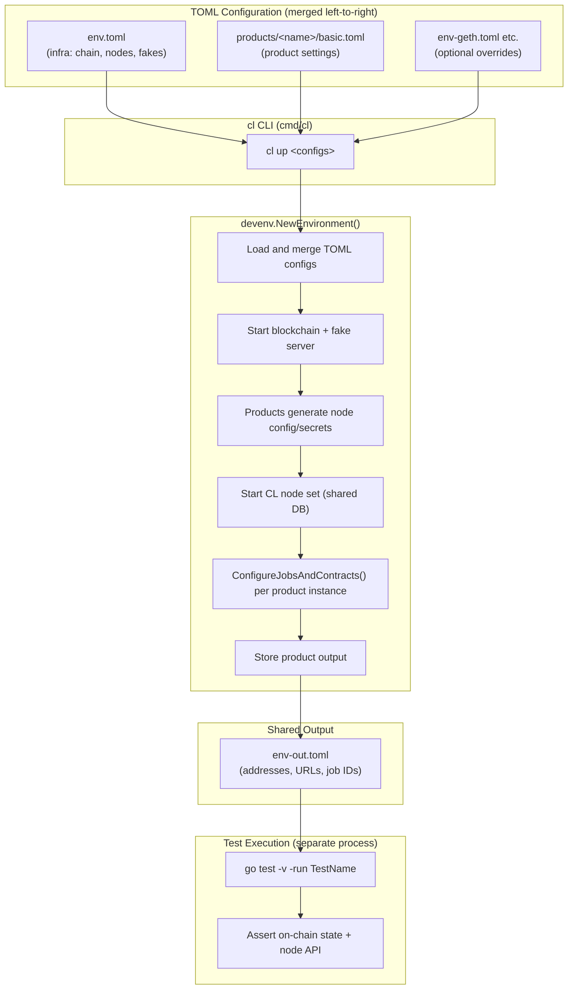
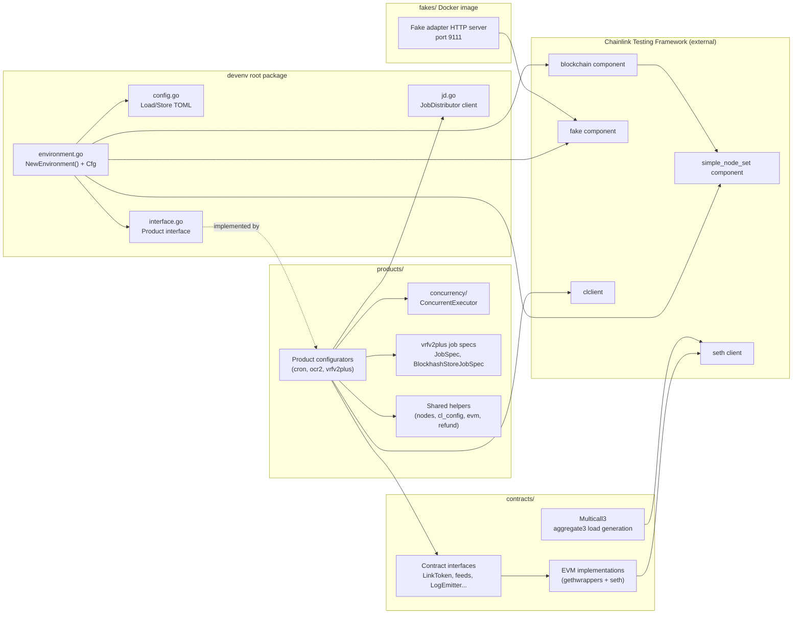
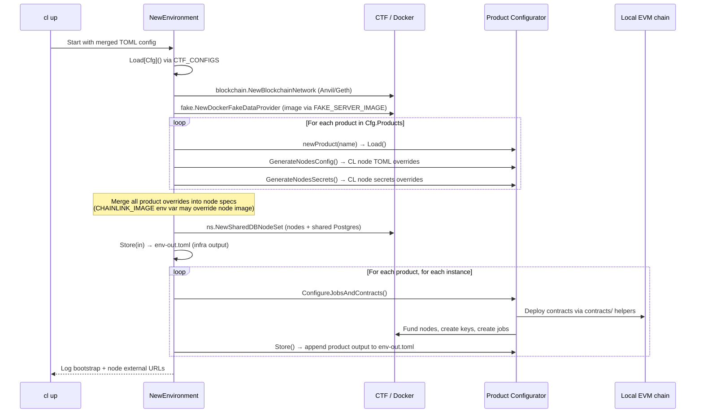
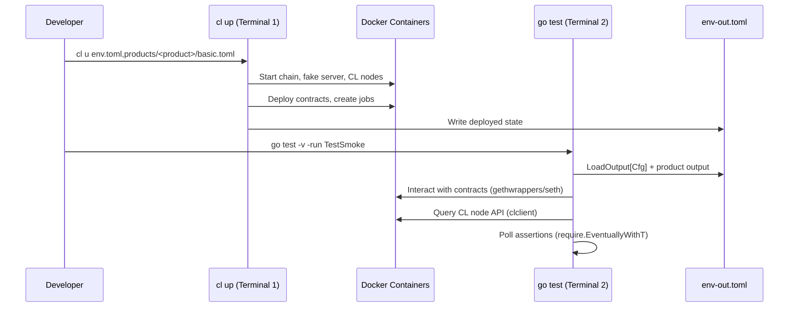

# devenv — Chainlink Developer Environment

> **Module**: `github.com/smartcontractkit/chainlink/devenv` (Go 1.26)
> **Location**: `chainlink/devenv/`

## 1. Purpose

`devenv` is a **self-contained, Docker-based development and simulation environment** for running Chainlink system-level tests locally and in CI. It is deliberately lightweight: it orchestrates a full Chainlink product stack from outside the node codebase, without importing `chainlink/v2` at all.

With a single command (`cl u env.toml,products/<product>/basic.toml`) it spins up:

| Layer | What runs | Provided by |
|---|---|---|
| **Blockchain** | Local EVM chain (Anvil by default, Geth via override) on chain ID `1337` | CTF `blockchain` component |
| **Fake data** | Mock external adapter HTTP server (port `9111`) returning controlled feed values | `devenv/fakes` Docker image |
| **Oracle nodes** | A set of Chainlink node containers (default 5) backed by a shared PostgreSQL database | CTF `simple_node_set` component |
| **Job Distributor** | Optional JD gRPC service client for proposing jobs to nodes | `chainlink-protos/job-distributor` |
| **Products** | Product-specific contracts + jobs: **Cron**, **OCR2**, **VRFv2Plus** | `devenv/products/*` configurators |

Key design principles (documented in `chainlink/devenv/design.md`):

- **Dependency isolation** — `devenv` never imports `github.com/smartcontractkit/chainlink/v2` or any child package. Contracts are bound via `chainlink-evm/gethwrappers`, node interaction via CTF's `clclient`, and on-chain interaction via CTF's `seth` client. This decouples the test environment from the core node codebase and avoids dependency hell.
- **TOML-driven configuration** — all infrastructure and product settings are declared in composable TOML files merged left-to-right through the `CTF_CONFIGS` environment variable.
- **Two-phase testing** — environment setup (`cl up`) and test execution (`go test`) are separate OS processes, connected by a shared `env-out.toml` output file that records deployed addresses, node URLs, and job IDs.
- **Product abstraction** — every Chainlink product implements a common `Product` interface, making it straightforward to plug in new products.

## 2. Position in the System

This module is one of several environments in the [Dev, Test & Simulation Environments](<../Dev,_Test___Simulation_Environments.md>) group:

| Sibling module | When to use it instead / alongside |
|---|---|
| [docker-dev-environments](docker-dev-environments.md) | Manual node debugging with `docker compose` files (`chainlink/tools/docker`) — no orchestration code, no product configurators. |
| [operations_scripts](operations_scripts.md) | One-off operational scripts under `chainlink/core/scripts` (CCIP finalization checks, CRE environment bootstrap, VRF docker stacks). |
| [integration-tests](integration-tests.md) | Heavier-weight integration tests that *do* import `chainlink/v2` and the deployment framework; run against remote/CTF environments. |
| [system-tests](system-tests.md) | The CRE-era system test framework (`chainlink/system-tests/lib/cre`) — the modern replacement path for multi-DON environments. |
| [deployment-environment](deployment-environment.md) | CLDF/CRIB-based environment with the node client models and JD test utilities used by the deployment framework. |
| [chainlink-node-web-sdk](chainlink-node-web-sdk.md) | Generated Go GraphQL SDK used by these environments (e.g. JD test tooling) to talk to node web APIs. |

`devenv` is the **fast inner loop** for product teams: two terminals, `cl u` + `go test`, all on local Docker.

## 3. Architecture Overview

### 3.1 Module Layout

```text
chainlink/devenv/
├── environment.go        # NewEnvironment() orchestrator + Cfg root config + Product registry
├── config.go             # Generic Load[T]/Store[T] TOML config system (CTF_CONFIGS)
├── interface.go          # Product interface (the extension contract)
├── jd.go                 # JobDistributor gRPC client (node/job/CSA services)
├── contracts/            # Contract interfaces + EVM implementations (LINK, WETH, mock feeds, VRF, multicall)
├── products/             # Product framework: shared helpers + cron/ocr2/vrfv2plus configurators + concurrency executor
│   ├── cron/             #   Cron product: bridge + cron job (no contracts)
│   ├── ocr2/             #   OCR2 product: LINK + OCR2Aggregator + 5-node DON
│   ├── vrfv2plus/        #   VRFv2Plus product: coordinator/BHS/BHF/wrapper contracts + job specs
│   └── concurrency/      #   Generic concurrent task executor utility
├── fakes/                # Standalone Go module → mock external adapter Docker image (port 9111)
│   ├── main.go           #   Bootstraps CTF fake data provider + ocr2/cron routes
│   ├── ocr2/ cron/       #   Per-product fake route registration
│   └── Dockerfile        #   Multi-stage image build (golang builder → alpine runtime)
├── cmd/cl/               # Cobra CLI + interactive shell driving the environment lifecycle
├── tests/                # Per-product smoke/soak tests (two-phase pattern, reads env-out.toml)
├── env*.toml             # Composable environment configs (base, geth, testnet, cl-rebuild, vrf variants)
├── dashboards/           # Grafana dashboard JSON (CL node errors)
└── Justfile              # build-fakes, push-fakes, cli, lint, clean
```

### 3.2 High-Level Data Flow



### 3.3 Component Relationships



### 3.4 Environment Bootstrap Sequence

`NewEnvironment()` in `environment.go` is the single entry point executed by `cl up`:



## 4. Core Concepts

### 4.1 Configuration System

The environment is configured entirely through TOML files selected by the `CTF_CONFIGS` environment variable (e.g. `CTF_CONFIGS=env.toml,products/ocr2/basic.toml`), which the `cl up` command sets from its arguments. The generic helpers in `config.go`:

- **`Load[T]()`** — reads each file left-to-right, decoding into the same struct so later files override earlier keys while preserving untouched keys. A missing `overrides.toml` is tolerated.
- **`Store[T]()`** — marshals the config to `<base>-out.toml` (or overwrites an existing cache file). This output file is the contract between the setup phase and the test phase.
- **`LoadOutput[T](path)`** — used by tests to reload `env-out.toml`.

The root config struct `Cfg` defines the top-level schema: `[[products]]` (name + instance count), `[[blockchains]]`, `[fake_server]`, `[[nodesets]]`, and an optional `[jd]` section. Each product configurator decodes its own `[[<product>]]` sections from the same merged files. A well-known Anvil dev key (`DefaultAnvilKey`) is provided for local funding operations.

Base configuration layers (see `chainlink/devenv/env*.toml`):

| Layer | File | Purpose |
|---|---|---|
| Base infrastructure | `env.toml` | Anvil chain (ID 1337), fake server image, 5-node DON with shared Postgres |
| Chain override | `env-geth.toml` / `env-testnet.toml` | Switch Anvil → Geth or a testnet |
| Image override | `env-cl-rebuild.toml` | Build the Chainlink node image from the local repository |
| Product config | `products/<name>/basic.toml` (+ `soak.toml`, per-variant files) | Product name, instances, product-specific settings, node-count overrides |
| Runtime output | `env-out.toml` (generated) | Deployed addresses, node URLs, job IDs consumed by tests |

### 4.2 The Product Interface

Every product implements `devenv.Product` (`interface.go`) and registers in the `newProduct()` switch in `environment.go`:

| Method | Responsibility |
|---|---|
| `Load()` | Decode the product's own TOML section (via `products.Load[T]`) |
| `Store(path, instanceIdx)` | Persist product output (addresses, job IDs) into the shared output file |
| `GenerateNodesConfig(ctx, ...)` | Return a Chainlink node config TOML override string for the product |
| `GenerateNodesSecrets(ctx, ...)` | Return a Chainlink node secrets TOML override string |
| `ConfigureJobsAndContracts(ctx, instanceIdx, ...)` | Deploy contracts, fund nodes, register keys, create jobs — per instance |

Registered products (add new ones with a `case "<name>"` in `newProduct()`):

| Product | TOML key | Contracts deployed | Notes |
|---|---|---|---|
| Cron | `cron` | None (bridge + cron job only) | Uses the fake server `POST /cron_response` route |
| OCR2 | `ocr2` | LINK, OCR2Aggregator | 5-node DON, configurable median/off-chain OCR2 settings, EA fake with deviation trigger |
| VRFv2Plus | `vrfv2_plus` | LINK, mock feeds, BHS, BatchBHS, VRF Coordinator v2.5, Wrapper, load-test consumers | Optional batch fulfillment, BHS/BHF maintenance jobs, multiple TX keys |

### 4.3 Two-Phase Testing



Every test in `devenv/tests/<product>/` follows the same pattern: load `env-out.toml`, register container-log cleanup, create ETH + CL node clients, bind contracts from deployed addresses, and poll for expected on-chain/API state. Tests must **not** import `chainlink/v2`, `integration-tests`, or `deployment` — only `devenv`, CTF, `chainlink-evm/gethwrappers`, and `libocr` (see `chainlink/devenv/design.md` for the full dependency rule).

## 5. Sub-Module Documentation

The module is organized into four sub-modules, each documented in detail on its own page:

| Sub-module | Documentation | Scope |
|---|---|---|
| **Environment Core** | [devenv_environment](devenv/devenv_environment.md) | The `NewEnvironment()` orchestrator, root `Cfg` TOML schema, module manifest/dependency policy, and the `JobDistributor` gRPC client (`GetCSAPublicKey`, `ProposeJob`, `NewJDConnection`). |
| **Contracts** | [devenv_contracts](devenv/devenv_contracts.md) | Chain-agnostic contract interfaces (`LinkToken`, `WETHToken`, `MockETHUSDFeed`, `MockLINKETHFeed`, `MockGasFeed`, `LogEmitter`), the Multicall3 wrapper (`CallWithValue`, `Result`, `MultiCallLogTriggerLoadGen`), and their EVM implementations on `seth` + `gethwrappers`. |
| **Products** | [devenv_products](devenv/devenv_products.md) | The product framework: shared node config/Docker helpers, the `cron`/`ocr2`/`vrfv2plus` configurators, VRFv2Plus job-spec templates (`JobSpec`, `BlockhashStoreJobSpec`), and the generic `ConcurrentExecutor` (`ChannelWithResult`, `NoTaskType`) used for parallel deployment tasks. |
| **Fakes** | [devenv_fakes](devenv/devenv_fakes.md) | The mock external adapter Docker image: multi-stage `Dockerfile` (golang builder → alpine runtime, port 9111) and its isolated Go module. |

Related pages in this group: [deployment-environment](deployment-environment.md) (CLDF/CRIB counterpart), [docker-dev-environments](docker-dev-environments.md) (manual compose stacks), and [integration-tests](integration-tests.md) / [system-tests](system-tests.md) (heavier-weight test suites).

## 6. Build, Tooling & Repository Artifacts

The module's behavior is defined by several build/packaging artifacts in the repository:

| Artifact | Role |
|---|---|
| `chainlink/devenv/go.mod` | Module manifest (`github.com/smartcontractkit/chainlink/devenv`, Go 1.26). Key dependencies: `chainlink-testing-framework/framework` (+ `seth`), `chainlink-evm` + `chainlink-evm/gethwrappers`, `chainlink-protos/job-distributor`, `libocr`, `cobra`, `go-prompt`, `gomega`, `zerolog`. |
| `chainlink/devenv/fakes/go.mod` | Separate module for the fake adapter server (`gin` + `zerolog` + CTF `fake` component), so the fake image build stays tiny and isolated. |
| `chainlink/devenv/fakes/Dockerfile` | Multi-stage build: `golang:1.26` builder compiles `fakes/main.go` → `alpine:3` runtime, exposing port **9111**. CA certificates are intentionally unpinned for latest security patches. |
| `chainlink/devenv/Justfile` | Task runner recipes: `build-fakes`, `push-fakes <registry>` (linux/amd64 → ECR), `cli` (installs the `cl` tool), `lint`, `clean`. |
| `chainlink/devenv/env*.toml` | Composable environment inputs (base, geth, testnet, CL-rebuild, VRF variants). |
| `chainlink/devenv/cmd/cl/` | Cobra CLI (`up`, `down`, `restart`, `test`, `obs up/down`, `bs up/down`, `sh`) plus an interactive shell with autocomplete; `cl up` sets `CTF_CONFIGS`, disables Ryuk cleanup, and calls `NewEnvironment` with a 7-minute timeout. |
| `chainlink/devenv/dashboards/` | Grafana dashboard JSON (CL node errors, logs, load testing). |
| `chainlink/devenv/tests/` | Per-product smoke/soak tests following the two-phase pattern. |

### Observability

`cl obs up` starts Loki + Prometheus + Grafana (add `-f` for Pyroscope, cadvisor, and a Postgres exporter). Node config generated by `products.DefaultLegacyCLNodeConfig` already points Pyroscope at `http://pyroscope:4040` and enables JSON debug logging, so containers are observable out of the box.

## 7. Relationship to Other Modules

- **Chainlink node under test** — the node containers run the official Chainlink image built from the [Node Application Core & Interfaces](<../Node_Application_Core___Interfaces/node_application.md>) codebase (Application lifecycle, GeneralConfig, relay adapters). `devenv` only interacts with it through its TOML config/secrets overrides and its REST/GraphQL APIs.
- **OCR2 jobs** — the `ocr2` product deploys an OCR2Aggregator and creates OCR2 reporting jobs on the nodes; job execution behavior is governed by the [OCR / OCR2 engines](<../Oracle_Engines___Data_Pipelines/ocr.md>) module.
- **VRFv2Plus jobs** — the `vrfv2plus` product's job specs (see [products sub-module](devenv/devenv_products.md)) produce the observation-source pipelines executed by the node's [VRF subsystem](<../Oracle_Engines___Data_Pipelines/vrf.md>).
- **Job Distributor** — `devenv/jd.go` is a thin gRPC client for the same JD service described in [Feeds Service / Job Distributor](<../Node_Platform_Services/feeds_service.md>); it embeds the node, job, and CSA service clients and can propose/accept jobs and read CSA public keys. The [chainlink-node-web-sdk](chainlink-node-web-sdk.md) offers the GraphQL alternative used by the deployment environments.
- **Shared foundation types** — product configurators import `chainlink-common/pkg/types` (e.g. `types.OCR2PluginType`) from the [Shared Foundation Libraries & Domain Types](<../Shared_Foundation_Libraries___Domain_Types.md>).
- **CI** — devenv smoke/soak tests run nightly via the matrix workflow described in [Build, CI & Release Infrastructure](<../Build,_CI___Release_Infrastructure.md>) (`devenv-nightly.yml`: one matrix entry per product combining an `envcmd` and a `testcmd`).

## 8. Extending the Environment

To add a new product (recipe from `chainlink/devenv/design.md`):

1. Create `products/<name>/configuration.go` implementing the `Product` interface.
2. Create `products/<name>/basic.toml` with the default product config.
3. Add a `case "<name>"` in `newProduct()` in `environment.go`.
4. Create `tests/<name>/smoke_test.go` that reads `env-out.toml` and asserts behavior.
5. Add a matrix entry to the nightly CI workflow.

For deterministic external data, register additional routes in `devenv/fakes/<product>/` and rebuild the fake image with `just build-fakes` (see [fakes sub-module](devenv/devenv_fakes.md)).
