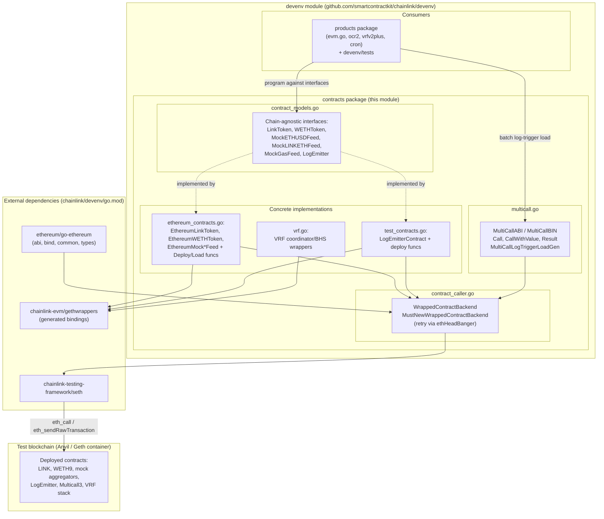
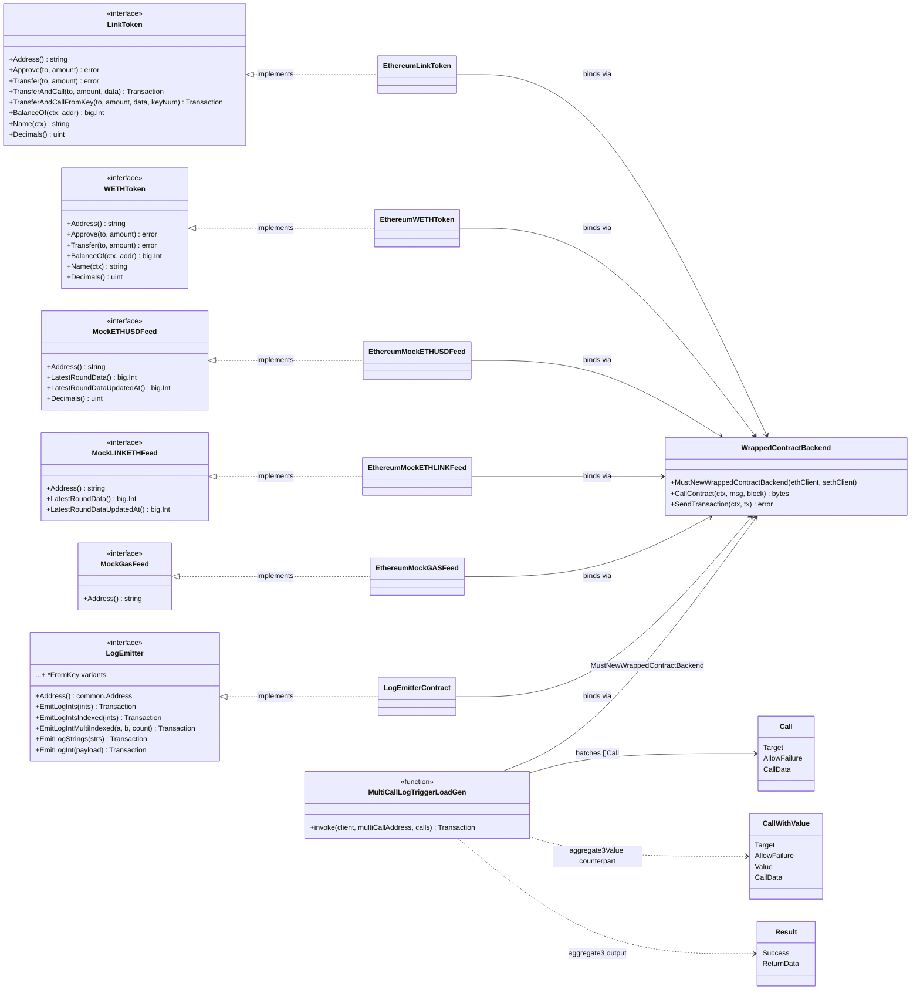
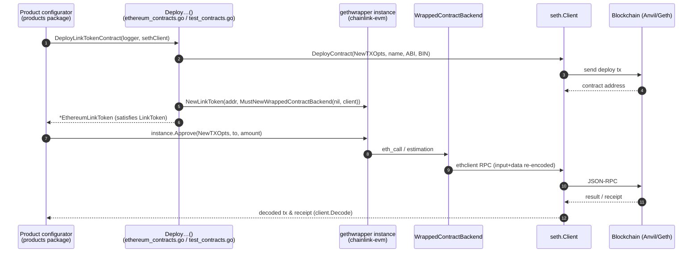
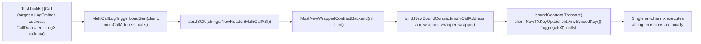

# devenv/contracts — Test Contract Models

## Overview

The `devenv/contracts` package (Go package `contracts` inside the module `github.com/smartcontractkit/chainlink/devenv`, see `chainlink/devenv/go.mod`) is the **smart-contract layer of the Chainlink Developer Environment (devenv)**. It "handles deployment, management, and interactions of smart contracts on various chains" (package doc, `chainlink/devenv/contracts/contract_models.go`).

The package is intentionally split into two layers:

1. **Contract models** (`contract_models.go`) — small, chain-agnostic Go **interfaces** (`LinkToken`, `WETHToken`, `MockLINKETHFeed`, `MockETHUSDFeed`, `MockGasFeed`, `LogEmitter`) that describe *what* the test environment needs from a contract, without binding to any concrete chain client.
2. **Multicall batching** (`multicall.go`) — an embedded [Multicall3](https://github.com/mds1/multicall) ABI/bytecode plus the `Call`, `CallWithValue` and `Result` tuple types and the `MultiCallLogTriggerLoadGen` helper, which packs many contract calls into a **single on-chain transaction** (used heavily for log-trigger load generation).

These interfaces are implemented by concrete Ethereum wrappers in the same package (`ethereum_contracts.go`, `test_contracts.go`, `vrf.go`) which are backed by `chainlink-evm` gethwrappers and the `chainlink-testing-framework/seth` client. Products and system tests consume only the interfaces, which keeps devenv decoupled from the core node codebase (see the dependency-isolation principle in `chainlink/devenv/design.md`).

> **Context:** This package is one of the building blocks of the devenv environment. See [devenv](../devenv.md) for the module overview, [devenv_environment](devenv_environment.md) for the environment lifecycle that invokes contract deployment, [devenv_products](devenv_products.md) for the products that consume these contracts, and [devenv_fakes](devenv_fakes.md) for the HTTP-based mock external adapters (a separate, off-chain complement to the on-chain mock feeds defined here).

---

## Architecture



Key architectural properties:

- **Interface-first design** — products and tests are written against `contract_models.go` interfaces, so a non-Ethereum chain adapter could be added by supplying new implementations without touching consumer code.
- **Core isolation** — devenv never imports `chainlink/v2`; it relies on the standalone `chainlink-evm` gethwrappers and the Chainlink Testing Framework (`chainlink/devenv/design.md`, "Dependency isolation").
- **Single choke point for RPC calls** — all read/write calls flow through `WrappedContractBackend` (`contract_caller.go`), which adds backwards-compatible `eth_call` encoding and optional retries.

---

## Core Components

### 1. Contract models — `chainlink/devenv/contracts/contract_models.go`

All six components are Go interfaces. Every interface exposes `Address() string` (or `common.Address` for `LogEmitter`) so callers can wire addresses into job specs and node configuration.

| Interface | Purpose | Key operations |
| --- | --- | --- |
| `LinkToken` | LINK token facade for funding nodes, paying fees, and triggering `transferAndCall`-based products (e.g., VRF subscriptions) | `Approve`, `Transfer`, `BalanceOf`, `TransferAndCall`, `TransferAndCallFromKey` (transact from a specific funded key), `Name`, `Decimals` |
| `WETHToken` | Wrapped Ether (WETH9) facade for wrapped-native-token scenarios | `Approve`, `Transfer`, `BalanceOf`, `Name`, `Decimals` (fixed at 18) |
| `MockETHUSDFeed` | On-chain mock ETH/USD aggregator (Chainlink `AggregatorV3`-style). Also reused as LINK/USD since the structure is identical (`ethereum_contracts.go`) | `LatestRoundData`, `LatestRoundDataUpdatedAt`, `Decimals` (8) |
| `MockLINKETHFeed` | On-chain mock ETH/LINK aggregator used to price LINK in gas/fee estimations | `LatestRoundData`, `LatestRoundDataUpdatedAt` |
| `MockGasFeed` | Placeholder mock gas-price feed; currently only exposes the address so it can be referenced in job specs | `Address` |
| `LogEmitter` | Shared `LogEmitter` test contract facade used to generate log events for **log-trigger** testing. Provides indexed / non-indexed / multi-indexed int and string emissions, each with an optional `FromKey` variant that sends from a specific funded key | `EmitLogInts`, `EmitLogIntsIndexed`, `EmitLogIntMultiIndexed`, `EmitLogStrings`, `EmitLogInt`, `EmitLogIntIndexed`, `EmitLogString` (+ `*FromKey` variants) |

The `FromKey` variants (e.g., `LinkToken.TransferAndCallFromKey`, `LogEmitter.EmitLogIntsFromKey`) are important for load generation: they let the harness spread transactions across multiple pre-funded keys (`client.NewTXKeyOpts(keyNum)`) to avoid nonce contention and to raise throughput.

### 2. Multicall batching — `chainlink/devenv/contracts/multicall.go`

This file embeds the **Multicall3** contract in source form:

- `MultiCallABI` — the full Multicall3 JSON ABI (`aggregate`, `aggregate3`, `aggregate3Value`, `tryAggregate`, block getters, …).
- `MultiCallBIN` — the deployed bytecode of Multicall3.
- `Call` — mirrors `Multicall3.Call3` (`Target`, `AllowFailure`, `CallData`).
- `CallWithValue` — mirrors `Multicall3.Call3Value` (`Target`, `AllowFailure`, `Value`, `CallData`).
- `Result` — mirrors `Multicall3.Result` (`Success`, `ReturnData`).

The functional core is:

```go
func MultiCallLogTriggerLoadGen(
    client *seth.Client,
    multiCallAddress string,
    calls []Call,
) (*types.Transaction, error)
```

It parses `MultiCallABI`, binds a go-ethereum `BoundContract` to the deployed Multicall3 address via `MustNewWrappedContractBackend(nil, client)`, and issues a **single `aggregate3` transaction** containing every call, using `client.NewTXKeyOpts(client.AnySyncedKey())` to pick any funded synced key. This turns N log-emission calls into one transaction — the primary mechanism for log-trigger load tests in devenv.

---

## Concrete implementations in the same package

The package completes the interface layer with Ethereum-specific wrappers (out of scope for this page's deep dive, but essential context — they are the objects actually returned to products):

| File | Contents |
| --- | --- |
| `ethereum_contracts.go` | `EthereumLinkToken`, `EthereumWETHToken`, `EthereumMockETHUSDFeed`, `EthereumMockETHLINKFeed`, `EthereumMockGASFeed` — each with `Deploy…` and `Load…` constructors (deploy via `client.DeployContract`, load via ABI/BIN registration into `client.ContractStore`). Also `DeployMultiCallContract` which deploys the embedded Multicall3 bytecode. |
| `test_contracts.go` | `LogEmitterContract` implementing `LogEmitter` on top of the generated `le.LogEmitter` gethwrapper, with `DeployLogEmitterContract(FromKey)` helpers. Uses elevated gas limits (`seth.WithGasLimit(100_000)`) on indexed/multi-indexed emissions to dodge underestimation errors on fast chains. |
| `vrf.go` | Wrappers for the VRF V2 Plus stack: `VRFCoordinatorV2_5`, batch coordinator, (Batch) `BlockhashStore`, wrapper contracts, and load-test consumers — the on-chain counterpart of the [vrfv2plus product](devenv_products.md) job specs (`JobSpec.CoordinatorAddress`, `BlockhashStoreJobSpec.BlockhashStoreAddress`). |
| `contract_caller.go` | `WrappedContractBackend` — a go-ethereum `bind.ContractBackend` wrapper that re-encodes `eth_call` payloads into both `input` and `data` fields for compatibility with older clients, honors `seth.ContextErrorKey` cancellation, and optionally retries transient connection errors through the internal generic `ethHeadBanger` helper (`MustNewRetryingWrappedContractBackend`). |

---

## Component Relationships



---

## Data Flow: Deployment and Interaction

The typical lifecycle of a contract in a devenv run. Deployment happens during the environment's `ConfigureJobsAndContracts()` phase (see [devenv_environment](devenv_environment.md)); interaction continues during the test phase.



Notes:

- All state-changing helpers funnel transactions through `client.Decode(...)`, which waits for and decodes receipts, so callers get deterministic success/failure at the call site.
- The `MustNewRetryingWrappedContractBackend` variant wraps read calls with the `ethHeadBanger` retry loop (retries on connection/EOF/`ErrClientQuit` errors up to `maxAttempts` with `retryDelay`), which is useful against flaky local chains.

---

## Process Flow: Multicall Log-Trigger Load Generation

`MultiCallLogTriggerLoadGen` collapses a batch of log emissions into one transaction:



Why it matters:

- **Throughput** — one transaction can trigger dozens of `LogEmitter` events, which multiplies the log-trigger event rate a Chainlink node must process during load/soak tests without being limited by per-tx nonce latency.
- **Determinism** — `aggregate3` executes calls in order within one block, simplifying assertions on received event counts.
- **Key management** — `client.AnySyncedKey()` lets seth choose any funded, synced key, matching the multi-key model exposed by the `*FromKey` interface methods.

---

## Dependencies

From `chainlink/devenv/go.mod` (module `github.com/smartcontractkit/chainlink/devenv`):

| Dependency | Role in this package |
| --- | --- |
| `github.com/ethereum/go-ethereum` | Core types (`common`, `core/types`), ABI parsing (`accounts/abi`), contract binding (`accounts/abi/bind`), `ethclient` |
| `github.com/smartcontractkit/chainlink-testing-framework/seth` | `seth.Client` — transaction submission, deployment, key management (`NewTXOpts`, `NewTXKeyOpts`, `AnySyncedKey`), receipt decoding, `ContractStore` for ABI/BIN registration |
| `github.com/smartcontractkit/chainlink-evm/gethwrappers` | Generated bindings for LinkToken, WETH9, mock aggregators, LogEmitter, and the VRF V2 Plus contract suite |
| `github.com/avast/retry-go/v4` | Retry policy of `WrappedContractBackend` (used by `ethHeadBanger`) |
| `github.com/rs/zerolog` | Structured logging for token/feed operations |

Per the devenv design principles (`chainlink/devenv/design.md`), this package deliberately depends on `chainlink-evm` rather than `chainlink/v2`, keeping the test environment buildable and versioned independently of the node codebase.

---

## Usage

A typical product/test flow (see [devenv_products](devenv_products.md)):

1. **Deploy primitives** — `DeployLinkTokenContract`, `DeployWETHTokenContract`, `DeployMockETHUSDFeed`, `DeployMockLINKETHFeed`, `DeployMockGASFeed`, `DeployLogEmitterContract`, `DeployMultiCallContract` return interface-typed handles.
2. **Fund and configure** — use `LinkToken.Transfer/TransferAndCall` to fund node/operator addresses, and feed `feed.Address()` values into job specs (e.g., `JobSpec.CoordinatorAddress`, OCR2 feed configuration).
3. **Generate activity** — tests call `LogEmitter.Emit*` directly for functional tests, or batch calls through `MultiCallLogTriggerLoadGen` for load tests; emitted logs drive the Chainlink nodes' log-trigger jobs.
4. **Assert** — read state via the same wrappers (`BalanceOf`, `LatestRoundData`, receipts) or via gethwrappers loaded with `Load…` constructors against `env-out.toml` addresses.

---

## Related Documentation

- [devenv](../devenv.md) — devenv module overview, quickstart, and CLI workflow
- [devenv_environment](devenv_environment.md) — `Cfg`/`NewEnvironment` lifecycle that drives `ConfigureJobsAndContracts`
- [devenv_products](devenv_products.md) — product implementations (OCR2, VRF V2 Plus, cron) that consume these contracts
- [devenv_fakes](devenv_fakes.md) — Dockerized mock external adapters (HTTP fakes complementing the on-chain mock feeds)
- [Dev, Test & Simulation Environments](../../Dev,_Test___Simulation_Environments.md) — parent documentation hub
