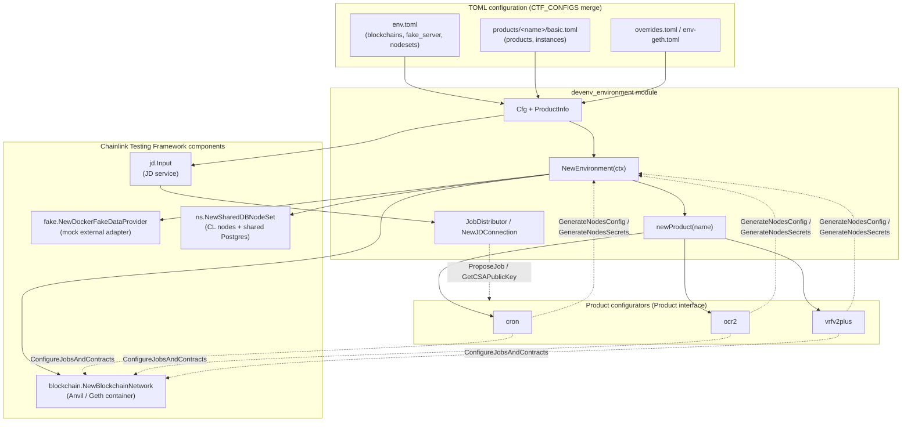
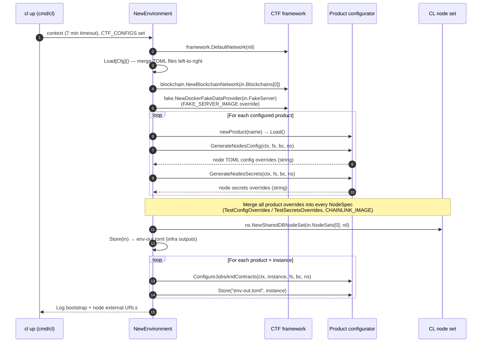
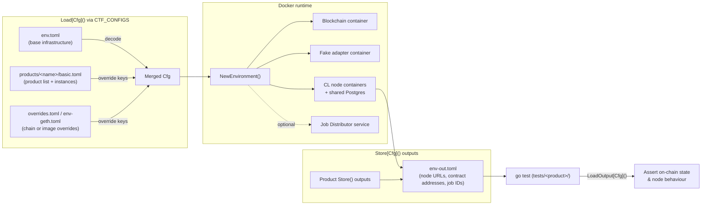

# devenv_environment

> **Module path:** `github.com/smartcontractkit/chainlink/devenv` (package `devenv`)
> **Category:** [Dev, Test & Simulation Environments](../../Dev,_Test___Simulation_Environments.md) → [devenv](../devenv.md)

## Introduction

`devenv_environment` is the bootstrap core of the **Chainlink Developer Environment** — a self-contained, Docker-based environment for running Chainlink nodes against a local blockchain for system-level testing and local product development. It is implemented as a **standalone Go module** (`chainlink/devenv/go.mod`) that deliberately does **not** import the core `chainlink/v2` node codebase, keeping the test environment decoupled from the production code.

The module provides three concerns:

| Concern | Component | Source |
|---|---|---|
| Environment configuration schema | `Cfg`, `ProductInfo` | `chainlink/devenv/environment.go` |
| Environment bootstrap pipeline | `NewEnvironment(ctx)` + `newProduct(name)` factory | `chainlink/devenv/environment.go` |
| Job Distributor client | `JobDistributor`, `JDConfig`, `NewJDConnection` | `chainlink/devenv/jd.go` |

The module orchestrates four categories of Docker infrastructure via the [Chainlink Testing Framework (CTF)](https://github.com/smartcontractkit/chainlink-testing-framework):

1. **Blockchain network** — an EVM dev chain (Anvil or Geth).
2. **Fake data provider** — a mock external adapter server (see [devenv_fakes](devenv_fakes.md)).
3. **Chainlink node set** — N nodes sharing a PostgreSQL database.
4. **Job Distributor (JD)** — optional offchain service used to propose/manage jobs.

Once infrastructure is up, **product configurators** (cron, OCR2, VRFv2+) deploy their contracts and jobs on top of it — see [devenv_products](devenv_products.md) and [devenv_contracts](devenv_contracts.md).

### Design principles

- **Dependency isolation** — the module never imports `chainlink/v2` or its children; it interacts with running nodes only through HTTP/gRPC APIs.
- **TOML-driven configuration** — composable TOML files merged left-to-right via the `CTF_CONFIGS` environment variable.
- **Two-phase testing** — environment setup (CLI process) and test execution (`go test` process) are separate, connected by a generated `env-out.toml` output file.
- **Product abstraction** — every Chainlink product implements a common `Product` interface, making new products straightforward to add.

---

## Core components

### `Cfg` — environment configuration schema

Defined in `chainlink/devenv/environment.go`, `Cfg` is the root TOML schema decoded from the merged `CTF_CONFIGS` files:

| Field | Type | TOML key | Required | Purpose |
|---|---|---|---|---|
| `Products` | `[]*ProductInfo` | `products` | no | Which products to deploy and how many instances of each |
| `Blockchains` | `[]*blockchain.Input` | `blockchains` | ✅ | Blockchain network definitions (type, image, chain ID, ports, CLI params) |
| `FakeServer` | `*fake.Input` | `fake_server` | ✅ | Mock external adapter image and port |
| `NodeSets` | `[]*ns.Input` | `nodesets` | ✅ | Chainlink node set definitions (node count, node images, shared DB) |
| `JD` | `*jd.Input` | `jd` | no | Job Distributor service settings |

`ProductInfo` carries `Name` (registry key for the factory) and `Instances` (how many independent product deployments to orchestrate). The framework input types (`blockchain.Input`, `fake.Input`, `ns.Input`, `jd.Input`) are owned by CTF — this module only composes them.

A typical base config (`chainlink/devenv/env.toml`) declares one Anvil chain (chain ID 1337), the `chainlink-fakes` image on port 9111, and a 5-node set backed by PostgreSQL 15.

### `NewEnvironment` — bootstrap pipeline

`NewEnvironment(ctx context.Context) error` is the single entry point that turns a merged TOML config into a running environment. It executes the phases described in [Bootstrap process flow](#bootstrap-process-flow) below.

### `newProduct` — product factory

Maps a `ProductInfo.Name` string to a `Product` configurator:

| Name key | Configurator | Product |
|---|---|---|
| `"cron"` | `cron.NewConfigurator()` | Cron jobs |
| `"ocr2"` | `ocr2.NewConfigurator()` | OCR2 data feeds |
| `"vrfv2_plus"` | `vrfv2plus.NewConfigurator()` | VRF v2 Plus |

Unknown names return an error, so adding a product requires one switch clause in `environment.go` plus an implementation of the [`Product` interface](devenv_products.md). The interface contract (`chainlink/devenv/interface.go`) is:

```go
type Product interface {
    Load() error
    Store(path string, instanceIdx int) error
    GenerateNodesSecrets(ctx, fs, bc, ns) (string, error)
    GenerateNodesConfig(ctx, fs, bc, ns) (string, error)
    ConfigureJobsAndContracts(ctx, instanceIdx, fs, bc, ns) error
}
```

### `JobDistributor` — offchain job management client

Defined in `chainlink/devenv/jd.go`. `JobDistributor` wraps the generated gRPC clients from `chainlink-protos/job-distributor` and is used by product configurators to propose jobs to nodes through the offchain Job Distributor rather than talking to each node's API directly.

```go
type JobDistributor struct {
    nodev1.NodeServiceClient   // node registration/lookup
    jobv1.JobServiceClient     // job proposals
    csav1.CSAServiceClient     // CSA key management
    WSRPC string               // WebSocket RPC endpoint
}
```

| API | Behaviour |
|---|---|
| `NewJDConnection(cfg JDConfig)` | Opens a `grpc.NewClient` connection using insecure credentials; `JDConfig` carries `GRPC` and `WSRPC` endpoints. Unary interceptors are supported via a (currently empty) chain. |
| `GetCSAPublicKey(ctx)` | Lists CSA keypairs and returns the first public key; errors when none are registered. |
| `ProposeJob(ctx, req)` | Delegates to `JobServiceClient.ProposeJob`, wrapping transport errors and rejecting nil proposals — the proposed job is accepted on the node identified by `ProposeJobRequest.NodeId`. |

Because all three proto clients are **embedded**, `JobDistributor` satisfies the underlying `NodeServiceClient`, `JobServiceClient`, and `CSAServiceClient` interfaces directly and can be passed wherever those types are expected.

---

## Architecture

The module sits at the centre of the devenv stack: it consumes merged TOML configuration, drives CTF components to create Docker infrastructure, delegates product-specific setup to configurators, and exposes the Job Distributor client used during that setup.



**Key relationships:**

- `Cfg` is a pure composition of CTF input types — the module owns no infrastructure primitives itself.
- Product configurators are resolved by the factory and drive two distinct phases: node config generation (before nodes start) and job/contract configuration (after nodes start).
- The `JobDistributor` client is the channel through which products push job proposals to the running node set.

---

## Bootstrap process flow

`NewEnvironment` runs a strictly ordered pipeline. Steps 1–7 bring up shared infrastructure; steps 8–9 are per-product and per-instance.



Behaviour details worth noting:

- **Single blockchain constraint** — only `in.Blockchains[0]` is started (chain ID 1337). If products need different infrastructure, the comment in `environment.go` directs users to a different `env.toml` layout.
- **Shared-DB node set** — all nodes in `NodeSets[0]` share one database; product config/secrets overrides are *concatenated* (`strings.Join(..., "\n")`) across every product before being applied to every node spec.
- **Fail-fast semantics** — every phase returns wrapped errors; the environment aborts on the first failure (e.g., unknown product, failed node-set creation).
- **Instance fan-out** — `ConfigureJobsAndContracts` is called once per `ProductInfo.Instances`, and each instance's outputs are appended to `env-out.toml` via the product's own `Store` implementation.

---

## Configuration and data flow

The environment uses a layered TOML merge plus a generated output file that forms the contract between the setup phase (CLI) and the test phase (`go test`).



Supporting this flow, `chainlink/devenv/config.go` provides the generic `Load[T]`/`Store[T]`/`LoadOutput[T]` helpers (TOML decode with left-to-right override, output written to `<base>-out.toml`) and the `L` zerolog logger used by `environment.go`. Product configurators mirror the same pattern per product — see [devenv_products](devenv_products.md).

### Environment variables

| Variable | Set by | Effect |
|---|---|---|
| `CTF_CONFIGS` | CLI (`cl up env.toml,products/ocr2/basic.toml`) | Comma-separated TOML files merged by `Load[Cfg]()` |
| `FAKE_SERVER_IMAGE` | Developer | Overrides `FakeServer.Image` after config load |
| `CHAINLINK_IMAGE` | Developer | Overrides the image of every node spec after product overrides are merged |
| `TESTCONTAINERS_RYUK_DISABLED` | CLI (`cl up`/`cl restart`) | Keeps test containers alive between runs |

---

## Dependencies

The module manifest (`chainlink/devenv/go.mod`, Go 1.26.6) reflects the isolation principle — the only Chainlink packages imported are tooling/protos, never the core node:

| Dependency group | Notable modules | Used for |
|---|---|---|
| **CTF framework** | `chainlink-testing-framework/framework` (+ `components/blockchain`, `components/fake`, `components/jd`, `components/simple_node_set`), `seth` | Docker orchestration, blockchain networks, node sets, JD component, Ethereum transactions |
| **Job Distributor** | `chainlink-protos/job-distributor` (`nodev1`, `jobv1`, `csav1`) | The gRPC clients embedded in `JobDistributor` |
| **EVM stack** | `go-ethereum`, `chainlink-evm`, `chainlink-evm/gethwrappers` | Contract bindings used by product configurators (see [devenv_contracts](devenv_contracts.md)) |
| **CLI / shell** | `spf13/cobra`, `c-bata/go-prompt` | The `cl` CLI (`cmd/cl`) and interactive shell |
| **Config & serialization** | `pelletier/go-toml/v2`, `davecgh/go-spew` | `Load`/`Store` TOML merge machinery |
| **Observability** | `rs/zerolog`, `uber/zap` | Structured console logging |
| **HTTP / gRPC** | `go-resty/resty/v2`, `google.golang.org/grpc` | Node API calls, JD connections |

Companion manifests in the same directory tree: `chainlink/devenv/fakes/go.mod` builds the mock external adapter image (multi-stage `builder` → `stage_1` in `chainlink/devenv/fakes/Dockerfile`) — see [devenv_fakes](devenv_fakes.md).

---

## Usage lifecycle

1. **One-time setup** — from `chainlink/devenv/`: `just build-fakes` (builds the mock adapter image) and `just cli` (installs the `cl` tool). See `chainlink/devenv/Justfile`.
2. **Start the environment** — `cl u env.toml,products/<product>/basic.toml`. The CLI (`chainlink/devenv/cmd/cl/chainlink.go`) sets `CTF_CONFIGS`, disables Ryuk cleanup, and invokes `de.NewEnvironment(ctx)` with a 7-minute timeout. `cl r` (restart) additionally tears down existing test containers first.
3. **Run tests** — from `chainlink/devenv/tests/<product>/`: `go test -v -run <TestName>`. Tests read `env-out.toml` to discover node URLs, contract addresses and job IDs.
4. **Teardown** — `cl down` removes all test containers.

An interactive shell (`cl sh`) offers autocomplete for the same commands. Observability (Loki + Prometheus + Grafana, dashboards in `chainlink/devenv/dashboards/`) can be layered on with `cl obs up [-f]`.

---

## Relationship to other modules

- **Parent module** — [devenv](../devenv.md) gives the overall layout of the standalone module and its test suites (`chainlink/devenv/tests/{cron,ocr2,vrfv2plus,features}`).
- **Siblings**
  - [devenv_products](devenv_products.md) — the `Product` interface implementations (cron, ocr2, vrfv2plus) and shared product helpers (node config, gas settings, concurrency executors).
  - [devenv_contracts](devenv_contracts.md) — contract models (LINK token, feeds, multicall, VRF) deployed by product configurators.
  - [devenv_fakes](devenv_fakes.md) — the mock external adapter image referenced by `Cfg.FakeServer`.
- **Same category**
  - [docker-dev-environments](../docker-dev-environments.md) — static `docker-compose`-based node environments (a simpler, non-programmatic alternative).
  - [system-tests](../system-tests.md) — the CRE system-tests framework, which follows a similar programmatic-provisioning philosophy at larger scale.
  - [integration-tests](../integration-tests.md) and [deployment-environment](../deployment-environment.md) — heavier test/CI environments (gotcha-based, CRIB).
- **Depended-on documentation** — the nodes orchestrated here run the [Node Application Core & Interfaces](../../Node_Application_Core___Interfaces.md) stack; observability dashboards align with the [Telemetry & Observability Platform](../../Telemetry___Observability_Platform.md).

## Extension guide: adding a product

1. Implement the five-method `Product` interface (`chainlink/devenv/interface.go`), including multi-instance awareness in `ConfigureJobsAndContracts`.
2. Add a `case` to `newProduct` in `chainlink/devenv/environment.go` mapping the TOML `products.name` key to your configurator.
3. Provide a product TOML fragment (e.g., `products/<name>/basic.toml`) declaring `[[products]]` with `name` and `instances`.
4. Optionally add smoke tests under `chainlink/devenv/tests/<name>/` and wire them into the devenv CI matrix.
