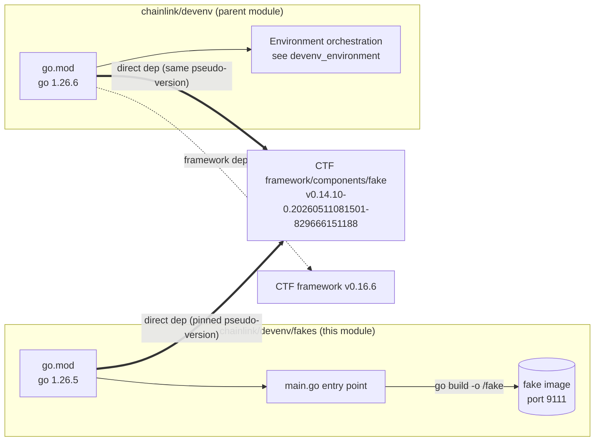
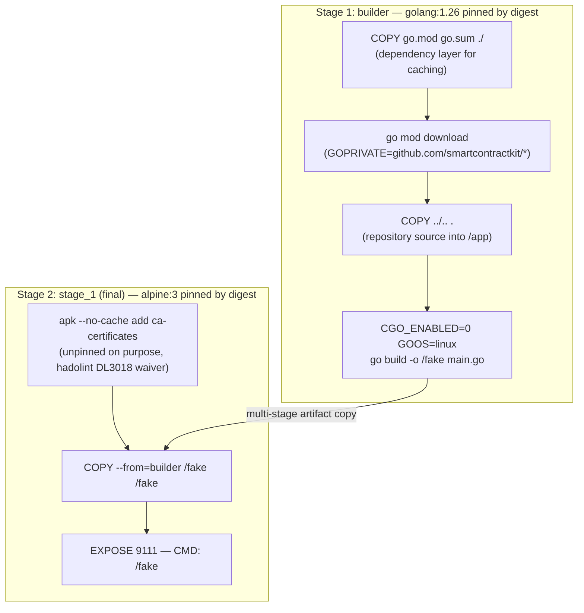
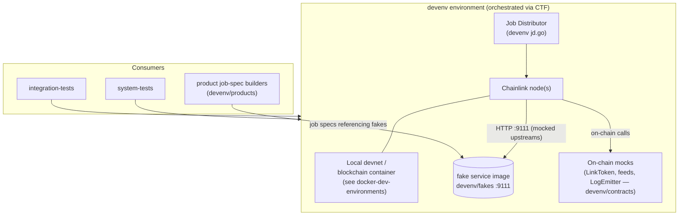

# devenv/fakes — Fake Service Container Images

`devenv/fakes` is a small, self-contained Go module plus a Dockerfile whose single purpose is to package the "fake" service components from the [chainlink-testing-framework (CTF)](https://github.com/smartcontractkit/chainlink-testing-framework) into a runnable, minimal Docker image. This image provides lightweight mock/stub HTTP services that development, integration, and simulation environments use in place of real external dependencies (e.g., upstream price/gas services) so that multi-node test environments can run deterministically and offline.

This module is a sub-module of the [devenv development environment toolkit](../devenv.md). It complements its siblings:

| Sibling module | Role | Documentation |
|---|---|---|
| `devenv` (root) | Environment orchestration, Job Distributor harness | [devenv_environment](devenv_environment.md) |
| `devenv/contracts` | On-chain test contracts (tokens, feeds, log emitters, multicall) | [devenv_contracts](devenv_contracts.md) |
| `devenv/products` | Product-specific job-spec builders (e.g., VRFv2+) | [devenv_products](devenv_products.md) |
| `devenv/fakes` (**this module**) | Off-chain mock HTTP services, delivered as a container image | — |

> **Key architectural property:** `devenv/fakes` is *never* imported as a Go library by the Chainlink node or the devenv orchestrator. It is a **separate Go module** (`github.com/smartcontractkit/chainlink/devenv/fakes` with its own `go.mod`) that exists solely so it can be compiled into a small static binary and shipped as a container image. Consumers interact with it exclusively over HTTP on port **9111**.

---

## Module Composition

The module consists of two tracked artifacts plus a build entry point:

| File | Type | Role |
|---|---|---|
| `chainlink/devenv/fakes/Dockerfile` | Container definition | Two-stage build (stages `builder` and `stage_1`) producing the `/fake` static binary and the minimal runtime image |
| `chainlink/devenv/fakes/go.mod` | Go module manifest | Defines module `github.com/smartcontractkit/chainlink/devenv/fakes` (Go 1.26.5) and pins the fake-component implementation |
| `chainlink/devenv/fakes/main.go` | Entry point (referenced by the Dockerfile's `go build main.go`) | Wires the CTF fake components into the HTTP server; not part of this module's documented component surface — see the `Dockerfile` for how it is consumed |

### Dependency profile (`go.mod`)

The direct dependency set is deliberately tiny — three requirements tell the whole story:

| Dependency | Purpose |
|---|---|
| `github.com/gin-gonic/gin v1.12.0` | HTTP router/framework serving the fake endpoints on port 9111 |
| `github.com/rs/zerolog v1.35.1` | Structured logging to container stdout |
| `github.com/smartcontractkit/chainlink-testing-framework/framework/components/fake v0.14.10-0.20260511081501-829666151188` | The **actual fake service implementations**, hosted in the CTF framework and pinned here to a specific commit pseudo-version |

Two details in this manifest are worth calling out:

1. **The pseudo-version pin.** `v0.14.10-0.20260511081501-829666151188` is not a tagged release; it tracks an in-flight commit of CTF's `components/fake` package. This ensures the image and its consumers agree on exact fake behavior. Critically, the parent `devenv` module (`chainlink/devenv/go.mod`) pins **the identical pseudo-version** of `framework/components/fake`, so the environment-orchestration code and the fake image are always built against the same implementation. Bump both together.
2. **Heavy indirect dependencies are compile-time only.** The indirect set (Docker/Moby client, `testcontainers-go`, Kubernetes `client-go`, `go-ethereum`, `golang-jwt`, OpenTelemetry, `quic-go`, …) is pulled in transitively by `chainlink-testing-framework/framework v0.16.6`. None of it ships in the image: the Dockerfile builds a static, CGO-free binary, so the runtime image stays minimal (see [Docker Image Build](#docker-image-build)).

The version alignment between the two modules is illustrated below:



---

## Docker Image Build

### Stage overview

The `Dockerfile` is a classic two-stage multi-stage build: a large builder image compiles a static binary, and a tiny Alpine runtime image ships only that binary plus CA certificates.



### Stage 1 — `builder` (Golang toolchain)

* **Base image:** `golang:1.26@sha256:6c2a5538f964f1c82f97ad14988bf05de100d922d159d0e398b54c7b0ca0c6c9` — pinned by digest for reproducible builds. Note the Dockerfile uses the `1.26` toolchain image while `go.mod` declares `go 1.26.5`; both must be kept compatible when upgrading.
* **`ENV GOPRIVATE=github.com/smartcontractkit/*`** — forces Go module resolution for all SmartContract Kit module paths to bypass the public module proxy and fetch directly from VCS with credentials. This is required whenever the pinned fake-component version (or its transitive SmartContract Kit dependencies) cannot be served by `proxy.golang.org`.
* **Layer-caching strategy:** only `go.mod`/`go.sum` are copied first and `go mod download` is run before copying source. Dependency downloads are cached as long as the manifests are unchanged, which keeps iterative rebuilds fast despite the large indirect dependency graph described above.
* **Source copy:** `COPY ../.. .` brings the repository source tree into `/app` so the module's `main.go` and its local packages can be compiled. The Dockerfile therefore assumes a build context that spans the source tree above the `fakes` directory — the concrete `docker build` invocation and context layout are owned by the consuming test tooling, not by this directory (there is no Make target for it in [`chainlink/GNUmakefile`](../../Build,_CI___Release_Infrastructure/chainlink_build_and_tooling.md)).
* **Static build:** `CGO_ENABLED=0 GOOS=linux go build -o /fake main.go` produces a fully static Linux binary. This is what allows the runtime stage to be Alpine-without-libc and keeps the heavy transitive dependencies (Docker SDK, Kubernetes client, go-ethereum, …) out of the image.

### Stage 2 — `stage_1` (final runtime)

* **Base image:** `alpine:3@sha256:294b683cb724975bec92580e1e685676bd4b50bda910ddb8c51d4cabeaec77e6` — again digest-pinned, keeping the image minimal and audit-friendly.
* **`RUN apk --no-cache add ca-certificates`** — installs root TLS certificates so the fake service can make outbound HTTPS calls to services it mocks. This is the **only** package installed, and it is deliberately **unpinned** ("always take the latest patched ca-certificates"), with an explicit `hadolint ignore=DL3018` waiver documenting the intent. This is the one intentional deviation from the digest-pinning policy used everywhere else in the file.
* **Artifact copy:** `COPY --from=builder /fake /fake` — only the single static binary moves between stages; no Go toolchain, module cache, or source code reaches the final image.
* **Runtime contract:** `EXPOSE 9111` (informational; consumers must still publish/map the port) and `CMD ["/fake"]` exec-form entrypoint, so the process receives container signals directly for clean shutdown.

### Security and reproducibility summary

| Property | Mechanism |
|---|---|
| Reproducible toolchain | Builder and runtime base images pinned by digest |
| Minimal attack surface | Static binary; Alpine runtime; single CA package |
| No secrets in image | Credentials used only at build time via `GOPRIVATE` module fetch |
| Predictable behavior | `components/fake` implementation pinned to a commit pseudo-version, shared with the devenv orchestrator |
| Exception policy | `ca-certificates` intentionally unpinned (latest patched CAs), documented via hadolint waiver |

---

## Runtime Behavior and Data Flow

At runtime, the image is a stateless HTTP service. The test/environment harness starts the container; test actors (Chainlink nodes, job pipelines, assertions) call the fake endpoints over HTTP; the service responds using the canned/recorded behavior implemented by CTF's `components/fake` package and logs via `zerolog`.

```mermaid
sequenceDiagram
    autonumber
    participant H as devenv / test harness
    participant R as Container runtime
    participant F as fake service (:9111)
    participant N as Chainlink node / test actor

    H->>R: start fake image (CMD /fake)
    R->>F: run static binary on Alpine
    F->>F: register gin routes backed by CTF fake components
    F-->>H: ready, listening on port 9111
    N->>F: HTTP request to mocked endpoint
    F->>F: zerolog structured trace
    F-->>N: deterministic mocked response
    Note over F: stateless; no DB, no chain access, no external deps
```

Design consequences of this model:

* **Transport-only coupling.** Consumers depend on the fake service's HTTP contract, not its Go types — which is why the module is kept out of the consumers' `go.mod` files (except where test code deliberately imports CTF's fake *types* directly, as the parent devenv module does for orchestration).
* **No persistence.** The container has no volumes or databases; any state is in-process. Environment resets are achieved by container restarts.
* **Determinism.** Because the implementation version is pinned at the same commit for both the orchestrator and the image, fake behavior is identical across a test run's client and server sides.

---

## Position in the Development Environment Stack

The fake image is one of several interchangeable services a devenv-based environment can start alongside Chainlink nodes, a local devnet, and the Job Distributor. It is the off-chain counterpart to the on-chain mocks in `devenv/contracts`:



Where to go next:

* How environments are defined and started: [devenv_environment](devenv_environment.md)
* On-chain mock contracts that pair with the off-chain fakes: [devenv_contracts](devenv_contracts.md)
* Product-level job-spec construction (e.g., VRFv2+): [devenv_products](devenv_products.md)
* Compose-based node/devnet stacks (different tooling, same goal): [docker-dev-environments](../docker-dev-environments.md)
* Primary automated consumers: [system-tests](../system-tests.md), [integration-tests](../integration-tests.md)

---

## Maintenance Notes

* **Upgrading the fake implementation** requires updating the `framework/components/fake` pseudo-version in *both* `chainlink/devenv/fakes/go.mod` and `chainlink/devenv/go.mod` so the image and the orchestrator stay in lockstep.
* **Go upgrades** must update three places consistently: the `go 1.26.5` directive in `go.mod`, the `golang:1.26` digest in the `builder` stage, and any parent-module Go version that shares the source tree copied via `COPY ../.. .`.
* **Do not pin `ca-certificates`** in the runtime stage — the unpinned install is intentional (always latest patched CAs) and is documented with a `hadolint ignore=DL3018` waiver in the Dockerfile.
* **Port 9111** is the image's stable service port; keep it unchanged across refactors, as environments and node configurations reference it.
* **Build context caveat:** because of `COPY ../.. .`, the image cannot be built with the `fakes` directory alone as context; the invoking tooling must supply a context that includes the repository source tree.

## References

* `chainlink/devenv/fakes/Dockerfile` — build definition (stages `builder`, `stage_1`)
* `chainlink/devenv/fakes/go.mod` — module manifest and pinned fake-component version
* `chainlink/devenv/go.mod` — parent devenv module; confirms identical `components/fake` pseudo-version pin
* `chainlink/GNUmakefile` — confirms this module has no dedicated build target (image construction is owned by test tooling)
* Parent overview: [devenv](../devenv.md) · Index: [Dev, Test & Simulation Environments](../../Dev,_Test___Simulation_Environments.md)
