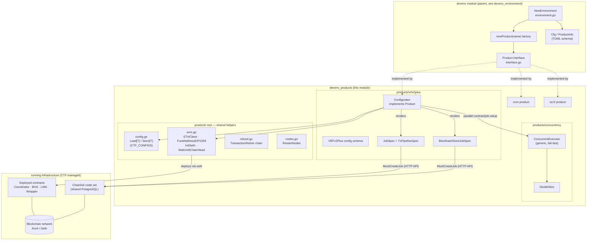
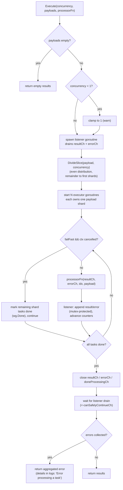
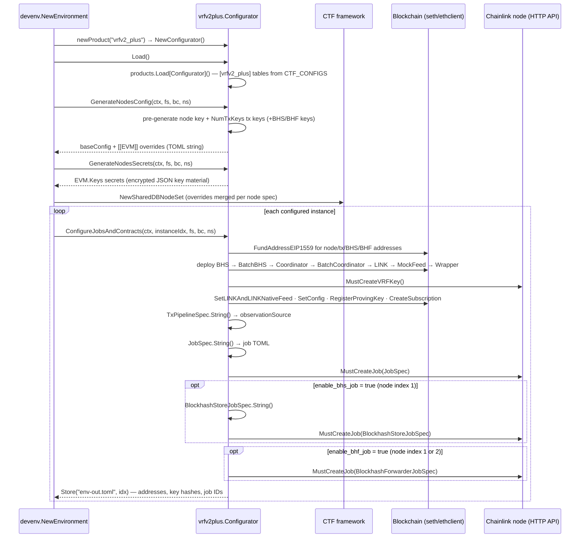
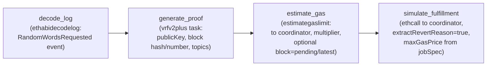
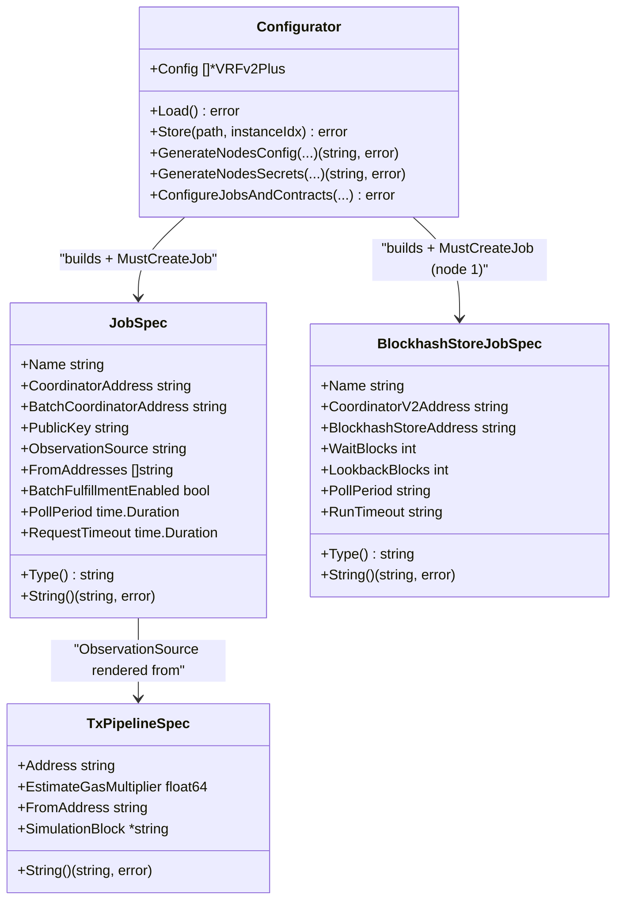

# devenv_products

> **Module path:** `github.com/smartcontractkit/chainlink/devenv` (packages under `chainlink/devenv/products/...`)
> **Category:** [Dev, Test & Simulation Environments](../../Dev,_Test___Simulation_Environments.md) → [devenv](../devenv.md)

## Introduction

`devenv_products` is the **product layer** of the Chainlink Developer Environment. While the parent [devenv](../devenv.md) module boots generic infrastructure (blockchain network, fake data provider, Chainlink node set — see [devenv_environment](devenv_environment.md)), this module owns everything *product-specific* on top of that infrastructure:

| Concern | Package / Components | Source |
|---|---|---|
| Shared product plumbing | `products` root: TOML `Load`/`Store`, key funding, gas helpers, refund retriers, node restart | `chainlink/devenv/products/config.go`, `evm.go`, `refund.go`, `nodes.go`, `cl_config.go` |
| Generic concurrency utility | `concurrency`: `ConcurrentExecutor`, `ChannelWithResult`, `NoTaskType`, `DivideSlice` | `chainlink/devenv/products/concurrency/executor.go`, `slice.go` |
| VRF v2 Plus product | `vrfv2plus`: `Configurator`, job spec builders (`JobSpec`, `TxPipelineSpec`, `BlockhashStoreJobSpec`) | `chainlink/devenv/products/vrfv2plus/*.go` |
| Other products (same pattern) | `cron`, `ocr2` configurators | `chainlink/devenv/products/cron/`, `ocr2/` |

Every product implements the devenv [`Product` interface](devenv_environment.md) (`Load`, `Store`, `GenerateNodesConfig`, `GenerateNodesSecrets`, `ConfigureJobsAndContracts` — defined in `chainlink/devenv/interface.go`). The environment bootstrap (`NewEnvironment`) discovers configurators through the `newProduct(name)` factory and drives them through their lifecycle; this module provides the implementations and the reusable toolkit they are built with.

The module is part of the standalone `chainlink/devenv` Go module (`chainlink/devenv/go.mod`), which intentionally does **not** import the `chainlink/v2` core — products interact with running nodes exclusively through their HTTP/GraphQL job APIs.

**On-chain counterparts** (VRF Coordinator, BlockhashStore, LINK token, etc.) are deployed from [devenv_contracts](devenv_contracts.md); the fake external-adapter server consumed by OCR2 products is documented in [devenv_fakes](devenv_fakes.md).

---

## Architecture and component relationships



Key relationships:

- **Inversion of control** — the parent `devenv` package defines *what* a product must do (the `Product` interface); this module defines *how* each product does it. `environment.go` never references product types directly except in the factory switch.
- **contracts ↔ products** — products call the deployment helpers from [devenv_contracts](devenv_contracts.md) (e.g. `contracts.DeployBlockhashStore`, `contracts.DeployVRFCoordinatorV2_5`) and record resulting addresses in their own output config.
- **concurrency ↔ products** — `ConcurrentExecutor` is a self-contained generic utility (only dependency: `rs/zerolog`) used to parallelize per-key work such as deploying contract instances from multiple funded keys (see `concurrency/example_test.go`).

---

## Core components

### `concurrency` — generic concurrent task execution

Source: `chainlink/devenv/products/concurrency/executor.go` (plus `slice.go`, `executor_test.go`, `example_test.go`)

#### `ConcurrentExecutor[ResultType, ResultChannelType, TaskType]`

A generic fan-out/fan-in utility that runs a task function across `N` worker goroutines, distributing a payload slice evenly via [`DivideSlice`](#divideslice), and aggregating results and errors into a single slice.

| Element | Role |
|---|---|
| `NewConcurrentExecutor(logger, opts...)` | Constructor; defaults to `context.Background()` and **fail-fast enabled** |
| `WithContext(ctx)` | Functional option — propagation/cancellation source (e.g. test timeouts) |
| `WithoutFailFast()` | Functional option — run *all* tasks even after failures |
| `Execute(concurrency, payloads, processorFn)` | Run one task per payload element with `concurrency` workers |
| `ExecuteSimple(concurrency, repeatTimes, simpleFn)` | Convenience wrapper that synthesizes an empty payload of `NoTaskType` and runs `repeatTimes` repetitions |
| `GetErrors()` | Errors accumulated during the last run (also surfaced in `Execute`'s returned error) |

The **task function contract** (type aliases `TaskProcessorFn` / `SimpleTaskProcessorFn`) is strict:

- Send exactly **one** message — either a result to `resultCh` (a channel of any type implementing `ChannelWithResult[ResultType]`, i.e. exposing `GetResult()`) **or** an error to `errorCh` — never both, never neither.
- The `executorNum` parameter is the worker index; the canonical pattern is `keyNum := executorNum + 1` so that on-chain key `0` (the root/funder key) is never used by workers.

#### `NoTaskType` and `ChannelWithResult`

- `NoTaskType` is a dummy marker struct used to instantiate the executor's `TaskType` parameter when tasks carry no payload (used with `ExecuteSimple`).
- `ChannelWithResult[ResultType]` is the interface a result message must implement so the listener can unwrap it via `GetResult()`.

#### Execution model



Behavioural notes:

- **Fail-fast** (default): the first task error cancels the derived context; workers then drain their remaining shard by calling `wgProcesses.Done()` instead of invoking the processor. With `WithoutFailFast()`, every task runs to completion.
- **Error aggregation**: individual task errors are logged and collected; `Execute` returns a summary error ("failed to process N task(s)") while `GetErrors()` exposes the individual errors.
- **Deterministic shutdown**: after `wgProcesses.Wait()`, the executor closes the result/error channels and waits for the background listener (`canSafelyContinueCh`) before returning — no goroutine leaks.
- **Shared-state safety**: `results`/`errors` slices are guarded by a mutex; the completion counter is atomic.

#### `DivideSlice[T]`

`chainlink/devenv/products/concurrency/slice.go` — splits a slice into `parts` near-equal chunks (remainder distributed over the first shards; `parts == 1` returns the original slice). Used by `Execute` to shard work across workers.

#### Intended usage

The canonical use case is **parallel contract deployment / funding from separate keys** during product orchestration, as demonstrated in `concurrency/example_test.go`:

```go
executor := concurrency.NewConcurrentExecutor[ContractInstance, contractResult, contractConfiguration](logger)
deployFn := func(resultCh chan contractResult, errorCh chan error, executorNum int, cfg contractConfiguration) {
    keyNum := executorNum + 1 // key 0 is the root key
    instance, err := client.deployContractConfigurableFromKey(keyNum, cfg)
    if err != nil { errorCh <- err; return }
    resultCh <- contractResult{instance: instance}
}
results, err := executor.Execute(client.getConcurrency(), contractConfigs, deployFn)
```

---

### `vrfv2plus` — VRF v2 Plus product

Source: `chainlink/devenv/products/vrfv2plus/` (`configuration.go`, `core.go`, `job_spec.go`, `job_spec_bhs.go`, `job_spec_bhf.go`)

The package implements the [Product interface](devenv_environment.md) for **VRF v2 Plus**: it pre-generates node/tx/BHS/BHF EVM keys, generates node config & secrets overrides, deploys the full on-chain stack, registers VRF proving keys, and creates the corresponding jobs on Chainlink nodes from the declarative specs below.

#### Configurator lifecycle



#### `JobSpec` — the VRF v2 Plus fulfillment job

Source: `chainlink/devenv/products/vrfv2plus/job_spec.go`

A declarative, TOML-tagged struct that renders the node-side `type = "vrf"` job via `String()` (Go `text/template`, `schemaVersion = 1`):

| Field group | Fields | Purpose |
|---|---|---|
| Identity | `Name`, `ExternalJobID` | Job name; UUID generated per deployment |
| Contracts | `CoordinatorAddress`, `BatchCoordinatorAddress` (rendered only when `BatchFulfillmentEnabled`) | Fulfillment targets |
| Crypto | `PublicKey` | Compressed VRF proving key (from `MustCreateVRFKey`) |
| Signers | `FromAddresses` | Node key + extra tx keys used to submit fulfillment txs |
| Chain | `EVMChainID`, `MinIncomingConfirmations` | Chain binding and finality gate |
| Batch fulfillment | `BatchFulfillmentEnabled`, `BatchFulfillmentGasMultiplier` | Optional batched fulfillment path |
| Backoff/polling | `BackOffInitialDelay`, `BackOffMaxDelay`, `PollPeriod`, `RequestTimeout` | Retry cadence |
| Pipeline | `ObservationSource` | Embedded pipeline spec (below) |

#### `TxPipelineSpec` — the observation-source pipeline

`TxPipelineSpec.String()` renders the node-side pipeline DAG that reacts to `RandomWordsRequested` logs:



The optional `SimulationBlock` field (`nil`, `"latest"` or `"pending"`) injects `block="…"` into the `estimate_gas` and `simulate_fulfillment` tasks; any other value fails template rendering. The rendered string is embedded verbatim as `JobSpec.ObservationSource`.

> The runtime interpretation of these pipeline tasks is owned by the node's execution engine — see the [pipeline module documentation](../../Oracle_Engines___Data_Pipelines/pipeline.md).

#### `BlockhashStoreJobSpec` — the BHS maintenance job

Source: `chainlink/devenv/products/vrfv2plus/job_spec_bhs.go`

Renders the `type = "blockhashstore"` job that periodically persists block hashes so VRF proofs remain verifiable long after the request block:

| Field | Purpose |
|---|---|
| `Name`, `ExternalJobID` | Job identity (UUID per deployment) |
| `CoordinatorV2Address`, `CoordinatorV2PlusAddress` | Coordinators the job serves |
| `BlockhashStoreAddress` | Storage target contract |
| `FromAddresses` | Dedicated BHS tx key (`bhsKeyAddr`, funded only when the job is enabled) |
| `EVMChainID` | Chain binding |
| `WaitBlocks`, `LookbackBlocks` | Deferred-write tuning (e.g. preset `2` / `20`) |
| `PollPeriod`, `RunTimeout` | Scheduling/timeouts (strings, e.g. `"1s"` / `"30s"`) |

A companion `BlockhashForwarderJobSpec` (`job_spec_bhf.go`, not a listed core component) follows the same pattern for the batch-forwarder job and is created on the node *after* the BHS node when `enable_bhf_job` is set.

#### Spec composition



All specs share the `marshallTemplate(jobSpec, name, templateString)` helper (`job_spec.go`): it parses a Go `text/template` and executes it against the struct, returning node-consumable TOML. Errors from either parse or execute phases are returned verbatim.

---

## Configuration reference

Product configuration follows the devenv [TOML layering convention](devenv_environment.md): files listed in the `CTF_CONFIGS` env var are merged left-to-right, and the `[[products]]` table selects `name = "vrfv2_plus"` with an `instances` count. Product tuning lives in `[[vrfv2_plus]]` tables (decoded into `VRFv2Plus`, `configuration.go`).

Selected fields that directly shape the job specs:

| TOML key | Feeds into | Notes |
|---|---|---|
| `num_tx_keys` | `JobSpec.FromAddresses`, key generation | Extra tx keys beyond the node key |
| `minimum_confirmations` | `JobSpec.MinIncomingConfirmations`, `Coordinator.SetConfig` | `0` enables `pending`-block mode |
| `vrf_job_simulation_block` | `TxPipelineSpec.SimulationBlock` | `""` or `"pending"` |
| `batch_fulfillment_enabled` / `batch_fulfillment_gas_multiplier` | `JobSpec.BatchFulfillment*`, `BatchCoordinatorAddress` | Multiplier defaults to `1.1` when unset |
| `vrf_job_poll_period` / `vrf_job_request_timeout` | `JobSpec.PollPeriod` / `RequestTimeout` | Invalid durations fall back to `1s` / `24h` |
| `enable_bhs_job` + `bhs_job_*` | `BlockhashStoreJobSpec` | BHS key is generated/funded only when enabled |
| `enable_bhf_job` + `bhf_job_*` | `BlockhashForwarderJobSpec` | Created after the BHS node |
| `cl_nodes_funding_eth`, `cl_node_max_gas_price_gwei`, `gas_settings` | funding + `[EVM.KeySpecific]` node overrides | |

Preset profiles shipped with the package (compose them via `CTF_CONFIGS`, e.g. `env.toml,products/vrfv2plus/basic.toml`):

| Preset | Scenario |
|---|---|
| `basic.toml` | Single VRF job, no extra keys, default confirmations |
| `two_keys.toml` | Extra tx keys for multi-key fulfillment |
| `bhs.toml` | Enables the BlockhashStore job (`wait_blocks = 2`, `lookback_blocks = 20`) |
| `bhf.toml` | Additionally enables the BlockhashForwarder job |
| `batch.toml` | Batch fulfillment enabled |
| `replay.toml` | Short `request_timeout = 5s` for replay scenarios |
| `pending_block.toml` | `minimum_confirmations = 0` + `vrf_job_simulation_block = "pending"` for instant-block testing |

Deployment outputs (`VRFDeployedContracts`, `VRFKeyOutput`) — contract addresses, compressed/uncompressed proving key, key hash, job IDs, tx-key addresses — are persisted per instance to `env-out.toml` via `Configurator.Store`, closing the [two-phase testing loop](devenv_environment.md) consumed by `go test` suites under `chainlink/devenv/tests/vrfv2plus/`.

---

## Adding a new product

1. Create `chainlink/devenv/products/<name>/` with a `Configurator` implementing the [`Product` interface](devenv_environment.md) (reuse the root helpers `Load`/`Store`, `ETHClient`, `FundAddressEIP1559`, `InitSeth`).
2. Add a `case "<name>":` clause to `newProduct` in `chainlink/devenv/environment.go` and register it in `ProductInfo`.
3. Ship preset TOMLs and, if jobs must be created on nodes, render node job specs the way `vrfv2plus` does (struct + `text/template` → TOML → node HTTP API).
4. Use `concurrency.ConcurrentExecutor` for any per-key parallelizable work (contract instances, funding, seeding).

---

## Related documentation

- [devenv](../devenv.md) — module overview and navigation hub
- [devenv_environment](devenv_environment.md) — bootstrap pipeline, `Product` interface contract, TOML layering, two-phase testing
- [devenv_contracts](devenv_contracts.md) — on-chain contract deployments invoked by product configurators
- [devenv_fakes](devenv_fakes.md) — fake external adapter server consumed by OCR2 products
- [Pipeline execution engine](../../Oracle_Engines___Data_Pipelines/pipeline.md) — node-side runtime that interprets the `ObservationSource` rendered here
- [VRF module](../../Oracle_Engines___Data_Pipelines/vrf.md) — production VRF oracle engine whose dev-environment counterpart this product exercises
