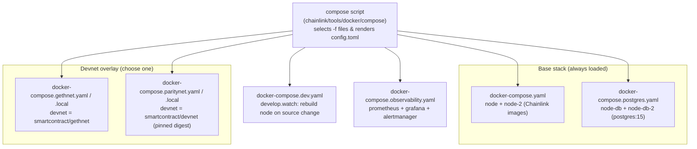
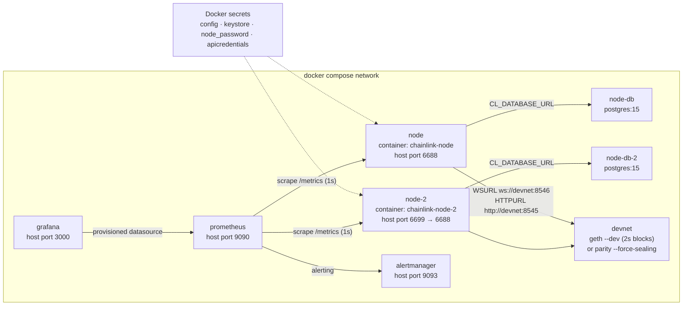
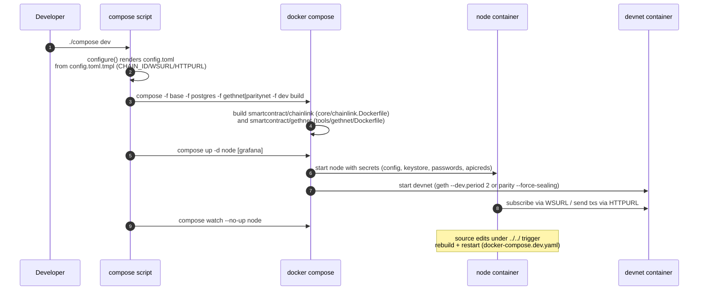

# Docker Dev Environments

> **Module location:** `chainlink/tools/docker/` (Compose overlays, observability provisioning, `compose` helper script) and `chainlink/tools/gethnet/` + `chainlink/tools/gethnet-london/` (custom Geth devnet images)
> **Parent module:** [Dev, Test & Simulation Environments](../Dev,_Test___Simulation_Environments.md)

## 1. Purpose

The `docker-dev-environments` module provides the fastest, batteries-included way to run a **local Chainlink node cluster against a simulated blockchain** using Docker Compose. It is the canonical "run the node on your laptop" workflow:

- Builds and runs **one or two Chainlink node containers** from the production image definition [`core/chainlink.Dockerfile`](../../repo/chainlink/core/chainlink.Dockerfile) (multi-stage build of the `chainlink` binary plus Loop plugins).
- Pairs each node with a dedicated **PostgreSQL 15** container and injects `CL_DATABASE_URL` into the node environment.
- Attaches an **in-memory devnet** (Geth in `--dev` mode or a pinned Parity/OpenEthereum image) with **prefunded accounts**, so the node can submit transactions immediately after boot.
- Optionally layers a **local observability stack** (Prometheus + Grafana + Alertmanager) that scrapes the nodes' `/metrics` endpoints.
- Supports **watch-mode development**: source edits trigger an image rebuild and container restart (`docker compose watch`).

**Scope / non-goals:** this module is for interactive local development only. It is not used for Kubernetes/production deployments, and it is not the programmatic (Go) environment harness — for that see [devenv](devenv.md). Heavier end-to-end harnesses live in [integration-tests](integration-tests.md) and [system-tests](system-tests.md).

## 2. How it is used — the `compose` wrapper script

Everything is driven by the shell script `chainlink/tools/docker/compose`, which layers the YAML files with `docker compose -f` and renders the node configuration file:

1. **File layering** — the base stack is always `docker-compose.yaml` + `docker-compose.postgres.yaml`. If no external RPC is provided (`HTTPURL`/`WSURL` unset), exactly one devnet overlay is added: `docker-compose.gethnet.yaml` when `GETH_MODE=true`, otherwise `docker-compose.paritynet.yaml`. `WITH_OBSERVABILITY=true` additionally appends `docker-compose.observability.yaml`, and the `dev` command appends `docker-compose.dev.yaml`.
2. **Config rendering** — `configure()` substitutes `SET_CHAIN_ID`, `SET_WSURL` and `SET_HTTPURL` into [`config.toml.tmpl`](../../repo/chainlink/tools/docker/config.toml.tmpl) and writes `config.toml`, which is mounted into the nodes as the `config` Docker secret.
3. **Lifecycle commands** — `dev`, `up`, `clean`, `logs`, `connect`, `eth:restart` (reset devnet to genesis) and `db:restart` (wipe a node database).

| Env var | Effect |
|---|---|
| `WITH_OBSERVABILITY=true` | Adds the Prometheus/Grafana/Alertmanager overlay and boots `grafana` |
| `GETH_MODE=true` | Uses the Geth devnet overlay (chain ID `1337`) instead of Parity (chain ID `34055`) |
| `CHAIN_ID=<n>` | Overrides the chain ID rendered into `config.toml` |
| `HTTPURL` / `WSURL` | Points the node at an external RPC; if **both** are set the devnet container is not started |

```sh
cd chainlink/tools/docker
./compose dev                          # 1 node + postgres + devnet + watch mode
WITH_OBSERVABILITY=true ./compose up   # 2 nodes + 2 DBs + devnet + observability
CHAIN_ID=11155111 WSURL=wss://eth.sepolia HTTPURL=https://eth.sepolia ./compose dev  # external RPC
```

The node Operator UI is then reachable at `http://localhost:6688` (API credentials: [`tools/secrets/apicredentials`](../../repo/chainlink/tools/secrets/apicredentials)).

## 3. Architecture overview

### 3.1 Compose file layering

The module follows an **overlay composition** model: a minimal, always-loaded base, plus mutually-exclusive scenario overlays. No single file describes the whole stack — the effective stack is the union selected by the `compose` script.



The **`.local` variants** of the devnet overlays differ only in port publishing: the non-local files expose RPC ports *within the Compose network only* (`ports: - 8545`), while `.local` binds them to the host (`8545:8545`, `8546:8546`) so external tools (e.g. Remix, test scripts) can reach the devnet directly.

### 3.2 Container topology



Key wiring details:

- **Node identity & fast transactions.** The base compose file notes: *"the keystore import allows us to submit transactions immediately because addresses are specified when starting the parity/geth node to be prefunded with eth."* The node keystore secret is [`tools/secrets/0xb90c7E3F7815F59EAD74e7543eB6D9E8538455D6.json`](../../repo/chainlink/tools/secrets), while the Geth devnet unlocks prefunded account `0x9ca9d2d5…` ([`tools/gethnet/Dockerfile`](../../repo/chainlink/tools/gethnet/Dockerfile), password from the shared `node_password` secret → [`tools/clroot/password.txt`](../../repo/chainlink/tools/clroot)).
- **Node entrypoint.** Both node services run
  `chainlink -c /run/secrets/config node start -d -p /run/secrets/node_password -a /run/secrets/apicredentials`
  i.e. start the node with the rendered TOML config, in development/insecure mode (`-d`), unlocking the imported keystore and loading API credentials. This boots the application whose lifecycle and configuration are documented in [Node Application Core & Interfaces](../Node_Application_Core___Interfaces.md).
- **Image build.** `build.context: ../../` + `dockerfile: core/chainlink.Dockerfile` builds the full plugin-enabled node image (deps → remote/local plugins → chainlink binary → ubuntu final stage, `EXPOSE 6688`, healthcheck on `/health`).
- **Scrape targets.** [`prometheus/prometheus.yaml`](../../repo/chainlink/tools/docker/prometheus/prometheus.yaml) scrapes `chainlink-node:6688` and `chainlink-node-2:6688` on `/metrics` every second and forwards alerts to `alertmanager:9093`.

### 3.3 Runtime flow of `./compose dev`



## 4. Core components

| Artifact (path) | Services / stages | Responsibility |
|---|---|---|
| [`chainlink/tools/docker/docker-compose.yaml`](../../repo/chainlink/tools/docker/docker-compose.yaml) | `node`, `node-2` | Base cluster: builds `smartcontract/chainlink` from `core/chainlink.Dockerfile`, mounts Docker secrets (`config`, `keystore`, `node_password`, `apicredentials`), loads `.env`, publishes `6688` / `6699→6688`, `restart: always` |
| [`chainlink/tools/docker/docker-compose.postgres.yaml`](../../repo/chainlink/tools/docker/docker-compose.postgres.yaml) | `node-db`, `node-db-2` | One `postgres:15` per node on named volumes (`node-db-data`, `node-db-2-data`); injects `CL_DATABASE_URL=postgresql://…@node-db[-2]:5432/…` and `depends_on` into the nodes |
| [`chainlink/tools/docker/docker-compose.gethnet.yaml`](../../repo/chainlink/tools/docker/docker-compose.gethnet.yaml) / [`.local`](../../repo/chainlink/tools/docker/docker-compose.gethnet.local.yaml) | `devnet` | Geth devnet built from `tools/gethnet`, container `geth`, ports `8545` (HTTP) / `8546` (WS), data in `geth-db-data` volume; nodes get `depends_on: devnet` |
| [`chainlink/tools/docker/docker-compose.paritynet.yaml`](../../repo/chainlink/tools/docker/docker-compose.paritynet.yaml) / [`.local`](../../repo/chainlink/tools/docker/docker-compose.paritynet.local.yaml) | `devnet` | Parity/OpenEthereum devnet from pinned image digest `smartcontract/devnet@sha256:9bcf…`, `--force-sealing --reseal-max-period 4000`, data in `parity-db-data` volume |
| [`chainlink/tools/docker/docker-compose.dev.yaml`](../../repo/chainlink/tools/docker/docker-compose.dev.yaml) | `node` (watch) | Compose `develop.watch` with `action: rebuild` on the whole repo (`../../`), ignoring `.changeset/`, `.github/`, `charts/`, `docs/`, `fuzz/`, `integration-tests/`, `tools/`, SGX target, etc. |
| [`chainlink/tools/docker/docker-compose.observability.yaml`](../../repo/chainlink/tools/docker/docker-compose.observability.yaml) | `prometheus`, `grafana`, `alertmanager` | Local observability: Prometheus TSDB + 5s global scrape, Grafana 10.4.3 with provisioned dashboards (`grafana/provisioning/`) and `grafana/config.monitoring`, Alertmanager with `/config/alertmanager.yml` |
| [`chainlink/tools/gethnet/Dockerfile`](../../repo/chainlink/tools/gethnet/Dockerfile) | image `smartcontract/gethnet` | `ethereum/client-go:v1.9.16`, `geth --dev --dev.period 2 --mine`, unlocks prefunded `0x9ca9d2d5…` with the `node_password` secret, config from [`tools/gethnet/config.toml`](../../repo/chainlink/tools/gethnet/config.toml) (network id 1337, all HTTP/WS modules open) |
| [`chainlink/tools/gethnet-london/Dockerfile`](../../repo/chainlink/tools/gethnet-london/Dockerfile) | image `smartcontract/gethnet:london` | `ethereum/client-go:v1.10.8`, initializes a **London-fork** `genesis.json` (network id 34055), copies prefunded devnet keys into the keystore, `--fakepow --nodiscover`, full HTTP/WS API, exposes 8545/8546/8547/30303 |
| [`chainlink/tools/docker/compose`](../../repo/chainlink/tools/docker/compose) | helper script | Overlay selection, `config.toml` rendering, lifecycle commands (`dev`/`up`/`clean`/`logs`/`connect`/`eth:restart`/`db:restart`), enables BuildKit (`DOCKER_BUILDKIT=1`) |

**Secrets wiring (base stack):**

| Secret name | Source file | Consumed by |
|---|---|---|
| `node_password` | `tools/clroot/password.txt` | node entrypoint (`-p`), devnet account unlock |
| `apicredentials` | `tools/clroot/apicredentials` | node entrypoint (`-a`), Operator UI login |
| `keystore` | `tools/secrets/0xb90c7E3F….json` | node keystore import (prefunded signing address) |
| `config` | `tools/docker/config.toml` (generated from `config.toml.tmpl`) | node startup config (`-c`) |

## 5. Sub-module documentation

The module is documented in four sub-modules, mirroring the overlay split (each page covers the components of the corresponding compose file(s), their service definitions, and their wiring into the base stack):

| Sub-module (generated page) | Components covered |
|---|---|
| [Node Deployment](docker-dev-environments/docker-dev-environments_node-deployment.md) — `docker-dev-environments_node-deployment.md` | Base cluster `node` / `node-2` from `docker-compose.yaml` (build from `core/chainlink.Dockerfile`, secrets, entrypoint, ports) plus the PostgreSQL pairing `node-db` / `node-db-2` and `CL_DATABASE_URL` injection from `docker-compose.postgres.yaml` |
| [Devnet Simulators](docker-dev-environments/docker-dev-environments_devnet-simulators.md) — `docker-dev-environments_devnet-simulators.md` | The `devnet` service and `node`/`node-2` `depends_on` wiring in `docker-compose.gethnet.yaml` and `docker-compose.paritynet.yaml` (incl. `.local` host-port variants), plus the custom images from `tools/gethnet/Dockerfile` and `tools/gethnet-london/Dockerfile` |
| [Dev Workflow Overlay](docker-dev-environments/docker-dev-environments_dev-workflow-overlay.md) — `docker-dev-environments_dev-workflow-overlay.md` | `docker-compose.dev.yaml`: the `node` service's `develop.watch` rebuild-on-change configuration consumed by `./compose dev` |
| [Observability Stack](docker-dev-environments/docker-dev-environments_observability-stack.md) — `docker-dev-environments_observability-stack.md` | `docker-compose.observability.yaml`: `prometheus`, `grafana` and `alertmanager` services, their volumes, provisioning layout and scrape/alert wiring |

## 6. Position in the system

- The containers run the Chainlink node binary itself — application bootstrapping, `GeneralConfig`, and the EVM relay are documented in [Node Application Core & Interfaces](../Node_Application_Core___Interfaces.md); the compose overlays are effectively the transport for that application's runtime configuration (`config.toml` secret + `.env` + `CL_DATABASE_URL`).
- The local Prometheus/Grafana stack is the lightweight, dev-oriented counterpart of the production-grade [Telemetry & Observability Platform](../Telemetry___Observability_Platform.md) (Beholder/OTLP, CHIP ingress), which it does **not** replace.
- Sibling environments in [Dev, Test & Simulation Environments](../Dev,_Test___Simulation_Environments.md):
  - [devenv](devenv.md) — programmatic Go environment/CTF harness (uses Docker underneath but is code-driven rather than compose-driven).
  - [operations_scripts](operations_scripts.md) — operational scripts and other Compose-based stacks (e.g. the VRF 5-node dev cluster in `core/scripts/common/vrf/docker/docker-compose.yml`).
  - [integration-tests](integration-tests.md) / [system-tests](system-tests.md) / [capabilities_integration_tests](capabilities_integration_tests.md) — CI test suites that build their own images and topologies.
  - [deployment-environment](deployment-environment.md) / [chainlink-node-web-sdk](chainlink-node-web-sdk.md) — remote deployment tooling and the generated node API client (this module's nodes expose the same HTTP API on port 6688).

## 7. Operational notes

- **Cleaning up:** `./compose clean` runs `docker compose down -v --remove-orphans` for both the base and dev file sets and removes the generated `config.toml`. For disk pressure, `docker system prune`.
- **Resource usage:** builds run in parallel by default; unset `DOCKER_COMPOSE_BUILD_OPTS` to fall back to Compose defaults if the machine struggles (see [`tools/docker/README.md`](../../repo/chainlink/tools/docker/README.md)).
- **Resetting state:** `eth:restart` force-removes the `devnet` container and its data volume (`docker_geth-db-data` / `docker_parity-db-data`); `db:restart` additionally wipes `node-db` and restarts the node.
- **Hidden logs:** if Compose swallows container output, use `docker ps` + `docker logs -f <container>` directly.
- The Geth devnet runs in insecure dev mode (unlocked prefunded keys, all RPC modules enabled, `--allow-insecure-unlock` in the London image) — suitable **only** for local development.
