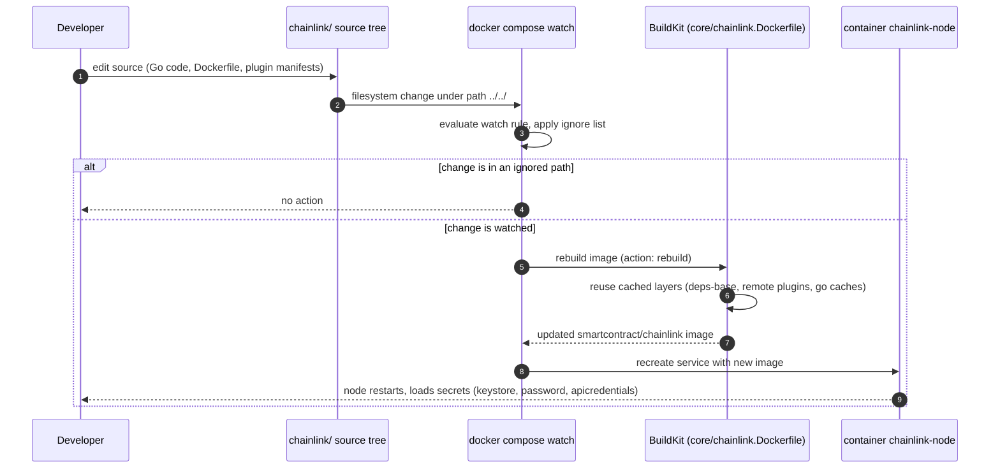
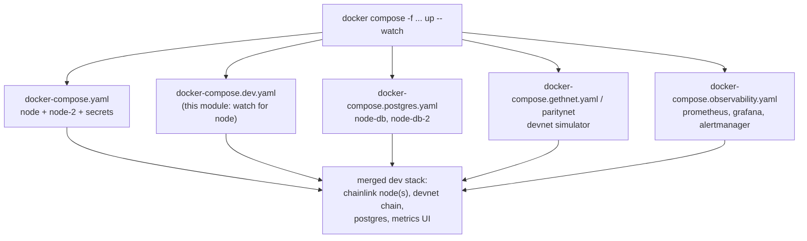

# Docker Dev Environments — Dev Workflow Overlay (`docker-compose.dev.yaml`)

## 1. Overview

The **dev-workflow-overlay** module provides a single, deliberately small artifact: [`chainlink/tools/docker/docker-compose.dev.yaml`](../../chainlink/tools/docker/docker-compose.dev.yaml). It is a **Docker Compose overlay** that attaches a Compose **watch mode** configuration (`develop.watch`) to the `node` service, so that a developer editing the Chainlink source tree gets an automatic *edit → rebuild image → restart container* loop:

```yaml
services:
  node:
    develop:
      watch:
        - action: rebuild
          path: ../../
          ignore:
            - '.changeset/'
            - '.github/'
            - 'charts/'
            - 'core/sgx/target/'
            - 'docs/'
            - 'fuzz/'
            - 'integration-tests/'
            - 'tools/'
```

Key characteristics:

- **It is an overlay, not a stack.** The file defines no new services, images, ports, or secrets. It only *merges* a `develop.watch` rule onto the existing `node` service declared in the base file `chainlink/tools/docker/docker-compose.yaml` (see the parent module: [docker-dev-environments](../docker-dev-environments.md)).
- **It is inert outside watch mode.** The `develop` section is consumed exclusively by `docker compose watch` / `docker compose up --watch` (Compose v2.22+). A plain `docker compose up` behaves exactly as if the overlay were absent.
- **Rebuild, not sync.** The single watch action is `rebuild`: when watched files change, Compose rebuilds the `smartcontract/chainlink` image from `core/chainlink.Dockerfile` and recreates the container. This matches the node's deployment model — the binary, plugins, and config are baked into the image, not bind-mounted.

---

## 2. Module scope

| Artifact | Role |
|---|---|
| `chainlink/tools/docker/docker-compose.dev.yaml` | The overlay: `develop.watch` rule (`action: rebuild`) for the `node` service |
| *(referenced)* `chainlink/tools/docker/docker-compose.yaml` | Base definition of `node`, `node-2`, and the `secrets` block this overlay extends |
| *(referenced)* `chainlink/core/chainlink.Dockerfile` | The image the `rebuild` action produces (multi-stage Go build + plugin installation) |
| *(referenced)* `chainlink/GNUmakefile` (`docker` target) | Canonical, fully-parameterized build of the same image with `buildx` |

There are no sub-modules. Sibling overlays within the parent module are documented separately: [node deployment](docker-dev-environments_node-deployment.md), [devnet simulators](docker-dev-environments_devnet-simulators.md), and [observability stack](docker-dev-environments_observability-stack.md).

---

## 3. Architecture: how the overlay composes with the base stack

Compose merges multiple `-f` files into one effective project. This overlay only contributes the `develop` key; every runtime property of `node` (image, build context `../../`, entrypoint, secrets, port `6688`, `.env` file, `restart: always`) comes from the base file.

```mermaid
flowchart LR
    subgraph BASE["docker-compose.yaml (base)"]
        direction TB
        N1["service: node<br/>image: smartcontract/chainlink<br/>build: context ../../ + core/chainlink.Dockerfile"]
        SEC["secrets: node_password, apicredentials,<br/>keystore, config"]
        N2["service: node-2"]
    end

    subgraph OVL["docker-compose.dev.yaml (this module)"]
        direction TB
        W["develop.watch<br/>action: rebuild<br/>path: ../../ (repo root)"]
        IGN["ignore: .changeset/, .github/, charts/,<br/>core/sgx/target/, docs/, fuzz/,<br/>integration-tests/, tools/"]
        W --- IGN
    end

    N1 -- "overlay merge" --> EFF["effective node service<br/>base definition + watch config"]
    W -- "adds develop.watch" --> EFF
    N2 -.-> "not watched, unchanged" -.-> EFF
    SEC -.-> EFF
```

**Path resolution detail.** The watch `path: ../../` is resolved *relative to the compose file's directory* (`chainlink/tools/docker/`), so it points at the `chainlink/` repository root — exactly the same directory as the base file's `build.context: ../../`. If the repository layout changes, both values must be updated in tandem.

**Selective watching.** Only the `node` service receives watch configuration. `node-2` (the second node in the base file) is never rebuilt automatically and keeps running on its original image — useful when a second node serves as a stable peer during local testing.

---

## 4. The watch rule in detail

### 4.1 Semantics of `action: rebuild`

Compose watch supports three actions: `sync` (copy changed files into the running container), `sync+restart`, and `rebuild`. This module selects `rebuild` because a Chainlink node image is a compiled artifact:

1. The binary is produced by `make install-chainlink` inside `core/chainlink.Dockerfile` (the `build-chainlink` stage).
2. Remote and local LOOPP plugins are installed via `loopinstall` (`build-remote-plugins` / `build-local-plugins` stages) — see [Plugin Process Framework (Loop)](../../Plugin_Process_Framework_(Loop).md).
3. The base compose `entrypoint` runs `chainlink node start`; there is no mechanism to hot-swap the binary in a running container.

`rebuild` therefore guarantees the container always runs an image consistent with the source tree, at the cost of a full (though heavily cached) image build per change.

### 4.2 The ignore list

Watched path: `../../` (the whole `chainlink/` repo). Without filtering, every edit — including docs and CI churn — would trigger a rebuild. The ignore list carves out everything that cannot affect the node image:

| Ignored path | Rationale |
|---|---|
| `.changeset/` | Release-note/version-bump files; no effect on image content |
| `.github/` | CI workflow definitions |
| `charts/` | Helm deployment manifests (deploy-time, not build-time) |
| `core/sgx/target/` | Rust/SGX build-artifact directory (pure churn) |
| `docs/` | Documentation |
| `fuzz/` | Fuzz-test corpora |
| `integration-tests/` | Separate Go module for test tooling |
| `tools/` | Developer tooling |

This mirrors the strategy documented inside `core/chainlink.Dockerfile` itself: the `deps` stage's `COPY . .` "relies on `.dockerignore` excluding everything not needed for the build (docs, CI config, test infra, non-Go tooling) so unrelated workspace churn doesn't invalidate the layer." The watch ignore list applies the same principle one level up — at the *trigger* boundary rather than the *build context* boundary. Together they ensure that a rebuild actually re-runs the layers that matter (Go compilation) while cache-heavy layers (`deps-base` module download, remote plugin installation) are reused from BuildKit cache mounts (`go-mod-cache`, `go-build-cache`).

### 4.3 Edit → rebuild feedback loop



---

## 5. Typical workflow

From `chainlink/tools/docker/`:

```bash
# Start the node and enter watch mode (base + this overlay)
docker compose -f docker-compose.yaml -f docker-compose.dev.yaml up --watch

# Equivalent: start normally, then watch
docker compose -f docker-compose.yaml -f docker-compose.dev.yaml watch
```

The overlay can be freely combined with the other overlays in this module family, which remain orthogonal because they touch different service keys:

```bash
docker compose \
  -f docker-compose.yaml \
  -f docker-compose.postgres.yaml \
  -f docker-compose.gethnet.yaml \
  -f docker-compose.observability.yaml \
  -f docker-compose.dev.yaml \
  up --watch
```



Details of the individual stacks (secrets layout, database wiring, devnet prefunding, metrics endpoints) are covered by the sibling pages listed in §2 and are not repeated here.

---

## 6. Operational notes and limitations

- **Compose version.** `develop.watch` requires Docker Compose v2 (v2.22 or newer recommended). Older CLIs ignore the section silently, which can look like the overlay "does nothing."
- **First rebuild is expensive.** The initial build compiles the Go binary and installs all plugins (see `core/chainlink.Dockerfile`). Subsequent rebuilds benefit from BuildKit cache mounts and cached plugin stages; the Dockerfile is explicitly structured so that remote-plugin stages are "cached as long as go.mod/go.sum and plugin manifests are unchanged."
- **Private plugins.** The image build mounts an optional `GIT_AUTH_TOKEN` build secret for private Go modules and plugins. When building via `docker compose build`, that secret is not configured; builds needing private plugins should use the canonical `make docker` invocation from `chainlink/GNUmakefile`, which wires the secret and version build-args (`COMMIT_SHA`, `VERSION_TAG`, `CL_AUTO_DOCKER_TAG`, `CL_INSTALL_PRIVATE_PLUGINS`). See [chainlink build and tooling](../../Build,_CI___Release_Infrastructure/chainlink_build_and_tooling.md).
- **Only `node` is watched.** Rebuilding `node-2` (or a postgres-paired variant) requires an explicit `docker compose build node-2` or extending this overlay with additional watch entries.
- **Rebuild granularity.** Because the action is `rebuild` (not `sync`), each watched change restarts the container. Node state persisted in the container filesystem (e.g. a non-Postgres bolt DB) is discarded on recreation; use the [postgres overlay](docker-dev-environments_node-deployment.md) for durable state across rebuilds.
- **Watch config is not deployed config.** Nothing in this file affects production or CI images; it is developer ergonomics only.

---

## 7. Related documentation

- Parent module: [docker-dev-environments](../docker-dev-environments.md) — the overlay family and directory conventions.
- [Node deployment overlays](docker-dev-environments_node-deployment.md) — base `node`/`node-2` services and the postgres variant this overlay attaches to.
- [Devnet simulators](docker-dev-environments_devnet-simulators.md) — `gethnet`/`paritynet` chains that pair with the node services.
- [Observability stack](docker-dev-environments_observability-stack.md) — Prometheus/Grafana/Alertmanager side stack.
- [Chainlink build and tooling](../../Build,_CI___Release_Infrastructure/chainlink_build_and_tooling.md) — `GNUmakefile` `docker` target and the canonical image build.
- Top-level environment catalog: [Dev, Test & Simulation Environments](../../Dev,_Test___Simulation_Environments.md).
