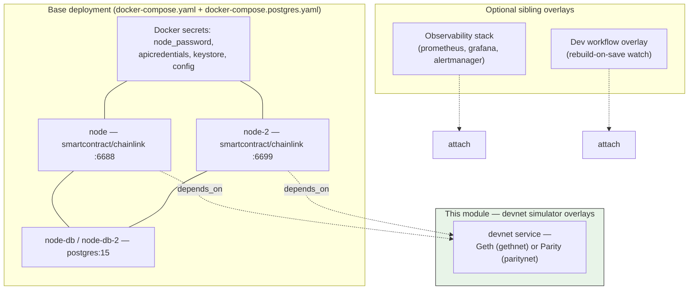
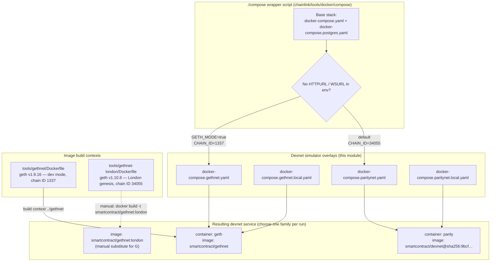
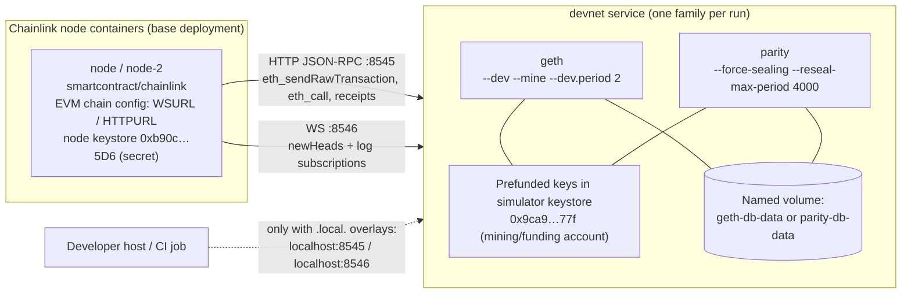
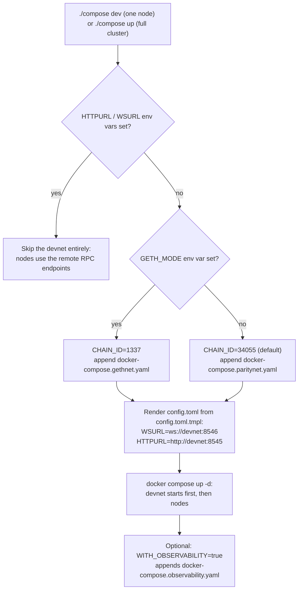

# Devnet Simulators (Geth & Parity)

## 1. Overview

This module provides the **local EVM blockchain simulators ("devnets")** for the Docker-based development environment in `chainlink/tools/docker/`. When a developer runs the local stack, these simulators stand in for a real blockchain network, giving Chainlink nodes:

- An **auto-mining EVM chain** that produces blocks continuously, so no external testnet is required.
- **Open JSON-RPC endpoints** (HTTP on `8545`, WebSocket on `8546`) reachable from the node containers over the Compose network.
- **Prefunded accounts**, so nodes can submit transactions immediately from block 0 without a manual funding step.
- **Persistent chain state** in named Docker volumes, plus documented reset procedures.

Two simulator families are supported, exposed as alternative Compose overlays:

| Family | Compose files | Simulator | Chain ID | Image |
|---|---|---|---|---|
| **Geth** | `docker-compose.gethnet.yaml` / `docker-compose.gethnet.local.yaml` | `geth` (containers built from `chainlink/tools/gethnet` or `chainlink/tools/gethnet-london`) | `1337` | `smartcontract/gethnet` |
| **Parity** | `docker-compose.paritynet.yaml` / `docker-compose.paritynet.local.yaml` | Parity devnet | `34055` | `smartcontract/devnet@sha256:9bcf4a47…` (digest-pinned) |

The overlays follow the [Compose multiple-file merge model](https://docs.docker.com/compose/multiple-compose-files/): each devnet file extends the [base node deployment](docker-dev-environments_node-deployment.md) by adding a `devnet` service and wiring `depends_on` into the `node` and `node-2` services, guaranteeing the simulator is up before the nodes start.

This module is one layer of the broader simulation tooling described in [Dev, Test & Simulation Environments](../../Dev,_Test___Simulation_Environments.md); the programmatic (non-Docker) counterpart is covered in [devenv](../devenv.md).

---

## 2. Position in the Docker Dev Environment

The Docker dev environment (`chainlink/tools/docker/`) is assembled from composable Compose files:



- The **base deployment** (nodes, databases, secrets) is documented in [node-deployment](docker-dev-environments_node-deployment.md).
- The **dev workflow overlay** (live-rebuild) is documented in [dev-workflow-overlay](docker-dev-environments_dev-workflow-overlay.md).
- The **observability stack** (Prometheus/Grafana/Alertmanager) is documented in [observability-stack](docker-dev-environments_observability-stack.md).
- The Chainlink node behavior running inside the node containers is documented in [Node Application Core & Interfaces](../../Node_Application_Core___Interfaces.md).

---

## 3. Architecture and Composition

### 3.1 Component map

| Artifact | Role |
|---|---|
| `chainlink/tools/docker/docker-compose.gethnet.yaml` | Adds the **Geth devnet** service (`build: ../gethnet` → image `smartcontract/gethnet`, container `geth`); ports declared without host binding; volume `geth-db-data`; secret `node_password`. Adds `depends_on: devnet` to `node` and `node-2`. |
| `chainlink/tools/docker/docker-compose.gethnet.local.yaml` | Same as above but **publishes host ports** `8545:8545` and `8546:8546` for direct host-side access (curl, `cast`, MetaMask, scripts). |
| `chainlink/tools/docker/docker-compose.paritynet.yaml` | Adds the **Parity devnet** service (digest-pinned image, container `parity`, runs as `root`); volume `parity-db-data`; no secrets. Same `depends_on` wiring. |
| `chainlink/tools/docker/docker-compose.paritynet.local.yaml` | Same as above with host-pinned ports `8545:8545` / `8546:8546`. |
| `chainlink/tools/gethnet/Dockerfile` | Builds the legacy Geth devnet image (geth `v1.9.16`, `--dev` mode, NetworkId `1337`). |
| `chainlink/tools/gethnet-london/Dockerfile` | Builds the London-fork Geth devnet image (geth `v1.10.8`, NetworkId `34055`, genesis-initialized). |

### 3.2 Architecture diagram



The `.local.` variants are **not** referenced by the `compose` wrapper script; they are intended for manual invocation when you want the RPC endpoints pinned on the host (the non-`.local.` files declare `ports: - 8545` / `- 8546`, relying on the Compose network for connectivity rather than deterministic host ports).

---

## 4. The Geth Devnet Simulator

### 4.1 Legacy image (`chainlink/tools/gethnet/Dockerfile`)

Built from `ethereum/client-go:v1.9.16` and tagged `smartcontract/gethnet` by the Compose overlay (`build: ../gethnet` combined with `image: smartcontract/gethnet`):

```dockerfile
FROM ethereum/client-go:v1.9.16
WORKDIR /gethnet
COPY datadir datadir/
COPY config.toml .
ENTRYPOINT [ "geth" ]
CMD ["--dev", "--datadir", "/gethnet/datadir", "--mine", "--ipcdisable",
     "--dev.period", "2", "--unlock", "0x9ca9d2d5e04012c9ed24c0e513c9bfaa4a2dd77f",
     "--password", "/run/secrets/node_password", "--config", "/gethnet/config.toml"]
```

Key behaviors:

| Flag / file | Effect |
|---|---|
| `--dev` | Instant-seal proof-of-authority dev chain; the datadir (including a pre-seeded keystore) is baked into the image. |
| `--dev.period 2` | Produces a block every **2 seconds** even without traffic, giving nodes a steady head stream. |
| `--unlock 0x9ca9d2d5e04012c9ed24c0e513c9bfaa4a2dd77f` | Keeps the prefunded devnet account unlocked (present in the image keystore as `UTC--2017-01-05T20-42-24.637Z--9ca9d2d5…`). This is the funding/mining account. |
| `--password /run/secrets/node_password` | Unlock password read from the Docker secret `node_password` (sourced from `../clroot/password.txt` in the base deployment). |
| `--ipcdisable` | Disables the Unix IPC socket, which cannot be shared through a container. |

The baked-in `chainlink/tools/gethnet/config.toml` configures the node process:

| Setting | Value | Purpose |
|---|---|---|
| `NetworkId` | `1337` | Matches the `CHAIN_ID=1337` default the `compose` script uses in Geth mode. |
| `HTTPHost/HTTPPort` | `0.0.0.0:8545` | RPC reachable from other containers. |
| `HTTPModules` | `eth, net, web3, admin, personal, debug` | Full RPC surface for node operations and debugging. |
| `HTTPCors` / `HTTPVirtualHosts` | `["*"]` | Permissive access (dev only). |
| `WSHost/WSPort` | `0.0.0.0:8546` | WebSocket endpoint for head/log subscriptions. |
| `InsecureUnlockAllowed` | `true` | Permits account unlock while HTTP is enabled. |
| Miner | Gas 8M floor/ceil, gas price 1, 3s recommit | Cheap, fast block production. |

The image keystore also contains a second key (`UTC--2018-04-27…--7db75251a74f40b15631109ba44d33283ed48528`).

### 4.2 London-fork image (`chainlink/tools/gethnet-london/Dockerfile`)

An alternative simulator image built from `ethereum/client-go:v1.10.8`, intended to be built manually and tagged `smartcontract/gethnet:london` (per the in-file comment), then substituted for the `devnet` service image:

- **Genesis-initialized at build time**: `RUN geth --datadir /gethnet/datadir init genesis.json` activates the **London fork** (EIP-1559 fee market, etc.) from block 0 — unlike the legacy image, which relies on geth's dev-mode defaults.
- **Prefunded key copied into the keystore** (`COPY keys/* /gethnet/datadir/keystore/`): the same `0x9ca9d2d5e04012c9ed24c0e513c9bfaa4a2dd77f` devnet key used by the legacy image. The password is baked into the image (`COPY node_password .`) and passed as `--password=node_password` rather than a Docker secret.
- **Network ID `34055`** — deliberately aligned with the Parity-family chain ID used by the `compose` script, so a London image can be dropped in without changing chain config.
- **Exposed ports**: `8545` (HTTP), `8546` (WS), `8547` (GraphQL), `30303` (p2p) — although the Compose overlay only maps `8545`/`8546`.
- **Runtime flags**: `--fakepow`, `--nodiscover`, `--mine` with `--miner.threads=1` and `--miner.recommit=1s`, `--allow-insecure-unlock --unlock 0` (unlocks the first keystore key), and an enlarged transaction pool (`--txpool.accountslots=1024`, `--txpool.accountqueue=1024`) for throughput-heavy tests. HTTP serves `eth,web3,personal,net`; WS serves `eth,web3,net,admin,debug,txpool`.

### 4.3 Geth overlay wiring (`docker-compose.gethnet*.yaml`)

```yaml
services:
  node:    { depends_on: [devnet] }
  node-2:  { depends_on: [devnet] }
  devnet:
    build: ../gethnet
    container_name: geth
    image: smartcontract/gethnet
    ports: ["8545", "8546"]          # .local. variant: "8545:8545", "8546:8546"
    volumes:
      - geth-db-data:/gethnet/datadir/geth
    secrets: [node_password]
volumes:
  geth-db-data:
```

Notes:

- The named volume mounts only `/gethnet/datadir/geth` (the chain database), keeping the keystore baked into the image intact across restarts.
- Because both `build` and `image` are specified, Compose builds the image from `chainlink/tools/gethnet/` and tags it `smartcontract/gethnet`.

---

## 5. The Parity Devnet Simulator

Defined in `docker-compose.paritynet.yaml` / `docker-compose.paritynet.local.yaml`:

```yaml
  devnet:
    container_name: parity
    image: smartcontract/devnet@sha256:9bcf4a476db965af7f6a2152a3f07f8bd0b35e51ec45b122ebc9ce87cd1304a7
    user: root
    command: --reseal-max-period 4000 --force-sealing --config /devnet/miner.toml --db-path /devnet/database
    ports: ["8545", "8546"]          # .local. variant: "8545:8545", "8546:8546"
    volumes:
      - parity-db-data:/devnet/database
```

Key characteristics:

- **Digest-pinned image** (`@sha256:9bcf4a47…`): Parity Ethereum is deprecated, so pinning guarantees a byte-identical, immutable simulator image.
- **`--force-sealing` / `--reseal-max-period 4000`**: forces block sealing even for empty blocks / without incoming transactions, so the chain always advances (Parity's equivalent of geth's `--dev.period`).
- **`--config /devnet/miner.toml`**: a miner/chain config baked into the pinned image; per the base deployment's comment ("addresses are specified when starting the parity/geth node to be prefunded with eth"), it seeds the account addresses used by the Chainlink nodes.
- **`--db-path /devnet/database`** persisted to the `parity-db-data` named volume.
- No Docker secrets are consumed (unlike the Geth overlay).
- Exposes the same RPC surface as the Geth variants (`8545` HTTP, `8546` WS), so the node-side chain configuration is identical regardless of simulator choice.

---

## 6. Runtime Data Flow



Flow narrative:

1. **Startup ordering** — the overlay injects `depends_on: devnet` into `node` and `node-2`, so the simulator container starts first. Both families present the identical contract (RPC `8545`, WS `8546`), so the nodes' configuration does not change when switching simulators.
2. **Node connectivity** — the rendered node `config.toml` (see [node-deployment](docker-dev-environments_node-deployment.md) and `chainlink/tools/docker/config.toml.tmpl`) points the `[[EVM.Nodes]]` entries at the simulator: `WSURL=ws://devnet:8546` and `HTTPURL=http://devnet:8545` (the `devnet` service name resolves over the Compose network).
3. **Prefunding** — the simulator images ship prefunded keys (e.g. the unlocked `0x9ca9…77f` account) and seed the node account addresses (`0xb90c…5D6`, mounted as the node's keystore secret). This is why the base deployment can "submit transactions immediately" — no faucet step is needed.
4. **Block production** — Geth seals a block every 2 s (`--dev.period 2`); Parity force-seals with a 4000 ms max reseal period. Nodes receive a continuous head stream over WebSocket.
5. **Persistence** — chain state lives in `geth-db-data` / `parity-db-data` named volumes and survives `docker compose restart` and node restarts.
6. **Host access (optional)** — only the `.local.` overlay variants publish the RPC ports to `localhost`, enabling tools such as `cast`, `curl`, or browser wallets to interact with the devnet directly.

---

## 7. Bring-Up Workflow

The devnet overlays are selected automatically by the `chainlink/tools/docker/compose` wrapper script:



### 7.1 Command matrix

| Goal | Command |
|---|---|
| Geth simulator + one node in dev-watch mode | `GETH_MODE=true ./compose dev` |
| Parity simulator + full cluster (default) | `./compose up` |
| Bring-your-own RPC (no simulator) | `CHAIN_ID=11155111 WSURL=wss://eth.sepolia HTTPURL=https://eth.sepolia ./compose dev` |
| Observability attached | `WITH_OBSERVABILITY=true ./compose up` |
| Reset chain to genesis | `./compose eth:restart` (removes the `devnet` container and `docker_geth-db-data` or `docker_parity-db-data` volume, then restarts it) |
| Reset node DB + chain | `./compose db:restart` |
| Teardown everything | `./compose clean` (also deletes the rendered `config.toml`) |

### 7.2 Service / port / persistence reference

| Service | Container name | Image | Ports | Volume | Secrets |
|---|---|---|---|---|---|
| `devnet` (gethnet) | `geth` | `smartcontract/gethnet` (built from `tools/gethnet`) | `8545` HTTP, `8546` WS (host-pinned in `.local.` variant) | `geth-db-data:/gethnet/datadir/geth` | `node_password` |
| `devnet` (paritynet) | `parity` | `smartcontract/devnet@sha256:9bcf…` | `8545` HTTP, `8546` WS (host-pinned in `.local.` variant) | `parity-db-data:/devnet/database` | — |
| `devnet` (London variant, manual swap) | — | `smartcontract/gethnet:london` (built from `tools/gethnet-london`) | `8545` HTTP, `8546` WS, `8547` GraphQL, `30303` p2p (image-level) | `/gethnet/datadir` (initialize at build; volume mapping comes from the overlay used) | password baked into image |

---

## 8. Relationship to Other Modules

| Module | Relationship |
|---|---|
| [node-deployment](docker-dev-environments_node-deployment.md) | Provides the `node`/`node-2` services, Docker secrets (`node_password`, `keystore`, `apicredentials`, `config`), and secrets files that the devnet overlays extend and consume. The `node_password` secret is shared by the nodes and the Geth simulator. |
| [dev-workflow-overlay](docker-dev-environments_dev-workflow-overlay.md) | Composable on top of a devnet selection; the `./compose dev` command applies it automatically. |
| [observability-stack](docker-dev-environments_observability-stack.md) | Independent overlay; can be combined with either simulator family via `WITH_OBSERVABILITY=true`. |
| [devenv](../devenv.md) | The Go-programmatic development environment (job-distributor + products such as VRF v2 Plus). It is an alternative to (not a consumer of) these Docker simulators, sharing the same goal of local multi-service simulation. |
| [integration-tests](../integration-tests.md) / [system-tests](../system-tests.md) | Heavier-weight test frameworks that provision their own blockchain environments (e.g., Anvil/CRIB); these Docker devnets are the lightweight, manual-development counterpart. |
| [Node Application Core & Interfaces](../../Node_Application_Core___Interfaces.md) | The Chainlink node application running in the `node`/`node-2` containers that consumes the simulated chain. |

---

## 9. Security Considerations

These simulators are **strictly for local development**. They deliberately trade security for convenience:

- **Public dev keys with known passwords** are baked into the images (`tools/gethnet/datadir/keystore/*`, `tools/gethnet-london/keys/*`, `tools/gethnet-london/node_password`). Never reuse these accounts on any real network.
- **`--allow-insecure-unlock`** and geth's `InsecureUnlockAllowed = true` permit account unlocking with HTTP enabled.
- **Open CORS/virtual hosts** (`*`) and broad RPC module sets (`admin`, `personal`, `debug`, `txpool`) are enabled on `0.0.0.0`.
- The Parity container runs as **`user: root`**.

Do not publish the non-`.local.` overlays' ephemeral ports or the `.local.` variants' pinned ports (`8545`/`8546`) on any shared or production host.

---

## 10. Related Documentation

- Parent: [docker-dev-environments](../docker-dev-environments.md)
- Siblings: [node-deployment](docker-dev-environments_node-deployment.md) · [dev-workflow-overlay](docker-dev-environments_dev-workflow-overlay.md) · [observability-stack](docker-dev-environments_observability-stack.md)
- Top-level: [Dev, Test & Simulation Environments](../../Dev,_Test___Simulation_Environments.md) · [devenv](../devenv.md)
- Node internals: [Node Application Core & Interfaces](../../Node_Application_Core___Interfaces.md)

Supporting repository artifacts referenced above: `chainlink/tools/docker/compose` (wrapper script), `chainlink/tools/docker/config.toml.tmpl` (node chain config template), `chainlink/tools/docker/README.md` (usage guide), and the container definitions under `chainlink/tools/gethnet/` and `chainlink/tools/gethnet-london/`.
