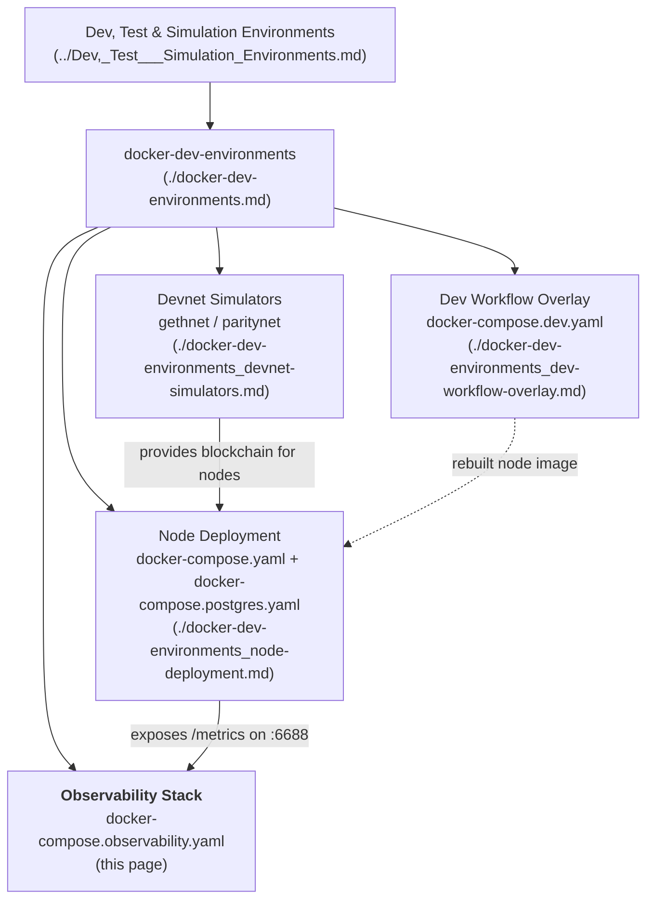
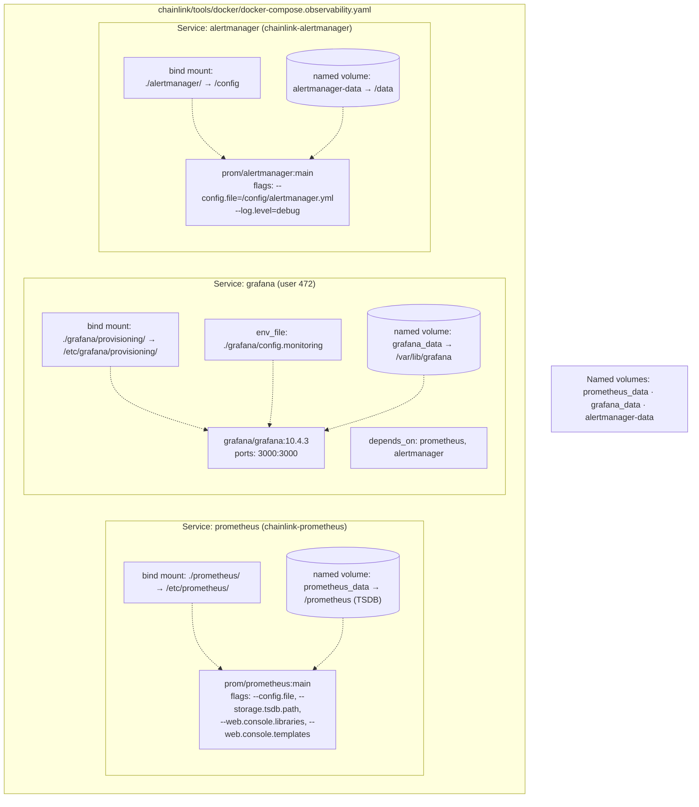
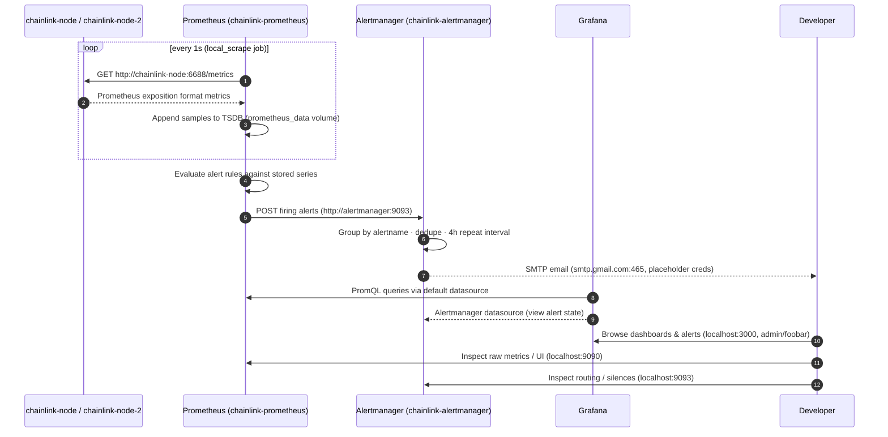
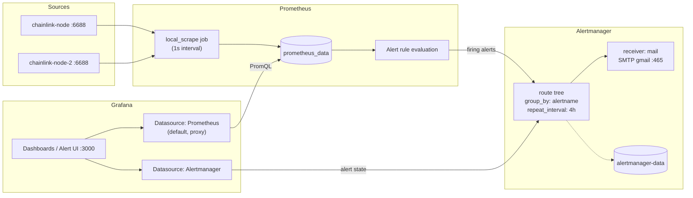
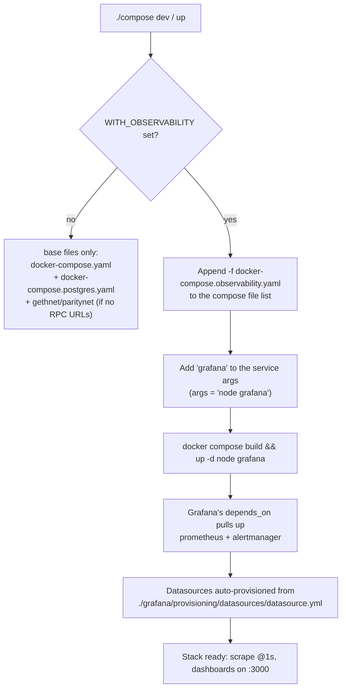

# Docker Dev Environments — Observability Stack

> **Module page:** `Dev,_Test___Simulation_Environments/docker-dev-environments/docker-dev-environments_observability-stack.md`
> **Primary artifact:** `chainlink/tools/docker/docker-compose.observability.yaml`

## 1. Introduction

The **observability stack** is an optional Docker Compose overlay that adds metrics collection, dashboarding, and alerting to the local Chainlink node development environment. It is deliberately lightweight — three off-the-shelf OSS containers with zero custom code — and is intended purely for **local development and experimentation**, not production observability.

The module consists of a single Compose file (`chainlink/tools/docker/docker-compose.observability.yaml`) that declares three services:

| Service | Image | Container name | Purpose |
|---|---|---|---|
| `prometheus` | `prom/prometheus:main` | `chainlink-prometheus` | Scrapes node `/metrics` endpoints, stores time series, evaluates alert rules |
| `grafana` | `grafana/grafana:10.4.3` | *(compose-generated)* | Visualization layer; auto-provisioned with Prometheus + Alertmanager datasources |
| `alertmanager` | `prom/alertmanager:main` | `chainlink-alertmanager` | Deduplicates, groups, and routes Prometheus alerts (email receiver) |

It is activated through the `compose` wrapper script (`chainlink/tools/docker/compose`) when the `WITH_OBSERVABILITY` environment variable is set, as documented in `chainlink/tools/docker/README.md`.

This page documents the stack's architecture, its configuration surface, the metrics/alerting data flow, and its relationship to the rest of the system.

---

## 2. Position in the System

This module is one of four overlays/services groups under the [Docker Dev Environments](../docker-dev-environments.md) umbrella:



The observability stack is a **consumer** of the services defined by [Node Deployment](docker-dev-environments_node-deployment.md): the `node` and `node-2` containers (built from `core/chainlink.Dockerfile`, see [Chainlink Build and Tooling](../../Build,_CI___Release_Infrastructure/chainlink_build_and_tooling.md)) run the Chainlink node whose WebServer exposes a `/metrics` endpoint on port `6688` (see [Node Application Lifecycle](../../Node_Application_Core___Interfaces/node_application/node_application_lifecycle.md)).

---

## 3. Architecture

The stack is self-contained in a private Compose network; all inter-service communication uses Docker DNS names. Named volumes provide persistence for each component's data.



Key structural facts from `docker-compose.observability.yaml`:

- **All three services use `restart: always`** — the stack self-heals and survives Docker daemon restarts.
- **`grafana` is the only service with `depends_on`** (`prometheus`, `alertmanager`). Because the `compose` script explicitly starts only `node` and `grafana` (see §7), Grafana acts as the *entry service* that pulls the other two containers up.
- **Prometheus and Alertmanager are pinned to the floating `main` tag**, while Grafana is pinned to `10.4.3`. Expect `main`-tag images to drift; pin them for reproducibility if needed.
- Grafana runs as UID `472` (the official Grafana image user) so the `grafana_data` volume has correct ownership.
- Prometheus container console assets (libraries/templates) are enabled via command flags for the built-in UI.

---

## 4. Configuration Surface

The stack is entirely configuration-driven via files bind-mounted from `chainlink/tools/docker/`:

| File | Mounted into | Role |
|---|---|---|
| `chainlink/tools/docker/prometheus/prometheus.yaml` | `prometheus:/etc/prometheus/prometheus.yaml` | Scrape jobs, scrape intervals, Alertmanager routing |
| `chainlink/tools/docker/alertmanager/alertmanager.yml` | `alertmanager:/config/alertmanager.yml` | Alert routing tree and receivers |
| `chainlink/tools/docker/grafana/config.monitoring` | `grafana` env_file | Grafana env vars (admin password, sign-up policy) |
| `chainlink/tools/docker/grafana/provisioning/datasources/datasource.yml` | `grafana:/etc/grafana/provisioning/` | Declarative datasource provisioning |

### 4.1 Prometheus (`prometheus/prometheus.yaml`)

```yaml
global:
  scrape_interval: 5s
scrape_configs:
  - job_name: 'local_scrape'
    scrape_interval: 1s
    static_configs:
      - targets: ['chainlink-node:6688', 'chainlink-node-2:6688']
    metrics_path: '/metrics'
alerting:
  alertmanagers:
    - scheme: http
      static_configs:
        - targets: ['alertmanager:9093']
```

- **Global scrape interval 5s**, but the `local_scrape` job overrides it to **1s** for high-resolution local debugging.
- Targets use Docker service DNS names matching the `container_name` values from [Node Deployment](docker-dev-environments_node-deployment.md) (`chainlink-node`, `chainlink-node-2`), both on the node's internal port `6688`.
- Alerts are forwarded to `alertmanager:9093` over plain HTTP.

### 4.2 Alertmanager (`alertmanager/alertmanager.yml`)

- **Route:** all alerts go to the `mail` receiver; `group_by: [alertname]` batches alerts of the same name; `repeat_interval: 4h` limits re-notification noise.
- **Receiver:** a single SMTP email receiver targeting `smtp.gmail.com:465` with **placeholder credentials** (`your_mail@gmail.com` / empty `auth_password`). **You must edit this file** (and ideally supply the password via a secret rather than the bind-mounted file) before expecting email delivery.

### 4.3 Grafana environment (`grafana/config.monitoring`)

```
GF_SECURITY_ADMIN_PASSWORD=foobar
GF_USERS_ALLOW_SIGN_UP=false
```

- Admin UI password is the well-known development value `foobar`.
- Self sign-up is disabled; the `admin` account is the only entry point.

### 4.4 Grafana datasource provisioning (`grafana/provisioning/datasources/datasource.yml`)

Provisioned at container start, so a fresh volume needs no manual setup:

| Datasource | URL | Notes |
|---|---|---|
| `Prometheus` | `http://prometheus:9090` | Type `prometheus`, access `proxy`, **`isDefault: true`**, editable |
| `Alertmanager` | `http://alertmanager:9093` | Type `alertmanager`, `implementation: prometheus`, `handleGrafanaManagedAlerts: false` |

The provisioning file also declares a `deleteDatasources` entry for any stale `Prometheus` datasource in the database volume, guaranteeing a clean re-provision on restart.

---

## 5. Metrics & Data Flow

The end-to-end pipeline for one scrape/alert cycle:



Flow summary:

1. **Expose** — each Chainlink node serves `/metrics` on its WebServer port (`6688`); nothing in this module changes node configuration (the node's `config.toml` is generated from `config.toml.tmpl` by the `compose` script and contains no observability-specific settings).
2. **Scrape & store** — Prometheus pulls both nodes every second into its TSDB volume.
3. **Alert** — Prometheus evaluates rules and pushes alerts to Alertmanager, which routes them to the email receiver.
4. **Visualize** — Grafana queries Prometheus for dashboards and proxies Alertmanager state; humans interact only with Grafana on port `3000` in the common case.

---

## 6. Alerting Component Interaction



---

## 7. Activation & Lifecycle

The stack is **not started by default**. It is wired into the developer workflow by the `compose` shell script (`chainlink/tools/docker/compose`):

```sh
# from chainlink/tools/docker
WITH_OBSERVABILITY=true ./compose up    # full cluster (2 nodes + 2 DBs + devnet + observability)
WITH_OBSERVABILITY=true ./compose dev   # single node, watch-mode rebuild + observability
```



Lifecycle notes (from the `compose` script):

- `./compose clean` runs `docker compose down -v` on the **full file list**, so when `WITH_OBSERVABILITY=true` is exported at clean time, the `prometheus_data`, `grafana_data`, and `alertmanager-data` volumes are deleted too.
- `./compose logs [service]` works for `prometheus`, `grafana`, and `alertmanager` since they run under the same Compose project.
- `db:restart` / `eth:restart` reset workflows only touch the base services; observability data is unaffected.
- The `up` command runs `$base up` with **no** service args, which starts every service in the merged file list — including the observability stack — in the foreground.

---

## 8. Access Points

| Component | URL / address | Credentials |
|---|---|---|
| Grafana UI | `http://localhost:3000` | user `admin`, password `foobar` (from `grafana/config.monitoring`) |
| Prometheus UI / API | `http://localhost:9090` | none (unauthenticated) |
| Alertmanager UI | `http://localhost:9093` | none (unauthenticated, `--log.level=debug`) |
| Node metrics (in-network) | `http://chainlink-node:6688/metrics`, `http://chainlink-node-2:6688/metrics` | n/a (host access via `6688` / `6699` from the node compose file) |

---

## 9. Persistence Model

All state is held in **named volumes** declared at the bottom of `docker-compose.observability.yaml` (`prometheus_data`, `grafana_data`, `alertmanager-data`), meaning:

- Metric history, Grafana dashboards/users, and Alertmanager silences/notifications survive container restarts and `stop`/`start` cycles.
- Configuration is *not* in volumes — it lives in the bind-mounted files under `chainlink/tools/docker/` and is version-controlled with the repo.
- Only `docker compose down -v` (e.g. `./compose clean`) wipes this state.

---

## 10. Relationship to Other Observability Modules

This stack is the **simplest tier** of Chainlink's observability tooling. For production-shaped or code-driven observability, see the [Telemetry & Observability Platform](../../Telemetry___Observability_Platform.md) module:

| Concern | This module | Related module |
|---|---|---|
| Local metrics scraping & alerting | ✅ Prometheus/Alertmanager/Grafana | — |
| Kafka-based monitoring pipeline for feeds (ZooKeeper/Kafka/Schema Registry) | — | [ops-monitoring-stack](../../Telemetry___Observability_Platform/ops-monitoring-stack.md) (`chainlink-common/ops/monitoring/docker-compose.yml`) |
| Programmatic Grafana dashboard provisioning (Go CLI/API client) | — | [observability-lib](../../Telemetry___Observability_Platform/observability-lib.md) |
| In-node OTLP telemetry emission (Beholder) | — | [beholder-telemetry](../../Telemetry___Observability_Platform/beholder-telemetry.md) |
| OCR/feed monitoring agents & Avro exporters | — | [monitoring](../../Telemetry___Observability_Platform/monitoring.md) |

Prometheus can scrape the same `/metrics` endpoint regardless of whether nodes emit OTLP telemetry via Beholder; the two mechanisms are complementary and covered respectively by this module and the Beholder page.

---

## 11. Operational Notes & Customization

- **Add a scrape target:** append to `static_configs.targets` in `chainlink/tools/docker/prometheus/prometheus.yaml`, then `docker compose restart prometheus` (Prometheus does not hot-reload static configs here).
- **Change alert delivery:** edit the `receivers` block in `chainlink/tools/docker/alertmanager/alertmanager.yml`. The shipped `mail` receiver is a template with placeholder Gmail credentials.
- **Dashboard management:** the shipped provisioning covers **datasources only** (no dashboards folder is mounted). Create dashboards in the UI (persisted in `grafana_data`), or manage them as code using [observability-lib](../../Telemetry___Observability_Platform/observability-lib.md).
- **Single-node dev (`./compose dev`):** Prometheus still scrapes two targets; `chainlink-node-2` will simply be `DOWN` in the targets view when only `node` is running — harmless, but expected.

### Security caveats (development-only)

1. All ports are published on all host interfaces (`0.0.0.0`), and Prometheus/Alertmanager expose unauthenticated UIs — **do not run this stack on a shared or internet-reachable host**.
2. The Grafana admin password is a hardcoded development default (`foobar`).
3. The Alertmanager email receiver invites putting SMTP credentials in a bind-mounted plaintext file; prefer Docker secrets or environment injection if credentials are required.

---

## 12. Summary

The observability stack is a three-service Compose overlay (`prometheus` + `grafana` + `alertmanager`) defined in `chainlink/tools/docker/docker-compose.observability.yaml`, activated by `WITH_OBSERVABILITY=true` through the `compose` wrapper script. It scrapes the local Chainlink nodes' `/metrics` endpoints at 1s resolution, persists time series and UI state in named volumes, provisions Grafana datasources declaratively, and routes Prometheus alerts to a configurable email receiver — providing a zero-code, batteries-included observability layer for local development, with heavier-duty alternatives documented under the [Telemetry & Observability Platform](../../Telemetry___Observability_Platform.md).
