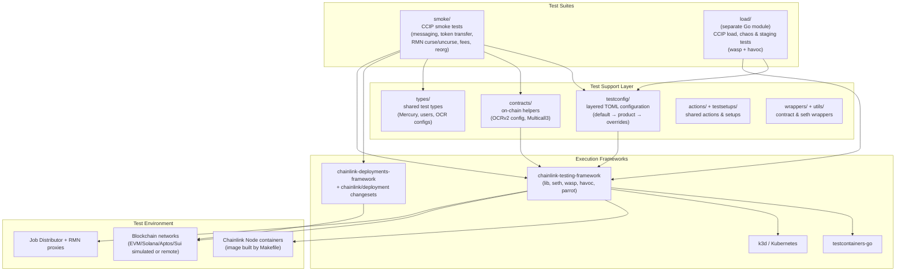
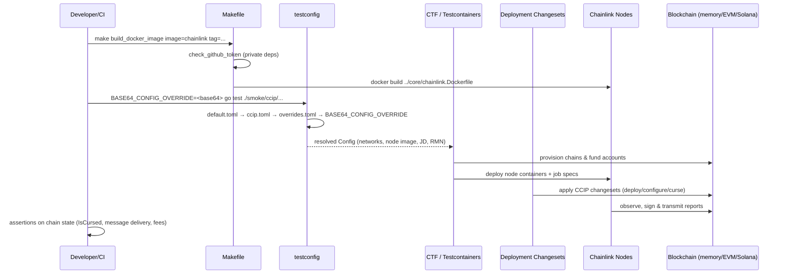
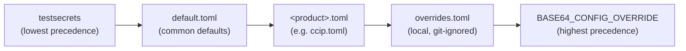

# Integration Tests (`chainlink/integration-tests`)

## Overview

The `integration-tests` module is a self-contained Go module (`github.com/smartcontractkit/chainlink/integration-tests`) that hosts **end-to-end integration, smoke and load tests** for the Chainlink node, with the **CCIP (Cross-Chain Interoperability Protocol)** product as its primary and most actively maintained test surface.

It is built on the [Chainlink Testing Framework (CTF)](https://github.com/smartcontractkit/chainlink-testing-framework) and supports three execution models:

| Execution model | Mechanism | Typical use |
|---|---|---|
| Local Docker | [Testcontainers](https://golang.testcontainers.org/) spins up node/DB/blockchain containers on the host | Fast, stable local runs |
| Kubernetes | CTF k8s helpers provision the test topology in an AWS cluster | Soak, performance, benchmark, chaos tests |
| GitHub Actions CI | Secrets + `BASE64_CONFIG_OVERRIDE` pushed into CI workflows | Automated E2E regression |

> [!NOTE]
> The module's README marks this directory as **DEPRECATED in favor of the newer developer environment** (`chainlink/devenv`, documented in [devenv](devenv.md)). Nevertheless, it remains the home of the extensive CCIP smoke and load test suites and is still wired into the repository's Makefiles and CI.

## Position in the System

This module is one of the test/simulation environments in the parent module [Dev, Test & Simulation Environments](../Dev,_Test___Simulation_Environments.md). Its siblings are:

- [devenv](devenv.md) – the newer developer environment (successor; product-level job specs and local environments)
- [system-tests](system-tests.md) – CRE/Keystone-focused system test libraries
- [capabilities_integration_tests](capabilities_integration_tests.md) – integration tests for chain capabilities plugins
- [docker-dev-environments](docker-dev-environments.md) – docker-compose stacks for running the node locally
- [deployment-environment](deployment-environment.md) – node clients, CRIB, and JD test utilities consumed by deployment flows

The tests exercise real node builds produced by [Build, CI & Release Infrastructure](../Build,_CI___Release_Infrastructure.md) (the node image is built from `chainlink/core/chainlink.Dockerfile` via the module Makefile) and drive on-chain scenarios using the changesets/operations of the [CCIP Deployment Suite](../CCIP_Deployment_Suite.md) and the shared domain types from [Shared Foundation Libraries & Domain Types](../Shared_Foundation_Libraries___Domain_Types.md).

## Architecture

### Module Layout

| Path | Role |
|---|---|
| `Makefile` | Developer entry point: tooling installation, lint, compile checks, node image build & push, tracing stack |
| `go.mod` | Module manifest; depends on `chainlink/v2`, `chainlink/deployment`, CTF (lib/seth), multi-chain SDKs (Ethereum, Solana, Aptos, Sui), testcontainers, MCMS, libocr |
| `load/go.mod` | **Separate Go module** (`chainlink/load-tests`) for load/chaos tests, adding `wasp` (load generation) and `havoc` (chaos) on top of the same stack |
| `contracts/` | On-chain interaction helpers: OCRv2 aggregator configuration and a Multicall3-based batch transaction generator |
| `testconfig/` | Layered TOML test configuration with product packages (`ccip/`) and embedded defaults |
| `types/` | Shared test types: Mercury server options, user credentials, Mercury OCR configuration |
| `smoke/` | Smoke test suites — the `ccip/` folder holds ~35 CCIP test files |
| `load/ccip/` | CCIP load, chaos and staging tests (separate module) |
| `actions/`, `testsetups/`, `utils/`, `wrappers/`, `docker/` | Shared actions, per-product setups, seth utilities, contract wrappers and Docker test-env builders |

## Sub-module Documentation

The module is organized into four functional areas, each documented in detail below (documentation files are saved under `Dev,_Test___Simulation_Environments/integration-tests/`):

1. **[Integration Tests — Build & Tooling](integration-tests/integration-tests_build_tooling.md)** — the Makefile targets (`install_qa_tools`, `build`, `build_docker_image`, `build_push_docker_image`, `check_github_token`, `install_gotestloghelper`, `lint`, `push-ccip-test-image`, `remove_test_execution_artefacts`, `run_tracing`) plus the module manifests (`go.mod`, `load/go.mod`) and the Docker image pipeline that produces the Chainlink node/test images used by every test run.
2. **[Integration Tests — Contract Helpers](integration-tests/integration-tests_contract_helpers.md)** — the `contracts` package: OCRv2 `OffChainAggregatorV2Config`, node key-export interfaces (`ChainlinkKeyExporter`, `ChainlinkNodeWithKeysAndAddress`) and the Multicall3 batch helpers (`CallWithValue`, `Result`, `MultiCallLogTriggerLoadGen`).
3. **[Integration Tests — Test Configuration & Types](integration-tests/integration-tests_test_configuration.md)** — the layered TOML configuration system, the CCIP product config (`Config`, `JDConfig`, `RMNConfig`, `NodeConfig`) and shared types (`MercuryServerOpts`, `User`, `MercuryOCRConfig`).
4. **[Integration Tests — CCIP Smoke Tests](integration-tests/integration-tests_ccip_smoke_tests.md)** — the RMN curse/uncurse smoke suite: table-driven curse scenarios (`CurseTestCase`, `ForceOptionTestCase`), direct vs. MCMS-governed execution (Schedule/Bypass timelock actions), idempotency, connected-lane filtering and force-option semantics.

## Test Execution Flow

A typical smoke test run (e.g. `ccip_cs_rmn_curse_uncurse_test.go`) follows this sequence:

## Configuration Precedence

Test behaviour is controlled by a layered TOML configuration (details in [Test Configuration & Types](integration-tests/integration-tests_test_configuration.md)):

## Key Dependencies

The `go.mod` manifest pins the module to the repository it tests via `replace` directives:

- `github.com/smartcontractkit/chainlink/v2` → `../` (the node itself)
- `github.com/smartcontractkit/chainlink/deployment` → `../deployment` (changeset framework used to drive CCIP deployments in tests)
- `github.com/ugorji/go/codec` pinned to `v1.2.12` for codecgen compatibility with MCMS

Major external dependencies: `chainlink-testing-framework` (lib/seth/wasp/havoc/parrot), `testcontainers-go`, `go-ethereum`, `gagliardetto/solana-go`, `aptos-labs/aptos-go-sdk`, `block-vision/sui-go-sdk`, `chainlink-ccip` (+ per-chain packages), `chainlink-deployments-framework`, `mcms`, `libocr`, and the Job Distributor protos — reflecting the multi-chain scope of the CCIP test suite.

## Relationship to Other Modules

| Dependency | Usage |
|---|---|
| [Node Application Core & Interfaces](../Node_Application_Core___Interfaces.md) | The node binaries/APIs under test (web API, sessions, jobs) are built into the image that this module deploys |
| [CCIP Deployment Suite](../CCIP_Deployment_Suite.md) | Changesets (`v1_6.RMNCurseChangeset`, lane/chain configuration, token pools) are executed directly by smoke tests against in-memory or live chains |
| [CRE & Keystone Deployment Suite](../CRE___Keystone_Deployment_Suite.md) | Capabilities-registry deployment helpers reused when testing registry-backed workflows |
| [Deployment Framework Core](../Deployment_Framework_Core___Product_Deployments.md) | Common changeset/operation primitives (`commonchangeset.ApplyChangesets`) and MCMS/timelock tooling |
| [Plugin Process Framework (Loop)](../Plugin_Process_Framework_(Loop).md) | Loop plugins are packaged into node images exercised by plugin-related scenarios |
| [Telemetry & Observability Platform](../Telemetry___Observability_Platform.md) | `run_tracing` Makefile target and Grafana dashboards surface test run telemetry |
| [ devenv](devenv.md) | Officially designated successor for new tests; `load/ccip` and product job-spec helpers mirror devenv patterns |
