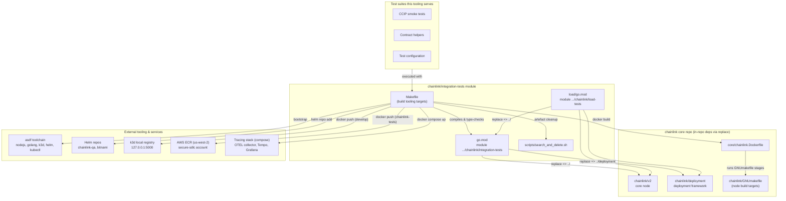
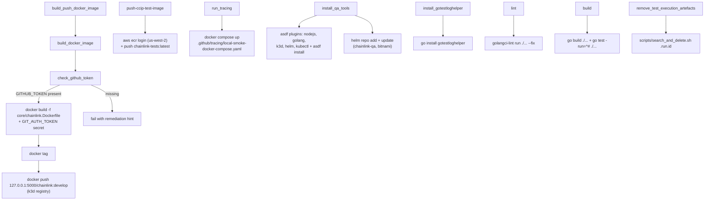
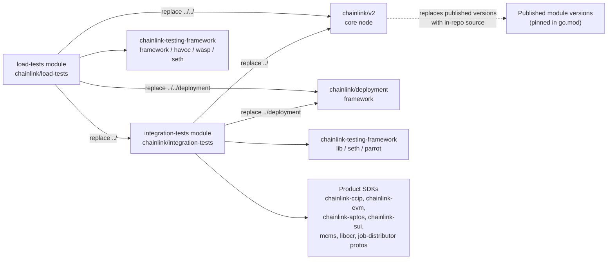
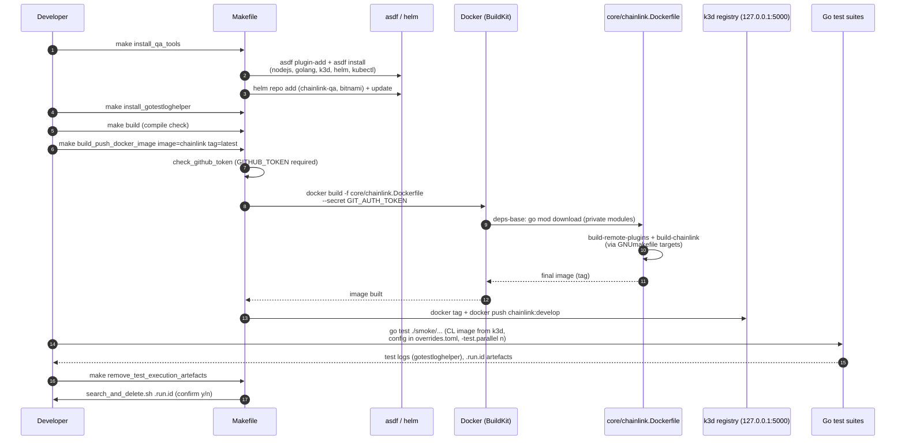

# Integration Tests — Build Tooling

## Introduction

The `integration-tests_build_tooling` module contains the **build, packaging, and environment-provisioning tooling** for the `chainlink/integration-tests` Go module. It is not application code — instead, it is the set of infrastructure assets that make the integration and smoke test suites buildable, lintable, and executable against real node images:

- **`chainlink/integration-tests/Makefile`** — a Make-based task runner covering toolchain bootstrap, linting, compile checks, Docker image construction and publishing, distributed-tracing stack orchestration, and CI artefact cleanup.
- **`chainlink/integration-tests/go.mod`** — the Go module manifest defining the integration tests' dependency graph, including live `replace` directives against the core `chainlink/v2` node and the `chainlink/deployment` framework.
- **`chainlink/integration-tests/load/go.mod`** — the manifest for the sibling **load-tests** module (`github.com/smartcontractkit/chainlink/load-tests`), which re-uses the integration-tests module and adds load-generation tooling.

Together these assets support the test suites documented in the parent [integration-tests](../integration-tests.md) module — the [CCIP smoke tests](integration-tests_ccip_smoke_tests.md), [contract helpers](integration-tests_contract_helpers.md), and [test configuration](integration-tests_test_configuration.md).

---

## Module context and responsibilities

Within the [Dev, Test & Simulation Environments](../../Dev,_Test___Simulation_Environments.md) domain, this module answers the question: *"How do developers and CI build and prepare everything needed to run integration tests?"* It deliberately owns only **build-side concerns**; runtime simulation is owned by the [devenv](../devenv.md) and [docker-dev-environments](../docker-dev-environments.md) modules, and cluster-level system testing by [system-tests](../system-tests.md).

| Responsibility | Where it lives |
|---|---|
| Developer toolchain bootstrap (asdf plugins, helm repos) | `Makefile` target `install_qa_tools` |
| Test-log helper installation | `Makefile` target `install_gotestloghelper` |
| Linting of the test module | `Makefile` target `lint` |
| Compile checking of test code | `Makefile` target `build` |
| Building the Chainlink node Docker image | `Makefile` targets `check_github_token`, `build_docker_image` |
| Publishing the image to the local k3d registry | `Makefile` target `build_push_docker_image` |
| Publishing the test-runner image to AWS ECR | `Makefile` target `push-ccip-test-image` |
| Local distributed-tracing stack for smoke tests | `Makefile` target `run_tracing` |
| Post-run artefact hygiene | `Makefile` target `remove_test_execution_artefacts` |
| Dependency graph / module wiring | `go.mod`, `load/go.mod` |

### Architecture overview



---

## Makefile reference (`chainlink/integration-tests/Makefile`)

The Makefile exports `GOPATH` and `GO111MODULE` and detects the host OS into `OSFLAG` (`LINUX`, `OSX`, `WIN32`), which drives OS-conditional logic in the tooling bootstrap. The documented usage pattern is `make <target> key=value` for parameterized targets.

### Environment bootstrap and developer tooling

#### `install_qa_tools`
Installs the full local toolchain required to run integration tests:

1. **Windows is explicitly unsupported** — the target prints a request for contributions and exits `1`.
2. **asdf bootstrap** — if `asdf` is not on `PATH`, it is installed via Homebrew on macOS; on Linux the target instructs the user to install it from [asdf-vm.com](https://asdf-vm.com/guide/getting-started.html) and exits.
3. **Plugin installation** — adds the `nodejs`, `golang`, `k3d`, `helm`, and `kubectl` asdf plugins (idempotently, `|| true`) and runs `asdf install` to install the pinned tool versions.
4. **Helm chart repositories** — adds the `chainlink-qa` repo (`https://raw.githubusercontent.com/smartcontractkit/qa-charts/gh-pages/`) and the `bitnami` repo, then runs `helm repo update`.

The k3d dependency is significant: integration tests run Chainlink nodes on a local Kubernetes cluster, which is why the Docker publishing targets below push to the k3d in-cluster registry.

#### `install_gotestloghelper`
```bash
go install github.com/smartcontractkit/chainlink-testing-framework/tools/gotestloghelper@latest
```
Installs the log formatter from [chainlink-testing-framework](https://github.com/smartcontractkit/chainlink-testing-framework), used to render structured test logs from test runs.

### Code quality

#### `lint`
```bash
golangci-lint --color=always run ./... --fix -v
```
Runs [golangci-lint](https://golangci-lint.run) with auto-fix across the module. The effective lint rules come from `chainlink/.golangci.yml`; repo-wide lint tooling is described in [chainlink build and tooling](../../Build,_CI___Release_Infrastructure/chainlink_build_and_tooling.md).

#### `build`
```bash
go build ./... go test -run=^# ./...
```
A compile/verification target: it builds every package in the module and runs `go test` with the `-run=^#` pattern, which matches no test names — so **test code is compiled and type-checked but never executed**. This makes it a fast CI-friendly smoke check that the module (including all `_test.go` files) still builds against the `replace`d core modules.

A comment in the Makefile documents the intended test invocation convention:

> All commands will use 16 threads to run tests in parallel. To change this, use `-test.parallel n`. Remember to set `selected_networks` and `CL image` in the TOML file (e.g. `overrides.toml`).

### Docker image build and publishing pipeline

#### `check_github_token`
Fails fast unless `GITHUB_TOKEN` is set, printing remediation guidance (e.g. `GITHUB_TOKEN=$(gh auth token)`). The token is required to pull **private Go module dependencies** during the image build — the same prerequisite documented for building plugins in the main repo README ("build-plugins" section).

#### `build_docker_image`
```
make build_docker_image image=chainlink tag=latest
```
Depends on `check_github_token`, then builds the shared multi-stage node image:

```bash
docker build -f ../core/chainlink.Dockerfile \
    --build-arg COMMIT_SHA=$(git rev-parse HEAD) \
    --build-arg VERSION_TAG=$(git describe --always) \
    --build-arg CL_AUTO_DOCKER_TAG=$(tag) \
    --build-arg CHAINLINK_USER=chainlink \
    --secret id=GIT_AUTH_TOKEN,env=GITHUB_TOKEN \
    -t $(image):$(tag) ../
```

Key aspects:
- The **build context is the repository root** (`../`), and the Dockerfile is `chainlink/core/chainlink.Dockerfile` — the *same* image definition used by the `docker`, `docker-ccip`, and `docker-plugins` targets in the root [GNUmakefile](../../Build,_CI___Release_Infrastructure/chainlink_build_and_tooling.md).
- `GITHUB_TOKEN` is injected as a **BuildKit secret** (`GIT_AUTH_TOKEN`), consumed by the Dockerfile's `go mod download` stage for private modules.
- `CHAINLINK_USER=chainlink` produces a non-root image (UID/GID `14933`).

#### `build_push_docker_image`
```
make build_push_docker_image image=chainlink tag=latest
```
Depends on `build_docker_image`, then retags and pushes the freshly built image to the **k3d local registry** so that Kubernetes-based integration tests can pull it:

```bash
docker tag $(image):$(tag) 127.0.0.1:5000/chainlink:develop
docker push 127.0.0.1:5000/chainlink:develop
```

#### `push-ccip-test-image`
Publishes the **test-runner image** (`chainlink-tests:latest`) to AWS ECR for remote/CI consumption. Requires the `base-image-registry` variable (the secure-sdlc AWS account registry; see the integration-tests README for how to obtain it):

```bash
aws ecr get-login-password --region us-west-2 | docker login --username AWS --password-stdin $(base-image-registry).dkr.ecr.us-west-2.amazonaws.com
docker tag chainlink-tests:latest $(base-image-registry).dkr.ecr.us-west-2.amazonaws.com/chainlink-tests:latest
docker push $(base-image-registry).dkr.ecr.us-west-2.amazonaws.com/chainlink-tests:latest
```

This is the CCIP-specific publishing path complementing the smoke tests in [integration-tests_ccip_smoke_tests](integration-tests_ccip_smoke_tests.md) (protocol details in [CCIP Cross-Chain Protocol](../../CCIP_Cross-Chain_Protocol.md)).

### Observability support

#### `run_tracing`
Spins up the distributed-tracing containers used to collect spans from local smoke test runs:

```bash
cd ../.github/tracing
docker compose -f ../.github/tracing/local-smoke-docker-compose.yaml up
```

The stack provisions an **OTEL collector → Grafana Tempo → Grafana UI** pipeline; the folder's `README.md` documents how core and LOOP plugins emit OpenTelemetry spans and how traces are queried at `localhost:3000/explore`. Tracing configuration inside the node itself is covered by [Node Application Core & Interfaces](../../Node_Application_Core___Interfaces.md) (tracing config) and the [Telemetry & Observability Platform](../../Telemetry___Observability_Platform.md) for the wider observability stack.

### Artefact hygiene

#### `remove_test_execution_artefacts`
Deletes all occurrences of the `.run.id` file left behind by test executions:

```bash
./scripts/search_and_delete.sh .run.id
```

The helper script `chainlink/integration-tests/scripts/search_and_delete.sh` recursively finds matching files under the current directory, lists them, and **requires interactive confirmation (`y`) before deleting** — a safety measure against accidental removal. A companion script in the same directory, `buildTestMatrixList.sh`, generates the GitHub Actions job-matrix JSON consumed by the integration-tests CI workflow (it is invoked by CI, not by this Makefile).

### Makefile dependency graph



---

## Go module manifests

### `chainlink/integration-tests/go.mod`

- **Module:** `github.com/smartcontractkit/chainlink/integration-tests` (Go `1.27.1`).
- **Live source replaces** — the test module always compiles against the working tree, not published artifacts:
  - `github.com/smartcontractkit/chainlink/v2 => ../` — the core node (see [Node Application Core & Interfaces](../../Node_Application_Core___Interfaces.md) and [Node Platform Services](../../Node_Platform_Services.md)).
  - `github.com/smartcontractkit/chainlink/deployment => ../deployment` — the changeset framework (see [Deployment Framework Core & Product Deployments](../../Deployment_Framework_Core___Product_Deployments.md)).
- **Compatibility pin:** `github.com/ugorji/go/codec => v1.2.12`. The comment explains that chainlink-evm's generated codecgen output is incompatible with ugorji/go/codec `v1.3.1` (pulled transitively by `mcms v0.47.x`), so it is pinned to the version used by the rest of the repo.
- **Principal direct dependencies** (the "what can integration tests touch" surface):
  - **Test infrastructure:** `chainlink-testing-framework/lib`, `.../seth` (EVM test client), `.../parrot`, `testcontainers-go`, `onsi/gomega`, `stretchr/testify`.
  - **Deployment & governance:** `chainlink-deployments-framework`, `mcms`, `cld-changesets`, `libocr`, `chainlink-protos/job-distributor`.
  - **Per-chain product SDKs:** `chainlink-ccip` (+ `chains/evm`, `chains/solana`, `chains/solana/gobindings`), `chainlink-evm` (+ `gethwrappers`), `chainlink-aptos` (+ `/deployment`), `chainlink-sui` (+ `/codec`, `/deployment`), `chain-selectors`, `go-ethereum`, `gagliardetto/solana-go`, `aptos-labs/aptos-go-sdk`, `block-vision/sui-go-sdk`.

### `chainlink/integration-tests/load/go.mod`

- **Module:** `github.com/smartcontractkit/chainlink/load-tests` (Go `1.27.1`) — a separate module for load/performance tests.
- **Live source replaces**:
  - `chainlink/v2 => ../../` and `chainlink/deployment => ../../deployment` (same as above, adjusted for depth).
  - `chainlink/integration-tests => ../` — **load tests import the integration-tests module itself**, reusing its helpers, presenters, and configuration instead of duplicating them.
  - Same `ugorji/go/codec => v1.2.12` pin.
- **Additional load-generation dependencies** on top of the integration-tests stack: `chainlink-testing-framework/framework`, `.../havoc` (chaos engineering), and `.../wasp` (load generation), plus `go-uber.org/atomic` and `golang.org/x/sync`.

### Module dependency graph



Because of the `replace` directives, any change to the core node or the deployment framework is **immediately visible** to integration tests without publishing — this keeps tests synchronized with core development but also means the `build` target is the gate that catches breakages early.

---

## End-to-end workflow

The following sequence shows how a developer typically uses this tooling to run integration tests locally on k3d:



Optionally, before running tests, the developer can call `make run_tracing` to bring up the OTEL/Tempo/Grafana containers and capture distributed traces from the nodes under test (see the [tracing README](https://github.com/smartcontractkit/chainlink) in `chainlink/.github/tracing/`).

For CI, the flow differs in the publishing step: instead of the k3d registry, `push-ccip-test-image` pushes the `chainlink-tests` test-runner image to AWS ECR, and `buildTestMatrixList.sh` supplies the job matrix that fans smoke tests out across runners.

---

## Relationship to other modules

| Related module | Relationship |
|---|---|
| [integration-tests](../integration-tests.md) | Parent module; this tooling builds, packages, and prepares everything its test suites need. |
| [integration-tests_ccip_smoke_tests](integration-tests_ccip_smoke_tests.md) | CCIP smoke tests executed using images published by `build_push_docker_image` / `push-ccip-test-image`. |
| [integration-tests_contract_helpers](integration-tests_contract_helpers.md) | Contract wrappers compiled as part of the `build` compile check and used by tests at runtime. |
| [integration-tests_test_configuration](integration-tests_test_configuration.md) | TOML/env configuration referenced by the parallelism and `selected_networks` guidance of the Makefile. |
| [chainlink build and tooling](../../Build,_CI___Release_Infrastructure/chainlink_build_and_tooling.md) | Owns the root `GNUmakefile` and `.golangci.yml` invoked (directly or transitively) by this Makefile and Dockerfile. |
| [docker-dev-environments](../docker-dev-environments.md) | Compose-based local node/devnet stacks; alternative manual setup to this module's k3d-based flow. |
| [devenv](../devenv.md) | Programmatic simulation environment that can also consume node images built here (e.g. for tracing setups). |
| [system-tests](../system-tests.md) | Cluster-level test framework; consumes the same node images and ECR-published test artifacts. |
| [Deployment Framework Core & Product Deployments](../../Deployment_Framework_Core___Product_Deployments.md) | `chainlink/deployment` framework wired in via `replace` and exercised by the tests. |
| [CCIP Cross-Chain Protocol](../../CCIP_Cross-Chain_Protocol.md) | Protocol under test by the CCIP smoke suites supported by `push-ccip-test-image`. |
| [Telemetry & Observability Platform](../../Telemetry___Observability_Platform.md) | Broader telemetry ecosystem; `run_tracing` is the local companion stack for trace collection. |

---

## Operational notes and gotchas

1. **`GITHUB_TOKEN` is mandatory for image builds.** Private module downloads inside `chainlink.Dockerfile` use the `GIT_AUTH_TOKEN` BuildKit secret; `check_github_token` gates this. The quickest source is `GITHUB_TOKEN=$(gh auth token)`.
2. **Windows is not supported** by `install_qa_tools`; use Linux or macOS (asdf via Homebrew is auto-installed on macOS).
3. **Parameterized targets:** `build_docker_image` / `build_push_docker_image` require `image=` and `tag=` variables; `push-ccip-test-image` requires `base-image-registry=`.
4. **The k3d registry is hardcoded** to `127.0.0.1:5000` with the fixed tag `chainlink:develop` — tests that reference the CL image expect this tag (adjust `overrides.toml` accordingly).
5. **Codec pin is load-bearing:** the `ugorji/go/codec => v1.2.12` replace exists because of a codecgen incompatibility introduced transitively by `mcms`; removing it will break generated-code compilation.
6. **`build` never runs tests** (`-run=^#` matches nothing); it only proves the module, including test files, compiles against the replaced in-repo modules.
7. **Artefact cleanup is interactive** — `search_and_delete.sh` lists every `.run.id` match and waits for a `y` before deleting.
8. **Parallelism convention:** tests run with 16 parallel threads by default; override with `-test.parallel n` per the Makefile comment, and set `selected_networks` and the CL image in the test TOML (e.g. `overrides.toml`).
