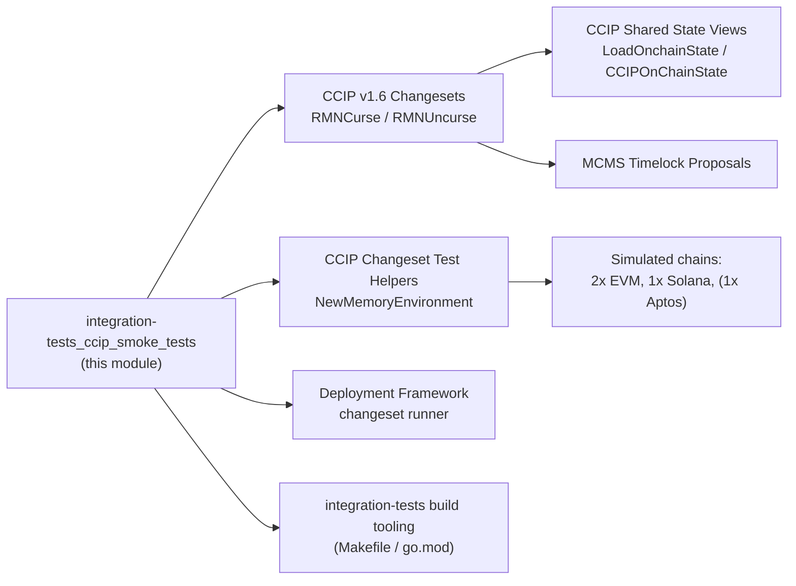
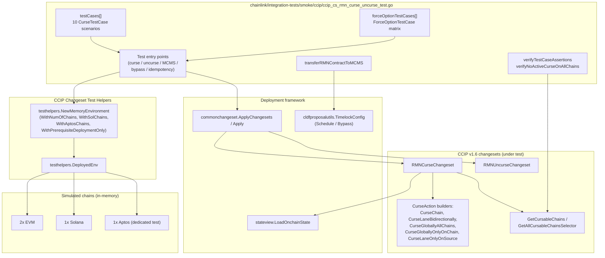
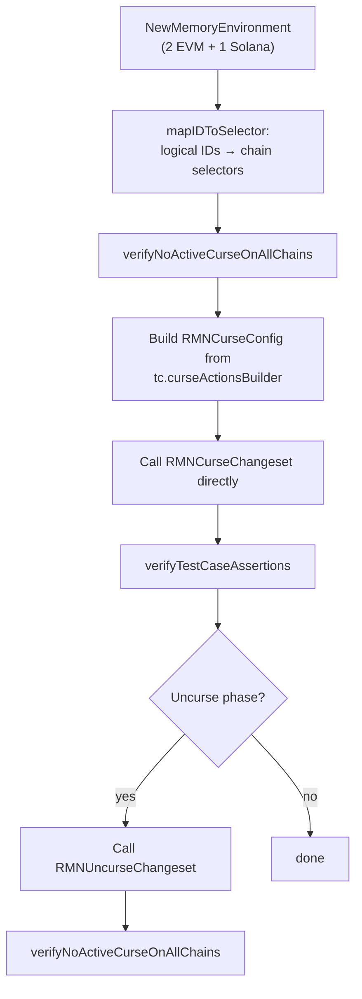
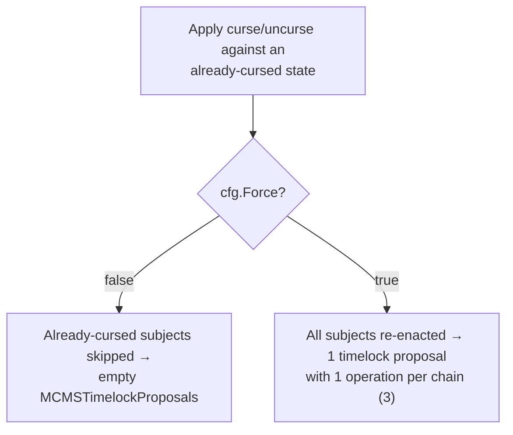

# CCIP Smoke Tests — RMN Curse / Uncurse

The `integration-tests_ccip_smoke_tests` module contains the CCIP smoke suite that validates the **RMN (Risk Management Network) curse / uncurse changesets** of the CCIP v1.6 deployment suite end-to-end. The single test file `chainlink/integration-tests/smoke/ccip/ccip_cs_rmn_curse_uncurse_test.go` spins up fully in-memory multi-chain CCIP environments (EVM + Solana + Aptos), applies the [`RMNCurseChangeset`](../../CCIP_Deployment_Suite/ccip-changesets/ccip-changesets_evm_1_6.md) / `RMNUncurseChangeset` both directly and through MCMS timelock governance, and asserts the resulting on-chain curse state on every chain and lane in the environment.

Unlike the docker/k8s based suites of the parent [integration-tests](../integration-tests.md) module, these smoke tests run entirely in-process against simulated chains, making them suitable as a fast gate for the curse/uncurse governance logic.

## Module Position in the System

The module sits at the intersection of three areas of the repository:

- It **consumes** the CCIP deployment changesets and shared state views ([CCIP Deployment Suite](../../CCIP_Deployment_Suite.md)).
- It **exercises** the changeset execution engine (operations → sequences → changesets) of the [Deployment Framework](../../Deployment_Framework_Core___Product_Deployments.md) via `commonchangeset.ApplyChangesets`.
- It is a member of the [Dev, Test & Simulation Environments](../../Dev,_Test___Simulation_Environments.md) family, alongside the [ChangeSet Test Helpers](../../CCIP_Deployment_Suite/ccip-changesets/ccip-changesets_testhelpers.md) that provision its environments.



## Test Architecture



## Core Components

All components live in `chainlink/integration-tests/smoke/ccip/ccip_cs_rmn_curse_uncurse_test.go` (Go module `github.com/smartcontractkit/chainlink/integration-tests`, declared in `chainlink/integration-tests/go.mod` with `replace` directives pointing at the local `chainlink` and `chainlink/deployment` modules).

### `ForceOptionTestCase` (registered core component)

The core component of this file describes one scenario of the `Force` flag matrix used by `TestRMNUncurseForceOption`:

| Field | Purpose |
|---|---|
| `name` | Human-readable scenario name |
| `force` | Value passed as `RMNCurseConfig.Force` |
| `expectedOperations` | Number of MCMS operations expected in the generated proposal (3 = one per chain) |
| `expectProposal` | Whether an `MCMSTimelockProposals` entry must be produced |
| `applyChangeset` | Closure that applies curse/uncurse against a `*testhelpers.DeployedEnv` and returns the `cldf.ChangesetOutput` |

The `forceOptionTestCases` slice instantiates four scenarios: uncurse/curse with `force=false` (an already-cursed subject is skipped → **no** proposal emitted) and uncurse/curse with `force=true` (subjects are re-enacted → proposal with 3 operations, one per cursable chain). This mirrors the changeset behaviour where already-cursed subjects are skipped unless `cfg.Force` is set.

### `CurseTestCase`, `curseAssertion` and `mapIDToSelectorFunc`

- **`CurseTestCase`** — a parametrized scenario: a `name`, a `curseActionsBuilder` closure that turns logical chain IDs into `[]v1_6.CurseAction`, and a list of `curseAssertions`.
- **`curseAssertion`** — one expected predicate: `chainID` (the chain being inspected), `subject` (the other chain, omitted for global curses), `globalCurse` (subject is the global-curse subject) and `cursed` (expected result of `IsCursed`).
- **`mapIDToSelectorFunc`** — resolves the stable logical identifiers `Evm1` (0), `Evm2` (1), `Sol1` (2) to real chain selectors via `v1_6.GetAllCursableChainsSelector(e.Env)`, keeping scenarios independent of selector ordering.

### Scenario catalogue (`testCases`)

| Scenario | Curse action(s) | Key expectation |
|---|---|---|
| `lane` | `CurseLaneBidirectionally(Evm1, Evm2)` | Both sides of the lane report cursed; all other pairs stay clean |
| `solana lane` | `CurseLaneBidirectionally(Evm1, Sol1)` | Cross-family (EVM↔Solana) lane curse |
| `lane duplicate` | Same lane cursed twice | Idempotent; only that lane is cursed |
| `chain` | `CurseChain(Evm1)` | Global curse flag on the chain; it appears cursed from every other chain |
| `solana chain` | `CurseChain(Sol1)` | Same semantics for Solana |
| `chain duplicate` / `solana chain duplicate` | Chain cursed twice | Idempotent |
| `chain and lanes` | `CurseChain(Evm1)` + lane curse `Evm2↔Sol1` | Combined global + lane curses |
| `all chain` | `CurseGloballyAllChains()` | Every chain globally cursed |
| `two chain globally` | `CurseChain(Evm1)` + `CurseChain(Sol1)` | Both chains globally cursed, all lanes affected |

## Test Entry Points

Every entry point iterates the full scenario catalogue with `t.Parallel()` sub-tests:

| Test | Runner | Mode |
|---|---|---|
| `TestRMNCurse` | `runRmnCurseTest` | Direct changeset call (no MCMS) |
| `TestRMNCurseMCMS` | `runRmnCurseMCMSTest` | MCMS timelock, `TimelockActionSchedule` |
| `TestRMNCurseBypass` | `runRmnCurseMCMSTest` | MCMS timelock, `TimelockActionBypass` |
| `TestRMNCurseIdempotent` | `runRmnCurseIdempotentTest` | Curse applied twice |
| `TestRMNUncurse` | `runRmnUncurseTest` | Curse → verify → uncurse → clean |
| `TestRMNUncurseMCMS` / `TestRMNUncurseBypass` | `runRmnUncurseMCMSTest` | MCMS curse → uncurse (schedule / bypass) |
| `TestRMNUncurseIdempotent` | `runRmnUncurseIdempotentTest` | Uncurse applied twice |
| `TestRMNCurseConfigValidate` | `runRmnCurseConfigValidateTest` | `RMNCurseConfig.Validate` only |
| `TestRMNCurseNoConnectedLanes` | inline | `IncludeNotConnectedLanes: false` filters unconnected lanes |
| `TestRMNCurseOneConnectedLanes` | inline | Single lane enabled via `UpdateOffRampSourcesChangeset` |
| `TestRMNCurseOneConnectedLanesGlobalOnly` | inline | `CurseGloballyOnlyOnChain` semantics |
| `TestRMNCurseOneConnectedLanesLaneOnlyOnSource` | inline | `CurseLaneOnlyOnSource` semantics |
| `TestRMNCurseOneConnectedLanesSolana` | inline | Solana source enabled via `AddRemoteChainToOffRamp` ([Solana changesets](../../CCIP_Deployment_Suite/ccip-changesets/ccip-changesets_solana.md)) |
| `TestRMNCurseUncurseAptos` | inline | Aptos family, kept in a dedicated test because Aptos environment setup is slow |
| `TestGetAllCursableChainsEmptyWhenNoRMNRemote` | inline | `WithPrerequisiteDeploymentOnly` → no cursable chains |
| `TestGetAllCursableChainsWithRMNRemote` | inline | Full deployment → exactly 3 cursable chains |
| `TestRMNUncurseForceOption` | `forceOptionTestCases` | `Force` flag matrix over `ForceOptionTestCase` |

## Execution Flow

### Direct (no-MCMS) path



### MCMS path

When `RMNCurseConfig.MCMS` is set, the test first transfers governance to MCMS, then drives the changeset through the deployment framework's proposal pipeline:

```mermaid
sequenceDiagram
    participant T as Test runner
    participant E as Memory environment (DeployedEnv)
    participant CS as RMNCurseChangeset
    participant SV as stateview.LoadOnchainState
    participant CC as CursableChain (EVM / Solana / Aptos)
    participant M as AggregateProposalsV2

    T->>E: NewMemoryEnvironment(2 EVM + 1 Solana)
    T->>SV: LoadOnchainState(e.Env)
    T->>E: transferRMNContractToMCMS()
    Note over E: RMNRemote (per chain) + RMNHome ownership<br/>moved to MCMS timelock; Solana contracts<br/>transferred and MCMS signers funded<br/>(Propose 100 / Canceller 350 /<br/>Bypasser 75 / Timelock 83 SOL)
    T->>CS: ApplyChangesets(RMNCurseChangeset, config)
    CS->>SV: LoadOnchainState
    CS->>CS: cfg.Validate + build/group curse actions
    CS->>CC: GetCursableChains → IsSubjectCursed
    CC-->>CS: already cursed? (skipped unless Force)
    CS->>CC: Curse(deployerGroup, subjects)
    CS->>M: aggregate EVM + Solana + Aptos proposals
    M-->>T: MCMSTimelockProposals
    T->>CC: verifyTestCaseAssertions → IsCursed(subject)
    T->>CS: ApplyChangesets(RMNUncurseChangeset, config)
    T->>CC: verifyNoActiveCurseOnAllChains
```

### Force-option decision logic



## Assertion Model

Both verification helpers are implemented on top of the [`CursableChain` interface](../../CCIP_Deployment_Suite/ccip-changesets/ccip-changesets_evm_1_6.md) returned by `GetCursableChains`:

- **`verifyTestCaseAssertions`** — resolves each assertion's chain family with `chain_selectors.GetSelectorFamily`, converts the subject selector with `globals.FamilyAwareSelectorToSubject` (or `globals.GlobalCurseSubject()` for global curses), and requires `IsCursed(subject)` to match the expected value.
- **`verifyNoActiveCurseOnAllChains`** — cross-product check that no chain/subject pair is cursed; used as the pre-condition before cursing and the post-condition after uncursing.

The "cursable chains" discovery covered by `TestGetAllCursableChains*` filters the deployed EVM, Solana and Aptos chains down to those that are actually cursable (i.e. have an RMNRemote), which is why the prerequisite-only deployment yields an empty map.

## Dependencies

| Dependency | Used for | Documented in |
|---|---|---|
| `testhelpers.NewMemoryEnvironment` / `DeployedEnv` | In-memory multi-chain CCIP environments | [ChangeSet Test Helpers](../../CCIP_Deployment_Suite/ccip-changesets/ccip-changesets_testhelpers.md) |
| `v1_6.RMNCurse/RMNUncurseChangeset`, curse-action builders | System under test | [CCIP Changesets — EVM v1.6](../../CCIP_Deployment_Suite/ccip-changesets/ccip-changesets_evm_1_6.md) |
| `ccipChangesetSolana` (`solana_v0_1_0`) | Solana off-ramp source / ownership transfer | [CCIP Changesets — Solana](../../CCIP_Deployment_Suite/ccip-changesets/ccip-changesets_solana.md) |
| `stateview.LoadOnchainState`, `CCIPOnChainState` | On-chain state access | [CCIP Shared — State Views](../../CCIP_Deployment_Suite/ccip-shared/ccip-shared_stateview.md) |
| `commonchangeset.Apply/ApplyChangesets/Configure` | Changeset execution engine | [Deployment Framework — deployment-common](../../Deployment_Framework_Core___Product_Deployments/deployment-common.md) |
| `mcmschangesets` (cld-changesets legacy), `cldfproposalutils.TimelockConfig` | MCMS ownership transfer, signer funding, timelock actions | [Deployment Framework](../../Deployment_Framework_Core___Product_Deployments.md) |
| `chain-selectors`, `globals` | Family resolution and curse subjects | [CCIP Cross-Chain Protocol](../../CCIP_Cross-Chain_Protocol.md) |

Test-level configuration (network overrides, user accounts, mercury options) for the broader integration-tests module is documented in [Test Configuration](integration-tests_test_configuration.md); generic contract helpers in [Contract Helpers](integration-tests_contract_helpers.md).

## Build & Execution

The suite is a standard Go test package inside the `chainlink/integration-tests` module (`chainlink/integration-tests/go.mod`, `go 1.27.1`). The module's Makefile (`chainlink/integration-tests/Makefile`) provides:

- `build` — compile check (`go build ./...` plus a compile-only test run `-run=^#`); useful to validate the suite builds without executing it.
- `lint` — `golangci-lint run ./... --fix -v`.
- `build_docker_image` / `build_push_docker_image` / `push-ccip-test-image` — build and push the Chainlink / chainlink-tests images; these support the *other* suites of the parent module and are **not** required here, because the curse/uncurse smoke tests provision simulated chains in-process.
- `run_tracing` — local tracing stack for smoke runs.
- `install_qa_tools`, `install_gotestloghelper` — developer tooling prerequisites.

Individual scenarios run with plain `go test`, e.g.:

```bash
cd chainlink/integration-tests
go test ./smoke/ccip/ -run 'TestRMNCurse$' -v          # direct curse matrix
go test ./smoke/ccip/ -run 'TestRMNUncurseForceOption' -v
go test ./smoke/ccip/ -run 'TestRMNCurseUncurseAptos' -v  # slower, Aptos setup
```

Because every sub-test creates its own memory environment and runs with `t.Parallel()`, the suite parallelizes well; see [Build Tooling](integration-tests_build_tooling.md) for the module's full build matrix.

## Related Documentation

- Parent module: [Integration Tests](../integration-tests.md)
- Environment family: [Dev, Test & Simulation Environments](../../Dev,_Test___Simulation_Environments.md)
- System under test: [CCIP Deployment Suite](../../CCIP_Deployment_Suite.md) — in particular the [EVM v1.6 changesets](../../CCIP_Deployment_Suite/ccip-changesets/ccip-changesets_evm_1_6.md) and [CCIP Shared State Views](../../CCIP_Deployment_Suite/ccip-shared/ccip-shared_stateview.md)
- Protocol context: [CCIP Cross-Chain Protocol](../../CCIP_Cross-Chain_Protocol.md)
