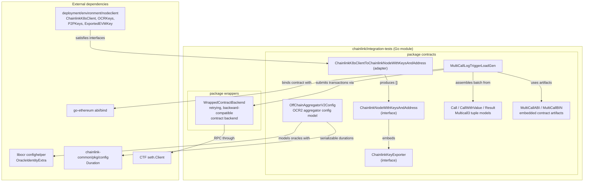
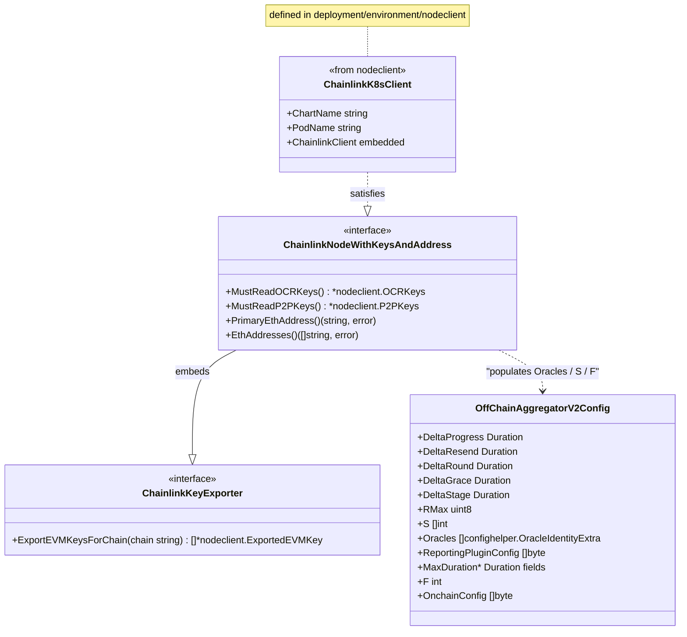
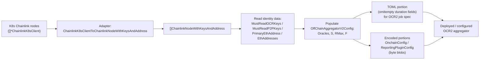
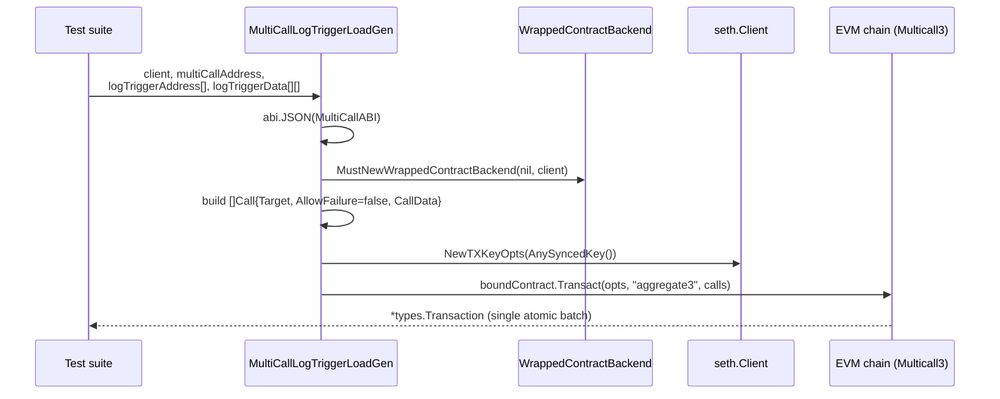
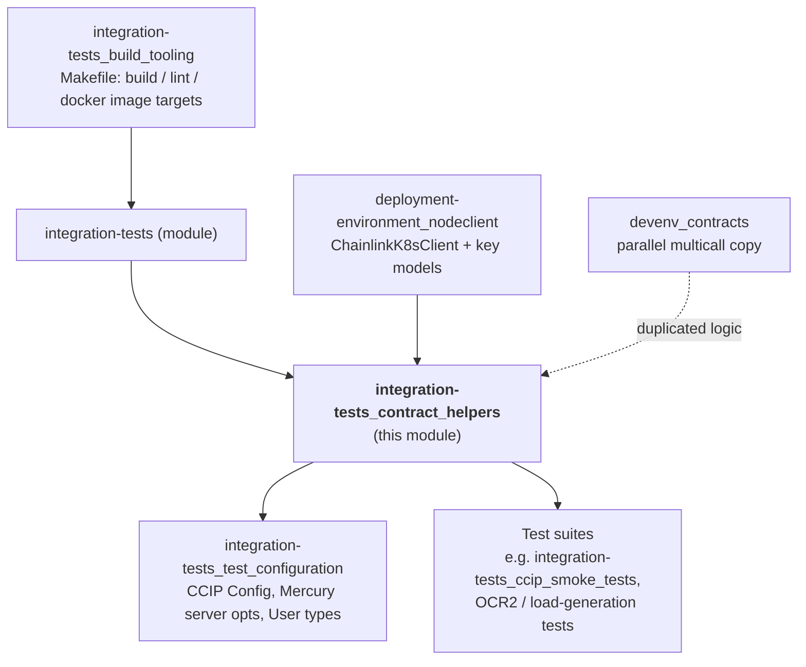

# Integration-Tests Contract Helpers

This module (`chainlink/integration-tests/contracts`, Go package `contracts`) provides the shared, test-side helpers that Chainlink integration tests use to interact with EVM smart contracts. It is a leaf utility layer inside the larger [integration-tests](../integration-tests.md) suite and serves two distinct concerns:

1. **OCR2 (Offchain Reporting v2) aggregator configuration modelling** — a serializable configuration struct plus a small interface layer that abstracts over how integration-test environments expose Chainlink node keys and addresses (today: Kubernetes-backed node API clients).
2. **Multicall3 batching** — embedded ABI/bytecode for the canonical [Multicall3](https://github.com/mds1/multicall) contract and a load-generation helper that batches many log-trigger calls into a single EVM transaction.

The module is intentionally small and dependency-light so that any test suite (OCR smoke tests, CCIP tests, load generators) can import it without pulling in heavyweight product code.

---

## Component Inventory

| File | Component | Kind | Responsibility |
|---|---|---|---|
| `contracts/contracts.go` | `OffChainAggregatorV2Config` | struct | TOML-serializable model of an OCR2 aggregator's timing, threshold, and plugin configuration. |
| `contracts/contracts.go` | `ChainlinkKeyExporter` | interface | Exports a node's EVM keys for a given chain. |
| `contracts/contracts.go` | `ChainlinkNodeWithKeysAndAddress` | interface | Read-side abstraction of a Chainlink node's OCR keys, P2P keys, and Ethereum addresses. |
| `contracts/contracts.go` | `ChainlinkK8sClientToChainlinkNodeWithKeysAndAddress` | adapter func | Lifts a slice of `*nodeclient.ChainlinkK8sClient` into the node abstraction. |
| `contracts/multicall.go` | `MultiCallABI`, `MultiCallBIN` | constants | Multicall3 ABI JSON and deployment bytecode (Solidity 0.8.12). |
| `contracts/multicall.go` | `Call`, `CallWithValue`, `Result` | structs | Go mirrors of the Multicall3 `Call`, `Call3`/`Call3Value`, and `Result` tuple types. |
| `contracts/multicall.go` | `MultiCallLogTriggerLoadGen` | function | Batches log-trigger calls and submits them atomically via Multicall3 `aggregate3`. |

Supporting in-module dependency: `integration-tests/wrappers/contract_caller.go` (`WrappedContractBackend`, created via `MustNewWrappedContractBackend`) is the transaction-signing/read backend used by the multicall helper.

---

## Architecture

The package sits at the bottom of the integration-tests dependency graph: it imports only external libraries (go-ethereum, libocr, chainlink-common config, chainlink-testing-framework) plus two intra-monorepo test packages (`deployment/environment/nodeclient` and its own `wrappers` package). Test suites consume it; it consumes nothing else from the `integration-tests` module.

Key structural points:

- **Interface seam, not abstraction for its own sake.** `ChainlinkNodeWithKeysAndAddress` exists so OCR2 config-building code does not hard-depend on the K8s client type. `*nodeclient.ChainlinkK8sClient` already satisfies it via its embedded `ChainlinkClient` (see [deployment-environment nodeclient](../deployment-environment/deployment-environment_nodeclient.md)); the adapter exists only to convert a slice.
- **Contract artifacts are embedded, not deployed from source.** `MultiCallABI` and `MultiCallBIN` are inline strings; tests point the bound contract at an already-deployed Multicall3 (available by default on most testnets and local anvil/geth deployments).
- **The `wrappers` layer normalizes RPC behaviour.** `WrappedContractBackend` fills both the legacy `input` and modern `data` fields on `eth_call`, and optionally retries transient connection errors — relevant when tests run against heterogeneous EVM clients.

---

## OCR2 Aggregator Configuration

### `OffChainAggregatorV2Config`

This struct mirrors the configuration surface of an OCR2 (Offchain Reporting v2) aggregator contract and its reporting plugin. Its TOML tags split the fields into two serialization classes:

| Serialization class | Fields | Purpose |
|---|---|---|
| `toml:",omitempty"` — emitted into the TOML document | `DeltaProgress`, `DeltaResend`, `DeltaRound`, `DeltaGrace`, `DeltaStage`, `MaxDurationQuery`, `MaxDurationObservation`, `MaxDurationReport`, `MaxDurationShouldAcceptFinalizedReport`, `MaxDurationShouldTransmitAcceptedReport` | OCR2 protocol timing parameters and plugin phase budgets. Durations use `commonconfig.Duration` from `chainlink-common/pkg/config`, which marshals correctly to TOML/JSON. |
| `toml:"-"` — excluded from TOML, populated programmatically | `RMax` (max rounds, `uint8`), `F` (fault tolerance threshold, `int`), `S` (oracle index list, `[]int`), `Oracles` (`[]confighelper.OracleIdentityExtra`), `ReportingPluginConfig` (`[]byte`), `OnchainConfig` (`[]byte`) | Identity/consensus data and pre-encoded payloads. `Oracles` reuses libocr's `confighelper.OracleIdentityExtra`; `OnchainConfig` and `ReportingPluginConfig` are ABI/config-encoded byte blobs produced by the calling test suite. |

This split matches how OCR2 job specs are assembled: the scalar protocol parameters live in the TOML portion of a job spec, while the oracle set and encoded configs are derived at runtime from the nodes under test.

### Node key access interfaces

- **`ChainlinkKeyExporter`** — a single-method interface (`ExportEVMKeysForChain(string) ([]*nodeclient.ExportedEVMKey, error)`). `ExportedEVMKey` is a standard V3 keystore JSON shape (cipher, KDF params, MAC), which tests use to fund or import node keys.
- **`ChainlinkNodeWithKeysAndAddress`** — composes the four read operations needed to build an OCR2 committee: OCR key bundles, P2P peer IDs, the primary transactor address, and the full address list.
- **`ChainlinkK8sClientToChainlinkNodeWithKeysAndAddress`** — a trivial but load-bearing adapter: it converts `[]*nodeclient.ChainlinkK8sClient` (what [deployment-environment nodeclient](../deployment-environment/deployment-environment_nodeclient.md) returns from a Kubernetes test environment) into `[]ChainlinkNodeWithKeysAndAddress`, so helper functions can be written against the interface.

### Configuration assembly flow

Typical usage in an OCR2 integration test:

The TOML portion can then be rendered into a job spec (the schema-side counterpart of this struct family lives in the node application; see [core config](../../Node_Application_Core___Interfaces/core_config.md) for how the node consumes such config).

---

## Multicall Batching

### Embedded contract artifacts

`MultiCallABI` and `MultiCallBIN` contain the full Multicall3 interface (including `aggregate`, `aggregate3`, `aggregate3Value`, `tryAggregate`, `blockAndAggregate`, and the block-info view helpers) plus deployable bytecode. Embedding them keeps the module self-contained — tests never need to compile Solidity.

### Tuple models

| Struct | Mirrors | Notes |
|---|---|---|
| `Call` | `Multicall3.Call3` | `Target`, `AllowFailure`, `CallData` — the variant used by `aggregate3`. |
| `CallWithValue` | `Multicall3.Call3Value` | Adds `Value *big.Int` for `aggregate3Value` batching with attached ETH. |
| `Result` | `Multicall3.Result` | Per-call `Success` flag and `ReturnData`, returned by the batching aggregators. |

### `MultiCallLogTriggerLoadGen`

This function is a load-generation primitive: given a Multicall3 address and a list of log-trigger contract addresses plus their encoded calldata, it wraps every call into a `Call` tuple and submits them all in **one** EVM transaction through Multicall3's `aggregate3` entrypoint.

Behaviour details worth knowing when writing tests:

- **Atomicity with fail-on-error semantics.** `aggregate3` is invoked with `AllowFailure = false` on every sub-call, so the transaction reverts if any target call fails — the batch either fully applies or fully reverts.
- **Key selection.** Transactions are signed with `client.NewTXKeyOpts(client.AnySyncedKey())`, letting the Seth client pick any funded, synced key rather than requiring a specific sender.
- **Wrapped backend.** `wrappers.MustNewWrappedContractBackend(nil, client)` is used for `CodeAt`/call plumbing; the nil EVM client is acceptable because the Seth client is always provided (the wrapper panics only if both are nil).
- **Duplicate implementation.** `chainlink/devenv/contracts/multicall.go` is a near-identical copy maintained for the devenv environment; its `MultiCallLogTriggerLoadGen` differs only in accepting a pre-built `[]Call` instead of address/data slices (see [devenv contracts](../devenv/devenv_contracts.md)). If you change one, check the other.

---

## How This Module Fits Into the System

- **Within the integration-tests module.** The [integration-tests](../integration-tests.md) parent page places this module among its siblings: build orchestration comes from [integration-tests_build_tooling](integration-tests_build_tooling.md) (`make build`, `make lint`, and the `chainlink-tests` Docker image targets in `chainlink/integration-tests/Makefile`), test parameters come from [integration-tests_test_configuration](integration-tests_test_configuration.md), and consumers include the CCIP smoke suites such as [integration-tests_ccip_smoke_tests](integration-tests_ccip_smoke_tests.md).
- **Module boundaries.** `chainlink/integration-tests/go.mod` is a separate Go module that `replace`-directs `chainlink/v2` and `chainlink/deployment` to local paths. This helper module's imports (`libocr confighelper`, `chainlink-common/pkg/config`, `chainlink-testing-framework/seth`, go-ethereum) are all resolved through that module graph.
- **Environment integration.** The node abstraction is satisfied by Kubernetes test-environment node clients described in [deployment-environment nodeclient](../deployment-environment/deployment-environment_nodeclient.md), which in turn connect to Chainlink nodes booted by the [deployment environment](../deployment-environment.md).
- **Relationship to product code.** None at runtime — the package imports no `core/` product code, which keeps contract-interaction helpers stable while node internals evolve. The only conceptual coupling is to the OCR2 config schema that the node itself parses (see [core config](../../Node_Application_Core___Interfaces/core_config.md)).

---

## Usage Notes and Gotchas

1. **Prefer the interfaces over concrete client types** when writing new OCR2 helpers — the adapter exists precisely so future environments (non-K8s, in-process mocks) can satisfy `ChainlinkNodeWithKeysAndAddress` without touching call sites.
2. **TOML field visibility matters** when extending `OffChainAggregatorV2Config`: adding a field without `toml:"-"` will silently change job-spec serialization; conversely, fields needed only for encoding should stay out of the TOML output.
3. **`aggregate3` with `AllowFailure=false` is all-or-nothing** — if partial success semantics are required, use `tryAggregate`/`aggregate3Value` via the same bound-contract pattern, or populate `CallWithValue` and call `aggregate3Value`.
4. **Keep the devenv copy in sync** — the multicall implementation is intentionally duplicated between `integration-tests` and `devenv`; a fix applied to only one will cause drift between the two test stacks.
5. **The embedded bytecode pins Solidity 0.8.12** — the artifacts match Multicall3's published deployment; do not regenerate them casually, since mainnet/local deployments of Multicall3 are immutable and canonical.
