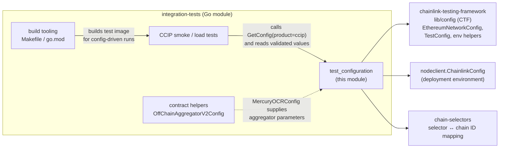
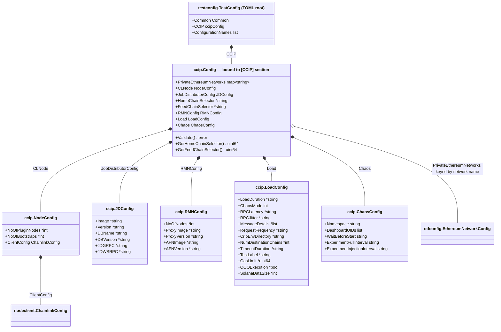
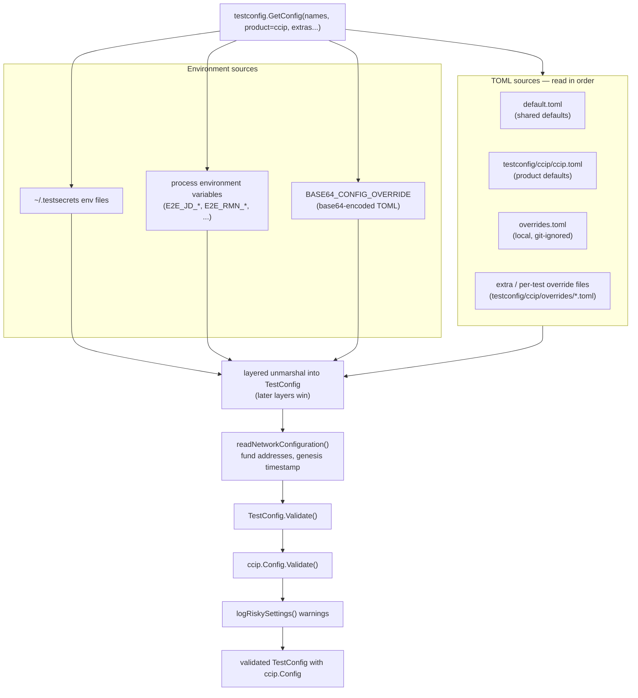
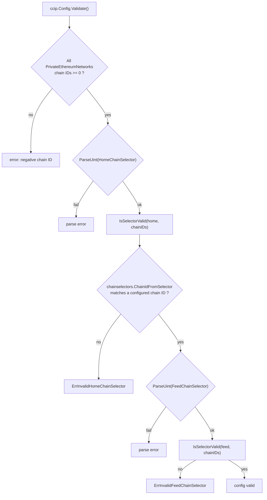
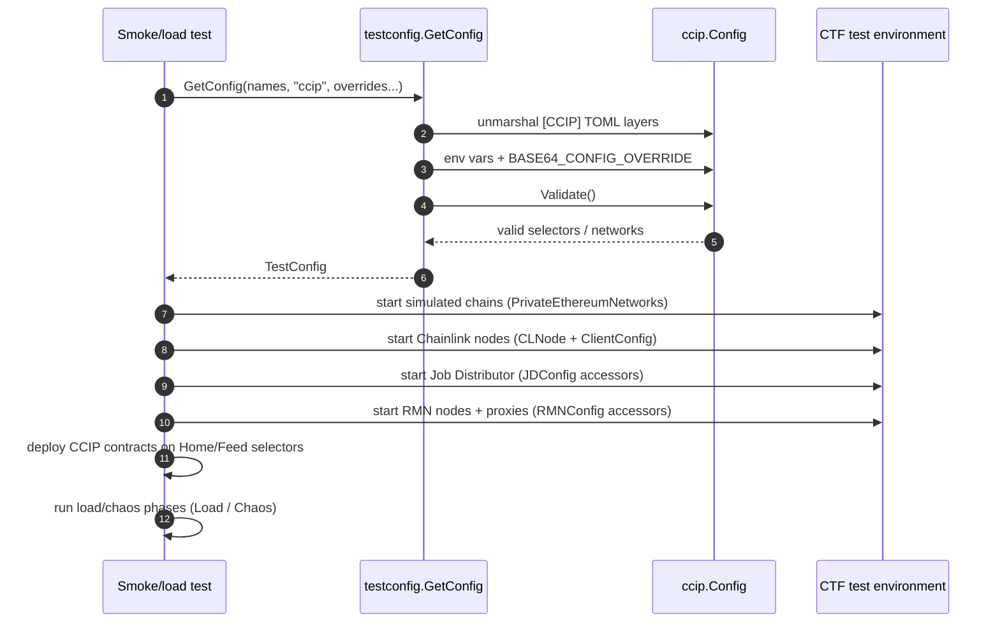

# Integration Tests — Test Configuration

The `integration-tests_test_configuration` module defines the **typed configuration schema** and **shared test-domain types** used by the Chainlink integration test suites. It has two halves:

- **`chainlink/integration-tests/testconfig/ccip/config.go`** — the CCIP product test configuration (`ccip.Config`): simulated private networks, Chainlink node cluster sizing, Job Distributor (JD) settings, RMN proxy settings, home/feed chain selectors, load and chaos parameters.
- **`chainlink/integration-tests/types/types.go`** — product-agnostic, shared test types: `MercuryServerOpts` / `MercuryServerType` (Mercury server provisioning), `User` (node admin credentials) and `MercuryOCRConfig` (OCR aggregator contract parameters).

These types are the contract between TOML configuration files (`testconfig/ccip/ccip.toml`, `overrides.toml`, base64 overrides) and the Go test code: the [chainlink-testing-framework (CTF)](#build-and-run-context) config loader unmarshals TOML into them, they validate their own consistency, and the tests consume them to provision environments and drive assertions.

## Module Position in the System

- It is one of the leaf packages of the [integration-tests](../integration-tests.md) module, alongside the [build tooling](integration-tests_build_tooling.md), [CCIP smoke tests](integration-tests_ccip_smoke_tests.md) and [contract helpers](integration-tests_contract_helpers.md) sub-modules.
- It **delegates** generic concerns to the CTF configuration library (`chainlink-testing-framework/lib/config`) — network configs, secret handling and env parsing — and to the [deployment environment](../deployment-environment.md)'s `nodeclient.ChainlinkConfig` for node credentials.
- It **feeds** the CCIP smoke/load suites, which deploy CCIP contracts from the [CCIP Deployment Suite](../../CCIP_Deployment_Suite.md) and exercise the protocol logic documented in [CCIP Cross-Chain Protocol](../../CCIP_Cross-Chain_Protocol.md).



The module belongs to the wider [Dev, Test & Simulation Environments](../../Dev,_Test___Simulation_Environments.md) family: it complements the [Docker dev environments](../docker-dev-environments.md) (standalone node/devnet stacks) and the [devenv](../devenv.md) developer environment, which is the recommended successor for local workflows.

## Architecture Overview

The CCIP configuration is a hierarchy of value structs. Every field is a pointer (or pointer-carrying struct) tagged `toml:",omitempty"`, so any layer of the configuration pipeline can override only the values it cares about. Accessors implement the fallback chain **TOML value → environment variable → built-in default**.



The `map~string~` on `ccip.Config` is `map[string]*ctfconfig.EthereumNetworkConfig` — one private (simulated) Ethereum network entry per named network (e.g. `SIMULATED_1`).

## Core Components

### `ccip.Config` — CCIP product test configuration

Top-level struct for the `[CCIP]` TOML section of the product configuration file. It is embedded into the shared `testconfig.TestConfig` as the `CCIP` field (see `testconfig/testconfig.go`).

| Field | Type | Purpose |
|---|---|---|
| `PrivateEthereumNetworks` | `map[string]*ctfconfig.EthereumNetworkConfig` | Simulated Ethereum networks to spin up per network name (chain ID, execution layer, genesis/funding settings) |
| `CLNode` | `*NodeConfig` | Chainlink plugin node cluster topology and node client credentials |
| `JobDistributorConfig` | `JDConfig` | Job Distributor container settings (image, version, DB, gRPC/WS RPC endpoints) |
| `HomeChainSelector` | `*string` | Chain selector of the CCIP **home chain** (string form, parsed to `uint64`) |
| `FeedChainSelector` | `*string` | Chain selector of the **feed chain** (price/fee feed deployment target) |
| `RMNConfig` | `RMNConfig` | Risk Management Network node count and rageproxy / AFN2 proxy container settings |
| `Load` | `*LoadConfig` | Load/soak test parameters (message mix, durations, RPC latency chaos, CRIB env dir) |
| `Chaos` | `*ChaosConfig` | Chaos-mesh experiment parameters for Kubernetes runs |

Key behaviour:

- **`Validate()`** — rejects negative chain IDs in any `PrivateEthereumNetworks` entry, parses both chain selectors, and requires each selector to resolve (via `chainselectors.ChainIdFromSelector`) to a chain ID present in the configured private networks. Failure yields `ErrInvalidHomeChainSelector` / `ErrInvalidFeedChainSelector`.
- **`GetHomeChainSelector()` / `GetFeedChainSelector()`** — parse the string selectors into `uint64` for the deployment code (the CCIP OCR3 plugin and changesets key all chains by selector).
- **`IsSelectorValid(selector, chainIDs)`** — helper that converts a selector to a chain ID with the `chain-selectors` library and compares it against the configured chain IDs using `isEqualUint64AndInt64`, which safely handles the `uint64`/`int64` conversion boundary.

### `NodeConfig` and node credentials

| Field | Purpose |
|---|---|
| `NoOfPluginNodes` | Number of Chainlink nodes participating in the CCIP plugin DON |
| `NoOfBootstraps` | Number of OCR bootstrap nodes (P2P deltas) |
| `ClientConfig` | `nodeclient.ChainlinkConfig` — node admin URL, e-mail, password, internal IP, custom HTTP headers and timeout, used by the node client to create sessions and submit jobs (see [deployment-environment](../deployment-environment.md)) |

### `JDConfig` — Job Distributor

The Job Distributor is the offchain service that proposes and approves jobs (see [feeds service](../../Node_Platform_Services/feeds_service.md) for the node-side counterpart). Every accessor falls back to an environment variable when the TOML value is empty, because JD endpoints are environment/namespace-specific:

| Accessor | TOML field | Env fallback | Built-in default |
|---|---|---|---|
| `GetJDImage()` | `Image` | `E2E_JD_IMAGE` | — (must be provided) |
| `GetJDVersion()` | `Version` | `E2E_JD_VERSION` | — (must be provided) |
| `GetJDGRPC()` | `JDGRPC` | `E2E_JD_GRPC` | — (must be provided) |
| `GetJDWSRPC()` | `JDWSRPC` | `E2E_JD_WSRPC` | — (must be provided) |
| `GetJDDBName()` | `DBName` | — | `JD_DB` (`DefaultDBName`) |
| `GetJDDBVersion()` | `DBVersion` | — | `14.1` (`DefaultDBVersion`) |

### `RMNConfig` — Risk Management Network

| Accessor | TOML field | Env fallback |
|---|---|---|
| `GetProxyImage()` | `ProxyImage` | `E2E_RMN_RAGEPROXY_IMAGE` |
| `GetProxyVersion()` | `ProxyVersion` | `E2E_RMN_RAGEPROXY_VERSION` |
| `GetAFN2ProxyImage()` | `AFNImage` | `E2E_RMN_AFN2PROXY_IMAGE` |
| `GetAFN2ProxyVersion()` | `AFNVersion` | `E2E_RMN_AFN2PROXY_VERSION` |

`NoOfNodes` selects the RMN oracle set size. The RMN proxies are exercised by curse/uncurse smoke tests (see [CCIP smoke tests](integration-tests_ccip_smoke_tests.md)).

### Supporting package types — `LoadConfig` and `ChaosConfig`

Defined in the same package (`testconfig/ccip/load.go`, `testconfig/ccip/chaos.go`) and referenced by `ccip.Config`:

- **`LoadConfig`** — parameters for CCIP load/soak runs: `LoadDuration`, `TimeoutDuration` (defaults to 30 min at accessor level), `RequestFrequency`, `ChaosMode` (`0` none / `1` RPC latency / `2` full suite), `RPCLatency` + `RPCJitter`, the `MessageDetails` mix (`TokenTransfer`, `Messaging`, `ProgrammableTokenTransfer` with ratio + `DataLengthBytes` + `DestGasLimit`, ratios must sum to 100), `NumDestinationChains`, `SolanaDataSize`, `GasLimit`, `OOOExecution`, `TestLabel`, and `CribEnvDirectory` (CRIB environment inputs — see [operations scripts, CRE environment](../operations_scripts/operations_scripts_cre_environment.md)). Its `Validate(t, e)` runs at test time against the live environment and asserts the number of destination chains does not exceed the deployed chains.
- **`ChaosConfig`** — chaos-mesh parameters for Kubernetes runs: target `Namespace`, Grafana `DashboardUIDs`, `WaitBeforeStart`, `ExperimentFullInterval` and `ExperimentInjectionInterval` (Go duration strings). Grafana dashboards come from the observability stack described in [Telemetry & Observability Platform](../../Telemetry___Observability_Platform.md).

### Shared test types — `integration-tests/types/types.go`

Product-agnostic types reused across CCIP and Mercury test suites:

**`MercuryServerType`** — which interfaces a local Mercury server exposes:

| Constant | Value |
|---|---|
| `MSWSRPC` | `"wsrpc"` |
| `MSWS` | `"ws"` |
| `MSREST` | `"rest"` |
| `MSAll` | `"all"` |

**`MercuryServerOpts`** — full provisioning options for a Mercury server container, grouped into `Server` (dev mode, automatic migrations, service kind, port), `RPC` (feed node private key, node pub keys, port), `Database` (URL, writer instance URL, encryption key) and `Bootstrap` (username, password), plus internal/external WSRPC URLs. This is what a test passes to the test-harness to stand up the Mercury backend against which node telemetry and report submission is validated.

**`User`** — a Chainlink node API user (`ID`, `Username`, `Password`) used to create node sessions through the node client (initial admin credentials when nodes are provisioned from `NodeConfig.ClientConfig`).

**`MercuryOCRConfig`** — the OCR2/OCR3 aggregator contract parameters needed to wire a Mercury-capable aggregator:

| Field | Type | Purpose |
|---|---|---|
| `Signers` | `[]common.Address` | Signer EOAs (must match the nodes' keys) |
| `Transmitters` | `[][32]byte` | Transmitter addresses in the chain-native 32-byte form |
| `F` | `uint8` | Fault tolerance threshold |
| `OnchainConfig` | `[]byte` | Packed onchain config blob |
| `OffchainConfigVersion` | `uint64` | Offchain config serialization version |
| `OffchainConfig` | `[]byte` | Packed offchain config blob |

It mirrors the deployment-side `OffChainAggregatorV2Config` documented in [contract helpers](integration-tests_contract_helpers.md); the domain semantics of the fields are defined by the OCR engine ([Oracle Engines & Data Pipelines](../../Oracle_Engines___Data_Pipelines.md)).

## Configuration Resolution Pipeline

`testconfig.GetConfig(configurationNames, Product("ccip"), extras...)` (in `testconfig/testconfig.go`) builds the `TestConfig` containing the `ccip.Config`. TOML files are unmarshalled layer-by-layer into the same struct, so later sources override earlier ones; environment variables fill unset values and a base64 payload can override everything (used by CI and the `Makefile` run commands).



**Override precedence** (highest first), as documented in `testconfig/README.md`:

1. `BASE64_CONFIG_OVERRIDE` environment variable
2. `overrides.toml`
3. `<product>.toml` (here `testconfig/ccip/ccip.toml`)
4. `default.toml`
5. test secrets (`~/.testsecrets`)

Two pipeline details worth knowing:

- **Embedded configs**: with the `embed` build tag (`testconfig/configs_embed.go`), `default.toml` and `ccip.toml` are compiled into the test binary, so only `overrides.toml` is needed for containerized/CI runs.
- **Secret hygiene**: `checkSecretsInToml` fails fast if TOML files contain keys that must come from test secrets (node images, RPC URLs, wallet keys).

## Validation Flow

The CCIP-specific validation guarantees that the topology described in TOML is internally consistent before any container is started.



Load and chaos settings are validated later, at test time, because they need a live environment: `LoadConfig.Validate(t, e)` checks duration strings, the message-mix ratio sum, the Solana data size floor and that `NumDestinationChains` ≤ deployed chains; `ChaosConfig.Validate(t, e)` requires namespace, dashboard UIDs and both experiment intervals.

## From Configuration to Test Environment

The sequence below shows how a CCIP smoke/load test turns the validated configuration into a running multi-chain environment. Container provisioning is driven by the CTF harness; contract deployment uses the CCIP changesets.



The same flow also consumes the shared types when Mercury lanes are involved: `MercuryServerOpts` provisions the Mercury server, `MercuryOCRConfig` configures aggregators, and `User` authenticates against node APIs.

## Build and Run Context

The module lives in its own Go module (`chainlink/integration-tests/go.mod`) with local `replace` directives to `../` (the `chainlink/v2` node) and `../deployment`, and key dependencies: `chainlink-testing-framework/lib` (CTF config/seth), `chain-selectors`, `pelletier/go-toml/v2`, `AlekSi/pointer`, and `ethereum/go-ethereum` (`common.Address` in `MercuryOCRConfig`).

Relevant targets from `chainlink/integration-tests/Makefile`:

| Target | Role |
|---|---|
| `build` | Compile all packages and compile-check tests (`go test -run=^#`) |
| `build_docker_image` / `build_push_docker_image` | Build the Chainlink node image (via `core/chainlink.Dockerfile`, requires `GITHUB_TOKEN`) and push into the local k3d registry |
| `push-ccip-test-image` | Push the built `chainlink-tests` image to the AWS ECR registry used by remote/CI CCIP runs |
| `run_tracing` | Local tracing stack for observing config-driven test runs |

Typical local execution (from `chainlink/integration-tests/README.md`), where the override TOML is passed via the base64 variable consumed by the pipeline above:

```bash
BASE64_CONFIG_OVERRIDE=$(cat ./testconfig/overrides.toml | base64) \
  go test -v -p 1 ./smoke/ccip/...
```

### Example: the `[CCIP]` section of `testconfig/ccip/ccip.toml`

```toml
[CCIP]
HomeChainSelector = '12922642891491394802' # for chain-2337
FeedChainSelector = '3379446385462418246' # for chain-1337

[CCIP.CLNode]
NoOfPluginNodes = 4
NoOfBootstraps = 1

[CCIP.PrivateEthereumNetworks.SIMULATED_1]
ethereum_version = "eth1"
execution_layer = "geth"
wait_for_finalization = false

[CCIP.PrivateEthereumNetworks.SIMULATED_1.EthereumChainConfig]
seconds_per_slot = 3
slots_per_epoch = 2
genesis_delay = 15
validator_count = 4
chain_id = 1337
addresses_to_fund = [ "0xf39Fd6e51aad88F6F4ce6aB8827279cffFb92266", "...", ]

[CCIP.Chaos]
Namespace = "crib-aw-remote"
DashboardUIDs = [""]
WaitBeforeStart = "0s"
ExperimentFullInterval = "15m"
ExperimentInjectionInterval = "9m"

[Load.CCIP.Load]
ChaosMode = 1            # 0 none, 1 RPC latency, 2 full chaos
RPCLatency = "400ms"
MessageDetails = [
    {Ratio = 3, MsgType = "TokenTransfer"},
    {Ratio = 82, MsgType = "ProgrammableTokenTransfer", DataLengthBytes = 5000, DestGasLimit = 650_000},
    # ...
]
LoadDuration = "5h"
NumDestinationChains = 30
```

The shipped `ccip.toml` defines six private networks (`SIMULATED_1..3` and `*_DEEPER_FINALITY` variants with `finality_depth = 10` used by reorg tests) so that test selection reduces to choosing `selected_networks` in `overrides.toml`.

## References

- Parent module: [integration-tests](../integration-tests.md)
- Sibling sub-modules: [build tooling](integration-tests_build_tooling.md) · [CCIP smoke tests](integration-tests_ccip_smoke_tests.md) · [contract helpers](integration-tests_contract_helpers.md)
- Node credentials source: [deployment environment](../deployment-environment.md) (`nodeclient.ChainlinkConfig`)
- Configuration consumers: [CCIP Deployment Suite](../../CCIP_Deployment_Suite.md) (changesets deployed against configured selectors) and [CCIP Cross-Chain Protocol](../../CCIP_Cross-Chain_Protocol.md) (protocol under test)
- Repository files: `chainlink/integration-tests/testconfig/ccip/config.go`, `testconfig/ccip/load.go`, `testconfig/ccip/chaos.go`, `testconfig/ccip/ccip.toml`, `testconfig/testconfig.go`, `testconfig/README.md`, `types/types.go`, `Makefile`, `go.mod`, `README.md`
