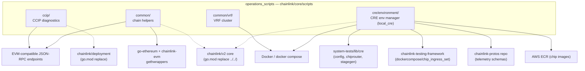
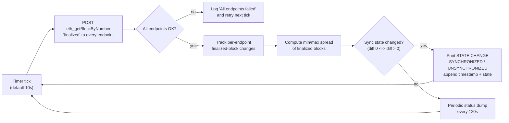
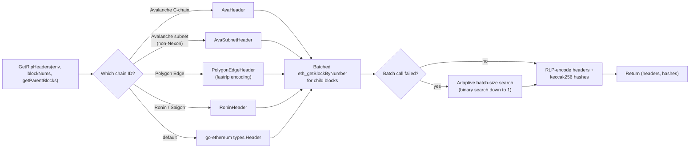
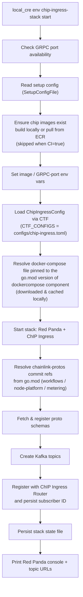
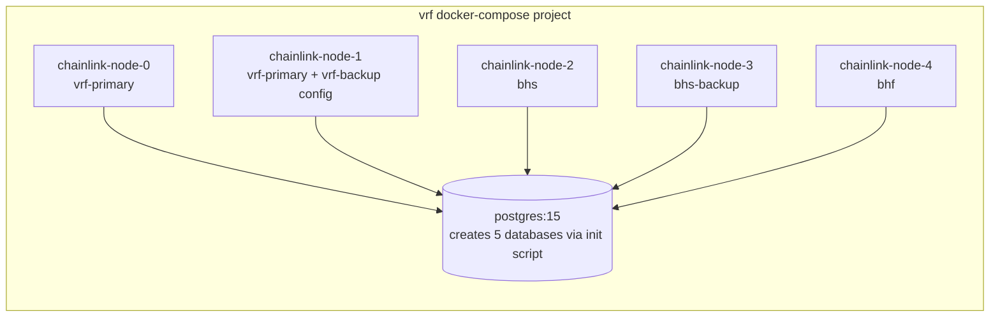

# Operations Scripts (`chainlink/core/scripts`)

> Wiki page for the **`operations_scripts`** module of the *Dev, Test & Simulation Environments* domain.

---

## 1. Overview & Purpose

The `operations_scripts` module is a **standalone Go module** rooted at `chainlink/core/scripts/` (declared as `github.com/smartcontractkit/chainlink/core/scripts` in `chainlink/core/scripts/go.mod`, Go 1.27.1). It collects the **imperative, operator-facing tooling** of the Chainlink / CRE stack:

- **CCIP diagnostics** — an RPC finalization monitor and a revert-reason decoding CLI.
- **Chain-common helpers** — shared plumbing for multi-chain (Avalanche, Avalanche subnets, Ronin, Polygon Edge, generic EVM) block-header retrieval, contract deployment, node funding and confirmation loops used by one-off operational scripts.
- **VRF node cluster** — a dockerized 5-node Chainlink cluster (VRF primary/backup, BHS/BHS-backup, BHF) plus PostgreSQL, together with its Go data model used to bootstrap jobs and keys.
- **CRE environment manager** — the `local_cre` CLI for running a local Chainlink Runtime Environment: ChIP Ingress (telemetry) stack lifecycle, Kafka topic management, proto schema registration, and DON topology discovery/visualization.

Unlike the Go-SDK based [devenv](devenv.md) or the declarative [system-tests](system-tests.md) library, this module contains **small, single-purpose programs and compose files** meant for interactive/diagnostic/operator use rather than as production or CI-test libraries. Many tools intentionally `panic` on errors (`PanicErr`) because they are run by humans watching a terminal.

### Module identity (`chainlink/core/scripts/go.mod`)

| Aspect | Value |
|---|---|
| Module path | `github.com/smartcontractkit/chainlink/core/scripts` |
| Go version | 1.27.1 |
| `replace` directives | `chainlink/v2` → `../../` · `chainlink/deployment` → `../../deployment` · `chainlink/system-tests/lib` → `../../system-tests/lib` · CRE example workflow → local path |
| Notable dependencies | `go-ethereum`, `chainlink-evm` (gethwrappers), `chainlink-testing-framework/framework` (+ `components/dockercompose`), `chainlink-deployments-framework`, `chainlink-common`, `spf13/cobra`, `moby/moby/client`, `avast/retry-go/v4` |

The `replace` directives guarantee the scripts always compile against the **in-repo** versions of the core node, the deployment framework and the system-tests library — see [Deployment Framework Core & Product Deployments](../Deployment_Framework_Core___Product_Deployments.md) and [System Tests](system-tests.md).

---

## 2. Architecture Overview

The module is organized into four functional areas that are largely independent of each other, sharing only the module-level dependency graph:



### Directory layout

```
chainlink/core/scripts/
├── go.mod                              # standalone module + replace directives
├── ccip/
│   ├── finalization_checker.go         # standalone RPC finalization monitor
│   └── revert-reason/
│       ├── Makefile                    # make build → bin/ccip-revert-reason
│       └── main.go                     # entry point (delegates to cobra command pkg)
├── common/
│   ├── helpers.go                      # Environment, SetupEnv, FundNodes, GetRlpHeaders, confirmations
│   ├── avalanche.go                    # AvaHeader, AvaBloom, AvaBlockNonce (coreth header copy)
│   ├── avalanche_subnet.go             # AvaSubnetHeader + subnet chain-ID detection
│   ├── ronin.go                        # RoninHeader + Ronin chain-ID detection
│   └── vrf/
│       ├── docker/docker-compose.yml   # 5 Chainlink nodes + Postgres
│       └── model/model.go              # Node, key & job-spec configuration models
└── cre/environment/
    ├── GNUmakefile                     # make install → local_cre binary
    └── environment/
        ├── chip_ingress_stack.go       # ChIP Ingress stack lifecycle + proto registration
        ├── error_location.go           # file:line extraction for DX telemetry
        └── topology.go                 # topology list / show / generate commands
```

---

## 3. Sub-modules

Detailed documentation lives in dedicated pages:

| Sub-module | Location | Focus | Documentation |
|---|---|---|---|
| **CCIP diagnostics** | `ccip/` | Finalized-block monitoring across RPC providers; revert-reason CLI | [operations_scripts_ccip](operations_scripts/operations_scripts_ccip.md) |
| **Chain-common helpers** | `common/` | Multi-chain header structs, environment bootstrap, funding, RLP header batch fetching | [operations_scripts_chain_common](operations_scripts/operations_scripts_chain_common.md) |
| **VRF node cluster** | `common/vrf/` | Dockerized VRF/BHS/BHF node cluster + bootstrap data model | [operations_scripts_vrf](operations_scripts/operations_scripts_vrf.md) |
| **CRE environment manager** | `cre/environment/` | `local_cre` CLI: ChIP Ingress stack, topology tooling, telemetry helpers | [operations_scripts_cre_environment](operations_scripts/operations_scripts_cre_environment.md) |

Summaries (each links to its detailed sub-module page under [`operations_scripts/`](operations_scripts/)):

- **[CCIP diagnostics](operations_scripts/operations_scripts_ccip.md)** — `finalization_checker.go` is a self-contained `main` that polls a hard-coded list of RPC endpoints with `eth_getBlockByNumber("finalized")`, decodes responses into `BlockResponse`/`Block`, computes the min/max finalized-block spread, prints *SYNCHRONIZED / UNSYNCHRONIZED* state transitions and keeps a running event log. The `revert-reason` CLI (built via its Makefile) decodes CCIP transaction revert reasons.
- **[Chain-common helpers](operations_scripts/operations_scripts_chain_common.md)** — the `Environment`/`SetupEnv` bootstrap (env vars `ETH_URL`, `ETH_CHAIN_ID`, `ACCOUNT_KEY`, `GAS_LIMIT`, `INSECURE_SKIP_VERIFY`), LINK token & feed deployment, transmitter funding, transaction/deployment confirmation helpers, explorer-link generation, `BinarySearch`, and the chain-aware `GetRlpHeaders` engine with per-chain header copies (`AvaHeader`, `AvaSubnetHeader`, `RoninHeader`, Polygon Edge, standard `types.Header`) and an adaptive batch-size RPC wrapper.
- **[VRF node cluster](operations_scripts/operations_scripts_vrf.md)** — a compose project with a shared `postgres:15` (five databases via an init script), five Chainlink nodes started with layered TOML configs (`base.toml` + role config) and Docker secrets for the node password and API credentials; `model/model.go` defines the `Node`, sending-key, job-spec and contract-address structures consumed by the surrounding bootstrap scripts.
- **[CRE environment manager](operations_scripts/operations_scripts_cre_environment.md)** — `make install` builds `local_cre` (version/commit/date ldflags, optional `asdf reshim`). The `environment` package implements cobra command groups: `env chip-ingress-stack start|stop|create-topics|register-protos` (with a deprecated `env beholder` alias), topology discovery/visualization (`topology list|show|generate`) and error-location extraction used by DX telemetry.

---

## 4. Key Flows

### 4.1 CCIP finalization monitoring (`ccip/finalization_checker.go`)



The tool never mutates state; it is purely observational and exits on `Ctrl+C`. Endpoints are edited directly in the source (`var endpoints = []Endpoint{...}`).

### 4.2 Chain-aware RLP header fetching (`common/helpers.go`)



Each header type implements the `Hashable` interface (`Hash() common.Hash`) so a single generic `getRlpHeaders[HEADER Hashable]` implementation serves every chain family. The header structs are deliberate **copies of upstream chain headers** (ava-labs/coreth, ava-labs/subnet-evm, ronin-chain) to avoid importing entire chain modules into scripts.

### 4.3 ChIP Ingress stack startup (`cre/environment/environment/chip_ingress_stack.go`)



On failure the stack is torn down (after a configurable `--wait-on-error-timeout`); panics are caught, reported with a stack trace, and trigger cleanup. `stop` unregisters the router subscriber (reading the persisted ID, with a legacy `beholder` fallback path) and removes the persisted state files. The deprecated `env beholder` command group is retained as an alias that prints deprecation banners pointing to `env chip-ingress-stack`.

### 4.4 VRF cluster topology (`common/vrf/docker/docker-compose.yml`)



All nodes wait for `database:5432` (via `docker-wait-for-others.sh`), read layered TOML configs mounted read-only at `/opt/config`, and receive `CL_DATABASE_URL` pointing at their own database. Docker secrets supply `node_password` and `apicredentials`. See [operations_scripts_vrf](operations_scripts/operations_scripts_vrf.md) for the port map and the matching Go model.

---

## 5. Build & Runtime Entry Points

| Artifact | Command | Result |
|---|---|---|
| `chainlink/core/scripts/ccip/revert-reason/Makefile` | `make build` | `bin/ccip-revert-reason` (plain `go build`) |
| `chainlink/core/scripts/cre/environment/GNUmakefile` | `make install` | `$(GOPATH)/bin/local_cre` with `main.Version` / `main.Commit` / `main.Date` ldflags; runs `asdf reshim golang` when asdf is present |
| `ccip/finalization_checker.go` | `go run ./ccip` (`-interval` flag) | long-running finalization monitor |
| `cre/environment` | `go run . env ...` / `local_cre ...` | cobra CLI (`env chip-ingress-stack`, `env setup`, `topology`, …) |

Most `common/` helpers are **libraries** linked by sibling `main` packages within the module rather than executables themselves.

---

## 6. Relationship to Sibling Modules

Within the *Dev, Test & Simulation Environments* domain, this module is the "hands-on operator" counterpart to the other environment providers:

| Module | Relationship |
|---|---|
| [devenv](devenv.md) | Programmatic Go SDK to spin ephemeral multi-service environments; operations scripts instead provide imperative, single-purpose CLIs and compose files. |
| [docker-dev-environments](docker-dev-environments.md) | Compose files for a generic dev node (`chainlink/tools/docker`); the VRF cluster here is a product-specific, role-specialized variant (primary/backup/BHS/BHF) with its own config layering. |
| [deployment-environment](deployment-environment.md) | CRIB / node-client based deployment environments; its `nodeclient` job-spec models mirror the kind of job specs the VRF bootstrap model defines. |
| [system-tests](system-tests.md) | **Code dependency**: the CRE environment manager imports `system-tests/lib/cre/environment/config` (`ChipIngressConfig` state persistence, `MustChipIngressStateFileAbsPath`), `system-tests/lib/cre/chiprouter` (subscriber registration), `stagegen` and `lib/format`. |
| [integration-tests](integration-tests.md) / [capabilities_integration_tests](capabilities_integration_tests.md) | Heavyweight automated E2E suites; operations scripts complement them for ad-hoc diagnostics that do not belong in CI. |
| [Deployment Framework Core & Product Deployments](../Deployment_Framework_Core___Product_Deployments.md) | The scripts module's `go.mod` `replace` binds it to the in-repo deployment framework used by CRE bootstrap tooling. |

---

## 7. Operational Notes & Conventions

- **Fail-fast semantics** — helpers such as `PanicErr` panic on the first error; scripts are meant to be watched, not retried automatically (the finalization checker is the notable exception, with its own retry loop).
- **Environment-variable configuration** — `SetupEnv` requires `ETH_URL`, `ETH_CHAIN_ID`, `ACCOUNT_KEY`; optional `GAS_LIMIT` and `INSECURE_SKIP_VERIFY` (TLS verification opt-out is explicit and user-owned).
- **Copied header types** — `AvaHeader`, `AvaSubnetHeader`, `RoninHeader` intentionally duplicate upstream structs (with links to sources in comments) to keep the scripts module light; any upstream header change must be mirrored here.
- **State persistence (CRE)** — ChIP Ingress stack state and router subscriber IDs are written under the repo state directory (resolved via system-tests `envconfig`), enabling `stop`/reconcile flows across invocations and other commands sharing `CTF_CONFIGS`.
- **Deprecation handling** — legacy names (`env beholder`, `--with-beholder`) print prominent banners and keep working until removal; new automation must use `env chip-ingress-stack` and `--with-chip-ingress-stack`.
- **Topology docs are generated** — `topology generate --check` fails CI if generated markdown/index under `docs/topologies` and `docs/TOPOLOGIES.md` is stale; regenerate with `go run . topology generate`.
