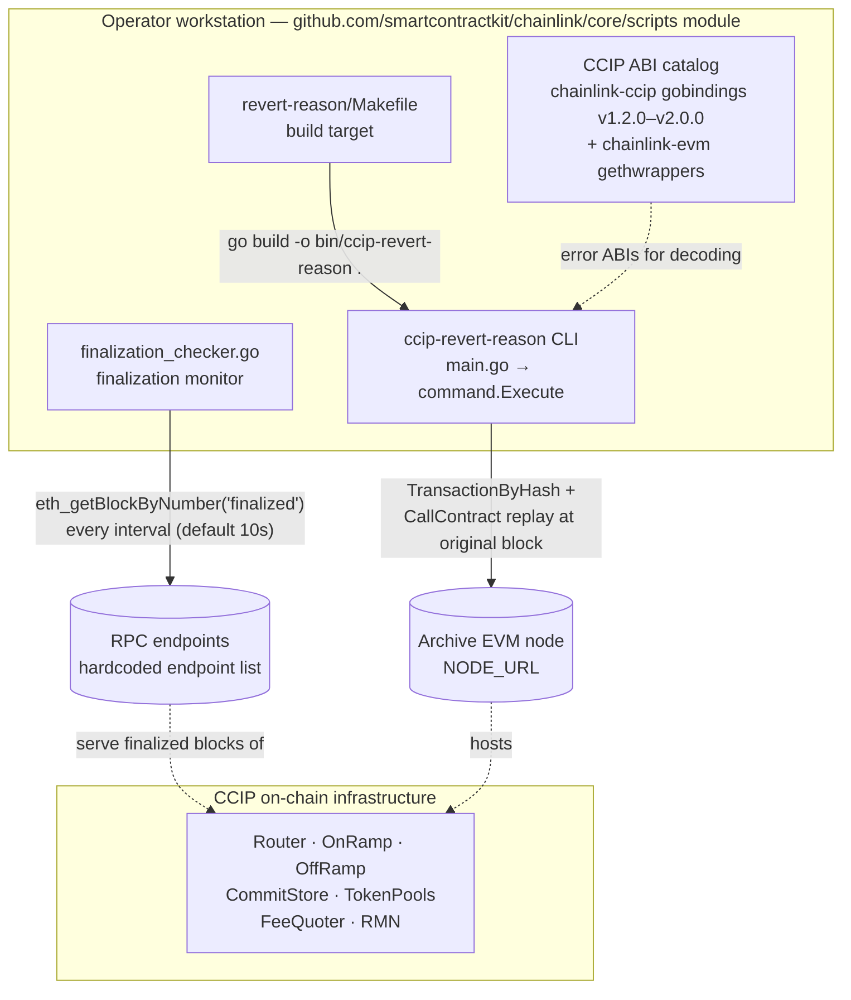
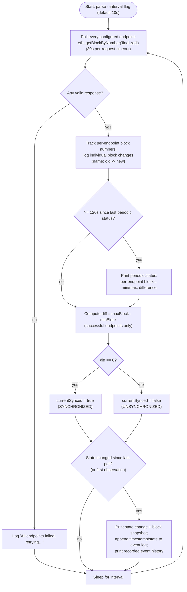
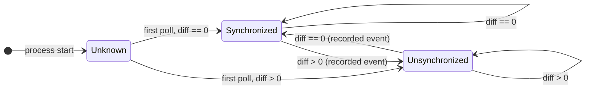
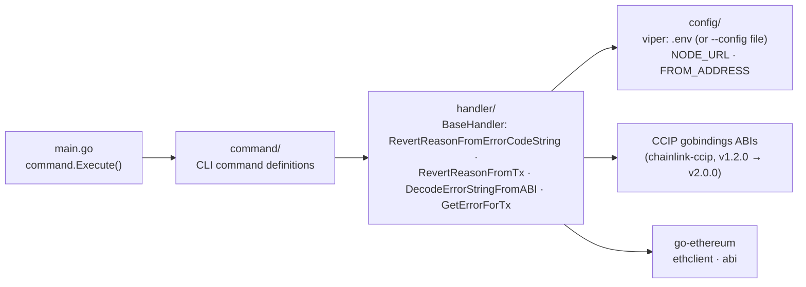
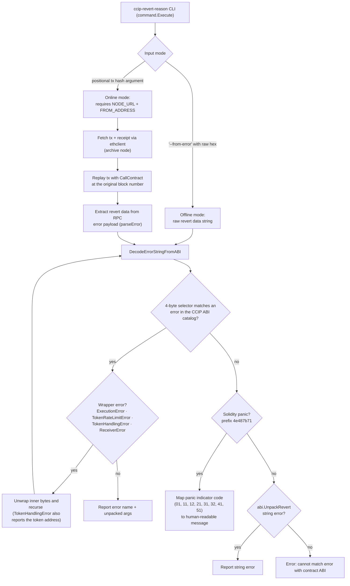
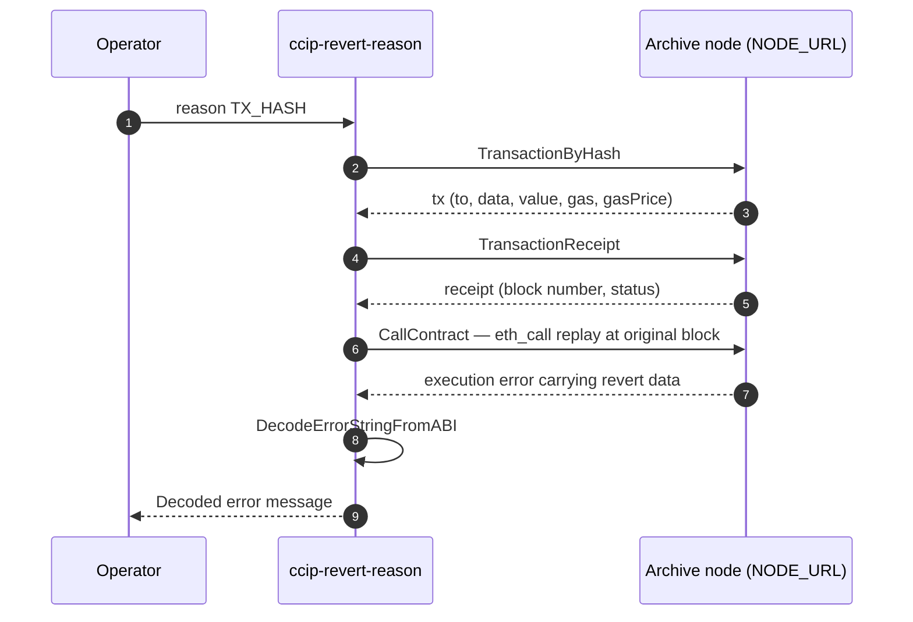

# CCIP Operations Scripts (`operations_scripts_ccip`)

> **Parent:** [Operations Scripts](../operations_scripts.md) · **Category:** [Dev, Test & Simulation Environments](../../Dev,_Test___Simulation_Environments.md)

## 1. Introduction

This module packages **standalone, operator-facing utilities for operating and debugging CCIP (Cross-Chain Interoperability Protocol) infrastructure**. The tools live under `chainlink/core/scripts/ccip/` and are *not* part of the node runtime: they are self-contained CLI programs built from the dedicated `github.com/smartcontractkit/chainlink/core/scripts` Go module and executed from an operator workstation against external EVM endpoints.

The module comprises two tools:

1. **Finalization Checker** (`finalization_checker.go`) — a long-running monitor that polls multiple EVM RPC endpoints for their *finalized* block numbers (`eth_getBlockByNumber("finalized")`), reports per-endpoint progress, and flags synchronized ↔ unsynchronized transitions. It is used to verify that the RPC providers backing a CCIP lane are consistent and healthy.
2. **CCIP Revert-Reason CLI** (`revert-reason/`) — a diagnostic tool that decodes EVM revert data against a catalog of CCIP contract ABIs (routers, on/off-ramps, token pools, fee quoter, RMN, …). It works either **offline** from a raw error hex string, or **online** by replaying a failed transaction against an archive node to recover the revert reason. The `Makefile` in this directory defines the `build` target that compiles the `ccip-revert-reason` binary.

For the protocol contracts these tools interact with (OnRamp/OffRamp/CommitStore/TokenPools/FeeQuoter/RMN), see [CCIP Cross-Chain Protocol](../../CCIP_Cross-Chain_Protocol.md); for how those contracts are deployed, see [CCIP Deployment Suite](../../CCIP_Deployment_Suite.md).

---

## 2. Module at a Glance

| Component | Location | Kind | Purpose |
|---|---|---|---|
| `BlockResponse` / `Block` | `chainlink/core/scripts/ccip/finalization_checker.go` | Go types | JSON-RPC envelope for `eth_getBlockByNumber`. `Result *Block` is a pointer so a `null` result (node not synced) is representable; `Number` carries the hex-encoded block height. |
| `Endpoint` | `chainlink/core/scripts/ccip/finalization_checker.go` | Go type | A named RPC endpoint (name + URL) under monitoring; the monitored list is hardcoded in the `endpoints` slice. |
| `getFinalizedBlockNumber` | `chainlink/core/scripts/ccip/finalization_checker.go` | Go function | Single-shot JSON-RPC query returning the finalized block number of one endpoint (30 s request timeout). |
| `main` polling loop | `chainlink/core/scripts/ccip/finalization_checker.go` | Go function | Interval-based monitor: tracks per-endpoint blocks, prints periodic status, detects and records sync-state transitions. |
| `Makefile` / `build` | `chainlink/core/scripts/ccip/revert-reason/Makefile` | Build target | Compiles the CLI: `go build -o bin/ccip-revert-reason .` |

Other entries in the same folder that are **outside** this module's core component set (listed for orientation): `ccip-revert-reason/` (a sibling CLI variant with its own `main.go` and tests), `secrets/`, `shared/`, and `debugreceiver/`.

---

## 3. Architecture

The two tools are independent binaries with no shared runtime. They consume EVM JSON-RPC endpoints externally and, in the revert-reason case, a large ABI catalog supplied by the `chainlink-ccip` Go bindings (see [build context](#6-build--runtime-context)).



**Key architectural traits**

- **Out-of-band tooling.** Neither tool links into the Chainlink node binary; both are `package main` programs under the separate `core/scripts` module. This keeps operational utilities decoupled from node releases.
- **Stateless / in-memory.** The finalization checker keeps its event history only in memory (it is lost on restart). The revert-reason CLI is entirely request-scoped.
- **Stdout-only reporting.** Neither tool integrates with telemetry/monitoring infrastructure; output is human-readable console text (see [Telemetry & Observability Platform](../../Telemetry___Observability_Platform.md) for the node's own observability stack, which these scripts do not use).

---

## 4. Finalization Checker (`finalization_checker.go`)

### 4.1 Purpose

When operating a CCIP lane it is important to know whether the RPC endpoints serving the participating chains agree on the *finalized* block height. Divergence (one provider lagging behind others) can stall oracles or cause inconsistent reads. This tool polls a set of endpoints and announces transitions between:

- **SYNCHRONIZED** — all successfully polled endpoints report the same finalized block number (`diff == 0`);
- **UNSYNCHRONIZED** — at least one endpoint's finalized block differs (`diff > 0`).

### 4.2 Data model

- `Endpoint{Name, URL}` — one entry per monitored provider. The list is **hardcoded** in the `endpoints` slice at the top of the file (marked `// MODIFY HERE THE ENDPOINTS YOU WANT TO TEST`); changing the monitored set requires editing the source and rebuilding.
- `Block{Number string}` and `BlockResponse{Result *Block}` — the JSON-RPC response envelope for `eth_getBlockByNumber("finalized", false)`. `Result` is a **pointer** because a JSON-RPC `result: null` (node not yet synced, no finalized block) must be distinguishable from a valid block. A `nil` result or an empty `Number` is treated as a failed poll for that endpoint.
- The hex block number is parsed with `fmt.Sscanf(..., "0x%x", &blockNum)`.

### 4.3 Process flow



### 4.4 Sync-state machine



Every observed transition — including the first classification after startup — is appended with a timestamp to an in-memory event log, which is re-printed in full after each change.

### 4.5 Configuration & runtime behavior

| Aspect | Value / behavior |
|---|---|
| Polling interval | `--interval` flag, seconds, **default 10** |
| Monitored endpoints | Hardcoded `endpoints` slice (edit source + rebuild to change) |
| Per-request timeout | 30 s (`context.WithTimeout` on the `http.DefaultClient` call) |
| Periodic status report | Every **120 s** regardless of state: per-endpoint blocks, min/max, difference |
| Failure handling | If *all* endpoints fail in a cycle, the tool logs and retries after the interval; individual failures (result `null`, transport error, parse error) mark that endpoint as `ERROR` in reports |
| Sync verdict scope | `min`/`max` are computed over **successfully polled** endpoints only — a failing endpoint does not by itself flip the state to unsynchronized |
| Event history | In-memory only (`timestamps` / `states` slices); lost on restart |
| Output | Stdout only — no alerting, metrics, or persistence |

### 4.6 Running

```bash
# from chainlink/core/scripts (module github.com/smartcontractkit/chainlink/core/scripts)
go run ./ccip/finalization_checker.go --interval 10
```

---

## 5. CCIP Revert-Reason CLI (`revert-reason/`)

### 5.1 Purpose

CCIP transactions can revert deep inside the contract stack (ramps, pools, fee quoter, RMN), and on-chain receipts frequently expose only the raw 4-byte-selector error payload. This CLI decodes such payloads into human-readable messages using a catalog of generated CCIP contract ABIs, and can also *recover* the revert reason of an already-mined failed transaction by re-executing it against an archive node.

### 5.2 Package layout & dependencies



The ABI catalog (`getAllABIs`) spans CCIP v1.2.0 through v2.0.0 — Router, OnRamp, OffRamp, CommitStore, TokenAdminRegistry, FeeQuoter, PriceRegistry, RMN, MessageHasher, Executor, CommitteeVerifier, CCTP verifiers/proxies, and the full family of token pools (burn/mint, lock/release, siloed, USDC, Lombard, fast-transfer variants) — plus `BurnMintERC677` and generic `ERC20`.

### 5.3 Build (the Makefile)

The module's build artifact is a minimal Makefile:

```makefile
build:
	go build -o bin/ccip-revert-reason .
```

- `make build` (run from `chainlink/core/scripts/ccip/revert-reason/`) produces `bin/ccip-revert-reason`.
- The build compiles within the `github.com/smartcontractkit/chainlink/core/scripts` Go module (see [build context](#6-build--runtime-context)), which is what pulls in the `chainlink-ccip` gobindings for the ABI catalog.

### 5.4 Decoding pipeline



Notable behaviors:

- **Recursive unwrapping.** Wrapper errors carrying inner `bytes` (e.g. CCIP `ExecutionError`) are decoded recursively until a concrete error is matched; a too-short inner payload yields `[reverted without error code]`.
- **Solidity panics.** Payloads beginning with `4e487b71` are mapped to the standard panic explanations (overflow, out-of-bounds index, etc.).
- **Archive-node requirement.** `GetErrorForTx` replays the call with `CallContract` at the receipt's block number. An archive node is mandatory; `parseError` detects a `missing trie node` failure and reports this explicitly. If the replay unexpectedly *succeeds*, the tool panics (`no error calling contract`).

### 5.5 Online (tx-hash) interaction flow



### 5.6 Configuration

Configuration is loaded with viper (`config/config.go`):

| Setting | Source | Notes |
|---|---|---|
| `NODE_URL` | `.env` file next to the binary (or a file passed via `--config`) or environment | EVM endpoint; must be archive-capable for tx-hash mode |
| `FROM_ADDRESS` | same | Address used as `From` when replaying the failed transaction |

The tool's README documents setup and usage; note that `viper.AutomaticEnv()` also accepts these values from the process environment.

### 5.7 Usage examples

```bash
# Build (or use `go run main.go` from the revert-reason directory)
make build

# Offline decode of a raw revert payload
./bin/ccip-revert-reason reason --from-error \
  "0x4e487b710000000000000000000000000000000000000000000000000000000000000032"
# → Decoded error: Assertion failure (out-of-bounds/negative index)

# Decode from a transaction hash (needs NODE_URL + FROM_ADDRESS in .env)
./bin/ccip-revert-reason reason <tx-hash>
```

---

## 6. Build & Runtime Context

Both tools compile inside the **`github.com/smartcontractkit/chainlink/core/scripts`** Go module (`chainlink/core/scripts/go.mod`, Go 1.27.1), which is deliberately separate from the node module:

- `replace` directives map `github.com/smartcontractkit/chainlink/v2` and `chainlink/deployment` back to the repository root, so scripts always build against the in-repo code.
- Key dependencies for this module: `smartcontractkit/chainlink-ccip/chains/evm` (generated gobindings supplying the revert-reason ABI catalog), `chainlink-evm` / `gethwrappers`, `chainlink-common`, and `chain-selectors`.

This mirrors the repo-wide pattern where operational and deployment tooling lives in its own module — see [Build, CI & Release Infrastructure](../../Build,_CI___Release_Infrastructure.md) for the central build system (the node's `GNUmakefile` and its `docker-ccip` image target are documented in [Chainlink Build and Tooling](../../Build,_CI___Release_Infrastructure/chainlink_build_and_tooling.md)).

---

## 7. Relationship to Other Modules

| Module | Relationship |
|---|---|
| [CCIP Cross-Chain Protocol](../../CCIP_Cross-Chain_Protocol.md) | The protocol whose contracts these tools observe. The revert-reason ABI catalog mirrors the on/off-ramp, commit-store, token-pool and fee-quoter types documented in [types-ccip](../../CCIP_Cross-Chain_Protocol/types-ccip.md), and the chain-specific codecs (e.g. EVM address/extra-data codecs) in [ccip chain codecs](../../CCIP_Cross-Chain_Protocol/ccip/ccip_chain_codecs.md). |
| [CCIP Deployment Suite](../../CCIP_Deployment_Suite.md) | Deploys the contracts whose ABIs this module decodes and whose lanes the finalization checker helps monitor. |
| [Operations Scripts](../operations_scripts.md) | Parent module grouping all `core/scripts` tooling. Siblings: [Chain Common Scripts](operations_scripts_chain_common.md) (shared chain helpers such as header types), [CRE Environment Scripts](operations_scripts_cre_environment.md), and [VRF Scripts](operations_scripts_vrf.md). |
| [Integration Tests](../integration-tests.md) | CCIP smoke tests (e.g. RMN curse/uncurse scenarios) and the `push-ccip-test-image` Makefile target live here; the finalization checker complements such test/ops runs by watching RPC-provider consistency while they execute. |
| [Dev, Test & Simulation Environments](../../Dev,_Test___Simulation_Environments.md) | The top-level category situating these operator tools alongside the other simulation and test environments. |

---

## 8. Operational Notes & Limitations

- **Finalization checker** monitors *RPC-provider agreement* on finalized blocks — it is not a chain-finality oracle. Endpoints are hardcoded in source; change them by editing the `endpoints` slice and rebuilding. Event history is not persisted.
- **Sync verdict semantics.** Because min/max are computed only over endpoints that responded in a cycle, a persistently failing endpoint is reported as `ERROR` but does not by itself trigger an unsynchronized transition.
- **Revert-reason CLI** requires the CCIP contract ABIs to be *compiled into* the binary (generated bindings from `chainlink-ccip`); newly introduced contract versions require regenerating/upgrading the bindings and rebuilding.
- Both tools print human-readable output only; for automated pipelines, parse stdout or extend the tools rather than relying on their console formatting.
