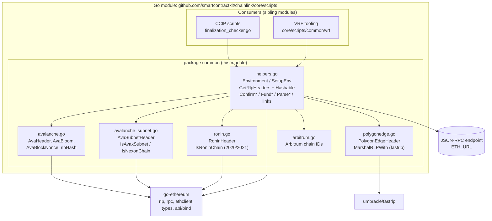
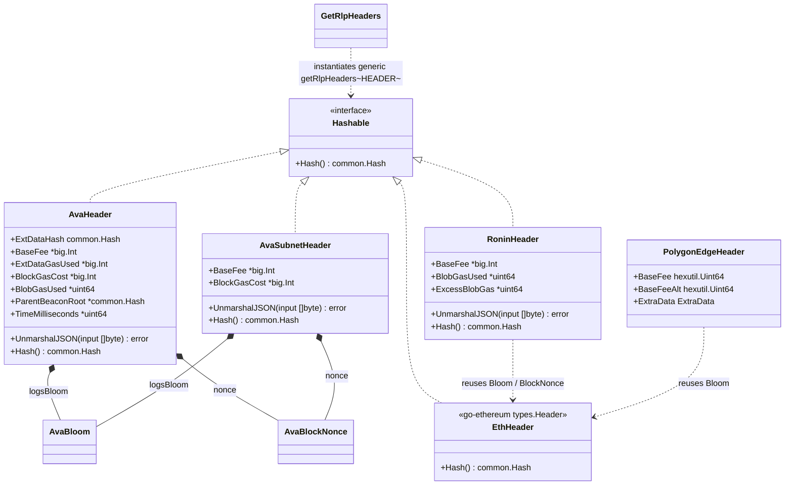
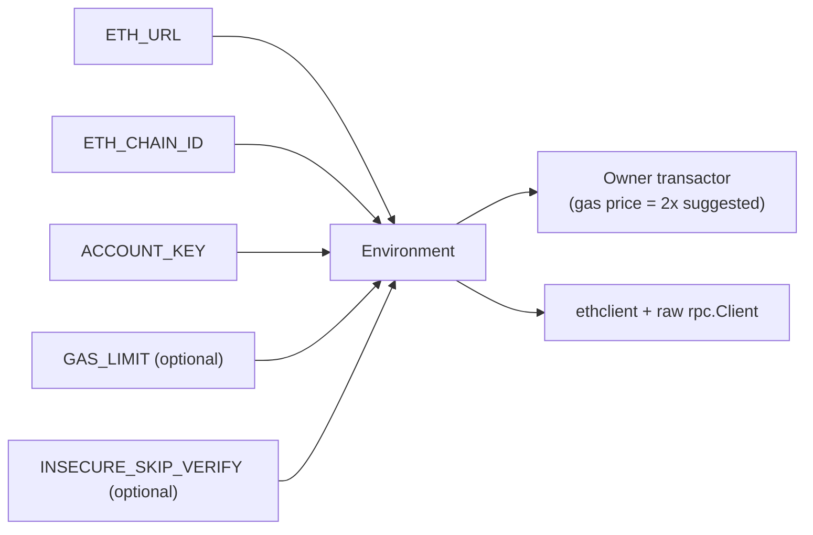
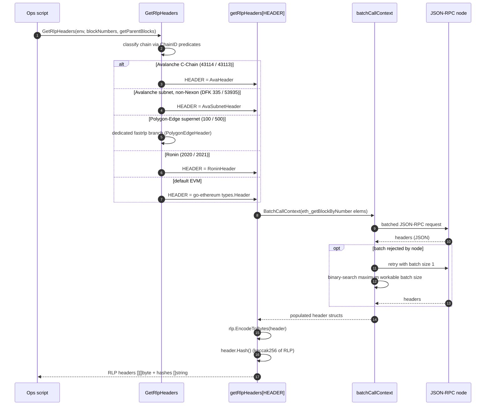
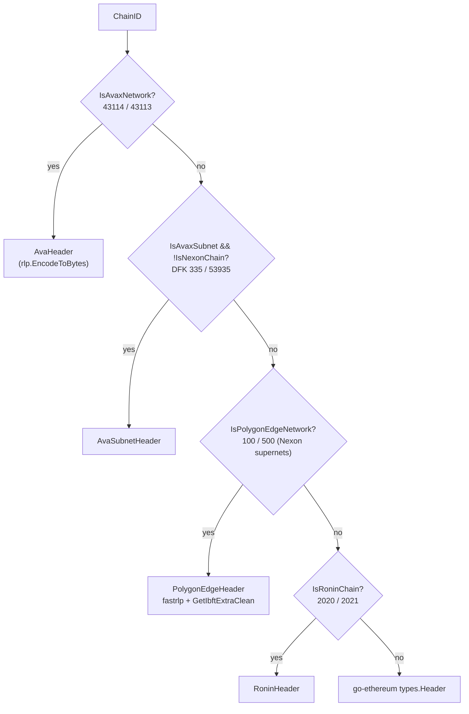
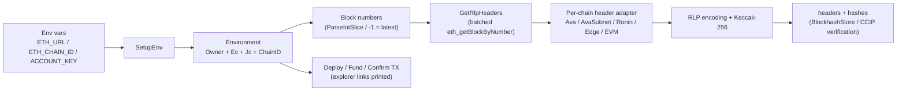

# Operations Scripts — Chain Common (`chainlink/core/scripts/common`)

> Part of the [operations scripts](../operations_scripts.md) family within
> [Dev, Test & Simulation Environments](../../Dev,_Test___Simulation_Environments.md).

## 1. Introduction

`operations_scripts_chain_common` documents the **chain-common utility package** of the operational
scripts Go module (`github.com/smartcontractkit/chainlink/core/scripts`, declared in
`chainlink/core/scripts/go.mod`). This package (`chainlink/core/scripts/common`) is the shared
foundation for standalone Go "ops scripts" that talk directly to blockchain JSON-RPC endpoints —
deploying contracts, funding nodes, fetching and hashing block headers, and confirming
transactions — outside of the Chainlink node binary itself.

Its two central concerns are:

1. **Script runtime plumbing** — bootstrapping an on-chain operating environment from environment
   variables (`Environment`/`SetupEnv`), argument parsing, transaction confirmation, node funding,
   and block-explorer link generation.
2. **Chain-agnostic block header handling** — the `Hashable` interface plus per-chain header
   adapters (`AvaHeader`, `AvaSubnetHeader`, `RoninHeader`) that let a single generic routine
   (`GetRlpHeaders`) fetch RLP-encoded block headers and recompute their Keccak-256 hashes across
   EVM-compatible chains whose header layouts differ (Avalanche C-Chain, Avalanche subnets,
   Ronin, Polygon-Edge supernets, standard EVM).

This module is deliberately **dependency-minimized by design**: instead of importing heavyweight
chain-specific client modules (ava-labs/coreth, subnet-evm, ronin-chain, polygon-edge), it vendors
small local copies of the header structs with hand-written JSON unmarshalling. This keeps the
scripts module's dependency graph (see `chainlink/core/scripts/go.mod`) free of conflicting
transitive versions.

## 2. Package Layout

| File | Responsibility |
|---|---|
| `chainlink/core/scripts/common/helpers.go` | `Environment`, `SetupEnv`, `GetRlpHeaders`, `Hashable`, TX confirmation, node funding, argument parsers, explorer links, `batchCallContext`, `CalculateLatestBlockHeader`, chain predicates `IsAvaxNetwork` / `IsPolygonEdgeNetwork` |
| `chainlink/core/scripts/common/avalanche.go` | `AvaHeader` (copy of ava-labs/coreth `types.Header`), `AvaBloom`, `AvaBlockNonce`, `rlpHash` helper |
| `chainlink/core/scripts/common/avalanche_subnet.go` | `AvaSubnetHeader` (copy of subnet-evm `types.Header`), subnet/Nexon chain-ID constants and predicates (`IsAvaxSubnet`, `IsNexonChain`) |
| `chainlink/core/scripts/common/ronin.go` | `RoninHeader` (copy of ronin-chain `Header`), `RoninChainID` (2020) / `RoninSaigonChainID` (2021), `IsRoninChain` |
| `chainlink/core/scripts/common/polygonedge.go` *(supporting)* | `PolygonEdgeHeader`, `MarshalRLPWith` (fastrlp-based), `GetIbftExtraClean` |
| `chainlink/core/scripts/common/arbitrum.go` *(supporting)* | Arbitrum chain-ID constants and `IsArbitrumChainID` (used by gas-estimation special case in `FundNode`) |

The package also ships operational deployments for the VRF product
(`chainlink/core/scripts/common/vrf/...`, documented in
[operations_scripts_vrf](operations_scripts_vrf.md)), including the
`chainlink/core/scripts/common/vrf/docker/docker-compose.yml` stack that runs five Chainlink nodes
(vrf-primary, vrf-backup, bhs, bhs-backup, bhf) plus a PostgreSQL database.

## 3. Core Components

### 3.1 `Hashable` interface (helpers.go)

```go
type Hashable interface {
    Hash() common.Hash
}
```

This is the module's key **extension point**. The generic function
`getRlpHeaders[HEADER Hashable]` works uniformly over any header type that can compute its own
hash (typically `keccak256(rlp(header))`). Implementations in this package:

| Implementation | Source chain | Notes |
|---|---|---|
| `AvaHeader` | Avalanche C-Chain (coreth) | Adds `ExtDataHash`, `ExtDataGasUsed`, `BlockGasCost`, EIP-4844 blob fields, EIP-4788 `ParentBeaconRoot`, and Granite fields (`TimeMilliseconds`, `MinDelayExcess`) |
| `AvaSubnetHeader` | Avalanche subnets (subnet-evm) | Trimmed layout: adds `BaseFee`, `BlockGasCost` only |
| `RoninHeader` | Ronin / Saigon (2020/2021) | Reuses go-ethereum `types.Bloom`/`types.BlockNonce`; adds `BaseFee`, blob fields |
| `go-ethereum/types.Header` | standard EVM chains | Used as the default adapter |
| `PolygonEdgeHeader` | Polygon-Edge supernets (chain IDs 100/500) | **Does not** implement `Hashable`; handled by a dedicated fastrlp branch in `GetRlpHeaders` |

Each adapter also implements `UnmarshalJSON` with a local `Header` mirror struct (the decode shim)
that performs strict "required field" validation on the RPC-JSON response — this mirrors the
`gencodec`-generated unmarshalling in the upstream clients without importing them.

### 3.2 Script environment (`Environment` + `SetupEnv`)

`Environment` bundles everything an ops script needs:

- `Owner *bind.TransactOpts` — the funded "owner" signer
- `Ec *ethclient.Client` — typed Ethereum client
- `Jc *rpc.Client` — raw JSON-RPC client (used for batch calls)
- `ChainID int64`

`SetupEnv(overrideNonce bool)` builds it from environment variables:

| Variable | Required | Purpose |
|---|---|---|
| `ETH_URL` | yes | JSON-RPC endpoint |
| `ETH_CHAIN_ID` | yes | Target chain ID |
| `ACCOUNT_KEY` | yes | Hex private key of the owner account |
| `GAS_LIMIT` | no | Explicit gas limit |
| `INSECURE_SKIP_VERIFY` | no | Disables TLS verification (opt-in, `#nosec G402` documented) |

Notable behaviors: gas price is set explicitly (legacy, non-EIP-1559 style) at **2× the suggested
gas price** to avoid underpriced transactions, and `overrideNonce` switches from `PendingNonceAt`
to `NonceAt` (confirmed-block nonce) for chains where pending nonces are unreliable.

### 3.3 Header fetching & hashing (`GetRlpHeaders`)

`GetRlpHeaders(env, blockNumbers, getParentBlocks) ([][]byte, []string, error)` returns RLP-encoded
headers and their hashes. When `getParentBlocks` is true it fetches the **child** block
(`blockNumber + 1`), since the child header carries the parent hash that downstream verification
logic needs (e.g. VRF BlockhashStore workflows). `CalculateLatestBlockHeader` builds on this to
print a computed vs. fetched block-hash comparison for a given block (or `-1` for latest).

### 3.4 Transaction & account helpers

- `ConfirmTXMined`, `ConfirmContractDeployed`, `ConfirmCodeAt` — wait for mining/deployment and
  print explorer links, block numbers, gas usage.
- `FundNodes` / `FundNode` — send native currency to transmitter addresses; Arbitrum chains get
  `EstimateGas`-based limits, all others use the classic `21_000` transfer limit.
- `DeployLinkToken`, `DeployLinkEthFeed` — deploy LINK and a mock v0.3 aggregator feed
  (dev/test scaffolding, complementing the contract models in
  [devenv](../devenv.md#devenv_contracts)).
- `BinarySearch` — find the largest amount for which a predicate (e.g. withdrawability) holds.
- `ParseArgs`, `ParseIntSlice`, `ParseBigIntSlice`, `ParseAddressSlice`, `ParseHashSlice`,
  `ParseHexSlice` — CLI argument plumbing with required-flag enforcement.
- `ExplorerLink`, `ContractExplorerLink`, `TenderlySimLink` — human-friendly links to Etherscan,
  Snowtrace, BscScan, PolygonScan, Arbiscan, BaseScan, zkSync, Ronin explorers and Tenderly.

## 4. Architecture

### 4.1 Component architecture



### 4.2 Type relationships



## 5. Key Workflows

### 5.1 Script bootstrap (`SetupEnv`)



### 5.2 Header fetch and RLP hashing (`GetRlpHeaders`)



Chain dispatch (including the Polygon-Edge special case, which encodes via `fastrlp` and strips
iBFT `Committed` signatures from `extraData` before hashing):



> **Nexon special case:** Nexon chain IDs (5668, 595581, 807424, 847799, 60118, 68414) are
> Avalanche subnets by classification, but are excluded from the `AvaSubnetHeader` path
> ("Nexon chain does not work with AvaSubnetHeader") because their supernets are Polygon-Edge
> networks (chain IDs 100/500) handled by the fastrlp branch.

### 5.3 Funding and confirmation

`FundNodes` iterates `FundNode` per transmitter address: resolved nonce from the confirmed block,
legacy signed transfer (Arbitrum uses `EstimateGas`, otherwise 21 000 gas), submission, then
`bind.WaitMined` — with an explorer link printed for every hop. Confirmation helpers wrap the same
pattern for arbitrary transactions and deployments.

## 6. Data Flow Summary



## 7. Dependencies

**Build/manifest context** (`chainlink/core/scripts/go.mod`):

- Dedicated Go module `github.com/smartcontractkit/chainlink/core/scripts` (go 1.27.1) — *not*
  part of the `chainlink/v2` node binary; scripts are run ad hoc (e.g. `go run`) or built by
  per-directory Makefiles (see [operations_scripts_ccip](operations_scripts_ccip.md) for the
  `revert-reason` Makefile).
- Repo-local `replace` directives to `chainlink/v2`, `chainlink/deployment`, and
  `chainlink/system-tests/lib` keep scripts aligned with in-tree libraries.
- Key external deps: `go-ethereum v1.17.4` (rlp, rpc, ethclient, abi/bind, types),
  `umbracle/fastrlp` (Polygon-Edge RLP), `shopspring/decimal` (argument parsing).

**Runtime inputs:** environment variables (Section 3.2), funded owner key, and a JSON-RPC endpoint
that supports batched `eth_getBlockByNumber`.

## 8. Relationship to Other Modules

| Module | Relationship |
|---|---|
| [operations_scripts](../operations_scripts.md) | Parent module grouping all core ops scripts |
| [operations_scripts_ccip](operations_scripts_ccip.md) | Sibling consumer — CCIP finalization checking and revert-reason tooling build on `Environment`/helpers |
| [operations_scripts_vrf](operations_scripts_vrf.md) | Sibling consumer — VRF node stack (`common/vrf/docker/docker-compose.yml`) and job tooling; the header/RLP-hash utilities underpin BlockhashStore/BlockHeaderFeeder verification |
| [operations_scripts_cre_environment](operations_scripts_cre_environment.md) | Sibling — CRE environment bring-up tooling in the same scripts module |
| [devenv](../devenv.md) | Complementary local dev environment; its [contract models](../devenv.md#devenv_contracts) overlap with `DeployLinkToken`/`DeployLinkEthFeed` scaffolding |
| [docker-dev-environments](../docker-dev-environments.md) | Alternative docker-compose based node/devnet stacks |
| [system-tests](../system-tests.md), [integration-tests](../integration-tests.md) | Heavier-weight Go test frameworks that replace ad hoc scripting for CI |
| [types-core chain contracts](../../Shared_Foundation_Libraries___Domain_Types/types-core/types-core_chain-contracts.md) | Production-grade chain interaction abstractions (BatchRead/Sequence, TxMeta) that supersede these script helpers in product code |
| [CCIP Cross-Chain Protocol](../../CCIP_Cross-Chain_Protocol/ccip.md) | Consumers of header-hash verification semantics via its job validation tooling |

## 9. Operational Notes & Caveats

- **Gas pricing:** `SetupEnv` deliberately uses legacy gas pricing at 2× the suggested price;
  scripts are not EIP-1559 aware. Adjust `GAS_LIMIT` for contract-deployment-heavy scripts.
- **Nonce strategy:** `overrideNonce=true` pins the nonce to the latest confirmed block — required
  on some chains where pending-nonce queries behave unexpectedly.
- **Child-block semantics:** `GetRlpHeaders(..., getParentBlocks=true)` returns the header of
  block `N+1`, which embeds block `N`'s hash as `parentHash`. `CalculateLatestBlockHeader` offsets
  accordingly (`-1` means "current latest block").
- **Hash parity check:** `CalculateLatestBlockHeader` prints both the locally computed Keccak hash
  and the node-reported hash — a quick sanity check that the vendored header layouts match the
  chain's actual consensus encoding.
- **RPC batching:** `batchCallContext` degrades gracefully on nodes with batch-size limits by
  binary-searching the largest acceptable batch.
- **Adding a new chain:** (1) vendor a header struct with `Hash()` and strict `UnmarshalJSON`
  satisfying `Hashable`, (2) add chain-ID constants + `IsXxx` predicate, (3) add a dispatch case in
  `GetRlpHeaders` (or a fastrlp branch if the chain's RLP differs from go-ethereum's encoder).
- **Security:** `INSECURE_SKIP_VERIFY` disables TLS verification and is intended only for local
  testnets; the code comments flag this explicitly.
