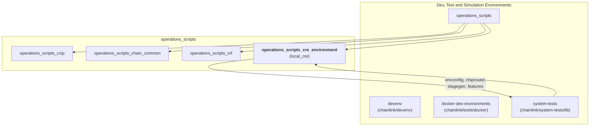
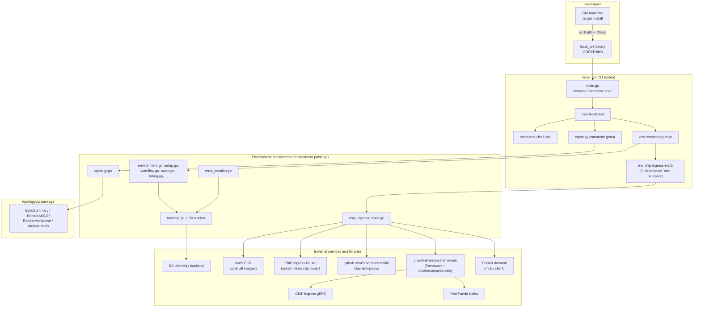
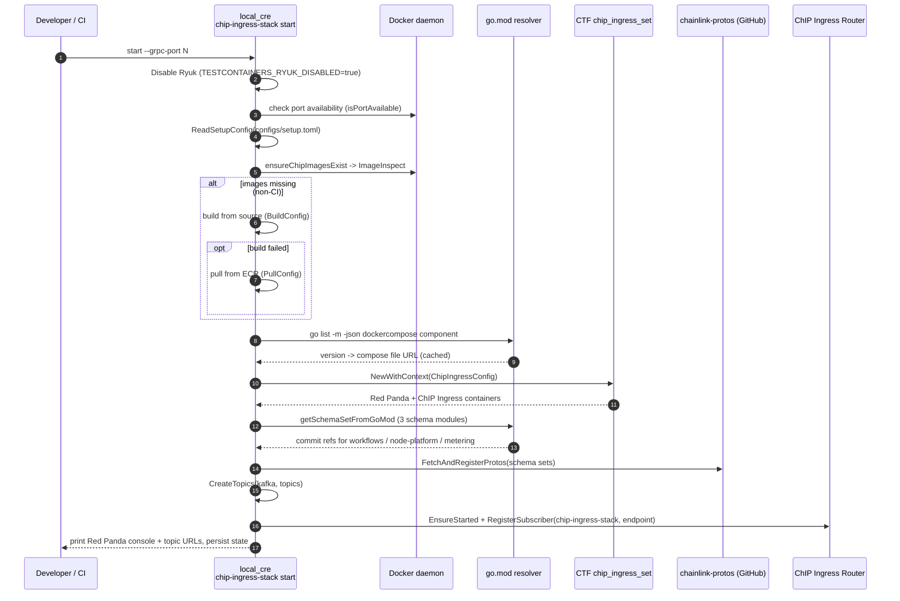
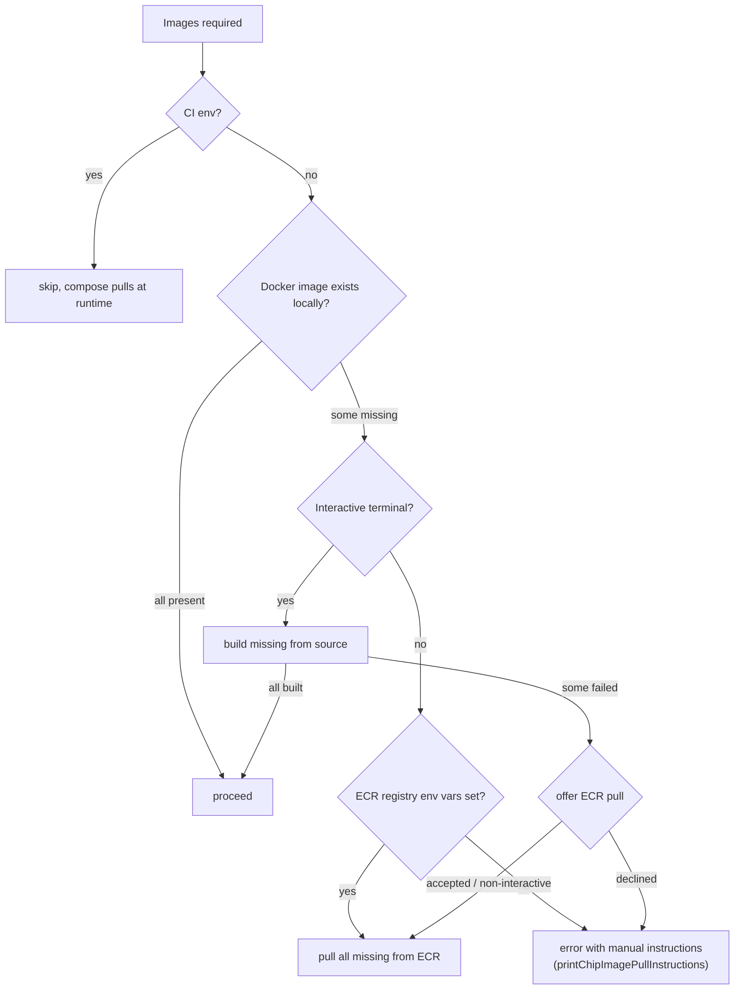
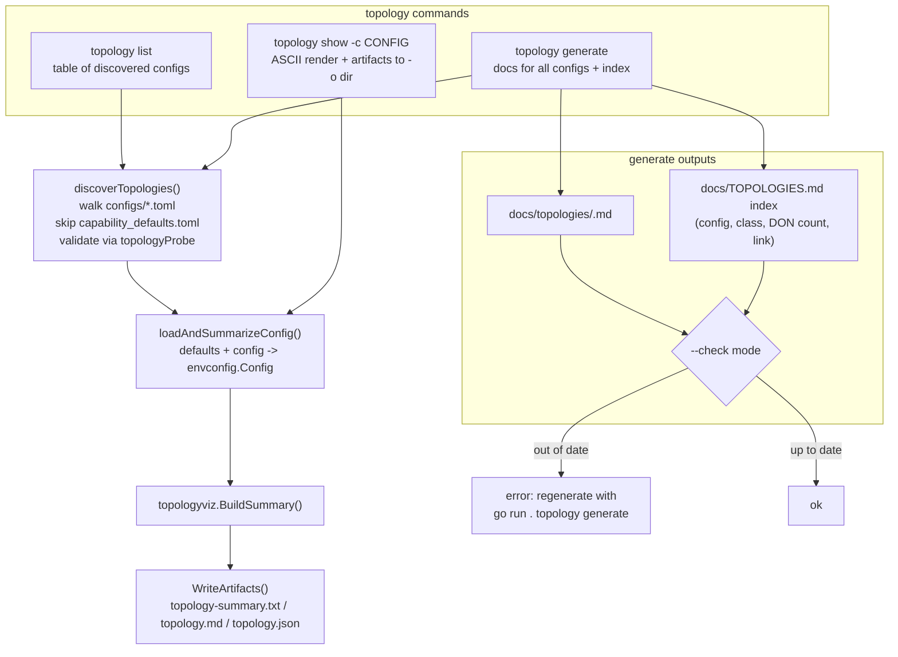

# Operations Scripts — CRE Environment (`local_cre`)

> **Module path:** `Dev,_Test___Simulation_Environments/operations_scripts/operations_scripts_cre_environment`
> **Source root:** `chainlink/core/scripts/cre/environment/` (Go module `github.com/smartcontractkit/chainlink/core/scripts`, see `chainlink/core/scripts/go.mod`)

---

## 1. Overview

The **CRE environment operations module** provides the build entry point and the core subsystems of **`local_cre`**, the interactive command-line tool that provisions, runs, inspects, and tears down a full **Chainlink Runtime Environment (CRE)** on a developer workstation or CI runner.

A "CRE environment" is a Docker-based local topology of:

- **Blockchain simulators** (e.g. geth/anvil-based devnets),
- **Node sets** — groups of Chainlink nodes organised into DONs (workflow DONs, gateway DONs, capabilities DONs),
- A **Job Distributor (JD)** for off-chain job proposal management,
- Optional **billing platform service** and **Chip Ingress telemetry stack** (Red Panda Kafka + ChIP ingress).

The module covered by this page contributes four distinct pieces:

| Piece | File(s) | Responsibility |
|---|---|---|
| Build entry point | `chainlink/core/scripts/cre/environment/GNUmakefile` | Builds and installs the `local_cre` binary into `$(GOPATH)/bin` |
| Chip Ingress stack management | `.../environment/chip_ingress_stack.go` | Lifecycle, image management, proto schema registration, Kafka topic setup and router wiring for the telemetry stack |
| Topology discovery & visualisation | `.../environment/topology.go` | Discovers, inspects, and generates documentation for DON topology TOML configs |
| Error location extraction | `.../environment/error_location.go` | Resolves a `file:line` attribution for failures, used by DX telemetry |

The remaining sub-commands of the `env` group (start/stop/status, workflow deploy, swap, state, billing) are assembled in `.../environment/environment.go` and consume the same shared infrastructure (CTF framework, system-tests libs, DX tracker) described here.

---

## 2. Position in the System

This module is a leaf of the [Operations Scripts](../operations_scripts.md) family inside the [Dev, Test & Simulation Environments](../../Dev,_Test___Simulation_Environments.md) tree. The sibling pages cover related script bundles:

- [CCIP operations scripts](operations_scripts_ccip.md) — finalization checker, revert-reason tooling.
- [Chain-common scripts](operations_scripts_chain_common.md) — header/chain helpers for avalanche, ronin, avalanche-subnet.
- [VRF operations scripts](operations_scripts_vrf.md) — 5-node VRF docker-compose stack and node model.

While the [devenv module](../devenv.md) and [docker-dev-environments module](../docker-dev-environments.md) offer scripted/docker-compose based local stacks, `local_cre` is the **fully-featured, interactive CRE environment manager** that shares its configuration model and orchestration libraries with the [CRE system-tests module](../system-tests.md).



> Note: the dependency between `local_cre` and `system-tests/lib` is a **local Go module replace** (`replace github.com/smartcontractkit/chainlink/system-tests/lib => ../../system-tests/lib` in `chainlink/core/scripts/go.mod`), so the CLI always builds against the in-repo system-tests libraries rather than a published version.

---

## 3. Architecture

### 3.1 Component Diagram



### 3.2 How the CLI is assembled

`main.go` registers the top-level command groups (`environment.EnvironmentCmd`, `environment.TopologyCmd()`, `examples.ExamplesCmd`, `environment.BsCmd`, `environment.ObsCmd`) onto `root.RootCmd` and handles two special invocations directly:

- `local_cre version` / `-v` / `--version` — prints build metadata (populated via ldflags at build time, see §4).
- `local_cre sh` / `shell` — starts the **interactive shell** after setting the default `CTF_CONFIGS=configs/workflow-gateway-don.toml`.

The `env` group (defined in `environment.go`) wires together `start`, `stop`, `status`, workflow commands, the Chip Ingress stack commands (both the current `chip-ingress-stack` and the deprecated `beholder` alias), `swap`, `state`, and `billing` sub-commands. Its `init()` also creates a local `bin/` working directory for tooling downloaded at runtime.

---

## 4. Build & Installation (`GNUmakefile`)

The Makefile (`chainlink/core/scripts/cre/environment/GNUmakefile`) exposes a single `install` target:

```makefile
install:
	go build -o $(GOPATH)/bin/local_cre -ldflags="-X main.Version=$$(git describe --tags) \
	-X main.Commit=$$(git rev-parse HEAD) -X main.Date=$$(date -u +%Y-%m-%dT%H:%M:%SZ)" .
	@if command -v asdf >/dev/null 2>&1; then \
		asdf reshim golang; \
	fi
```

Key behaviours:

1. **Version injection** — `main.Version`, `main.Commit`, and `main.Date` (declared in `main.go`) are populated via `-ldflags -X` from `git describe --tags`, `git rev-parse HEAD`, and a UTC timestamp. This is what `local_cre version` reports.
2. **Install location** — the binary is placed at `$(GOPATH)/bin/local_cre` (default `~/go`), making it available on `PATH` for the interactive shell entry point (`local_cre sh`).
3. **asdf compatibility** — when [asdf](https://asdf-vm.com) is detected, `asdf reshim golang` is run so the new binary is visible in asdf-managed shims.

The build is performed from within the `chainlink/core/scripts` Go module, whose `go.mod` (`chainlink/core/scripts/go.mod`) pins all orchestration dependencies and applies the local `replace` directives to `chainlink/v2`, `chainlink/deployment`, and `chainlink/system-tests/lib`.

This module is integrated into the wider build system via `chainlink/GNUmakefile` (see [chainlink build and tooling](../../Build,_CI___Release_Infrastructure/chainlink_build_and_tooling.md)); the `local_cre` Makefile is self-contained and only requires a working Go toolchain and Git.

---

## 5. CLI Surface

| Command group | Sub-commands | Source | Purpose |
|---|---|---|---|
| `env chip-ingress-stack` | `start`, `stop`, `create-topics`, `register-protos` | `chip_ingress_stack.go` | Manage the local telemetry ingestion stack |
| `env beholder` *(deprecated)* | same sub-commands | `chip_ingress_stack.go` | Deprecated alias of the above; prints a deprecation banner on `--help` and after every successful run |
| `topology` | `list`, `show`, `generate` | `topology.go` | Discover, inspect, and document DON topologies |
| `env` | `start`, `stop`, `status`, `swap`, `state`, `billing`, workflows | `environment.go` + friends | Full CRE environment lifecycle (documented in the Local CRE user docs) |
| *(root)* | `version`, `sh` | `main.go` | Build info and interactive shell |

---

## 6. Chip Ingress Stack Management

`chip_ingress_stack.go` manages the **Chip Ingress stack** — the local telemetry ingestion pipeline used to capture CRE/workflow, node-platform, and metering telemetry events during development and testing. The stack consists of **Red Panda (Kafka)** and the **ChIP Ingress** gRPC service, both launched as a docker-compose "test stack" via the `chipingressset` component of the chainlink-testing-framework (CTF).

The telemetry event schemas and the emitter clients that produce these events are documented in the [Chip Ingress module](../../Telemetry___Observability_Platform/chip-ingress.md) and the [Beholder telemetry module](../../Telemetry___Observability_Platform/beholder-telemetry.md); this section covers only the *local stack operations* side.

### 6.1 Lifecycle — `start`

The `env chip-ingress-stack start` command performs the following steps:



Step highlights:

1. **Pre-flight port check** — `isPortAvailable` fails fast when ChIP Router or another ChIP Ingress instance already occupies the target gRPC port, with guidance to use `--grpc-port`.
2. **CI short-circuit** — when `CI=true`, the local image pre-check is skipped and docker-compose pulls images at runtime; image-version env vars are likewise left for the workflow to set.
3. **CTF config juggling** — the command temporarily sets `CTF_CONFIGS=configs/chip-ingress.toml` (the default `DefaultChipIngressStackConfigFile`), restoring the caller's previous value on exit, because other commands use the same variable for their own configs.
4. **Compose file auto-detection** — `getComposeFileFromGoMod` runs `go list -m -json github.com/smartcontractkit/chainlink-testing-framework/framework/components/dockercompose` (with `cmd.Dir` set to the `core/scripts` module root), resolves the compose file URL for the pinned version (commit hash for pseudo-versions, version tag otherwise), downloads it with 5-attempt exponential-backoff retries, and caches it under `~/.local/share/chip_ingress_set/docker-compose-<ref>.yml`.
5. **State persistence** — the resolved output (gRPC endpoint, console URL) is stored via `in.Store(envconfig.MustChipIngressStateFileAbsPath(...))` so subsequent commands (and `reconcilePersistedChipIngressStackWithRouter`) can rediscover the running stack.

### 6.2 Proto schema registration

Before telemetry can be published, the ChIP Ingress service must know the wire schemas. `getSchemaSetFromGoMod` derives **three schema sets** from the exact `chainlink-protos` versions pinned in `chainlink/core/scripts/go.mod`:

| Schema set | Config file | Covers |
|---|---|---|
| `workflows` | `chip-cre.json` | CRE / workflow telemetry |
| `node-platform` | `chip-schemas.json` | `PluginRelayerConfigEmitter`, `common.v1.ChainPluginConfig` |
| `metering` | `chip-cll.meter.json` | Durable resource metering (`MeterRecord`, `MeterSnapshot` on the `cll.meter` domain) — without it, ChIP Ingress **silently drops** metering events with *"Subject 'cll-meter-metering.v1.MeterRecord' not found"* |

`schemaCommitRefFromGoMod` → `extractCommitRef` normalises four version formats into a Git ref usable against `https://github.com/smartcontractkit/chainlink-protos`:

1. `v1.2.1` → used as-is,
2. `v0.0.0-20211026045750-20ab5afb07e3` → short hash `20ab5afb07e3`,
3. full 40-char commit hash → used as-is,
4. `v0.0.0-YYYYMMDDHHMMSS-SHORTHASH` → extracted short hash.

`FetchAndRegisterProtos` clones the referenced commits and registers the schemas with the running ChIP Ingress instance. The standalone `register-protos` sub-command re-runs just this step against an existing stack (default `localhost:<default ChIP gRPC port>`).

### 6.3 Container image management

`ensureChipImagesExist` → `ensureManagedImagesExist` guarantees `chip-ingress` and `chip-config` images exist before start-up:



- Docker availability is verified with a `Ping` through the **moby client** (`github.com/moby/moby/client`, pinned in `chainlink/core/scripts/go.mod`).
- Pull configuration carries per-image "missing registry env vars" (`missingRegistryEnvVars`) that must be exported for ECR authentication; the remediation hints point operators to `go run . env setup` with `ECR_<...>=<registry-url>` assignments.
- Interactive detection (`isInteractiveTerminal`) distinguishes human sessions (prompt to pull instead of build) from automation (auto-pull), keeping CI logs unattended-safe.

### 6.4 Router integration and state files

The ChIP Ingress Router (provided by `system-tests/lib/cre/chiprouter`) multiplexes telemetry emitters onto ChIP Ingress endpoints:

- On `start`, if the router can be started (`chiprouter.EnsureStarted`), the stack endpoint is registered via `registerChipIngressStackWithRouter` and the returned subscriber ID is persisted to `<repo-root>/state/chip_ingress_router_chip_ingress_stack_subscriber` (mode `0600`). Any legacy beholder-named subscriber file is removed.
- On `stop`, the persisted ID (with fallback to the legacy `chip_ingress_router_beholder_subscriber` file) is used to unregister the subscriber, then state files are removed and `framework.RemoveTestStack(DEFAULT_STACK_NAME)` tears the compose stack down.
- `loadPersistedChipIngressStackState` / `reconcilePersistedChipIngressStackWithRouter` allow other commands to re-attach to a running stack from the persisted `ChipIngressConfig`.

### 6.5 Deprecation handling

`env beholder` remains as a deprecated alias of `env chip-ingress-stack`. It is constructed by `beholderDeprecatedChipIngressStackCmd` and surfaces the migration message in two ways: a banner appended to `--help` output, and a `PersistentPostRun` banner printed after any successful sub-command. Likewise, `printDeprecatedWithBeholderStartFlagBanner` warns when the legacy `--with-beholder` / `-b` flag of `env start` is used, directing users to `env start --with-chip-ingress-stack`.

### 6.6 Observability of the command itself

Every `start` invocation reports success/failure through the **DX tracker** (`dxTracker.Track(MetricChipIngressStackStart, ...)`) with a legacy `MetricBeholderStart` duplicate for continuity. Failure metadata includes a single-line error message; error *location* attribution is handled by `error_location.go` (§8).

---

## 7. Topology Discovery & Visualisation

`topology.go` implements the `topology` command group over TOML configs in `core/scripts/cre/environment/configs/`. It is the tooling behind the generated topology documentation (e.g. `docs/TOPOLOGIES.md` in the same directory).

### 7.1 Discovery model

A TOML file is recognised as a **topology config** when unmarshalling into the `topologyProbe` struct yields a valid shape:

- at least one `blockchains` entry,
- at least one `nodesets` entry (a DON),
- a `jd` (Job Distributor) section,
- an `infra` section.

`discoverTopologies` walks `configs/`, skips `capability_defaults.toml` (the shared defaults file, `defaultCapabilitiesConfigFile`), validates each candidate with the probe, and summarises it. Summary building (`topologyviz.BuildSummary`) loads each config **layered over the defaults file** (`capability_defaults.toml + <config>`), then classifies the topology (`single-don`, `multi-don`, `sharded`), extracts infra type, and per-DON details (node counts/roles, supported chains, capability placements).

### 7.2 Commands



Behaviour notes:

- **`list`** renders an ASCII table (config path, topology class, DON count) of every discoverable config.
- **`show`** defaults to `configs/workflow-gateway-don.toml`, prints the ASCII rendering and writes `topology-summary.txt` / `topology.md` (+ JSON) into the output dir (default `state`).
- **`generate`** writes one markdown file per topology under `docs/topologies/`, an index at `docs/TOPOLOGIES.md` (with relative links), and **deletes stale `*.json` targets**. With `--check`, nothing is written; instead the command exits non-zero listing out-of-date files — this is used as a drift gate in CI.
- **`generateTopologyArtifactsForLoadedConfig`** writes the same artifacts into the environment **state directory** whenever an environment starts from a config, so live runs are documented too.

The per-config TOML files (e.g. `workflow-gateway-sharded-manual.toml`, `workflow-don-solana.toml`, `workflow-gateway-don-stellar.toml`, billing/sharded/failover variants) are the canonical examples of CRE DON topologies; they are consumed at start-up by the same `envconfig.Config` loader from the [system-tests module](../system-tests.md).

---

## 8. DX Telemetry & Error Location Extraction

`error_location.go` answers one question for DX telemetry: *"which `file:line` in our code caused this failure?"* — used by `tracking.go` and other commands to attach actionable locations to failure events sent by the tracker.

Resolution strategy in `errorLocationForTracking(err error, panicStack []byte) string`:

1. **Panic stacks first** — `innermostUserFrameFromGoStack` parses `debug.Stack()` output line by line with the `goStackFileLine` regex (`\t<path>.go:<line>`), returning the first frame **not** under `/runtime/` or `/reflect/` (both Unix and Windows separators are handled). This makes reported locations reflect the *panic site*.
2. **Wrapped-error stacks second** — `errorLocationFromWrappedErrors` walks the `errors.Unwrap` chain, collects the innermost error exposing a `pkg/errors` `StackTrace()` (via the `stackTracer` interface), and formats its **innermost frame** (`frames[0]`) as `file:line` using `formatPkgErrorsFrameFileLine` (stripping the function-name line that `%+v` would print).
3. Empty result when nothing usable is found.

This complements the success/failure tracking shown in §6.6: the tracker records *what* failed and the result, while this package records *where*.

---

## 9. External Dependencies

| Dependency | Role | Pinned in |
|---|---|---|
| `chainlink-testing-framework/framework` + `components/dockercompose` (CTF) | Test-stack orchestration (`RemoveTestStack`, `Load[T]` config framework, logging), Chip Ingress set compose lifecycle | `chainlink/core/scripts/go.mod` (`v0.16.8` / `v0.1.23`) |
| `system-tests/lib/cre` (`envconfig`, `chiprouter`, `stagegen`, `libformat`, `flags`, `features`) | Config model/state files, telemetry router, staged CLI output, feature flags | local `replace` → `chainlink/system-tests/lib` (see [system-tests](../system-tests.md)) |
| `github.com/smartcontractkit/chainlink-protos` | Telemetry wire schemas, fetched at runtime by commit ref | resolved from `go list -m` |
| `moby/moby/client` | Docker image inspection / ping | `chainlink/core/scripts/go.mod` |
| `spf13/cobra` | CLI framework | `chainlink/core/scripts/go.mod` |
| `pelletier/go-toml/v2` | Topology config probing | `chainlink/core/scripts/go.mod` |
| `avast/retry-go/v4` | Retried compose-file download | `chainlink/core/scripts/go.mod` |
| Docker daemon, AWS ECR, Red Panda, ChIP Ingress, ChIP Router | Runtime services | — |

The compose files themselves (for the Chip Ingress stack, billing platform, etc.) are sourced from the CTF repository at the pinned component version rather than vendored, which is why §6.1's go.mod resolution and local caching exist.

---

## 10. Integration with Other Modules

- **[Workflow & Capability Runtime (CRE Engine)](../../Workflow___Capability_Runtime_(CRE_Engine).md)** — the environment stands up the DONs that execute workflows; `env` workflow commands deploy compiled workflow binaries against it. Topology configs decide which capabilities (cron, vault, EVM/Solana/Stellar chain capabilities, gateway) are placed on which DON.
- **[CRE & Keystone Deployment Suite](../../CRE___Keystone_Deployment_Suite.md)** — on-chain deployment of capabilities registries, forwarders, and OCR3 contracts complements the off-chain environment provisioned here; the local CRE docs reference both halves of a working setup.
- **[Telemetry & Observability Platform](../../Telemetry___Observability_Platform/beholder-telemetry.md)** — the Chip Ingress stack managed here is the local counterpart of the production ChIP ingress pipeline; emitters ([Beholder](../../Telemetry___Observability_Platform/beholder-telemetry.md)) run inside the nodes started by this environment.
- **[System tests](../system-tests.md)** — shares the entire `system-tests/lib/cre` library surface (config model, chip router, feature flags); `local_cre` is effectively the interactive front-end to the same machinery the system tests drive programmatically.
- **[Deployment environment](../deployment-environment.md)** and **[Chainlink node web SDK](../chainlink-node-web-sdk.md)** — alternative/programmatic environment tooling for job-distributor-driven setups.
- **[Build, CI & Release Infrastructure](../../Build,_CI___Release_Infrastructure/chainlink_build_and_tooling.md)** — `topology generate --check` style documentation gating is consistent with repo-wide generated-docs checks (see also the weekly docs workflow in [repo CI and docs](../../Build,_CI___Release_Infrastructure/repo_ci_and_docs.md)).

---

## 11. Operations Cookbook

```bash
# Build and install the CLI (from chainlink/core/scripts/cre/environment)
make install                       # -> $(GOPATH)/bin/local_cre, then: local_cre sh

# Chip Ingress telemetry stack
go run . env chip-ingress-stack start --grpc-port 50052
go run . env chip-ingress-stack create-topics -k localhost:9092 -t cre
go run . env chip-ingress-stack register-protos -u localhost:50051
go run . env chip-ingress-stack stop

# Legacy alias (deprecated, prints banner)
go run . env beholder start

# Topology tooling
go run . topology list
go run . topology show -c configs/workflow-gateway-sharded-don.toml -o state
go run . topology generate                 # writes docs/topologies/*.md + docs/TOPOLOGIES.md
go run . topology generate --check         # CI drift gate

# Full environment (see Local CRE docs)
go run . env start --auto-setup
go run . env stop
```

Troubleshooting quick reference:

| Symptom | Cause / Fix |
|---|---|
| `port %d is already in use` on `chip-ingress-stack start` | ChIP Router or a previous ChIP Ingress instance holds the port; pass `--grpc-port` |
| `Subject 'cll-meter-metering.v1.MeterRecord' not found` | Metering protos not registered; run `register-protos` (schema set resolution from go.mod) |
| `missing N required image(s). Set ...` | ECR registry env vars not exported and non-interactive; export them or run `go run . env setup` |
| `topology generate` CI failure | Generated docs are stale; run `go run . topology generate` and commit |
| Stranded containers after failed start | Cleanup runs automatically after `--wait-on-error-timeout`; if a panic occurred, check the manual cleanup hint for the `chip-ingress` stack |

---

## 12. Component Reference

| Component | Location | Notes |
|---|---|---|
| `GNUmakefile` / `install` | `chainlink/core/scripts/cre/environment/GNUmakefile` | Builds `local_cre` with ldflags version injection; asdf reshim |
| `moduleInfo`, `schemaCommitRefFromGoMod`, `extractCommitRef` | `.../environment/chip_ingress_stack.go` | `go list -m -json` based chainlink-protos ref resolution (4 version formats) |
| `getSchemaSetFromGoMod` | `.../environment/chip_ingress_stack.go` | 3 schema sets: `chip-cre.json`, `chip-schemas.json`, `chip-cll.meter.json` |
| `getComposeFileFromGoMod` | `.../environment/chip_ingress_stack.go` | Pinned CTF compose file resolution + `~/.local/share/chip_ingress_set` cache + retry download |
| `startChipIngressStackCmd` / `startChipIngressStack` | `.../environment/chip_ingress_stack.go` | Full start-up sequence incl. image checks, CTF config juggling, topic creation, router registration, state persistence |
| `newStopChipIngressStackCmd` / `stopChipIngressStack` | `.../environment/chip_ingress_stack.go` | Router un-registration (incl. legacy file), state cleanup, stack removal |
| `ensureChipImagesExist` / `ensureManagedImagesExist` | `.../environment/chip_ingress_stack.go` | Image presence checks; interactive build vs ECR pull strategy |
| `beholderDeprecatedChipIngressStackCmd` | `.../environment/chip_ingress_stack.go` | Deprecated `env beholder` alias with help/post-run banners |
| `loadPersistedChipIngressStackState` / `restorePersistedChipIngressStackState` / `reconcilePersistedChipIngressStackWithRouter` | `.../environment/chip_ingress_stack.go` | State-file based re-attachment to a running stack |
| `TopologyCmd` (`list` / `show` / `generate`) | `.../environment/topology.go` | Discovery via `topologyProbe`, summarising via `topologyviz`, docs generation with `--check` gate |
| `errorLocationForTracking` / `errorLocationFromWrappedErrors` | `.../environment/error_location.go` | `file:line` attribution from panic stacks and pkg/errors unwrap chains |
| `BuildSummary` / `WriteArtifacts` / `RenderASCII` / `RenderMarkdown` | `.../topologyviz/topologyviz.go` | Topology classification (`single-don` / `multi-don` / `sharded`) and artifact rendering |
| `EnvironmentCmd` registry | `.../environment/environment.go` | Assembles `env` group; owns `dxTracker`, `bin/` dir, cleanup messages |
| `main` / version / `sh` | `.../main.go` | Root wiring, ldflags version vars, interactive shell default config |
