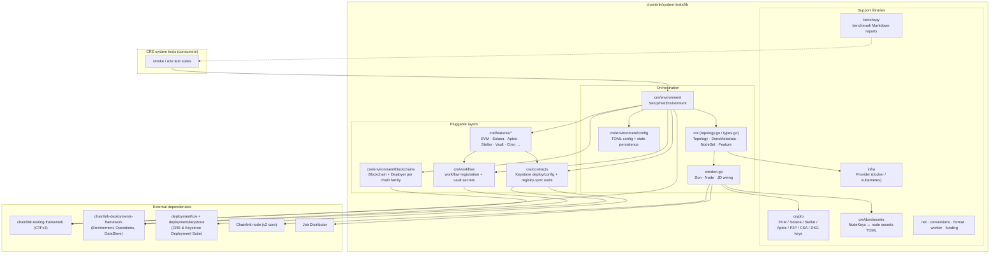
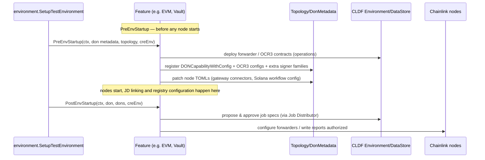

# System Tests Library (`chainlink/system-tests/lib`)

## 1. Overview

The `system-tests` module is a dedicated Go module (`github.com/smartcontractkit/chainlink/system-tests/lib`, Go 1.27.1, defined in `chainlink/system-tests/lib/go.mod`) that provides the **framework for building, starting and asserting against complete local CRE (Chainlink Runtime Environment) test environments**. Whereas [devenv](devenv.md) provisions lightweight per-product dev clusters and [integration-tests](integration-tests.md) hosts the historical cross-chain smoke suites, this library is the *programmable environment engine* used by the CRE system tests: it boots blockchain networks, deploys Keystone contracts, wires a Job Distributor (JD), generates node keys and TOML configs, starts Chainlink node fleets, installs "capability features", deploys workflows, and reports on benchmark results.

Key capabilities:

- **Multi-chain simulation** — deploys and funds EVM, Solana, Aptos, Stellar and Tron devnets through pluggable per-family `Deployer` implementations.
- **DON topology modelling** — declarative TOML-driven topologies of DONs (workflow / capabilities / gateway / shard / bootstrap DONs) with automatic key generation, gateway pairing and shard validation.
- **Job Distributor integration** — registers nodes, creates JD chain configs, proposes and approves job specs via the [chainlink node web SDK](chainlink-node-web-sdk.md) and the deployment framework's offchain client.
- **Pluggable capability features** — a `Feature` interface (`PreEnvStartup` / `PostEnvStartup` hooks) implemented per chain or service (EVM, Solana, Aptos, Stellar, Vault, Cron, …).
- **Workflow lifecycle support** — workflow binary registration, vault secret encryption/upload, and DB-level polling for capability-registry/OCR config propagation.
- **Benchmark reporting** — `benchspy` renders historical benchmark JSON results into Markdown bar-chart reports.

> The tests that *consume* this library (e.g. `chainlink/system-tests/smoke/**`) are intentionally not part of this documentation scope; this page covers the reusable library under `lib/`.

## 2. Architecture

### 2.1 Layered view

The library sits on top of the **Chainlink Testing Framework (CTFv2)** (external module `chainlink-testing-framework`), which provides the Docker/Kubernetes component primitives (blockchain containers, `clnode` outputs, JD container, postgres, chip router, fake services). Everything above it is orchestration owned by this module.

### 2.2 Module identity & build

The single `go.mod` at `chainlink/system-tests/lib` defines the module and pins its relationships to the monorepo:

- `replace github.com/smartcontractkit/chainlink/v2 => ../../` and `replace .../chainlink/deployment => ../../deployment` — the library always builds against the local core and deployment suites, so tests exercise the code under review.
- `replace github.com/ugorji/go/codec => ...v1.2.12` — a pin working around an incompatibility between `chainlink-evm`'s generated codecgen and the version pulled transitively by `mcms`.
- Notable dependencies: `chainlink-testing-framework/framework` (CTFv2 components), `chainlink-deployments-framework` (CLDF operations/datastore), `chainlink-evm/gethwrappers` (Keystone contract bindings), `chainlink-protos/job-distributor`, plus chain SDKs (`gagliardetto/solana-go`, `aptos-labs/aptos-go-sdk`, `go-stellar-sdk`, `fbsobreira/gotron-sdk`) and `k8s.io/client-go` for the Kubernetes provider.

Because the module depends on how the repo is built and configured, keep it aligned with the tooling described in [chainlink build and tooling](../Build,_CI___Release_Infrastructure/chainlink_build_and_tooling.md).

## 3. Environment startup lifecycle

The entry point is `environment.SetupTestEnvironment` (`lib/cre/environment/environment.go`). It executes a strict, stage-logged pipeline; the pluggable `Feature` and `Deployer` layers are invoked at well-defined points.

```mermaid
flowchart TD
    A["Start Chip Router<br/>(CTFv2 component)"] --> B["Start blockchains<br/>blockchains.Start + family Deployers"]
    B --> C["Deploy Keystone contracts<br/>(Workflow Registry + Capabilities Registry)<br/>cre/contracts"]
    C --> D["Build Topology<br/>cre.NewTopology → DonMetadata, node keys,<br/>gateway pairing, shard validation"]
    D --> E["Prepare node TOMLs<br/>donconfig.PrepareNodeTOMLs"]
    E --> F["Feature.PreEnvStartup<br/>(per feature × per DON)<br/>deploy forwarders, build capability<br/>registrations, patch node TOML"]
    F --> G["Start Job Distributor + DONs<br/>in parallel (lib/worker queue)"]
    G --> H["Link DONs to JD<br/>cre.LinkToJobDistributor:<br/>register nodes, create JD chain configs"]
    H --> I["Create gateway jobs +<br/>(deprecated) InstallableCapability job specs"]
    I --> J["Fund nodes<br/>(per chain family amounts)"]
    J --> K["Configure Capabilities Registry<br/>DONCapabilityWithConfigs from features,<br/>resolve contract DON IDs"]
    K --> L["Configure Workflow Registry<br/>(owners, allowed DONs, families)"]
    L --> M["Feature.PostEnvStartup<br/>(per feature × per DON)<br/>propose/approve jobs, configure forwarders,<br/>vault OCR3 + DKG contracts"]
    M --> N["Sharding setup<br/>(only if topology enables shards)"]
    N --> O["Persist state to TOML<br/>(workflow registry, chip ingress, billing)<br/>→ SetupOutput"]
```

Failure handling is deliberately explicit: JD and DON startup run concurrently through `lib/worker` futures, and if both fail the error that is not `context.Canceled` is surfaced as the root cause.

The `Feature` contract that plugs into stages **F** and **M** is central to the design:

## 4. Sub-modules

The library is split into the following documented sub-modules:

| Sub-module | Scope | Documentation |
| --- | --- | --- |
| **CRE environment & infrastructure** | TOML environment config + state persistence (`config.Config`, `ChipIngressConfig`, `BillingConfig`), multi-chain deployment abstraction (`Blockchain`, `Deployer`, `Start`), and the Docker/Kubernetes `infra.Provider` host/URL model. | [system-tests_cre_environment](system-tests/system-tests_cre_environment.md) |
| **Topology, DONs & node management** | Core domain types (`Topology`, `Don`, `Node`, `NodeSet`, `DonsMetadata`, capability flags/scope), node↔JD wiring (`LinkToJobDistributor`, JD chain configs, job-proposal helpers) and the key material stack (`crypto`, `don/secrets`). | [system-tests_cre_topology_nodes](system-tests/system-tests_cre_topology_nodes.md) |
| **Capability features** | The `Feature` plug-in implementations: EVM (v2), Solana (v2), Aptos, Stellar, Vault and Cron — each defining its capability registration, OCR3/forwarder contracts and job specs. | [system-tests_cre_capability_features](system-tests/system-tests_cre_capability_features.md) |
| **Workflow deployment & propagation** | Workflow registration against the Workflow Registry v2 contract, vault secret encryption/upload, and readiness polling of the `registry_syncer_states` snapshot in each node's database. | [system-tests_cre_workflow_deployment](system-tests/system-tests_cre_workflow_deployment.md) |
| **Benchmark reporting (benchspy)** | Rendering historical benchmark JSON runs (direct & Prometheus query executors) into grouped/ungrouped Markdown bar-chart reports via `MetricConfig`. | [system-tests_benchspy](system-tests/system-tests_benchspy.md) |

## 5. How it fits into the wider system

- **[CRE & Keystone Deployment Suite](../CRE___Keystone_Deployment_Suite.md)** — the primary upstream dependency. `lib/cre/contracts` and the features drive `chainlink/deployment/cre` (forwarders, OCR3, workflow registry) and `chainlink/deployment/keystone/changeset` operations/sequences through CLDF `operations.ExecuteOperation/ExecuteSequence`; contract addresses are tracked in the CLDF `DataStore` (see `deployment-environment` helpers such as [`JobApprover`](deployment-environment.md) and the [node web SDK](chainlink-node-web-sdk.md) used by `don.go` for GraphQL node access).
- **[Node Application Core & Interfaces](../Node_Application_Core___Interfaces.md)** — node TOML/secret files produced here are unmarshalled into `v2/core/services/chainlink.Config` / `v2/core/config/toml` types (e.g. `Solana.Workflow`, `Capabilities.GatewayConnector`, `WorkflowRegistry` sections), and node clients talk to the [web API](../Node_Application_Core___Interfaces/web_api.md) of running nodes.
- **[Shared Foundation Libraries](../Shared_Foundation_Libraries___Domain_Types.md)** — capability registration payloads use `chainlink-common/pkg/capabilities/pb` (`CapabilityConfig`, `MethodConfigs`, `RemoteTriggerConfig`); vault secrets use `chainlink-common/pkg/capabilities/actions/vault` and TDH2 encryption; chain identity uses `chain-selectors`.
- **[Docker dev environments](docker-dev-environments.md)** — CTFv2 starts Dockerised chains and nodes analogous to (but independently of) the compose files under `chainlink/tools/docker`; the Kubernetes provider instead deploys via Helm-backed naming conventions encoded in `infra.Provider`.
- **[Telemetry & Observability Platform](../Telemetry___Observability_Platform.md)** — the environment can start a Chip Ingress stack and billing platform service (`ChipIngressConfig`, `BillingConfig`) so workflow metering/chip telemetry can be asserted in tests.

## 6. Conventions & gotchas

- **State files**: environment setup persists restartable state (node sets, blockchain outputs, JD output, workflow registry config) as TOML under `core/scripts/cre/environment/state/` (`local_cre.toml`, `chip_ingress.toml`, `billing-platform-service.toml`, `workflow_registry.toml`). Loading is process-safe (`CTF_CONFIGS` env var is swapped under a mutex and restored), and `host.docker.internal` references are rewritten to the framework's host gateway on load.
- **Key material**: every node key is generated fresh (or imported from a previous run's encrypted secrets TOML). One bootstrap node per topology is a hard requirement; shard indexes must be sequential starting at 0.
- **Idempotency**: JD chain-config creation and node registration tolerate duplicates (unique-violation / `DuplicateFeedsManagerError`), making re-runs safe.
- **Deprecated path**: the `InstallableCapability` interface is superseded by `Feature`; it is still honoured in `SetupTestEnvironment` but slated for removal.
