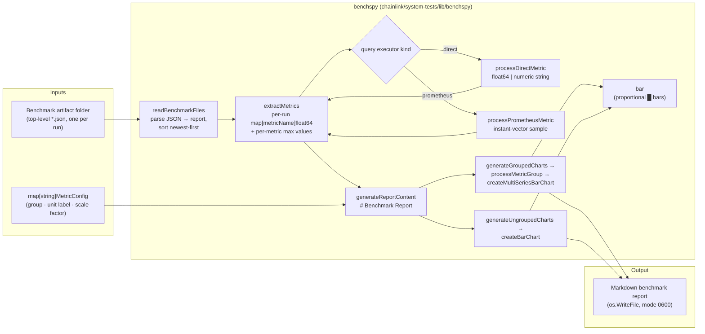
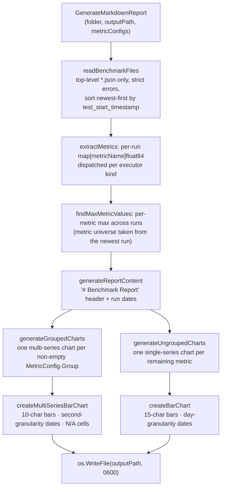
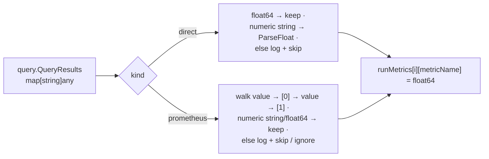
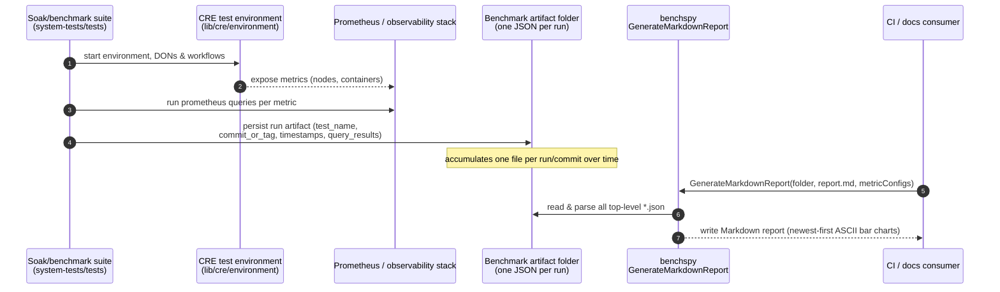

# Benchmark Reporting (benchspy)

## 1. Introduction

`system-tests_benchspy` is the **benchmark-reporting pillar** of the [system-tests library](../system-tests.md). It is a single, deliberately tiny Go package — `benchspy` at `chainlink/system-tests/lib/benchspy/markdown_reporter.go` — that **post-processes historical benchmark result files into a human-readable Markdown report** with ASCII bar charts.

Its role in the testing workflow is the *last mile* of performance testing: while the soak and benchmark suites ([system-tests_cre_environment](system-tests_cre_environment.md)) boot CRE environments and expose metrics, and the test tooling executes queries against them (direct database/value queries or Prometheus instant queries), `benchspy` is the offline renderer that turns the accumulated per-run JSON artifacts into a single trend report across runs and commits.

Key characteristics:

- **One public entry point** — `GenerateMarkdownReport(folder, outputPath, metricConfigs)` — plus one exported configuration type, `MetricConfig`. Everything else is internal.
- **Standard-library only** — the package imports nothing outside Go's standard library, so it adds zero dependency weight to the [module](#22-module-identity--build) (the module-level pins in `chainlink/system-tests/lib/go.mod` serve the rest of the library).
- **Two result formats supported** — benchmark artifacts may carry results produced by `"direct"` query executors (plain numbers / numeric strings) or `"prometheus"` query executors (Prometheus instant-vector samples).
- **Grouped and ungrouped rendering** — metrics sharing a `MetricConfig.Group` are combined into one multi-series chart; all remaining metrics get their own single-series chart.

## 2. Architecture

### 2.1 Component & data-flow view

The package is a pure, stateless pipeline: a folder of JSON artifacts and a metric-configuration map go in, a Markdown file comes out.



### 2.2 Module identity & build

`benchspy` is a package of the dedicated Go module `github.com/smartcontractkit/chainlink/system-tests/lib` (Go 1.27.1, defined in `chainlink/system-tests/lib/go.mod`). Relevant facts from the manifest:

- The module pins local monorepo relationships — `replace github.com/smartcontractkit/chainlink/v2 => ../../` and `replace .../chainlink/deployment => ../../deployment` — and works around a `ugorji/go/codec` incompatibility. **None of these affect `benchspy` itself**: the package compiles with only `encoding/json`, `fmt`, `os`, `path/filepath`, `sort`, `strconv`, `strings` and `time`, making it trivially portable and testable in isolation.
- The test suites that run soak/benchmark scenarios live in the sibling module `chainlink/system-tests/tests` (see `chainlink/system-tests/tests/go.mod`), which wires the library in with `replace github.com/smartcontractkit/chainlink/system-tests/lib => ../lib`.

Because the surrounding module's build is tied to the repo toolchain, keep it aligned with the conventions in [chainlink build and tooling](../../Build,_CI___Release_Infrastructure/chainlink_build_and_tooling.md).

## 3. Public API

### 3.1 `GenerateMarkdownReport`

```go
func GenerateMarkdownReport(folder string, outputPath string, metricConfigs map[string]MetricConfig) error
```

The exported orchestrator. It:

1. Reads every top-level `*.json` file in `folder` (non-recursive; directories and other suffixes are skipped) and parses each into a `report`, sorting runs **newest-first** by `test_start_timestamp`.
2. Extracts a `map[string]float64` of metrics per run (see §5.2) and the per-metric maximum across all runs.
3. Assembles the Markdown document: grouped multi-series charts first, then ungrouped single-series charts (§5.3).
4. Writes the result to `outputPath` with `0600` permissions (overwriting any existing file).

Error handling is *strict at the file level*: a directory that cannot be read, a file that cannot be read, or a JSON document that cannot be parsed aborts report generation with a wrapped error. Malformed *individual metric values* are not fatal — they are logged to stdout and skipped (§4.3).

### 3.2 `MetricConfig`

`MetricConfig` is the only tunable surface and drives both grouping and display:

| Field | Type | Purpose |
| --- | --- | --- |
| `Group` | `string` | Metrics sharing a non-empty group are rendered together in one multi-series chart titled with the group name (e.g. `"Latency"`, `"Memory"`). An empty group means the metric gets its own single-series chart. |
| `UnitLabel` | `string` | Suffix appended to each displayed value (e.g. `"s"`, `"MiB"`, `"ms"`). |
| `ScaleFactor` | `float64` | Divisor applied to the raw value for display — e.g. `1000.0` converts stored milliseconds to seconds, `1024*1024` converts bytes to MiB. Values `<= 0` are silently coerced to `1.0` to avoid division by zero. |

Note that grouping is *configuration-driven, not data-driven*: a group only appears in the report if at least one of its metrics exists in the data, and only the metrics actually present are charted.

## 4. Input artifact format

### 4.1 The `report` JSON schema

The unexported `report` struct defines the on-disk contract for each benchmark artifact (one JSON file per test run):

| JSON field | Go type | Meaning |
| --- | --- | --- |
| `test_name` | `string` | Name of the test / benchmark scenario. |
| `commit_or_tag` | `string` | Code revision the run was produced from. |
| `test_start_timestamp` | `time.Time` | Run start — used for report ordering and the chart `Date` column. |
| `test_end_timestamp` | `time.Time` | Run end. |
| `query_executors` | `[]{kind string, query_results map[string]any}` | The query executors that ran during the benchmark, each contributing named metric results. |

A minimal artifact:

```json
{
  "test_name": "Test_CRE_CacheSoak",
  "commit_or_tag": "abc1234",
  "test_start_timestamp": "2026-01-15T03:04:05Z",
  "test_end_timestamp": "2026-01-15T07:04:05Z",
  "query_executors": [
    {
      "kind": "prometheus",
      "query_results": {
        "node_rss_bytes": { "value": [1768448645.1, "536870912"] }
      }
    },
    {
      "kind": "direct",
      "query_results": {
        "registered_workflows": 20
      }
    }
  ]
}
```

The artifacts are produced by the benchmarking tooling used by the soak/benchmark suites (e.g. under `chainlink/system-tests/tests/soak/cre`, which run long-lived CRE environments from the [CRE test environment](system-tests_cre_environment.md) and sample both direct values and the Prometheus/observability stack).

### 4.2 Query executor result shapes

- **`kind: "direct"`** — the value is either a `float64` or a *string containing a number* (parsed with `strconv.ParseFloat`). The value is stored as-is under the metric name.
- **`kind: "prometheus"`** — the value follows the Prometheus HTTP API instant-query shape for a single sample: a map with a `"value"` key holding a `[timestamp, "value"]` vector, i.e. `{"value": [<unix_ts>, "<numeric string>"]}`. The parser walks `metric → "value" → [0] → "value" → [1]` and parses the sample value as a numeric string or `float64`.

### 4.3 Parsing tolerance

Value-level problems never fail the report; they are reported to stdout and skipped:

- unsupported value types (`fmt.Printf("Metrics %s: unexpected value type: %T\n", …)`),
- numeric strings that fail `ParseFloat`.

Structural problems in the Prometheus nesting (missing keys / wrong shapes) are likewise ignored — the metric is silently absent from that run.

## 5. Report generation pipeline

### 5.1 Process flow



### 5.2 Metric extraction dispatch

For each run, `extractMetrics` iterates the run's `query_executors` and switches on `kind`:



After extraction, `findMaxMetricValues` computes the maximum value of every metric across all runs. These maxima are the bar-length normalisation basis shared by all charts, so bars are comparable across runs *within a metric column* (each column scales against its own maximum, not a global one).

### 5.3 Chart rendering rules

| Aspect | Grouped (multi-series) | Ungrouped (single-series) |
| --- | --- | --- |
| Title | The `MetricConfig.Group` name (`## <group>`) | `## Metric: <name>` |
| Table columns | `Date` + one column per metric (header = metric name) | `Date` + `Value` |
| Date format | `2006-01-02 15:04:05` | `2006-01-02` |
| Bar width | 10 characters (`█` fill, space padding) | 15 characters |
| Missing values | Rendered as `N/A` | Arrays assumed aligned (same length) |
| Displayed value | `raw / ScaleFactor`, `%.3f`, followed by `UnitLabel` | same |

Bar rendering (`bar`) is proportional to `value/maxValue` with an epsilon guard (`maxValue <= 0.000001` → blank bar). `createBarChart` additionally recomputes the maximum with 20 % head-room padding if it receives a non-positive maximum — relevant only for direct callers, since `GenerateMarkdownReport` always passes precomputed maxima.

A rendered report looks like:

```markdown
# Benchmark Report

## Latency

| Date | p95_workflow_execution_ms | trigger_to_report_ms |
| --- | --- | --- |
| 2026-01-15 03:04:05 | ██████████ 1.234s | ███████ 0.890s |
| 2026-01-14 03:04:05 | █████████ 1.101s | ██████ 0.845s |

## Metric: registered_workflows

| Date       | Value |
| --- | --- |
| 2026-01-15 | ███████████████ 20.000 |
| 2026-01-14 | ███████████████ 20.000 |
```

## 6. End-to-end reporting workflow



In practice the report is the artifact that lets maintainers compare resource consumption (memory, CPU) and latency trends of CRE workflow execution across commits — the same metrics the soak tests assert against at run time (see the soak suites under `chainlink/system-tests/tests/soak/cre`, e.g. `resource_consumption_test.go` and `workflow_caching_test.go`, which sample Prometheus metrics from an environment built by the [CRE test environment](system-tests_cre_environment.md)).

## 7. Usage example

```go
import "github.com/smartcontractkit/chainlink/system-tests/lib/benchspy"

err := benchspy.GenerateMarkdownReport(
    "artifacts/benchmarks",          // folder with one *.json per run
    "artifacts/benchmarks/report.md",// output report
    map[string]benchspy.MetricConfig{
        "p95_workflow_execution_ms": {Group: "Latency", UnitLabel: "s",   ScaleFactor: 1000.0},
        "trigger_to_report_ms":      {Group: "Latency", UnitLabel: "s",   ScaleFactor: 1000.0},
        "node_rss_bytes":            {Group: "Memory",  UnitLabel: "MiB", ScaleFactor: 1024 * 1024},
        "registered_workflows":      {Group: "",        UnitLabel: "",    ScaleFactor: 1.0},
    },
)
```

Metrics present in the data but missing from `metricConfigs` are treated as ungrouped (default unit, scale `1.0`); conversely, configured metrics absent from the data are simply not charted.

## 8. Conventions & gotchas

- **The newest run defines the metric universe.** Runs are sorted newest-first, and both `findMaxMetricValues` and the grouped/ungrouped selection iterate the keys of `runMetrics[0]` (the newest run). A metric that only appears in older artifacts is dropped from the report and from max normalisation.
- **Strict files, lenient values.** Any unreadable or unparseable `*.json` fails the whole report; malformed individual values are only logged to stdout and skipped. Keep artifacts valid.
- **Non-recursive scan.** Only top-level `*.json` files are read; nested directories and other extensions are ignored.
- **Metric-name collisions.** Within one run, if multiple executors (or multiple `query_results` entries) emit the same metric name, later assignments overwrite earlier ones — and iteration over a `map[string]any` makes the winner nondeterministic. Keep metric names unique per run.
- **Nondeterministic ordering.** Group column order and ungrouped chart order derive from Go map iteration, so they may differ between invocations of the same input.
- **Bar scaling is per-metric.** Each metric's bars scale against that metric's own maximum (across runs), not a shared axis — cross-metric bar comparison within a grouped chart is not meaningful.
- **Non-positive scale factors** are silently replaced by `1.0`; non-positive maxima produce blank bars (epsilon guard at `1e-6`); negative values never fill a bar and never raise the maximum.
- **Output is overwritten** with `0600` permissions; make sure `outputPath` is not a file you need to preserve.
- **Date granularity differs**: day-level in single-series charts (safe for daily regression runs) vs. second-level in grouped charts (multiple runs per day are distinguishable there).

## 9. How it fits into the wider system

- **[system-tests (parent library)](../system-tests.md)** — `benchspy` is the last of the library's support pillars ("Benchmark reporting"), alongside the environment, topology, feature and workflow sub-modules. It is intentionally decoupled from them: it reads files, not live environments.
- **[CRE test environment](system-tests_cre_environment.md)** — the environments whose metrics feed benchmark artifacts are provisioned here (Docker/Kubernetes chains, DONs, Job Distributor); Prometheus-based result kinds presuppose an observability substrate monitoring those environments.
- **[Telemetry & Observability Platform](../../Telemetry___Observability_Platform.md)** — the `"prometheus"` executor results consumed by `benchspy` originate from Prometheus-compatible monitoring; the same stack family is described there and, for local development, in the [Docker observability stack](../docker-dev-environments/docker-dev-environments_observability-stack.md).
- **Soak / benchmark suites** — the actual producers and consumers of artifacts live in `chainlink/system-tests/tests` (a separate Go module that replaces the `lib` module locally); this page's package is their reporting backend.
- **[devenv](../devenv.md) / [integration-tests](../integration-tests.md)** — sibling environment modules with their own purposes (per-product dev clusters, historical cross-chain smoke suites); `benchspy` is specific to the CRE system-tests library.
