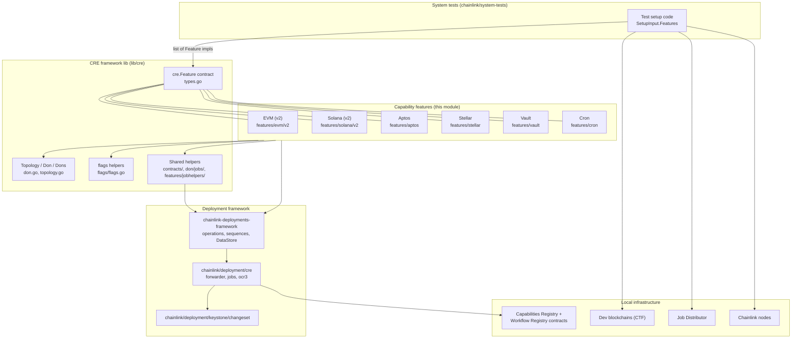
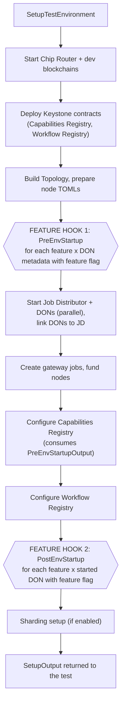
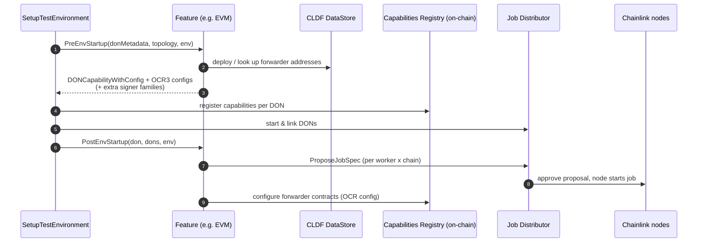
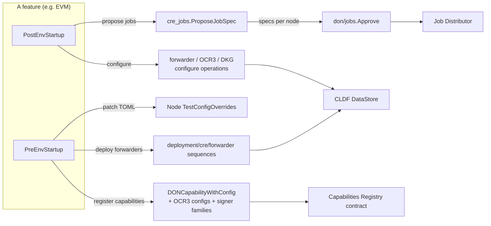

# System Tests: CRE Capability Features

## Introduction

This module implements the **pluggable capability features** of the local CRE (Chainlink Runtime Environment) system-test framework, located under `chainlink/system-tests/lib/cre/features/`. Each *feature* is a self-contained component that knows how to provision **one capability** (an oracle capability such as `cron` or `vault`, or a *chain capability* such as `evm`, `solana`, `aptos`, or `stellar`) inside a locally-spun multi-DON CRE environment.

Features are consumed by the environment orchestrator ([system-tests_cre_environment](system-tests_cre_environment.md)) through the `cre.Feature` contract: they run once **before** the Job Distributor and Chainlink nodes start (`PreEnvStartup`) — deploying forwarder contracts, patching node TOML configs, and producing capability registrations — and once **after** the environment is up (`PostEnvStartup`) — proposing and approving job specs via the Job Distributor and configuring on-chain forwarders.

This module is part of the [Dev, Test & Simulation Environments](../../Dev,_Test___Simulation_Environments.md) area. It is a leaf module of [system-tests](../system-tests.md) alongside:

| Sibling module | Responsibility |
|---|---|
| [system-tests_cre_environment](system-tests_cre_environment.md) | Environment bootstrap, blockchains, infra providers, test config |
| [system-tests_cre_topology_nodes](system-tests_cre_topology_nodes.md) | Topology/DON/node metadata, node key generation, secrets |
| [system-tests_cre_workflow_deployment](system-tests_cre_workflow_deployment.md) | Workflow compilation, secrets upload, registry sync state |
| [system-tests_benchspy](system-tests_benchspy.md) | Benchmark capture and reporting |

---

## Core abstraction: the `cre.Feature` contract

The contract is defined in `chainlink/system-tests/lib/cre/types.go`:

```go
type Feature interface {
        Flag() CapabilityFlag
        PreEnvStartup(
                ctx context.Context,
                testLogger zerolog.Logger,
                don *DonMetadata,
                topology *Topology,
                creEnv *Environment,
        ) (*PreEnvStartupOutput, error)
        PostEnvStartup(
                ctx context.Context,
                testLogger zerolog.Logger,
                don *Don,
                dons *Dons,
                creEnv *Environment,
        ) error
}

type PreEnvStartupOutput struct {
        DONCapabilityWithConfig []keystone_changeset.DONCapabilityWithConfig
        // keyed by LabelledName
        CapabilityToOCR3Config map[string]*ocr3.OracleConfig
        // keyed by LabelledName. Non-EVM chain families whose signing keys should be
        // included in OCR3 config signers for that capability (e.g. ["solana"]).
        // EVM is always included.
        CapabilityToExtraSignerFamilies map[string][]string
}
```

Key semantics:

* **`Flag()`** — returns the `CapabilityFlag` (a plain string) that matches the `capabilities` entries declared on a node set's TOML. Flags are constants in `lib/cre/types.go` (`cron`, `evm`, `vault`, `solana`, `aptos`, `stellar`, …). Chain-scoped variants use the `<flag>-<chainID>` form (e.g. `evm-1337`); the flags helper in `chainlink/system-tests/lib/cre/flags/flags.go` (`HasFlagForChain`, `HasFlagForAnyChain`, `RequiresForwarderContract`) decodes them. DON types (`workflow`, `capabilities`, `gateway`, `bootstrap`, `shard`) share the same string type.
* **`PreEnvStartup`** — runs before any node/JD container starts. It receives *metadata only* (`*DonMetadata` + `*Topology`), so it must not talk to running nodes. Its output feeds the Capabilities Registry configuration step (see below).
* **`PostEnvStartup`** — runs after nodes are started, linked to the Job Distributor and the registries are configured. It receives live `*Don` / `*Dons` handles and may propose jobs, configure contracts, and wait for on-chain state.
* **Capability registration payload** — `DONCapabilityWithConfig` carries the on-chain `CapabilitiesRegistryCapability` (`LabelledName`, `Version`, `CapabilityType`: `0` = TRIGGER, `1` = ACTION) plus a protobuf `CapabilityConfig` (method configs, `LocalOnly`).

> Note: the older `cre.InstallableCapability` interface (also in `types.go`) is **deprecated** in favor of `Feature`; the environment orchestrator still accepts it for legacy capabilities only.

---

## Architecture

### Component map



### Where the hooks run: environment lifecycle

The orchestrator `SetupTestEnvironment` in `chainlink/system-tests/lib/cre/environment/environment.go` is the **only** caller of the feature hooks. The two highlighted stages are this module's extension points:



Dispatch logic (abridged from `environment.go`):

* **PreEnvStartup** — `for feature := range input.Features.List()` × `topology.DonsMetadataWithFlag(feature.Flag())`; the returned `DONCapabilityWithConfig` entries are accumulated per DON ID, and `CapabilityToOCR3Config` / `CapabilityToExtraSignerFamilies` are merged into the `ConfigureCapabilityRegistryInput`.
* **PostEnvStartup** — `for feature := range input.Features.List()` × `dons.DonsWithFlag(feature.Flag())`; failures abort the whole setup.



---

## Feature catalog

All concrete types below satisfy `var _ cre.Feature = (*T)(nil)`. A comparison matrix follows the detailed sections.

### `EVM` — EVM chain capability (v2)

*File: `chainlink/system-tests/lib/cre/features/evm/v2/evm.go` · Flag: `cre.EVMCapability` (`"evm"`)*

**PreEnvStartup**

1. Computes the set of chains needing forwarders across *all* node sets (`chainsWithForwarders`, EVM and Tron families) using `flags.RequiresForwarderContract`.
2. Deploys the Keystone Forwarder contract on every selector that does not yet have one — the CLDF DataStore is consulted (`contracts.MightGetAddressFromDataStore`) so selectors already provisioned by the older `evm_v1` feature are skipped — via the `forwarder.DeploySequence` from [`deployment/cre/forwarder`](../../CRE___Keystone_Deployment_Suite.md), then seals the merged memory datastore back into the environment.
3. For each chain ID enabled for the `evm` flag on this DON, registers `evm:ChainSelector:<selector>` (version `1.0.0`, `UseCapRegOCRConfig: true`) with method configs:
   * **Read actions** (`CallContract`, `FilterLogs`, `BalanceAt`, `EstimateGas`, `GetTransactionByHash`, `GetTransactionReceipt`, `HeaderByNumber`) → `RemoteExecutableConfig` (30 s timeout, 10 max parallel requests, `Simple` hasher).
   * **`LogTrigger`** → `RemoteTriggerConfig` (refresh 20 s, expiry 60 s, `MinResponsesToAggregate = MaxFaultyNodes() + 1`, max batch 25, batch period 200 ms).
   * **`WriteReport`** → `RemoteExecutableConfig` with `WriteReportExcludeSignatures` hasher.
   * `LocalOnly` mirrors `don.HasOnlyLocalCapabilities()`.
4. Attaches `contracts.DefaultChainCapabilityOCR3Config()` per labelled name.

**PostEnvStartup**

1. Proposes standard capability jobs for every *(enabled chain × worker node)* pair concurrently (`errgroup` limited by `jobhelpers.Parallelism`), templating the per-node config from the `configTemplate` with runtime fallbacks (`ChainID`, `NetworkFamily`, `CreForwarderAddress`, `NodeAddress`, `DeltaStage`), validating substitution with `credon.ValidateTemplateSubstitution`, then `cre_jobs.ProposeJobSpec{}.Apply` with `Template: job_types.EVM` and an `OracleFactory` block (bootstrap peers `peerID@host:5001`, OCR2 key bundle, single-/multi-chain signing strategy) — followed by a single `jobs.Approve` over all specs.
2. Configures EVM forwarders for every DON carrying the `consensus` capability (`dons.DonsWithFlags(cre.ConsensusCapability)`) via `forwarder.ConfigureSeq`, grouping chains by address-ref qualifier.

Tuning constants: `deltaStage = block time + 1 s`, `requestTimeout = 30 s`, `registrationRefresh = 20 s`, `registrationExpiry = 60 s`.

### `Solana` — Solana chain capability (v2)

*File: `chainlink/system-tests/lib/cre/features/solana/v2/solana.go` · Flag: `cre.SolanaCapability` (`"solana"`)*

**PreEnvStartup**

1. Extracts the single Solana chain from the environment (`extractSolanaFromEnv`).
2. Forwarder handling — the Solana forwarder program is predeployed at chain spin-up; the feature registers its program ID in the datastore and executes `cre_sol_seq.DeployForwarderSeq` to initialize state, recording both `ForwarderContract` and `ForwarderState` addresses.
3. Patches every worker node's TOML overrides (`patchNodeTOML` → `updateNodeConfig`): unmarshals the typed core `Config`, enforces exactly one Solana chain, and injects a rendered `[Solana.Workflow]` block (`PollPeriod`, `AcceptanceTimeout`, `TxAcceptanceState`, `Local`) from the capability's config values.
4. Registers `solana:ChainSelector:<selector>` (type ACTION) with method configs for read actions (`GetAccountInfoWithOpts`, `GetBalance`, `GetBlock`, `GetFeeForMessage`, `GetMultipleAccountsWithOpts`, `GetSignatureStatuses`, `GetSlotHeight`, `GetTransaction`, `GetProgramAccounts`), `LogTrigger` (same remote-trigger shape as EVM), and `WriteReport` (`TransmissionSchedule_OneAtATime` with `deltaStage = finalization time + 2 s`).
5. Declares **EVM** as extra signer family (`CapabilityToExtraSignerFamilies`) because chain-read OCR and DON-to-DON messaging use the EVM signing schema.

**PostEnvStartup**

1. Creates and approves standard capability jobs (`Template: job_types.Solana`) per worker node; the templated config carries `CREForwarderAddress`, `CREForwarderState`, transmitter (node address), `isLocal`, chain ID, network, `deltaStage`, `readsEnabled`.
2. Configures forwarders for consensus DONs via the `ConfigureForwarders` changeset (`deployment/cre/forwarder/solana`) using `cre_sol.DefaultForwarderQualifier`.

The file also exposes the small `SolChain` interface (`SolChainID() string`) used to type blockchain handles.

### `Aptos` — Aptos chain capability

*File: `chainlink/system-tests/lib/cre/features/aptos/aptos.go` · Flag: `cre.AptosCapability` (`"aptos"`)*

**PreEnvStartup**

1. Resolves the Aptos chain IDs enabled for the flag on the DON; returns a nil output when none (feature effectively disabled).
2. Ensures forwarders for those chains (`ensureForwardersForChains`) and patches node TOMLs (`patchNodeTOML`).
3. Builds the `p2pToTransmitterMap` from worker metadata (per-node Aptos keys) and constructs `DONCapabilityWithConfig` entries labelled `aptos:ChainSelector:<selector>` (type ACTION, version `1.0.0`) with `BuildCapabilityConfig(values, p2pToTransmitterMap, localOnly)`; spec keys include `p2pToTransmitterMap`, `transmissionSchedule`, `deltaStage` (defaults: write delta 500 ms + 1 s, request timeout 30 s).
4. Declares **Aptos** as extra signer family via `cre.OCRExtraSignerFamiliesForFamily(chainselectors.FamilyAptos)` and attaches the default chain-capability OCR3 config.

**PostEnvStartup**

1. Configures forwarders for the enabled chains.
2. Proposes Aptos worker specs (bootstrap peers derived from the topology's single bootstrap node) and approves them with `crejobs.Approve`.

Aptos is largely **node-config driven** (legacy `aptosTransmitters` key kept for compatibility); it does not use the generic job-spec pipeline of EVM/Solana.

### `Stellar` — Stellar chain capability

*File: `chainlink/system-tests/lib/cre/features/stellar/stellar.go` · Flag: `cre.StellarCapability` (`"stellar"`)*

**PreEnvStartup**

1. Extracts the Stellar chain; returns an empty output if the environment has none.
2. Resolves the capability config and converts its `Values` into `methodConfigSettings` (`RequestTimeout`, `DeltaStage`, `TransmissionSchedule`).
3. Registers `stellar:ChainSelector:<selector>` (type ACTION) with the derived method configs and `LocalOnly`.
4. Deploys Stellar CRE forwarders (`deployStellarForwarders`).
5. Declares **Stellar** extra signer families.

**PostEnvStartup**

1. Configures the forwarders for the first consensus DON.
2. Authorizes forwarder transmitters (`authorizeStellarForwarderTransmitters`) so OCR3 reports can be relayed.
3. Proposes + approves standard capability jobs via `crejobs.Approve`.

### `Vault` — Vault (secrets) capability

*File: `chainlink/system-tests/lib/cre/features/vault/vault.go` · Flag: `cre.VaultCapability` (`"vault"`)*

**PreEnvStartup** (the most integration-heavy feature)

1. Resolves the runtime config — including optional **Auth0** settings (`IssuerURL`, `Audience`, `TenantID`) — from the capability's TOML values.
2. Gateway wiring: adds the `vault` handler to the topology's gateway service config (`topology.AddGatewayHandlers`), applies (and conflict-checks) Auth0 config via `applyGatewayAuth0Config`, and injects gateway-connector sections into every worker's node TOML through `don.ConfigureForGatewayAccess` (scoped to the DON's family).
3. Workflow-registry wiring: enables the node-side workflow registry syncer in each worker's TOML (`[Capabilities.WorkflowRegistry]` with registry address, `evm` network, registry chain ID, `reconciliation` sync strategy, contract version) plus a `CRE.Linking` block pointing at the local linking service (port `18124`). Applied to this DON **and all other workflow DONs** in the topology.
4. Registers the `vault` capability (type ACTION, version `1.0.0`) with a method config for `GetSecrets` (2-minute timeout, 10 parallel requests, `Simple` hasher). Vault is a *remote executable* served through the gateway — no chain-scoped labelled names.

**PostEnvStartup**

1. Deploys the Vault OCR3 pair — reporting plugin + DKG contracts — on the registry chain via the `creseq.DeployVault` sequence (qualifier `vault`), recording addresses in the datastore.
2. Proposes the `vault-worker` OCR3 job (`Template: job_types.OCR3`) with DKG dealer/recipient public keys harvested from worker DKG keys and optional Auth0 inputs; approves via `jobs.Approve`.
3. Configures the DKG contract (`ConfigureDKGOp`) using `contracts.DefaultOCR3_1Config(workers)` extended with `DKGOffchainConfig` (`T = 1`, dealer/recipient keys).
4. Reads the DKG instance ID from the DKG contract (`LatestConfigDetails`) to build a Vault `ReportingPluginConfig` override, then configures the Vault OCR3 contract (`ConfigureOCR3_1`) with it.

### `Cron` — Cron trigger capability

*File: `chainlink/system-tests/lib/cre/features/cron/cron.go` · Flag: `cre.CronCapability` (`"cron"`)*

The minimal feature:

* **PreEnvStartup** registers a single `cron-trigger` capability (type **TRIGGER**, version `1.0.0`) with `LocalOnly: don.HasOnlyLocalCapabilities()`.
* **PostEnvStartup** is a no-op — the cron trigger executes inside the node runtime; the cron job spec itself is proposed by the standard-capability job flow (see [system-tests_cre_workflow_deployment](system-tests_cre_workflow_deployment.md)).

### Comparison matrix

| Concern | Cron | EVM (v2) | Solana (v2) | Aptos | Stellar | Vault |
|---|---|---|---|---|---|---|
| Capability type | TRIGGER (0) | ACTION (1) | ACTION (1) | ACTION (1) | ACTION (1) | ACTION (1) |
| Chain-scoped labels | — | `evm:ChainSelector:<sel>` | `solana:ChainSelector:<sel>` | `aptos:ChainSelector:<sel>` | `stellar:ChainSelector:<sel>` | `vault` (DON-scoped) |
| Forwarder deployed in PreEnvStartup | — | ✅ (`DeploySequence`) | ✅ (predeployed + `DeployForwarderSeq`) | ✅ | ✅ | — |
| Node TOML patched | — | via generic config factory | ✅ (`[Solana.Workflow]`) | ✅ | — | ✅ (gateway connector + workflow registry syncer + linking) |
| Gateway handler needed | — | — | — | — | — | ✅ (+ Auth0) |
| Jobs proposed in PostEnvStartup | — | ✅ standard capability | ✅ standard capability | ✅ (worker specs) | ✅ standard capability | ✅ OCR3 worker |
| Extra OCR3 signer families | — | — | EVM | Aptos | Stellar | — |
| Contract configuration after start | — | forwarders (`ConfigureSeq`) | forwarders (changeset) | forwarders | forwarders + transmitter authorization | DKG + OCR3 contracts |

---

## Shared infrastructure and dependencies

All features build on the same toolkit; understanding these helpers is essential for writing a new feature:

* **`lib/cre/contracts`** — datastore utilities (`MustGetAddressFromDataStore`, `MightGetAddressFromDataStore`, `NewDataStoreFromExisting`, `DefaultChainCapabilityOCR3Config`, `DefaultOCR3_1Config`). Every feature resolves deployed contract addresses exclusively through the CLDF **DataStore** (`AddressRefKey` = chain selector + contract type + version + qualifier).
* **`lib/cre/don/jobs`** — `ProposeJobSpec`-consumed approval helper `jobs.Approve`, which maps produced spec files to node job proposals on the Job Distributor and accepts them concurrently.
* **`lib/cre/features/jobhelpers`** — `Parallelism` and `MergeSpecsByIndex` used by the concurrent job-proposal loops.
* **`lib/cre/don`** (`credon` alias) — `ApplyRuntimeValues` (TOML value fallbacks) and `ValidateTemplateSubstitution` (fails fast on unresolved template placeholders).
* **`cre.ResolveCapabilityConfig`** with `ChainCapabilityScope(chainID)` / `DonCapabilityScope()` — resolves `CapabilityConfig{BinaryName, Values}` for chain-scoped or DON-scoped flags (chain-scoped flags inherit base-capability defaults unless explicitly overridden).
* **Deployment framework** — features execute deployment-framework operations/sequences (forwarder deploy/configure, Vault deploy, OCR3/DKG configure) from [`deployment/cre/*`](../../CRE___Keystone_Deployment_Suite.md) on top of the CLDF operation bundle; see also the [Deployment Framework Core](../../Deployment_Framework_Core___Product_Deployments.md) page.



### Module and build context

The features live in the Go module `github.com/smartcontractkit/chainlink/system-tests/lib` (`chainlink/system-tests/lib/go.mod`), which pulls `chainlink-deployments-framework`, `chainlink-testing-framework`, `chain-selectors`, the keystone gethwrappers and the local `chainlink/v2` + `chainlink/deployment` modules via `replace` directives. Standard-capability binaries referenced by `CapabilityConfig.BinaryName` (resolved via `standardcapability.GetCommand`) are built from the `capabilities` workspace (`capabilities/Makefile` — see [capabilities workspace tooling](../../Build,_CI___Release_Infrastructure.md)), while the Chainlink node image consumed by node sets is produced by the main `chainlink/GNUmakefile`. Local CRE environment tooling lives in `chainlink/core/scripts/cre/environment/GNUmakefile`.

The capabilities these features provision at test time are documented in the [Workflow & Capability Runtime (CRE Engine)](../../Workflow___Capability_Runtime_(CRE_Engine).md) module (`capabilities/cron`, `capabilities/chain_capabilities/evm`, `.../solana`, `.../aptos`, `.../stellar`, and the vault capability); OCR3/DKG contract deployment details are in [CRE & Keystone Deployment Suite](../../CRE___Keystone_Deployment_Suite.md), and the chain/keystore primitives the environment uses are in [Shared Foundation Libraries & Domain Types](../../Shared_Foundation_Libraries___Domain_Types.md).

---

## Data flow summary

1. **Declaration** — a test declares node sets whose TOML `capabilities` include flags such as `evm-1337`, `cron`, `vault`, plus per-capability `[nodesets.capability_config.<flag>]` overrides (all values must be provided — overrides are not merged field-by-field, see `CapabilityConfig` in `lib/cre/types.go`).
2. **Provisioning (PreEnvStartup)** — the matching feature deploys chain contracts, patches TOMLs, and emits capability registrations + OCR3 configs (+ extra signer families).
3. **Registration** — the orchestrator writes those registrations to the on-chain Capabilities Registry and wires the Workflow Registry.
4. **Operation (PostEnvStartup)** — the feature proposes job specs to the Job Distributor (one per worker/chain where applicable), gets them approved on the nodes, and configures forwarder/OCR3 contracts, after which workflows can be deployed (see [system-tests_cre_workflow_deployment](system-tests_cre_workflow_deployment.md)).

---

## Extending the framework with a new feature

1. Choose/define a `CapabilityFlag` constant in `chainlink/system-tests/lib/cre/types.go`.
2. Implement the three `cre.Feature` methods in a new package under `chainlink/system-tests/lib/cre/features/<name>/`.
   * Keep `PreEnvStartup` free of live-node calls (only `DonMetadata`/`Topology`/`Environment`).
   * Return `nil` output (or an empty `PreEnvStartupOutput`) when the flag is absent from a DON — every feature must tolerate DONs that do not use it.
   * Resolve addresses through the DataStore helpers, never hardcode contract addresses.
   * Always finish job proposal with `jobs.Approve`; propose concurrently but merge specs deterministically (`jobhelpers.MergeSpecsByIndex`).
3. Register the feature in the test's `SetupInput.Features` (e.g. via the shared sets in `features/sets`), and add the flag to the relevant node sets' TOML capabilities.
4. If the capability needs gateway access, follow the Vault pattern (`topology.AddGatewayHandlers` + `don.ConfigureForGatewayAccess`); if it needs non-EVM OCR signers, populate `CapabilityToExtraSignerFamilies` (EVM is implicit).

---

## Related documentation

* [system-tests](../system-tests.md) — parent module overview
* [system-tests_cre_environment](system-tests_cre_environment.md) — environment bootstrap and the orchestrator invoking these hooks
* [system-tests_cre_topology_nodes](system-tests_cre_topology_nodes.md) — DON/node metadata, keys and secrets consumed by features
* [system-tests_cre_workflow_deployment](system-tests_cre_workflow_deployment.md) — workflow compilation, secrets upload, registry sync
* [Workflow & Capability Runtime (CRE Engine)](../../Workflow___Capability_Runtime_(CRE_Engine).md) — the runtime capabilities under test
* [CRE & Keystone Deployment Suite](../../CRE___Keystone_Deployment_Suite.md) — forwarder/OCR3/workflow-registry deployment operations used by features
