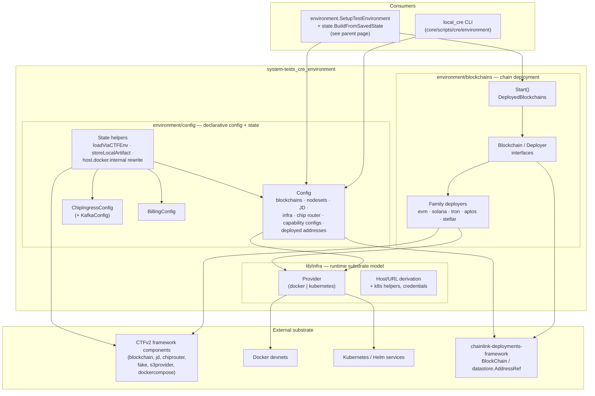
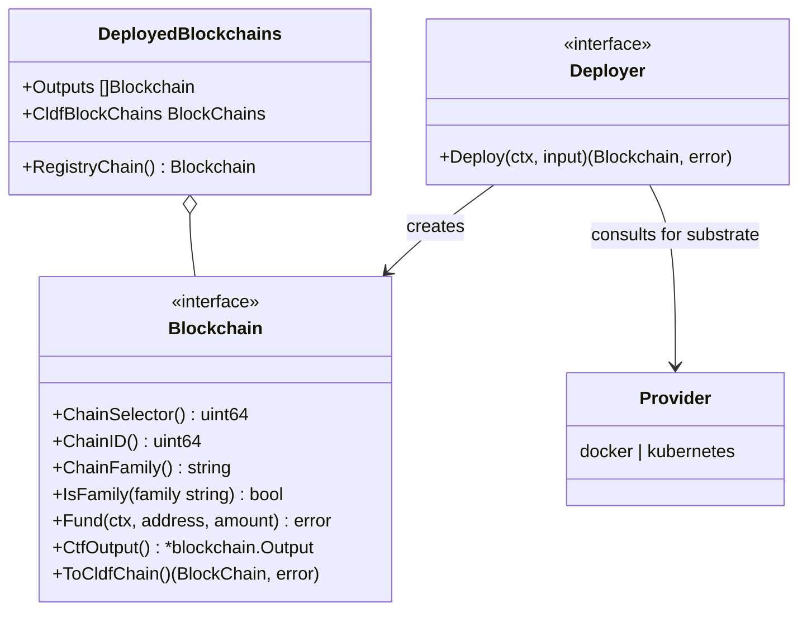
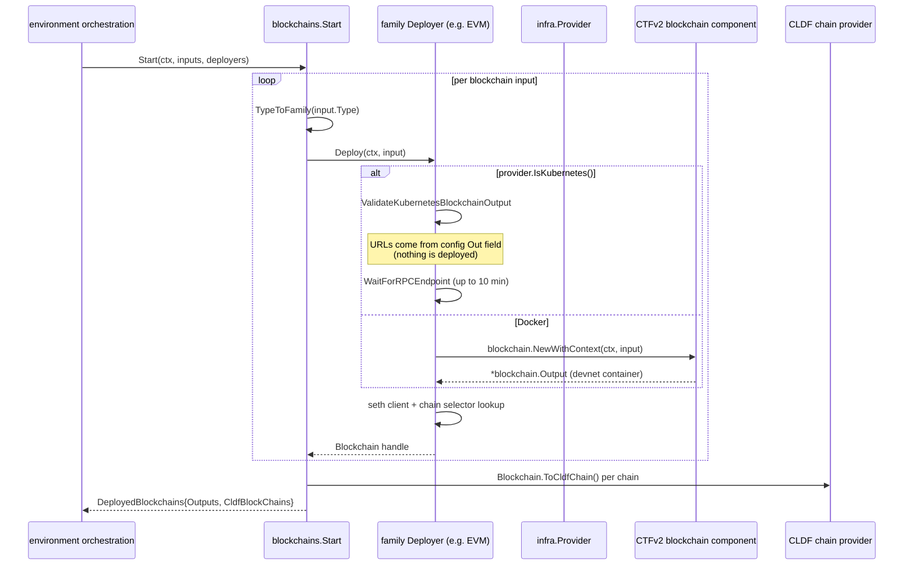
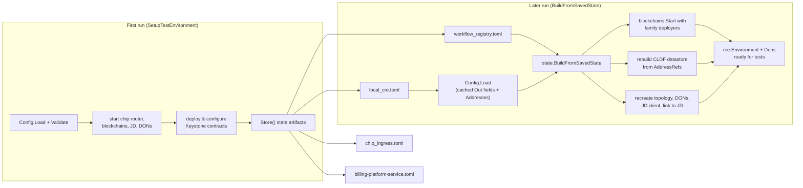

# CRE Test Environment: Configuration, Blockchain Deployment & Infrastructure

## 1. Introduction

`system-tests_cre_environment` is the **environmental foundation** of the CRE system-tests library: everything needed to *describe*, *provision*, *persist* and *reconstruct* a complete local CRE (Chainlink Runtime Environment) test environment. It is intentionally decoupled from *what runs inside* the environment (DON topology, capability features, workflow deployment) — those are covered by the sibling pages [system-tests_cre_topology_nodes](system-tests_cre_topology_nodes.md), [system-tests_cre_capability_features](system-tests_cre_capability_features.md) and [system-tests_cre_workflow_deployment](system-tests_cre_workflow_deployment.md).

The module consists of three pillars:

1. **Environment configuration & state persistence** (`cre/environment/config`) — a declarative TOML model (`Config`, `ChipIngressConfig`, `BillingConfig`) describing blockchains, DON node sets, the Job Distributor, the infrastructure provider and per-capability overrides. Configuration is loaded through the CTFv2 config loader, validated, and persisted to disk so an entire environment can be stopped and later rebuilt without re-deploying.
2. **Blockchain deployment abstraction** (`cre/environment/blockchains`) — family-agnostic `Blockchain` / `Deployer` interfaces with per-family implementations (EVM, Solana, Tron, Aptos, Stellar) that either launch Dockerised devnets via CTFv2 or attach to pre-provisioned Kubernetes chains, exposing both CTF outputs and [chainlink-deployments-framework](../../Deployment_Framework_Core___Product_Deployments.md) chain handles.
3. **Infrastructure provider model** (`lib/infra`) — the `Provider` type that abstracts **Docker vs Kubernetes** and derives the internal/external host names, gateway hosts and ports that node TOMLs must contain *before* any container or pod exists.

The primary consumers are the [`environment.SetupTestEnvironment`](../system-tests.md) orchestrator, the `state.BuildFromSavedState` rebuild path, and the `local_cre` CLI (built from `chainlink/core/scripts/cre/environment` by [operations_scripts_cre_environment](../operations_scripts/operations_scripts_cre_environment.md)).

## 2. Architecture

### 2.1 Component view

### 2.2 Position in the system-tests library

This module supplies the *substrate* consumed by the rest of `system-tests/lib/cre`:

| Concern | Owner | Documented in |
| --- | --- | --- |
| TOML config, validation, restartable state | `cre/environment/config` (this page) | this page |
| Chain startup (Docker or Kubernetes) | `cre/environment/blockchains` (this page) | this page |
| Docker/Kubernetes naming & URL model | `lib/infra` (this page) | this page |
| DON topology, keys, JD wiring | `cre` + `cre/don` packages | [system-tests_cre_topology_nodes](system-tests_cre_topology_nodes.md) |
| Capability feature plug-ins | `cre/features/*` | [system-tests_cre_capability_features](system-tests_cre_capability_features.md) |
| Workflow registration & propagation waits | `cre/workflow`, `cre/contracts` | [system-tests_cre_workflow_deployment](system-tests_cre_workflow_deployment.md) |
| Full environment startup pipeline | `environment.SetupTestEnvironment` | [system-tests (parent)](../system-tests.md) |

## 3. Environment configuration (`cre/environment/config`)

### 3.1 `Config` — the top-level environment descriptor

`Config` is the root TOML document for a local CRE (persisted as `local_cre.toml`). All fields are validated as required unless noted:

| Field | Type | Purpose |
| --- | --- | --- |
| `Blockchains` | `[]*blockchain.Input` (CTFv2) | ≥1 devnet definitions (type, chain ID, and, for Kubernetes, pre-configured `Out` URLs) |
| `NodeSets` | `[]*cre.NodeSet` | ≥1 DON definitions — see [topology & nodes](system-tests_cre_topology_nodes.md) |
| `JD` | `*jd.Input` (CTFv2) | Job Distributor settings incl. `CSAEncryptionKey` |
| `Infra` | `*infra.Provider` | Docker vs Kubernetes substrate (see §5) |
| `ChipRouter` | `*ctfchiprouter.Input` | CHIP router service (image overridable via the `CTF_CHIP_ROUTER_IMAGE` env var) |
| `Fake`, `FakeHTTP` | `*fake.Input` | Optional fake services (gateway / linking endpoints used by capability configs) |
| `S3ProviderInput` | `*s3provider.Input` | Optional S3-compatible artifact storage |
| `CapabilityConfigs` | `map[flag]cre.CapabilityConfig` | Per-capability value overrides keyed by capability flag |
| `Addresses` | `[]string` | Deployed contract addresses, each a JSON-encoded `datastore.AddressRef` |

Address round-tripping is explicit: `GetAddresses()` unmarshals the strings back into `datastore.AddressRef` values for the CLDF datastore, and `SetAddresses(refs)` marshals them for storage — this is how deployed Keystone contract addresses survive a stop/restart cycle.

### 3.2 Load pipeline

`Config.Load(absPath)` is idempotent (guarded by `mu` + `loaded`) and executes:

```mermaid
flowchart TD
    A["TOML file on disk<br/>(local_cre.toml)"] --> B["Config.Load(absPath)"]
    B --> C{"already loaded?"}
    C -- "yes" --> Z["no-op"]
    C -- "no" --> D["loadViaCTFEnv&#91;Config&#93;"]
    D --> D1["lock ctfEnvMu<br/>swap CTF_CONFIGS env var"]
    D1 --> D2["framework.Load&#91;T&#93;<br/>(CTFv2 TOML loader + validation)"]
    D2 --> D3["restore previous CTF_CONFIGS value"]
    D3 --> E["transformHostDockerInternalReferences<br/>(node TOML overrides +<br/>capability config values, recursively)"]
    E --> F["NodeSet.ValidateChainCapabilities<br/>(capabilities match declared blockchains)"]
    F --> G["copyExportedFields → Config<br/>(unexported mu/loaded skipped)"]
```

Two behaviours are worth calling out:

- **`CTF_CONFIGS` env-var dance** — the CTFv2 `framework.Load` reads its input path from the process-wide `CTF_CONFIGS` variable. `loadViaCTFEnv` sets it, loads, and restores the previous value (removing it if it was unset), all under a package-level mutex so concurrent loads cannot observe each other's paths. This contract is pinned by unit tests (§7).
- **`host.docker.internal` rewriting** — because containerised nodes cannot always reach the test process at `host.docker.internal`, `transformHostDockerInternalReferences` replaces every occurrence with the framework's resolved host gateway (`framework.HostDockerInternal()` minus the `http://` prefix). The rewrite is applied to each node's `UserConfigOverrides` TOML string and recursively through capability config values (strings, nested maps, slices).

### 3.3 Validation

`Config.Validate(envDependencies cre.CLIEnvironmentDependencies)` enforces, in order:

1. `jd.csa_encryption_key` must be non-empty.
2. Every capability flag on every node set must be known to the system (`envDependencies.SupportedCapabilityFlags()`); a trailing `-<chainID>` suffix is stripped first (`removeChainIDFromFlag`), so flags like `vault-1337` resolve to `vault`. Unknown flags return the list of valid ones to make test-config typos obvious.
3. Contract versions must match `DefaultContractSet()` exactly — OCR3 Capability `1.0.0`, Workflow Registry `2.0.0` (default DON family `test-don-family`), Capabilities Registry `2.0.0`, Keystone Forwarder `1.0.0`. These are the contract families deployed by the [CRE & Keystone Deployment Suite](../../CRE___Keystone_Deployment_Suite.md); a mismatch aborts startup before any infrastructure is provisioned.

### 3.4 Restartable state artifacts

All environment artifacts share one persistence mechanism (`storeLocalArtifact`: `MkdirAll`, TOML marshal, write `0600`) and one state directory relative to the repo root — `core/scripts/cre/environment/state/`:

| Artifact | File | Stored by | Notes |
| --- | --- | --- | --- |
| Full environment | `local_cre.toml` | `Config.Store` | Forces node-set `OverrideMode` from `"all"` → `"each"` (per-node secrets/P2P keys must not be collapsed), and clears the embedded CTFv2 `Input.NodeSpecs` so only the role-aware `NodeSpecs` tables are persisted |
| Chip Ingress stack | `chip_ingress.toml` | `ChipIngressConfig.Store` | `chipingressset.Input` + Kafka `Topics` — feeds the [Chip Ingress telemetry stack](../../Telemetry___Observability_Platform/chip-ingress.md) used for metering assertions |
| Billing platform | `billing-platform-service.toml` | `BillingConfig.Store` | Docker-compose billing service input |
| Workflow Registry config | `workflow_registry.toml` | `environment.SetupTestEnvironment` via `MustWorkflowRegistryStateFileAbsPath` | Registry owners, allowed DONs, families (see [workflow deployment](system-tests_cre_workflow_deployment.md)) |

Path helpers follow a uniform pattern (`Must*StateFileAbsPath` panics on path errors; `*StateFileExists` probes with `os.Stat`), and `RemoveAllEnvironmentStateDir` wipes the directory for a clean start.

> **Known workaround:** the TOML library cannot omit empty slices or customise marshalling, so `storeLocalArtifact` filters out the stray `node_specs = []` line that would otherwise collide with the real `[[nodesets.node_specs]]` array tables.

## 4. Blockchain deployment (`cre/environment/blockchains`)

### 4.1 Abstraction

- **`Blockchain`** unifies what the rest of the library needs from any chain: identity (`ChainSelector`/`ChainID`/`ChainFamily`), funding of node accounts, the raw CTFv2 output (container URLs) and a CLDF `BlockChain` handle for contract operations.
- **`Deployer`** is the per-chain-family factory. Implementations live in `blockchains/{evm,solana,tron,aptos,stellar}` and are assembled by `blockchains/sets.NewDeployerSet` into the `map[blockchain.ChainFamily]Deployer` that `SetupInput` accepts (this is also the extension point for custom chains).
- **`DeployedBlockchains`** is the aggregate result; **`RegistryChain()`** (index `0`) is always the EVM chain on which the Workflow & Capabilities Registry contracts are deployed.
- **`ValidateKubernetesBlockchainOutput`** fails fast when the Kubernetes provider is selected but a blockchain input has no pre-configured node URLs — on Kubernetes nothing is deployed by the test framework, URLs must come from the TOML config.

### 4.2 Startup flow

`Start(ctx, testLogger, commonLogger, inputs, deployers)` is the single entry point used by both `SetupTestEnvironment` and `BuildFromSavedState`:

Error handling is diagnostic-first: if no deployer is registered for an input's chain family, `Start` prints the last 30 lines of failed Docker container logs before returning.

The EVM implementation illustrates the full contract every deployer fulfils: it builds a `seth` client from the first node's WS URL (defaulting `PRIVATE_KEY` to the Anvil key when unset), resolves the chain selector via `chain-selectors`, supports per-test client cloning (`CloneWithSethClient`), funds accounts through `lib/funding`, and materialises the CLDF provider (`NewRPCChainProvider` with a family/transactor/confirmation configuration that differs for `anvil` vs real networks).

## 5. Infrastructure provider model (`lib/infra`)

`Provider` is written into every `Config` and consulted by node-config generation **before any infrastructure exists** — node TOMLs embed URLs, so host names must be derived from naming conventions rather than discovered. The code documents this explicitly as a coupling between the Helm charts used on Kubernetes and the Docker container names used by CTFv2:

| Target | Kubernetes | Docker (CTFv2) |
| --- | --- | --- |
| Node internal host (bootstrap) | `{don}-bt-{index}` | `{don}-node{index}` |
| Node internal host (plugin) | `{don}-{index}` | `{don}-node{index}` |
| Gateway node internal host | `{don}-bt-{index}-gtwnode` / `{don}-{index}-gtwnode` | `{don}-node{index}` |
| External gateway host | `{namespace}-gateway.{externalDomain}` | `localhost` |
| External gateway port | `80` | the container port |

Key properties and helpers:

- `IsKubernetes()` / `IsDocker()` — case-insensitive substrate checks; `Type` is validated `oneof=kubernetes docker` at load time.
- `InternalHost` / `InternalGatewayHost` / `ExternalGatewayHost` / `ExternalGatewayPort` — the naming rules above; the Kubernetes branch encodes the Helm service-name patterns also defined as constants in `infra/kubernetes.go` (`NodeBootstrapNameFormat = "%s-bt-%d"`, `NodePluginNameFormat = "%s-%d"`, JD services `job-distributor:80` and `job-distributor-noderpc-lb:80`).
- `KubernetesInput` — namespace, config folder, external domain/port, label selector, node API credentials, TLS flag for JD gRPC, and the provider flavour (`aws`, `kind`, …) with a required `Team` block for AWS cost attribution.
- Companions in the same package: `kubernetes.go` (in-cluster/kubeconfig `Clientset`, generated JD and node-set outputs using the naming conventions), `blockchain.go` (`WaitForRPCEndpoint` used by the deployers), and `credentials.go` (`NodeCredentials`).

## 6. Data flow: configure → run → persist → rebuild

The module's raison d'être is that a local CRE can be torn down and revived:

In the rebuild path the persisted `Addresses` seed a fresh CLDF `datastore`, contract versions are recovered from that datastore, and the JD client is rebuilt from the cached JD gRPC URL — so the second run skips all deployment and goes straight to workflow deployment or test assertions.

## 7. Testing the module itself

`config/config_test.go` pins the two subtle behaviours of the config layer:

- **`loadViaCTFEnvTestConfig`** — a minimal type proving that `loadViaCTFEnv` (1) loads the file at the swapped `CTF_CONFIGS` path, (2) leaves `CTF_CONFIGS` *unset* after loading when it was unset before, and (3) restores a *pre-existing* value verbatim afterwards. This guards against the process-wide env-var leak that would otherwise corrupt concurrent framework loads.
- **`TestTransformHostDockerInternalReferences`** — verifies the rewrite reaches node `UserConfigOverrides` TOML strings and capability config values at every nesting level (plain strings, nested maps, string slices).

## 8. Build & module identity

- The library is its own Go module `github.com/smartcontractkit/chainlink/system-tests/lib` (Go 1.27.1, see `chainlink/system-tests/lib/go.mod`), with `replace` directives pinning `chainlink/v2` and `chainlink/deployment` to the local monorepo — tests always exercise the code under review — plus a `ugorji/go/codec v1.2.12` pin for a codecgen incompatibility. Notable dependencies: `chainlink-testing-framework/framework` v0.16.8 (+ `chiprouter`, `dockercompose`, `fake` components), `chainlink-deployments-framework`, `seth`, `pelletier/go-toml/v2`, `Masterminds/semver/v3`, and `k8s.io/client-go` for the Kubernetes provider.
- The `local_cre` binary that drives these environments is built by the [CRE environment GNUmakefile](../operations_scripts/operations_scripts_cre_environment.md) (`chainlink/core/scripts/cre/environment/GNUmakefile`, target `install`), which stamps version/commit/date ldflags and exposes the `local_cre sh` interactive shell.
- Docker-level simulation primitives that this module composes (devnets, node containers, observability stack) are documented separately in [docker-dev-environments](../docker-dev-environments.md); the Kubernetes-side deployment helpers live in [deployment-environment](../deployment-environment.md).

## 9. Related documentation

- [system-tests (parent)](../system-tests.md) — library overview and the full `SetupTestEnvironment` lifecycle.
- [system-tests_cre_topology_nodes](system-tests_cre_topology_nodes.md) — `cre.NodeSet`, topology, keys and JD wiring driven by this module's config.
- [system-tests_cre_capability_features](system-tests_cre_capability_features.md) — capability features whose flags `Config.Validate` checks and whose values `transformHostDockerInternalReferences` rewrites.
- [system-tests_cre_workflow_deployment](system-tests_cre_workflow_deployment.md) — consumer of the persisted `workflow_registry.toml` artifact.
- [system-tests_benchspy](system-tests_benchspy.md) — benchmark reporting for tests run in these environments.
- [Workflow & Capability Runtime (CRE Engine)](../../Workflow___Capability_Runtime_(CRE_Engine).md) — the runtime the environment boots.
- [CRE & Keystone Deployment Suite](../../CRE___Keystone_Deployment_Suite.md) — contract deployment changesets whose versions `DefaultContractSet` pins.
- [Telemetry & Observability Platform](../../Telemetry___Observability_Platform.md) — the Chip Ingress / billing stacks this module can start.
- [Node Platform Services](../../Node_Platform_Services.md) — the Job Distributor service the `JD` config input starts.
- [Dev, Test & Simulation Environments](../../Dev,_Test___Simulation_Environments.md) — the surrounding module family.
