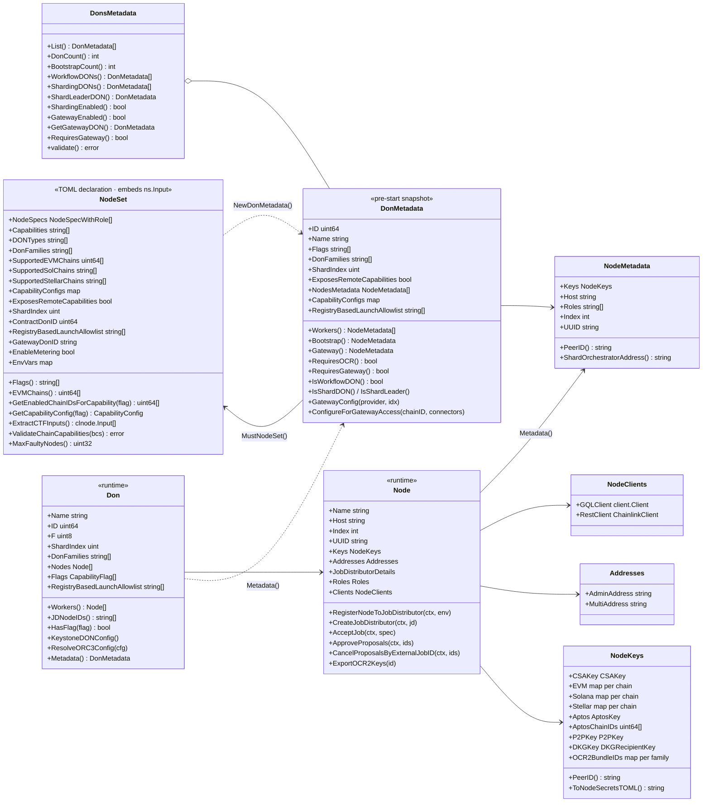
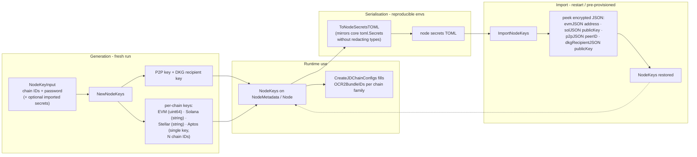
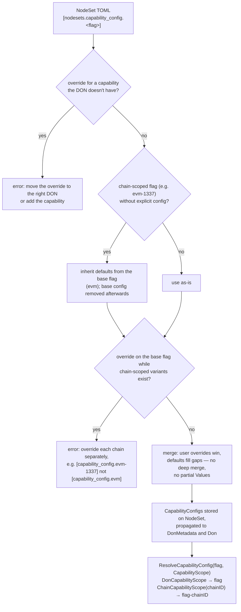

# CRE System Tests: DON Topology & Node Management

## 1. Introduction

`system-tests_cre_topology_nodes` is the **topology and node-management layer** of the CRE system-tests library (`chainlink/system-tests/lib/cre`). It answers two questions for every local CRE (Chainlink Runtime Environment) test run:

1. **What does the network look like?** — a declarative, TOML-serialisable model of DONs ([Decentralized Operator Networks](#3-core-concepts)), their nodes, roles, supported chains, capability flags, shard assignments and per-capability configuration ([`NodeSet`](#41-nodeset--the-toml-topology-declaration)).
2. **How do the nodes come alive?** — deterministic key/secrets generation and import, the runtime `Don`/`Node` objects with GraphQL + REST clients, Byzantine-fault-tolerance (`F`) computation, and the full [Job Distributor (JD) linking flow](#6-job-distributor-integration) that registers every node and creates its per-chain OCR2 configuration.

The module is intentionally split by lifecycle phase:

| Phase | Types | File |
| --- | --- | --- |
| **Declaration** (TOML config) | `NodeSet`, `NodeSpecWithRole`, `CapabilityConfig` | `lib/cre/types.go` |
| **Pre-start metadata** (keys generated, hosts known) | `DonMetadata`, `NodeMetadata`, `DonsMetadata` | `lib/cre/types.go` |
| **Runtime** (containers up, clients created) | `Don`, `Node`, `Roles`, `NodeClients`, `Addresses` | `lib/cre/don.go` |
| **Key material** | `NodeKeys`, `ImportNodeKeys`, `ToNodeSecretsTOML` | `lib/cre/don/secrets/secrets.go` |
| **Key primitives** | `EVMKey`, `EVMKeys`, `CSAKey` | `lib/crypto/evm.go`, `lib/crypto/csa.go` |

Everything here consumes the *substrate* provided by [system-tests_cre_environment](system-tests_cre_environment.md) (infrastructure `Provider`, deployed `Blockchain` handles) and is consumed by [system-tests_cre_capability_features](system-tests_cre_capability_features.md) and [system-tests_cre_workflow_deployment](system-tests_cre_workflow_deployment.md). The library lives in its own Go module, `github.com/smartcontractkit/chainlink/system-tests/lib` (see `chainlink/system-tests/lib/go.mod`), which pins CTFv2, the deployments framework and JD protobufs and replaces `chainlink/v2` / `chainlink/deployment` with local workspace copies.

## 2. Architecture

### 2.1 Component view

```mermaid
graph TB
    subgraph MODULE["system-tests_cre_topology_nodes (lib/cre)"]
        direction TB
        subgraph TYPES["types.go — topology model"]
            T1["CapabilityFlag / NodeType constants<br/>(workflow · capabilities · gateway ·<br/>bootstrap · shard + capability flags)"]
            T2["NodeSet<br/>TOML topology declaration"]
            T3["DonMetadata · NodeMetadata<br/>DonsMetadata (pre-start, keys, hosts)"]
            T4["Dons · Don · Node<br/>(runtime model + cross-refs)"]
            T5["SPI: Feature · Features<br/>InstallableCapability (deprecated)"]
            T6["Environment · GenerateConfigsInput<br/>peering data · contract versions"]
            T7["Scenario I/O types:<br/>WorkflowRegistry · ConfigureDataFeedsCache ·<br/>GatewayServiceConfig · SolChain ·<br/>ConfigureCapabilityRegistryInput"]
        end

        subgraph DONPKG["don.go — runtime + JD integration"]
            D1["Roles (bootstrap / plugin / gateway)"]
            D2["NewDON · NewNode<br/>F computation, clients, addresses"]
            D3["LinkToJobDistributor<br/>CreateJDChainConfigs (idempotent)"]
            D4["KeystoneDON interface<br/>GetVaultCapabilityDON"]
        end

        subgraph SEC["don/secrets — key material"]
            S1["NodeKeys (CSA · EVM · Solana ·<br/>Stellar · Aptos · P2P · DKG · OCR2 bundles)"]
            S2["NewNodeKeys / ImportNodeKeys /<br/>ToNodeSecretsTOML"]
            S3["Encrypted-JSON peeks:<br/>evmJSON · solJSON · p2pJSON · dkgRecipientJSON"]
        end

        subgraph CRYPTO["lib/crypto — primitives"]
            C1["EVMKey · EVMKeys<br/>NewEVMKey · GenerateNewKeyPair"]
            C2["CSAKey"]
        end
    end

    subgraph SIB["Sibling modules (same library)"]
        ENV["cre_environment<br/>infra.Provider · blockchains.Blockchain"]
        FEAT["cre_capability_features<br/>Feature implementations"]
        WF["cre_workflow_deployment<br/>workflow & registry deploy"]
    end

    subgraph EXT["External dependencies"]
        KS["CRE / Keystone deployment suite<br/>keystone changesets · offchain ops · ocr3 config"]
        CLDF["chainlink-deployments-framework<br/>cldf.Environment · operations · datastore"]
        SDK["Node web SDK GraphQL client"]
        CTF["chainlink-testing-framework<br/>clnode · clclient · blockchain"]
        JDPROTO["job-distributor protobufs"]
    end

    T2 --> T3
    T3 --> T5
    T4 --> D1
    D2 --> S1
    S2 --> S3
    S2 --> C1
    D3 --> JDPROTO

    T2 -- "hosts, InternalHost()" --> ENV
    T3 -- "hosts, InternalHost()" --> ENV
    T7 -- "blockchain handles" --> ENV
    FEAT -- "PreEnvStartup / PostEnvStartup" --> T5
    FEAT -- "don metadata, topology" --> T3
    WF -- "Dons, Don" --> T4
    D2 -- "container outputs" --> CTF
    D3 -- "JDUpsertNodeOp, chain configs" --> CLDF
    D3 -- "GQLClient" --> SDK
    D4 -- "DONCapabilityWithConfig,<br/>OracleConfig" --> KS
```



### 2.2 Position in the system-tests library

The [parent page](../system-tests.md) shows the whole library; this module is its **model layer**:

| Concern | Owner | Documented in |
| --- | --- | --- |
| TOML config, blockchain/provider substrate, state rebuild | `cre/environment/*`, `lib/infra` | [system-tests_cre_environment](system-tests_cre_environment.md) |
| Topology model, node keys, JD linking *(this page)* | `lib/cre/types.go`, `lib/cre/don.go`, `lib/cre/don/secrets`, `lib/crypto` | this page |
| Per-capability `Feature` implementations (EVM, Solana, Aptos, Stellar, Cron, Vault…) | `lib/cre/features/*` | [system-tests_cre_capability_features](system-tests_cre_capability_features.md) |
| Workflow deployment, secrets for workflows, registry pickup | `lib/cre/workflow`, `lib/cre/contracts` | [system-tests_cre_workflow_deployment](system-tests_cre_workflow_deployment.md) |
| Benchmark reporting | `lib/benchspy` | [system-tests_benchspy](system-tests_benchspy.md) |

The primary driver is the `local_cre` CLI / test orchestrator built from `chainlink/core/scripts/cre/environment` (see [operations_scripts_cre_environment](../operations_scripts/operations_scripts_cre_environment.md)) and the environment setup described on the [parent page](../system-tests.md).

## 3. Core concepts

### 3.1 DON types and capability flags

Two families of string constants drive the whole model (`types.go`):

- **DON types** (`CapabilityFlag` values used as node-set roles at DON granularity): `workflow`, `capabilities`, `gateway`, `bootstrap`, `shard`.
- **Capability flags**: `don-time`, `consensus`, `cron`, `evm`, `vault`, `http-trigger`, `http-action`, `solana`, `confidential-relay`, `confidential-workflows`, `aptos`, `stellar` — plus **chain-scoped variants** formed as `<flag>-<chainID>` (e.g. `evm-1337`, `aptos-4`), parsed by `parseChainCapabilityFlag` (last `-` splits base from an all-digit chain ID).

`NodeSet.Flags()` returns capabilities *and* DON types; `HasFlag` (both the `DonMetadata`/`Don` methods and the package-level helper) also matches chain-scoped flags by prefix, so `HasFlag("evm")` is true for `evm-1337`.

### 3.2 Node roles

| `Role` / `NodeType` | TOML string | Semantics |
| --- | --- | --- |
| `RoleBootstrap` / `BootstrapNode` | `bootstrap` | P2P / OCR bootstrap peer; gets `MultiAddress`, no admin address; at most one per DON |
| `RoleWorker` / `WorkerNode` | `plugin` | Payload worker. The value `plugin` deliberately matches the JD filter used by `chainlink-deployments-framework` to select non-bootstrap nodes |
| `RoleGateway` / `GatewayNode` | `gateway` | Gateway node; no JD chain configs, no admin address; at most one per DON |

### 3.3 Invariants enforced by the model

`DonsMetadata.validate()` rejects a topology unless:

- at least one DON exists and at least one DON contains a bootstrap node;
- if any DON *requires* a gateway (flags `vault`, `http-action`, `http-trigger` — see `DonMetadata.RequiresGateway`), some DON actually has a gateway node;
- when sharding is enabled, shard DON indexes are **unique and sequential starting at 0** (shard leader = index 0).

Other invariants live on `NodeSet`:

- `don_families` must be non-empty on every nodeset unless it only hosts bootstrap/gateway nodes (`donFamiliesRequired`); the first entry is the *primary family* used for gateway pairing, capability registration and workflow deploy (`DonFamily()` / `primaryDonFamily`).
- `MaxFaultyNodes()` returns `(N-1)/3` under the BFT assumption `N ≥ 3f+1`; `NewDON` applies the same rule to worker count and **fails** if a DON with the `consensus` capability would end up with `F == 0`.
- `ValidateChainCapabilities` verifies that every chain-scoped capability flag refers to a chain that is actually deployed (Solana and Stellar are exempt: they scope via `supported_sol_chains` / `supported_stellar_chains` instead of numeric flags).

## 4. Topology model (`types.go`)

### 4.1 Class view



### 4.2 `NodeSet` — the TOML topology declaration

`NodeSet` (embedding the CTFv2 simple-node-set input) is what test authors edit. Key fields:

- `node_specs` — role-aware specs (`NodeSpecWithRole` = CTF `clnode.Input` + `roles`); `ExtractCTFInputs()` feeds the container framework.
- `capabilities`, `don_types`, `don_families`, `shard_index`, `exposes_remote_capabilities` — topology semantics (§3).
- `supported_evm_chains` (a *filter* — `EVMChains()` falls back to chain-scoped capability IDs when empty), `supported_sol_chains`, `supported_stellar_chains`, `env_vars`.
- `capability_configs` — per-DON `CapabilityConfig {binary_name, values}` overrides (§7).
- `contract_don_id` (0 = optimistic `i+1`), `registry_based_launch_allowlist` (capabilities launched from the on-chain registry — job proposal is skipped), `gateway_don_id` (multi-gateway HTTP action routing), `enable_metering` (framework-generated `[Metering]` node config).

`DonMetadata` is the **resolved snapshot** built by `NewDonMetadata(nodeSet, id, provider, capabilityCfgs)`: it generates one `NodeMetadata` per spec in parallel (bounded by `GOMAXPROCS`) — keys via `NewNodeKeys`, host via `provider.InternalHost(i, isBootstrap, donName)` — then merges capability configs back onto the `NodeSet` so both views stay consistent.

### 4.3 Environment and scenario I/O types

`types.go` also hosts the vocabulary types passed between the orchestrator, features and the deployment suites:

| Type | Purpose |
| --- | --- |
| `Environment` | A materialised CRE: `cldf.Environment`, registry chain selector, deployed blockchains, contract versions, infra `Provider`; `RegistryChain()` looks up the home chain. `FreshExternalJobIDs` toggles random job IDs for feature job proposals. |
| `GenerateConfigsInput` / `NodeConfigTransformerFn` | Inputs for node TOML generation (peering data, chip-router gRPC URL, datastore, contract versions); validated with `Validate()`. |
| `CapabilitiesPeeringData` / `OCRPeeringData` | Global capabilities / OCR bootstrap peer IDs, hosts and ports. |
| `WorkflowRegistryInput` / `WorkflowRegistryOutput` | TOML-serialisable workflow-registry scenario state (`Store()` via `storeLocalArtifact`). |
| `ConfigureDataFeedsCacheInput` / `Output` | Data-feeds cache configuration; `Validate()` enforces parallel-length owner/sender/name slices. |
| `GatewayServiceConfig` (+ `GatewayServiceAuth0Config`), `GatewayConnectors` | Service-centric gateway definitions (handlers, DONs, optional Auth0); `FindByNodeUUID` resolves a node's gateway config. |
| `ConfigureCapabilityRegistryInput` | Everything needed to configure the on-chain capability registry: topology, node sets, `DONCapabilityWithConfig`s, `CapabilityToOCR3Config`, `CapabilityToExtraSignerFamilies`. |
| `SolChain` | Solana chain handle for scenarios (selector, chain ID/name, private key, artifacts dir). |
| `contractVersionsProvider` | Default contract versions (OCR3 1.0.0, WorkflowRegistry/CapabilitiesRegistry 2.0.0, KeystoneForwarder 1.0.0, Solana/Stellar forwarders) overridable from the CLDF datastore via `ContractVersionsProviderFromDataStore`. |

## 5. Node keys and secrets (`don/secrets` + `lib/crypto`)

### 5.1 Lifecycle



Key details:

- **Generation** (`NewNodeKeys`): with `ImportedSecrets` set, keys are imported instead (Aptos must be present if Aptos chains are requested); otherwise P2P and DKG keys are always created, EVM/Solana/Stellar keys per configured chain (via `crypto.NewEVMKey` → CTF `clclient.NewETHKey`, Solana/Stellar helpers), and a **single Aptos key** is shared across all requested Aptos chain IDs.
- **Serialisation** (`ToNodeSecretsTOML`): produces TOML shaped like the node's own `core/config/toml.Secrets` (EVM/Solana/Aptos/Stellar `Keys` arrays, `P2PKey`, `DKGRecipientKey`). A private mirror of the core struct is used deliberately — the original serialises secrets to `xxxxx`.
- **Import** (`ImportNodeKeys`): unmarshals that TOML, recovers public data by peeking into the encrypted JSON blobs (`evmJSON`, `solJSON`, `p2pJSON`, `dkgRecipientJSON`) or by decrypting (`aptoskey.FromEncryptedJSON`, `stellarkey.FromEncryptedJSON`), normalises Aptos/Stellar accounts, enforces a single distinct Aptos account, and rebuilds the `NodeKeys` map. This is what makes environments restartable.
- **Primitives** (`lib/crypto`): `EVMKey` / batch `EVMKeys` (encrypted JSON + public address + password + chain ID), `GenerateNewKeyPair` / `PrivateKeyToAddress` for ECDSA keypairs, and `CSAKey` (the node's Job-Distributor-facing CSA public key string).

## 6. Job Distributor integration (`don.go`)

### 6.1 Start-up linking sequence

```mermaid
sequenceDiagram
    autonumber
    participant Env as Orchestrator
    participant DON as Don / Node (don.go)
    participant GQL as Node GraphQL API<br/>(web SDK client)
    participant REST as Node REST API<br/>(CTF clclient)
    participant JD as Job Distributor
    participant OPS as CLDF operations bundle

    Env->>DON: NewDON(donMetadata, ctfNodes)
    par per node (errgroup)
        DON->>GQL: NewWithContext(externalURL, creds)
        DON->>REST: NewChainlinkClient(externalURL, creds)
        DON->>DON: role-based Addresses:<br/>worker → admin 0xf39F…92266, multiaddr ""<br/>bootstrap → multiaddr from internal P2P URL<br/>gateway → none
    end
    DON->>DON: F = (workers-1)/3; fail if consensus && F==0

    Env->>DON: LinkToJobDistributor(LinkDonsToJDInput)
    par per DON
        DON->>DON: FindDonSupportedChains(metadata, blockchains)
        par per node
            DON->>GQL: FetchCSAPublicKey (if not cached)
            DON->>OPS: JDUpsertNodeOp (name, CSA key, P2PID, DON labels)
            JD-->>DON: NodeID → JobDistributorDetails.NodeID
            DON->>GQL: ListJobDistributors / CreateJobDistributor(CSA key)<br/>(DuplicateFeedsManagerError tolerated)
            loop retry ×5, 500 ms backoff
                DON->>JD: GetNode → until IsConnected
            end
            Note over DON: JobDistributorDetails.JDID set
            DON->>JD: CreateJDChainConfigs (per chain, idempotent)
            DON->>GQL: FetchOCR2KeyBundleID per chain type
            loop retry ×5
                DON->>JD: ListNodeChainConfigs → skip if exists
                DON->>GQL: CreateJobDistributorChainConfig<br/>(OCR2 enabled, bootstrap flag, multiaddr,<br/>peer ID, key bundle; PG 23505 → treat as success)
            end
        end
    end
    Env->>Env: cldfEnv.NodeIDs = all registered node IDs
```

Notable behaviours in `CreateJDChainConfigs`:

- **Per-family account resolution**: EVM/Tron from local keys or GraphQL `FetchAccountAddress`; Solana uses its string chain ID from the `solana.Blockchain` handle; Aptos uses `aptosAccountForNode` (keys → REST `MustReadAptosAccounts` fallback, normalised and cached back onto `n.Keys.Aptos`, public key mirrored into `AccountAddrPubKey` so OCR config resolves); Stellar uses its string network ID. Tron is normalised to chain type `EVM`.
- **Deduplication** by `(chainID, chainType)` and idempotent create + observe (`listNodeChainConfigIDs` before/after) make the function safe on reruns; JD poll/RPC timeouts are 10 s / 3 s.
- The resulting chain configs are required because later changesets ask nodes for chain data, and OCR2 must be enabled because some contracts (e.g. the [capabilities registry](../../CRE___Keystone_Deployment_Suite/keystone/keystone_node_registration.md)) identify nodes by P2P IDs.

### 6.2 Proposal management and Keystone integration

- `Node.AcceptJob`, `ApproveProposals` and `CancelProposalsByExternalJobID` manage JD job proposals via the node's GraphQL client (the SDK behind it is documented in [deployment-environment_nodeclient](../deployment-environment/deployment-environment_nodeclient.md) / [chainlink-node-web-sdk](../chainlink-node-web-sdk.md)).
- The `KeystoneDON` interface (implemented by `Don`) bridges to the [CRE/Keystone deployment suite](../../CRE___Keystone_Deployment_Suite/keystone.md): `KeystoneDONConfig()` emits a `ConfigureKeystoneDON` with worker P2P IDs, and `ResolveORC3Config()` sets the OCR3 `TransmissionSchedule` to the worker count (see [cre-ocr3](../../CRE___Keystone_Deployment_Suite/cre-ocr3.md), [cre-jobs](../../CRE___Keystone_Deployment_Suite/cre-jobs.md)).
- `GetVaultCapabilityDON` is an on-chain helper: it paginates `CapabilitiesRegistry.GetDONs` (v2 gethwrapper, page size 100), finds the DON whose capability configurations contain the vault capability ID, and returns both the DON info and its protobuf-decoded `CapabilityConfig`.

## 7. Capability configuration resolution

`CapabilityConfig` overrides follow an **all-or-nothing per capability** rule, enforced in `processCapabilityConfigs`:



Because overrides replace the whole `CapabilityConfig`, callers must provide **all** `Values`; `mergeCapabilityConfigs` only backfills missing keys (and `BinaryName`) from defaults. Lookups go through `ResolveCapabilityConfig` with an explicit `CapabilityScope` (DON-level vs chain-scoped), which is how [capability features](system-tests_cre_capability_features.md) read their per-DON settings.

## 8. Extension points

Two SPIs let tests add capabilities without touching core plumbing:

- **`Feature`** (current): `Flag()` plus two hooks — `PreEnvStartup(ctx, logger, donMetadata, topology, creEnv) (*PreEnvStartupOutput, error)` (returns `DONCapabilityWithConfig`s, per-capability OCR3 `OracleConfig`s and extra non-EVM signer families) and `PostEnvStartup(ctx, logger, don, dons, creEnv) error`. `Features` is a simple registry. Concrete features are documented in [system-tests_cre_capability_features](system-tests_cre_capability_features.md).
- **`InstallableCapability`** (deprecated): the older five-method surface (`Flag`, `JobSpecFn`, `NodeConfigTransformerFn`, `GatewayJobHandlerConfigFn`, `CapabilityRegistryV2ConfigFn`) whose functions are still consumed by config generation and [workflow deployment](system-tests_cre_workflow_deployment.md).

Supporting contracts: `NodeSetWithCapabilityConfigs` (the interface satisfied by both `NodeSet` and `Don`), `JobSpecFn` / `JobSpecInput` for JD job proposals, `CapabilityRegistryConfigFn`, and `PersistentConfig` (`Load`/`Store` TOML artifacts — the same mechanism as `WorkflowRegistryOutput.Store` → `storeLocalArtifact`).

## 9. Cross-module dependencies

| Dependency | Used for | Reference |
| --- | --- | --- |
| [system-tests_cre_environment](system-tests_cre_environment.md) | `infra.Provider` (hosts/URLs), `blockchains.Blockchain` handles, TOML `Config` | sibling page |
| [system-tests_cre_capability_features](system-tests_cre_capability_features.md) | `Feature` implementations calling `PreEnvStartup`/`PostEnvStartup` | sibling page |
| [system-tests_cre_workflow_deployment](system-tests_cre_workflow_deployment.md) | `Dons`/`Don`, capability configs, workflow registry inputs | sibling page |
| [CRE/Keystone deployment suite](../../CRE___Keystone_Deployment_Suite/keystone.md) | `keystone_changeset.DONCapabilityWithConfig`, `ks_contracts_op.ConfigureKeystoneDON`, `cre_ocr3.OracleConfig`, Solana/Stellar forwarder versions, `cre_offchain` JD ops | [cre-core](../../CRE___Keystone_Deployment_Suite/cre-core.md), [cre-ocr3](../../CRE___Keystone_Deployment_Suite/cre-ocr3.md), [keystone_node_registration](../../CRE___Keystone_Deployment_Suite/keystone/keystone_node_registration.md) |
| [Deployment framework](../../Deployment_Framework_Core___Product_Deployments/deployment-common.md) | `cldf.Environment`, operations bundle, `datastore` address refs | framework page |
| [Node web SDK](../chainlink-node-web-sdk.md) / [deployment-environment](../deployment-environment.md) | Node GraphQL client (`client.NewWithContext`, feeds-manager & chain-config mutations, OCR2 bundle lookup) | SDK pages |
| chainlink-testing-framework (CTFv2) | `clnode.Output` (containers), `clclient.ChainlinkClient`, blockchain components | `chainlink/system-tests/lib/go.mod` |
| job-distributor / capabilities protobufs | `nodev1` chain-config RPCs, `capabilitiespb.CapabilityConfig`, vault capability ID | `chainlink/system-tests/lib/go.mod` |
| chain-selectors, smdkg, core keystores | chain family constants, DKG recipient key types, Aptos/Stellar key decryption | shared foundation libs ([types-core](../../Shared_Foundation_Libraries___Domain_Types/types-core.md)) |

Module boundaries and pinned versions are defined in `chainlink/system-tests/lib/go.mod` (notably the local `replace` directives for `chainlink/v2` and `chainlink/deployment`).

## 10. Source references

| File | Contents |
| --- | --- |
| `chainlink/system-tests/lib/cre/types.go` | Topology model, capability config resolution, `Feature`/`InstallableCapability` SPIs, `Environment`, scenario I/O types, contract-version provider |
| `chainlink/system-tests/lib/cre/don.go` | `Role(s)`, runtime `Don`/`Node`, `NewDON`/`NewNode`, JD linking (`LinkToJobDistributor`, `CreateJDChainConfigs`), proposal helpers, `KeystoneDON`, `GetVaultCapabilityDON` |
| `chainlink/system-tests/lib/cre/don/secrets/secrets.go` | `NodeKeys`, `NewNodeKeys`-compatible import/export (`ImportNodeKeys`, `ToNodeSecretsTOML`), encrypted-JSON peek structs |
| `chainlink/system-tests/lib/crypto/evm.go` | `EVMKey`, `EVMKeys`, `NewEVMKey`, `GenerateNewKeyPair`, `PrivateKeyToAddress` |
| `chainlink/system-tests/lib/crypto/csa.go` | `CSAKey` |
| `chainlink/system-tests/lib/go.mod` | Module boundary, dependency pins, local replaces |
