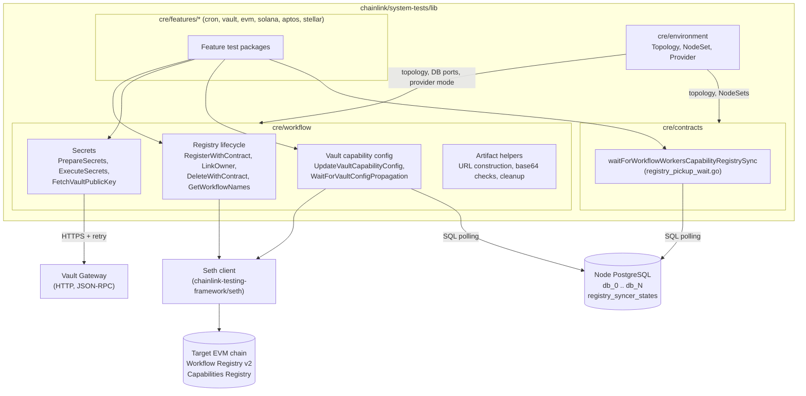
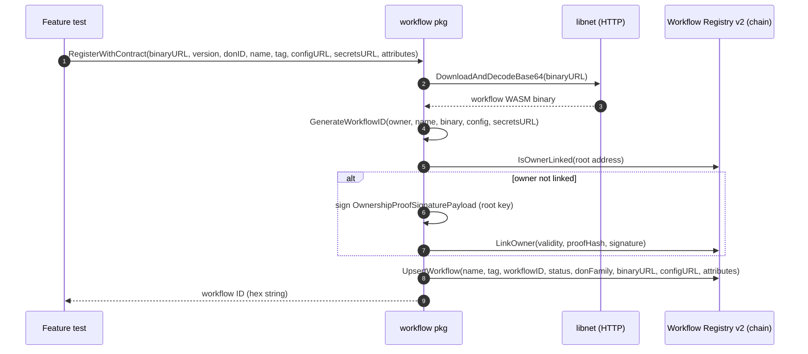
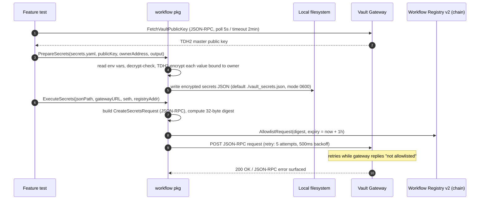
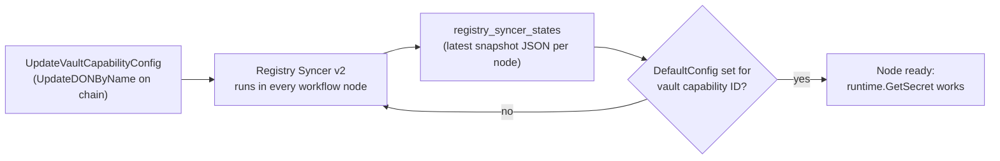
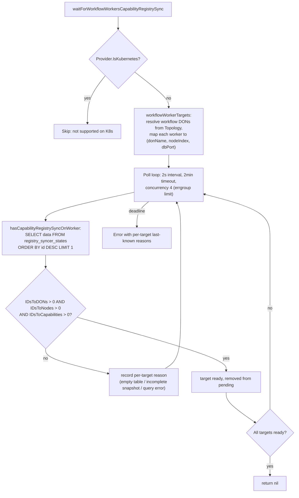

# System-Tests: CRE Workflow & Secret Deployment

## 1. Overview

The **CRE workflow deployment** module (`chainlink/system-tests/lib/cre/workflow` plus the sync-gating helper in `chainlink/system-tests/lib/cre/contracts`) is the part of the CRE system-test library that takes a test environment from *"nodes are running"* to *"workflows are registered, secrets are available, and every node has picked up the registry state"*.

It provides the Go helpers that CRE system tests use to:

1. **Register workflows on-chain** — download a compiled workflow binary, compute its deterministic workflow ID, link the workflow owner to an organization, and upsert (or delete) the workflow in the **Workflow Registry v2** contract.
2. **Provision vault secrets** — read a secrets YAML file, encrypt each value with the vault's TDH2 public key bound to the workflow owner, write the encrypted payload to disk, allowlist the resulting request digest on the Workflow Registry, and submit it to the **Vault Gateway**.
3. **Configure the vault capability** — merge the vault public key and decryption threshold into the vault capability's `DefaultConfig` inside the **Capabilities Registry** for the workflow DON.
4. **Wait for propagation** — poll each workflow node's local PostgreSQL database (`registry_syncer_states`) until the registry syncer has picked up the on-chain state, so tests only execute workflows once `runtime.GetSecret()` and capability lookups will succeed.

These helpers are consumed by the per-chain/per-capability feature packages documented in [system-tests_cre_capability_features](system-tests_cre_capability_features.md) and by the environment provisioning layer documented in [system-tests_cre_environment](system-tests_cre_environment.md).

## 2. Position in the overall system

```
chainlink/system-tests/lib/            (module: chainlink/system-tests/lib)
├── cre/
│   ├── workflow/          ← THIS MODULE (workflow.go, secrets.go, registry.go, compile.go, ...)
│   ├── contracts/         ← registry_pickup_wait.go (sync gating helper)
│   ├── environment/       ← topology, node sets, providers (see system-tests_cre_environment)
│   ├── features/          ← cron, vault, evm, solana, aptos, stellar ... (consumers)
│   └── types.go           ← Topology, NodeSet, Provider shared types
```

The module operates at the seam between three subsystems of the Chainlink node stack:

| Subsystem | Interaction |
|---|---|
| **Workflow Registry v2 / Capabilities Registry contracts** | Written via the `seth` client (`chainlink-testing-framework/seth`) using the generated gethwrappers (`chainlink-evm/gethwrappers/workflow/generated/...`). The contracts themselves are deployed by the deployment suite (see [CRE & Keystone Deployment Suite](../../CRE___Keystone_Deployment_Suite.md)). |
| **Vault capability & gateway** | Secrets are encrypted with the TDH2 scheme and exchanged as JSON-RPC over HTTP with the Vault Gateway; the wire types come from `chainlink-common/pkg/capabilities/actions/vault` (see [capabilities_vault](../../Workflow___Capability_Runtime_(CRE_Engine)/capabilities/capabilities_vault.md)). |
| **Registry syncer (per node)** | Each workflow node runs the registry syncer that snapshots on-chain registry state into its local Postgres table `registry_syncer_states` (see [workflows_syncer](../../Workflow___Capability_Runtime_(CRE_Engine)/workflows/workflows_syncer.md)). This module polls those snapshots to decide when it is safe to proceed. |

## 3. Source files & components

| File | Key components |
|---|---|
| `chainlink/system-tests/lib/cre/workflow/workflow.go` | `RegisterWithContract`, `LinkOwner`, `GetWorkflowNames`, `DeleteWithContract`, `DeleteAllWithContract`, `UpdateVaultCapabilityConfig`, `WaitForVaultConfigPropagation`, `VaultConfigHasPublicKey`, `IsBase64File`, `RemoveWorkflowArtifactsFromLocalEnv`; state mirror types `vaultSyncStatePayload`, `vaultSyncStateDON`, `vaultSyncStateDONCapConfig` |
| `chainlink/system-tests/lib/cre/workflow/secrets.go` | `PrepareSecrets`, `ExecuteSecrets`, `FetchVaultPublicKey`; YAML config types `vaultSecretsConfig`, `vaultSecretEntry`, `secretsNamesConfig` |
| `chainlink/system-tests/lib/cre/contracts/registry_pickup_wait.go` | `waitForWorkflowWorkersCapabilityRegistrySync`, `workflowWorkerTargets`, `hasCapabilityRegistrySyncOnWorker`, `capabilityRegistrySyncState` |

Supporting files in the same package (`registry.go`, `compile.go`, `tarball.go`, `docker.go`) handle wrapper compilation and container-side artifact handling; the components above are the core surface consumed by feature tests.

## 4. Architecture



Key design points:

- **No test framework coupling.** The package is a plain library (no `testing.T` in its APIs); feature packages orchestrate the calls. This keeps it usable from Ginkgo/Go tests and from the CTF-based environment builders.
- **Docker vs Kubernetes awareness.** DB-based polling helpers accept a `dbPort`/`nodeCount` or a `Provider`; when the provider is Kubernetes (or DB coordinates are unknown), they degrade to static waits or no-ops rather than failing.
- **Deterministic IDs.** Workflow identity is fully derived from `(owner address, name, binary bytes, config bytes, secrets URL)` so the same artifact always produces the same on-chain workflow ID.

## 5. Workflow registration & registry lifecycle

### 5.1 Flow



### 5.2 Behavior details

- **Artifact URLs.** When artifacts live inside a container (Docker provider), `constructArtifactURL` rewrites `binaryURL`/`configURL`/`secretsURL` to `file://<containerArtifactsDir>/<basename>`; otherwise the original URLs are used verbatim.
- **Workflow ID.** Computed via `chainlink-common/pkg/workflows.GenerateWorkflowID` — SHA-256 over `owner ‖ name ‖ workflow ‖ config ‖ secretsURL` with the first byte replaced by a version constant. The owner address is normalized (optional `0x` prefix stripped) before hashing.
- **Owner linking.** `LinkOwner` builds a signed ownership proof (SHA-256 over `owner + orgID + nonce`, signed with the Seth root key, `v` adjusted by +27) with a 24-hour validity timestamp and submits it to the registry. Registration and deletion paths check `IsOwnerLinked` first and only link when required.
- **Version gate.** All registry interactions require Workflow Registry **major version 2**; any other version returns an explicit error.
- **Deletion.** `DeleteWithContract` resolves the workflow ID by name from `GetWorkflowListByOwner` (limit `defaultWorkflowQueryLimit = 100`) and issues `DeleteWorkflow`; `DeleteAllWithContract` removes every workflow owned by the root key. `GetWorkflowNames` exposes listing for assertions.

## 6. Vault secrets provisioning

The secrets workflow encrypts test secrets so that only the owning workflow (owner-bound TDH2 encryption) can decrypt them at runtime via `runtime.GetSecret()`. The wire types (`EncryptedSecret`, `SecretIdentifier`, `CreateSecretsRequest`) are defined in `chainlink-common/pkg/capabilities/actions/vault/messages.proto`.

### 6.1 Accepted YAML formats

`PrepareSecrets` accepts two layouts (empty namespace defaults to `"main"`):

Format 1 — explicit (module's own type `vaultSecretsConfig`):

```yaml
secrets:
  - key: "my-secret"
    envVar: "MY_SECRET_ENV_VAR"
    namespace: "main"   # optional
```

Format 2 — `secretsNames`, shared with other CRE tooling (type `secretsNamesConfig`), taking the first env var of each list:

```yaml
secretsNames:
  SECRET_KEY:
    - ENV_VAR_NAME
```

### 6.2 End-to-end secrets flow



Notable behaviors:

- **Encryption** uses `tdh2easy` (threshold-domain hiding) via `vaultutils.EncryptSecretWithWorkflowOwner`, binding every ciphertext to the workflow owner address; identifiers carry `{Key, Owner, Namespace}`. Owner addresses are compared case-insensitively node-side (see `vaultutils.NormalizeOwner` in `chainlink/core/capabilities/vault/vaultutils/owner.go`).
- **Allowlisting.** The JSON-RPC request digest must be allowlisted on the Workflow Registry before the gateway accepts it — this mirrors the production security model and is why `ExecuteSecrets` takes the Seth client and registry address.
- **Gateway transport.** `cre.SendToVaultGateway` (in `chainlink/system-tests/lib/cre/gateway.go`) wraps the HTTP POST with bounded retry (5 attempts, 500 ms back-off delay) and specifically retries while the gateway reports the request is not yet allowlisted.
- **Public key availability.** `FetchVaultPublicKey` polls the gateway (5 s ticker, 2 min deadline) because the vault DKG instance publishes its TDH2 public key only after it is configured and running.

## 7. Vault capability configuration & propagation

Before workflow nodes can unwrap secrets, the **vault capability** entry in the Capabilities Registry must carry the vault public key and decryption threshold in its per-DON `DefaultConfig`.

### 7.1 Configuration update

`UpdateVaultCapabilityConfig`:

1. Loads the DON's `CapabilityConfigurations` from the `CapabilitiesRegistryDONInfo` returned by deployment.
2. For the vault capability ID, unmarshals the existing protobuf `CapabilityConfig` (preserving all pre-existing fields via `chainlink-protos/cre/go/values` map utilities).
3. Merges in `VaultPublicKey` and `Threshold`, re-marshals, and submits `UpdateDONByName` on-chain.
4. `VaultConfigHasPublicKey` provides an idempotency check so callers can skip the update when the key is already present.

### 7.2 Propagation wait



`WaitForVaultConfigPropagation(ctx, dbPort, nodeCount)`:

- Connects to the shared Postgres server at `127.0.0.1:<dbPort>`, one database per node named `db_0 … db_{nodeCount-1}` (credentials from the CTF `postgres` component).
- Polls every 2 s (deadline 2 min) — each node is checked concurrently via an `errgroup`, and only nodes still pending are re-queried.
- A node is ready when the latest `registry_syncer_states.data` row contains a non-nil `DefaultConfig` for the vault capability ID in any DON snapshot.
- **Fallback:** if `dbPort` or `nodeCount` is `0` (Kubernetes provider or missing state file), it waits a static `vaultConfigStaticPropagationWait = 15s` instead of erroring.

### 7.3 Registry syncer state data model

The polled JSON blob mirrors the syncer's snapshot (see the [registry syncer](../../Workflow___Capability_Runtime_(CRE_Engine)/workflows/workflows_syncer.md) documentation). Two partial mirrors exist in this module:

| Type | File | Shape |
|---|---|---|
| `vaultSyncStatePayload` / `vaultSyncStateDON` / `vaultSyncStateDONCapConfig` | `workflow/workflow.go` | `{IDsToDONs: {donID: {CapabilityConfigurations: {capID: {Config: bytes}}}}}` — checks vault `DefaultConfig` presence |
| `capabilityRegistrySyncState` | `contracts/registry_pickup_wait.go` | `{IDsToDONs, IDsToNodes, IDsToCapabilities}` as raw JSON maps — checks snapshot completeness |

## 8. Capability registry sync gating

`waitForWorkflowWorkersCapabilityRegistrySync` (in `contracts/registry_pickup_wait.go`) is the generic gating primitive: after the Capabilities Registry is configured on-chain, tests must wait until **every worker node of every workflow DON** has written at least one complete registry snapshot locally.



Implementation notes:

- Targets come from `cre.Topology.DonsMetadata.WorkflowDONs()` and each DON's `Workers()`, so only nodes that actually execute workflows are awaited (bootstrap/gateway DONs are skipped).
- DB port resolution: use the NodeSet's `DbInput.Port`, falling back to the CTF default `postgres.Port`; database name is `db_<workerIndex>`.
- The function is currently **unexported** and invoked by the contracts helpers during capability-registry configuration; Kubernetes environments are skipped because node DBs are not directly reachable there (those environments rely on the static-wait fallback of §7.2 for vault config).

## 9. Artifact & utility helpers

| Helper | Purpose |
|---|---|
| `constructArtifactURL` | Rewrites artifact URLs to `file://<dir>/<basename>` when artifacts were copied into test containers (`fileURLTemplate = "file://%s/%s"`). |
| `IsBase64File` / `isBase64Content` | Sanity-checks that a downloaded workflow binary is base64-encoded (samples up to 4 MB, ignores whitespace) before registration. |
| `RemoveWorkflowArtifactsFromLocalEnv` | Deletes generated artifact files (encrypted secrets JSON, compiled binaries); empty paths are skipped. |
| `DefaultWorkflowTag = "some-tag"`, `defaultWorkflowStatus = 0` | Defaults used by registration helpers when tests do not override them. |

## 10. Dependencies

The module lives in the `chainlink/system-tests/lib` Go module (`chainlink/system-tests/lib/go.mod`). The components documented here rely on:

| Dependency | Role |
|---|---|
| `chainlink-testing-framework/seth` | Ethereum client wrapper: transaction building/decoding, root-key signing, ABI store for error decoding. |
| `chainlink-evm/gethwrappers/workflow/generated/{workflow_registry_wrapper_v2, capabilities_registry_wrapper_v2}` | Typed bindings for `WorkflowRegistry` (v2) and `CapabilitiesRegistry`. |
| `chainlink-common/pkg/capabilities/actions/vault` | `EncryptedSecret`, `SecretIdentifier`, `CreateSecretsRequest`, vault capability ID and JSON-RPC method names (`messages.proto`). |
| `chainlink-common/pkg/workflows` | `GenerateWorkflowID` (canonical workflow identity hashing). |
| `smartcontractkit/tdh2` | TDH2 threshold encryption of secret values. |
| `chainlink-testing-framework/framework/components/postgres` | Shared Postgres credentials/ports used for per-node DB polling. |
| `goccy/go-yaml`, `jmoiron/sqlx`, `golang.org/x/sync/errgroup`, `Masterminds/semver` | YAML parsing, DB access, concurrent polling, version gating. |

## 11. Operational notes & failure modes

- **Secrets env vars must be exported** before `PrepareSecrets` runs; a missing env var aborts preparation with the offending key named.
- **Ordering matters:** the vault public key must be fetched *after* the vault DON (and its DKG instance) is up; `ExecuteSecrets` must run *after* the digest is allowlisted on-chain; `WaitForVaultConfigPropagation` must complete before workflows calling `runtime.GetSecret()` are executed.
- **Timeouts are bounded** everywhere (2 min for public-key fetch, config propagation and registry sync; 3 s per SQL query; 1 h allowlist expiry) so a misconfigured environment fails fast with actionable messages (per-target reasons on sync timeout).
- **Idempotency:** `VaultConfigHasPublicKey` and the owner-link check allow re-running test setup without redundant on-chain writes.

## 12. Related documentation

- Parent module: [system-tests](../system-tests.md) — library layout and test entry points.
- Environment provisioning & providers: [system-tests_cre_environment](system-tests_cre_environment.md) (topology builders, Docker/Kubernetes `Provider`, billing/ChipIngress config).
- Topology, DONs and node keys: [system-tests_cre_topology_nodes](system-tests_cre_topology_nodes.md) (`KeystoneDON`, node secrets, CSA/EVM keys).
- Feature packages that consume this module: [system-tests_cre_capability_features](system-tests_cre_capability_features.md).
- Benchmarking/reporting: [system-tests_benchspy](system-tests_benchspy.md).
- Node-side workflow engine, registry syncer and vault capability: [Workflow & Capability Runtime (CRE Engine)](../../Workflow___Capability_Runtime_(CRE_Engine).md) — in particular [workflows_syncer](../../Workflow___Capability_Runtime_(CRE_Engine)/workflows/workflows_syncer.md), [capabilities_registry](../../Workflow___Capability_Runtime_(CRE_Engine)/capabilities/capabilities_registry.md) and [capabilities_vault](../../Workflow___Capability_Runtime_(CRE_Engine)/capabilities/capabilities_vault.md).
- Deployment of the registries these helpers target: [CRE & Keystone Deployment Suite](../../CRE___Keystone_Deployment_Suite.md) and [Deployment Framework Core](../../Deployment_Framework_Core___Product_Deployments.md).
- Developer-facing equivalent of these flows (registry strategies, secrets handling): [cre-cli workflow commands](../../Developer_Toolchain_(CLI,_SDKs___API_Clients)/cre-cli-workflow-commands.md).
- Root overview: [Dev, Test & Simulation Environments](../../Dev,_Test___Simulation_Environments.md).
