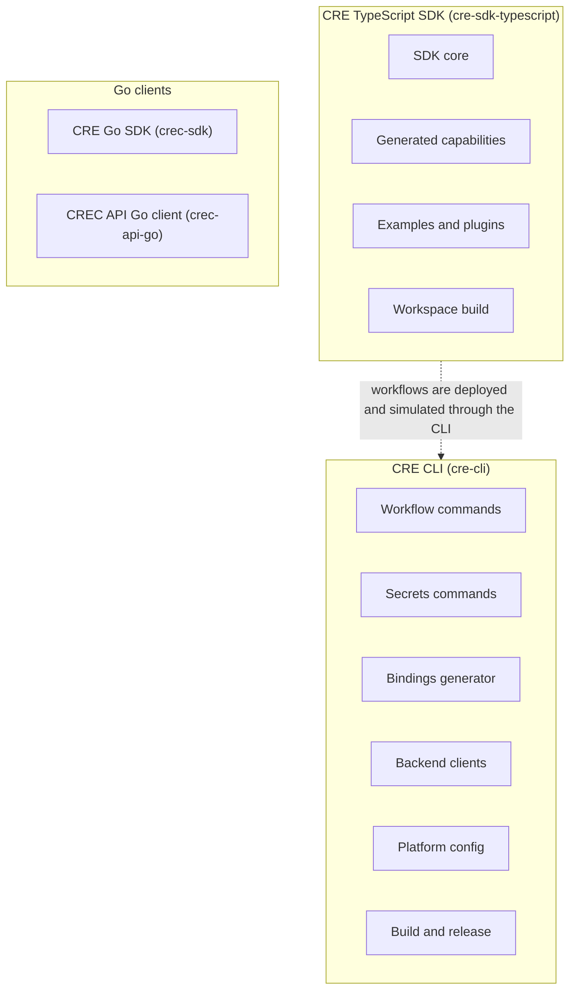
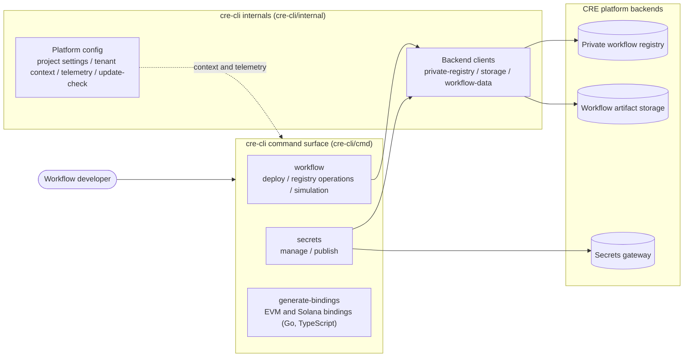
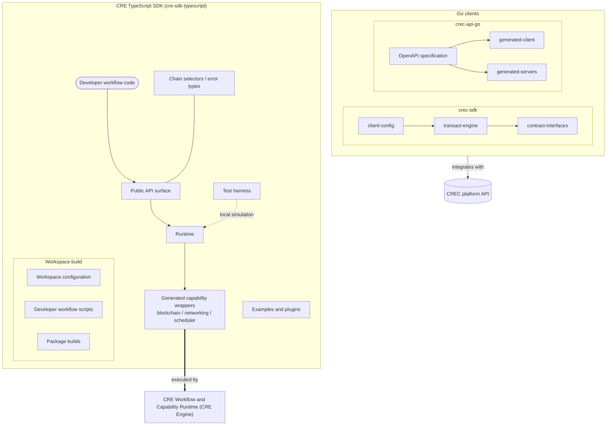

# Developer Toolchain (CLI, SDKs & API Clients)

## Purpose

This module packages the **developer-facing tooling for the Chainlink Runtime Environment (CRE)**: everything a workflow or integration developer needs to author, simulate, deploy, and operate workflows, plus the Go clients used to integrate with the CREC platform programmatically. It contains four sub-ecosystems:

1. **CRE CLI (`cre-cli`)** — the command-line entry point for the developer workflow:
   - **Workflow commands** — deploy workflows, run workflow-registry operations, and simulate workflows ([cre-cli-workflow-commands](<Developer_Toolchain_(CLI,_SDKs___API_Clients)/cre-cli-workflow-commands.md>)).
   - **Secrets management** — manage and publish encrypted workflow secrets via the secrets gateway ([cre-cli-secrets](<Developer_Toolchain_(CLI,_SDKs___API_Clients)/cre-cli-secrets.md>)).
   - **Bindings generator** — generate typed contract bindings for EVM and Solana (Go and TypeScript) ([cre-cli-bindings-generator](<Developer_Toolchain_(CLI,_SDKs___API_Clients)/cre-cli-bindings-generator.md>)).
   - **Backend clients** — internal clients for the private workflow registry, storage, and workflow-data services ([cre-cli-backend-clients](<Developer_Toolchain_(CLI,_SDKs___API_Clients)/cre-cli-backend-clients.md>)).
   - **Platform config** — project settings, tenant context, telemetry, and update checks ([cre-cli-platform-config](<Developer_Toolchain_(CLI,_SDKs___API_Clients)/cre-cli-platform-config.md>)).
   - **Build & release** — build tooling, installers, and release automation for distributing the CLI ([cre-cli-build-and-release](<Developer_Toolchain_(CLI,_SDKs___API_Clients)/cre-cli-build-and-release.md>)).

2. **CRE TypeScript SDK (`cre-sdk-typescript`)** — the SDK for authoring CRE workflows in TypeScript:
   - Core runtime, test harness for local simulation, chain selectors, error types, and public API surface ([cre-sdk-core](<Developer_Toolchain_(CLI,_SDKs___API_Clients)/cre-sdk-core.md>)).
   - Auto-generated, typed wrappers around platform capabilities — blockchain, networking, scheduler ([cre-sdk-generated-capabilities](<Developer_Toolchain_(CLI,_SDKs___API_Clients)/cre-sdk-generated-capabilities.md>)).
   - Examples and plugins, including Rust plugin examples and a Solana onchain-write example ([cre-sdk-examples-and-plugins](<Developer_Toolchain_(CLI,_SDKs___API_Clients)/cre-sdk-examples-and-plugins.md>)).
   - Workspace configuration, developer workflow scripts, and package builds ([cre-sdk-workspace-build](<Developer_Toolchain_(CLI,_SDKs___API_Clients)/cre-sdk-workspace-build.md>)).

3. **CRE Go SDK (`crec-sdk`)** — Go client SDK with client configuration, a transaction engine, and typed contract interfaces ([crec-go-sdk](<Developer_Toolchain_(CLI,_SDKs___API_Clients)/crec-go-sdk.md>)).

4. **CREC API Go client (`crec-api-go`)** — OpenAPI-generated Go clients and server stubs derived from the CREC API specification ([crec-api-go-openapi](<Developer_Toolchain_(CLI,_SDKs___API_Clients)/crec-api-go-openapi.md>)).

## Architecture

### Component map

The module is organized around one CLI, one TypeScript SDK workspace, and two Go-based clients:

### CRE CLI data flow

CLI commands delegate to internal backend clients, which target the CRE platform's remote services. Platform config supplies settings, tenant context, and telemetry to every command:

### Developer SDKs

The TypeScript SDK layers generated capability wrappers on top of a core runtime, with a test harness for local simulation. The Go clients provide on-chain interaction (transact engine + contract interfaces) and OpenAPI-generated access to the CREC API:

## Core components

| Component | Location | Purpose |
|---|---|---|
| [cre-cli-workflow-commands](<Developer_Toolchain_(CLI,_SDKs___API_Clients)/cre-cli-workflow-commands.md>) | `cre-cli/cmd/workflow` | Deploy workflows, perform registry operations, and run simulations. |
| [cre-cli-backend-clients](<Developer_Toolchain_(CLI,_SDKs___API_Clients)/cre-cli-backend-clients.md>) | `cre-cli/internal/client` | Clients for the CLI's backends: private registry, storage, and workflow-data services. |
| [cre-cli-secrets](<Developer_Toolchain_(CLI,_SDKs___API_Clients)/cre-cli-secrets.md>) | `cre-cli/cmd/secrets` | Secrets management: command definitions, gateway interaction, and request handling. |
| [cre-cli-bindings-generator](<Developer_Toolchain_(CLI,_SDKs___API_Clients)/cre-cli-bindings-generator.md>) | `cre-cli/cmd/generate-bindings` | Generates typed contract bindings: EVM bindings, Solana Go generator, Solana TypeScript bindings. |
| [cre-cli-platform-config](<Developer_Toolchain_(CLI,_SDKs___API_Clients)/cre-cli-platform-config.md>) | `cre-cli/internal` | Cross-cutting CLI configuration: project settings, tenant context, telemetry, update checks. |
| [cre-cli-build-and-release](<Developer_Toolchain_(CLI,_SDKs___API_Clients)/cre-cli-build-and-release.md>) | `cre-cli` | Build tooling, installers, and release automation for shipping the CLI. |
| [cre-sdk-core](<Developer_Toolchain_(CLI,_SDKs___API_Clients)/cre-sdk-core.md>) | `cre-sdk-typescript/packages/cre-sdk` | SDK runtime, test harness, chain selectors, error types, and public API surface. |
| [cre-sdk-generated-capabilities](<Developer_Toolchain_(CLI,_SDKs___API_Clients)/cre-sdk-generated-capabilities.md>) | `cre-sdk-typescript/packages/cre-sdk/src/generated-sdk` | Generated typed capability wrappers: blockchain, networking, scheduler, internal test. |
| [cre-sdk-examples-and-plugins](<Developer_Toolchain_(CLI,_SDKs___API_Clients)/cre-sdk-examples-and-plugins.md>) | `cre-sdk-typescript/packages` | Example packages and plugins, including Rust plugin examples and Solana onchain write. |
| [cre-sdk-workspace-build](<Developer_Toolchain_(CLI,_SDKs___API_Clients)/cre-sdk-workspace-build.md>) | `cre-sdk-typescript` | Workspace configuration, developer workflow scripts, and package build orchestration. |
| [crec-go-sdk](<Developer_Toolchain_(CLI,_SDKs___API_Clients)/crec-go-sdk.md>) | `crec-sdk` | Go SDK: build tooling, client configuration, contract interfaces, transaction engine. |
| [crec-api-go-openapi](<Developer_Toolchain_(CLI,_SDKs___API_Clients)/crec-api-go-openapi.md>) | `crec-api-go` | OpenAPI API specification plus generated Go clients and server stubs. |

## Relationship to the rest of the platform

The toolchain is the developer-facing boundary of the platform: workflows authored with the TypeScript SDK are executed by the **Workflow & Capability Runtime (CRE Engine)**, CLI operations target the platform's registry, storage, and secrets-gateway backends, and the Go clients integrate with the CREC API. It is intentionally independent of node internals and depends on the platform only through these public surfaces.